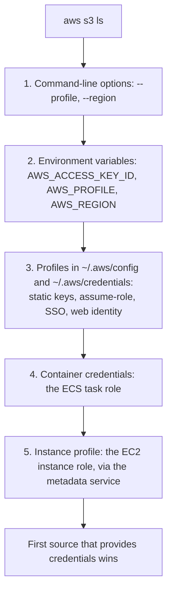

# Accounts, regions and the CLI

> **Status: AI draft, 2026-11-16.** Not yet verified by me. Commands are from the official documentation and were not run; output is illustrative.

## In one line

An AWS account is the boundary for resources, permissions and billing; a region is a separate geographic deployment of AWS made of isolated Availability Zones. The AWS CLI finds credentials in a fixed order (flags, environment variables, profiles, then the container or instance role), and `aws sts get-caller-identity` tells you which identity it found.

## The plain idea

Think of an **AWS account** as a building with its own locks, its own bills and its own contents. Nothing inside one account can touch another unless both sides explicitly allow it. Companies use many accounts so a mistake or a breach in one stays there ([Organizations, SCPs and multi-account](organizations-and-scps.md)).

AWS itself is spread across the world in **regions**, such as `ap-south-1` in Mumbai. Each region is a separate deployment: resources you create there live only there. Inside a region are several **Availability Zones** (AZs): groups of data centres far enough apart that a fire or power cut in one does not take down another, close enough for fast links. Spreading an application across AZs is how you survive one data centre failing ([High availability and failure domains](../operations/high-availability.md)).

The **AWS CLI** is the command-line way to call AWS. Every command is an API call signed with credentials, and the most common confusion is simply not knowing which credentials the CLI picked up.

## How it works

### Global, regional and zonal

| Scope | Examples | Meaning |
|---|---|---|
| Global | IAM, Organizations, Route 53, CloudFront | One configuration for the whole account, not tied to a region |
| Regional | VPC, S3 buckets, Lambda, DynamoDB, EKS control planes | Exists in one region; region outages affect it, other regions do not |
| Zonal | EC2 instances, EBS volumes, subnets | Lives in one AZ; an AZ failure takes it out |

Some services that look global have a home region for parts of their configuration; for example, certificates used by CloudFront must be created in `us-east-1` ([Route 53 and ACM](route53-and-acm.md)).

**AZ names and IDs.** `ap-south-1a` in your account is not necessarily the same physical zone as `ap-south-1a` in another account. The **AZ ID** (such as `aps1-az1`) is the same everywhere, so use IDs when coordinating zones between accounts.

### The root user

Each account has a **root user**: the email address that created it, with unrestricted power that policies inside the account cannot limit. Protect it with MFA, give it no access keys, and use it only for the few tasks that require it. Day-to-day work happens through IAM roles and federated sign-in ([Federation and SSO](federation-and-sso.md)).

### How the CLI finds credentials



This order explains most "why is it using the wrong account?" problems: an exported `AWS_ACCESS_KEY_ID` from an old session silently wins over the profile you meant to use. The same chain is used by the AWS SDKs, so applications behave the same way.

### Profiles and SSO

`~/.aws/config` holds named **profiles**. A profile can contain static keys (avoid them), say "assume this role using that profile", or point at IAM Identity Center:

```ini
[profile dev]
sso_session = company
sso_account_id = 123456789012
sso_role_name = DeveloperAccess
region = ap-south-1

[sso-session company]
sso_start_url = <your-start-url>
sso_region = ap-south-1
sso_registration_scopes = sso:account:access
```

`aws sso login --profile dev` opens a browser, you sign in, and the CLI caches short-lived credentials for that role. Nothing long-lived is stored on the laptop ([Federation and SSO](federation-and-sso.md)).

### Output, filtering and pagination

- `--output json | text | table | yaml` chooses the format. `text` suits shell loops.
- `--query` filters the response on the client side with **JMESPath**, for example `--query 'Reservations[].Instances[].InstanceId'`. Server-side filters (`--filters` on many EC2 commands) reduce what AWS sends in the first place.
- Many list calls return pages. The CLI follows the pages for you by default; `--max-items` and `--page-size` control how much it fetches.

### Before creating anything: a budget

Set an AWS Budgets alert on a new or personal account before the first resource, so an expensive mistake (a forgotten NAT gateway, a large instance) is noticed in hours, not at the end of the month ([Cost optimisation](../operations/cost-optimisation.md)). Check the Free Tier terms on the AWS pricing pages rather than relying on memory: they change.

## A concrete example

A deploy script fails with `AccessDenied`, and you are sure your role has the permission.

1. `aws sts get-caller-identity` shows `arn:aws:iam::111122223333:user/old-ci-user`: a different account and an IAM user, not your role.
2. `env | grep AWS_` shows `AWS_ACCESS_KEY_ID` exported in the shell, left over from an earlier test. Environment variables come before profiles, so they won.
3. `unset AWS_ACCESS_KEY_ID AWS_SECRET_ACCESS_KEY AWS_SESSION_TOKEN`, then `aws sts get-caller-identity --profile dev` shows the expected assumed role in `123456789012`.
4. Run the script again with `AWS_PROFILE=dev`. It works. Then remove the old user's access keys, which should not exist at all.

## Why not just...?

- **...use one account for everything?** One wrong command or compromised credential can then reach production, development and billing at once. Separate accounts are the strongest isolation AWS offers.
- **...create IAM users with access keys for each engineer?** Long-lived keys leak through laptops, scripts and repositories, and must be rotated by hand. Federated sign-in gives short-lived credentials tied to a real identity.
- **...ignore regions and create everything in the console's default?** Resources end up scattered, latency suffers, and data may sit in a country it should not. Choose regions on purpose, and set the region explicitly in profiles and code.

## Commands to know

Who am I?

```console
$ aws sts get-caller-identity
{
    "UserId": "AROAEXAMPLEROLEID:dev.user",
    "Account": "123456789012",
    "Arn": "arn:aws:sts::123456789012:assumed-role/DeveloperAccess/dev.user"
}
```

The first command to run when anything AWS behaves unexpectedly. An `assumed-role` ARN means temporary role credentials; a `user/` ARN means an IAM user's long-lived keys.

| Command | What it does |
|---|---|
| `aws configure sso` | Create an SSO profile interactively. |
| `aws sso login --profile dev` | Sign in and cache short-lived credentials. |
| `aws configure list` | Show where each setting (keys, region) is coming from. |
| `aws configure list-profiles` | List the profiles defined. |
| `aws ec2 describe-regions --query 'Regions[].RegionName' --output text` | Regions enabled for this account. |
| `aws ec2 describe-availability-zones --region ap-south-1 --query 'AvailabilityZones[].[ZoneName,ZoneId]' --output table` | AZ names and their stable IDs. |
| `aws <service> <command> help` | Built-in documentation for any command. |
| `AWS_PROFILE=dev aws ...`, or `--profile dev` | Use one profile for one command or shell. |

## How it breaks

| Symptom | Layer | Check | Likely cause |
|---|---|---|---|
| `Unable to locate credentials` | Credential chain | `aws configure list` | No profile, expired SSO session, or no role on the instance |
| Commands act on the wrong account | Credential chain | `aws sts get-caller-identity`; `env` for `AWS_` variables | Leftover environment variables or the wrong default profile |
| `The SSO session associated with this profile has expired` | SSO | Session age | Run `aws sso login` again |
| A resource "does not exist", though you can see it in the console | Region | `--region`, and the console's region selector | The CLI's default region differs from where the resource lives |
| `ExpiredToken` | Temporary credentials | Session duration | Assumed-role or SSO credentials expired; refresh them |
| `AccessDenied` | Permissions | The identity in use; [Least privilege and AccessDenied](least-privilege-and-accessdenied.md) | The identity is correct but lacks the permission, or a policy elsewhere denies it |

## Interview questions

**1. What is the difference between a region and an Availability Zone?**

<details markdown="1">
<summary>Answer</summary>

- A region is a separate geographic deployment of AWS, such as `ap-south-1`.
- An AZ is one or more data centres inside a region, isolated from the others but linked by fast networks.
- Spread workloads across AZs for resilience to data-centre failures; across regions for regional failures or locality.

</details>

**2. How does the AWS CLI decide which credentials to use?**

<details markdown="1">
<summary>Answer</summary>

- Command-line options first, then environment variables, then profiles in the config and credentials files (including assume-role and SSO), then container credentials, then the EC2 instance profile.
- The first source that provides credentials wins.
- `aws configure list` and `aws sts get-caller-identity` show what was picked.

</details>

**3. Why use many AWS accounts instead of one?**

<details markdown="1">
<summary>Answer</summary>

- An account is the strongest isolation boundary: permissions, resources, quotas and billing.
- It limits the blast radius of mistakes and breaches, for example between production and development.
- AWS Organizations manages them centrally, with guardrails and consolidated billing.

</details>

**4. What should you do with the root user of an account?**

<details markdown="1">
<summary>Answer</summary>

- Enable MFA, remove any access keys, and store the credentials securely.
- Do not use it for daily work; use federated roles.
- Use it only for the tasks that require it, and watch for its use in CloudTrail.

</details>

**5. Your script works on your laptop but runs against the wrong account in CI. What do you check?**

<details markdown="1">
<summary>Answer</summary>

- Print `aws sts get-caller-identity` in the job.
- Check which credentials the job really has: environment variables, the runner's instance role, or a profile.
- Fix the job to assume the intended role explicitly, ideally with OIDC ([OIDC from pipelines to AWS](../cicd/oidc-to-aws.md)).

</details>

**6. What is the difference between `--query` and `--filters` in the CLI?**

<details markdown="1">
<summary>Answer</summary>

- `--filters` is sent to the service, which returns only matching items.
- `--query` is applied by the CLI to the response, with JMESPath, to select and reshape fields.
- Use filters to reduce the data, then query to shape the output.

</details>

## Try it

*Untested: written from documentation.* These calls are read-only and free, but you need an AWS account and credentials. Set a budget alert on the account first.

**Step 1.** Find out who you are, and which settings are in effect.

```bash
aws sts get-caller-identity
aws configure list
```

**Step 2.** Predict how many regions are enabled for your account, then check, and list the AZ names and IDs in one region.

```bash
aws ec2 describe-regions --query 'Regions[].RegionName' --output text
aws ec2 describe-availability-zones --region ap-south-1 --query 'AvailabilityZones[].[ZoneName,ZoneId]' --output table
```

**Step 3.** Export a bogus variable and watch it take over, then remove it.

```bash
export AWS_PROFILE=does-not-exist
aws sts get-caller-identity
unset AWS_PROFILE
```

## Zoom out

Accounts and regions are the outermost boundaries of everything else in AWS: IAM decides who may act inside an account ([IAM policies and how they are evaluated](iam-policies.md)), and VPCs carve up the network inside a region ([VPC basics](vpc-basics.md)). The CLI's credential chain is the same one your applications and pipelines use. The principle to carry: before debugging permissions, prove which identity, account and region you are actually using.

## Sources

- [AWS documentation: Regions and Availability Zones](https://docs.aws.amazon.com/global-infrastructure/latest/regions/aws-regions.html)
- [AWS documentation: Availability Zone IDs](https://docs.aws.amazon.com/ram/latest/userguide/working-with-az-ids.html)
- [AWS CLI documentation: configuration and credential precedence](https://docs.aws.amazon.com/cli/latest/userguide/cli-chap-configure.html)
- [AWS CLI documentation: configuring IAM Identity Center authentication](https://docs.aws.amazon.com/cli/latest/userguide/cli-configure-sso.html)
- [AWS CLI documentation: filtering output with --query](https://docs.aws.amazon.com/cli/latest/userguide/cli-usage-filter.html)
- [IAM documentation: root user best practices](https://docs.aws.amazon.com/IAM/latest/UserGuide/root-user-best-practices.html)
- [AWS Budgets documentation](https://docs.aws.amazon.com/cost-management/latest/userguide/budgets-managing-costs.html)
