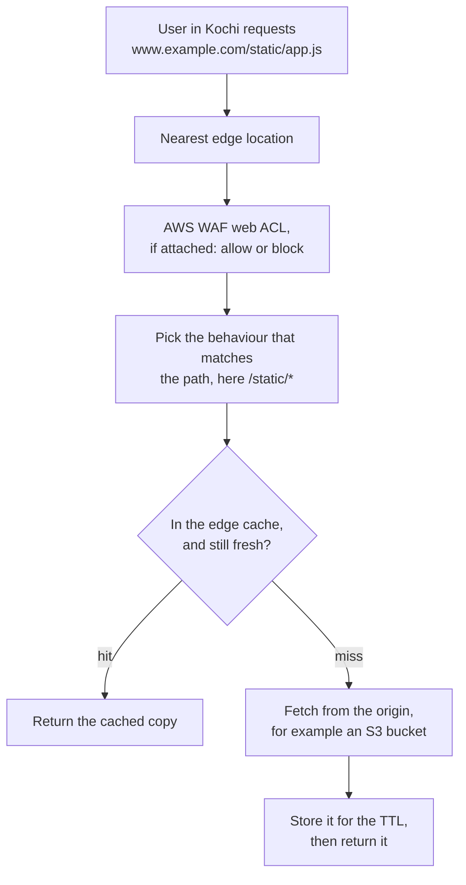

# CloudFront and WAF

> **Status: AI draft, 2026-11-16.** Not yet verified by me. Commands are from the official documentation and were not run; output is illustrative.

## In one line

CloudFront is AWS's CDN: edge locations near users cache responses from your origins according to behaviours and cache policies, and only misses travel back to the origin. AWS WAF filters HTTP requests at CloudFront, an ALB or API Gateway with managed and custom rules, rate limits and IP or geo matches; deploy new rules in Count mode first.

## The plain idea

Users far from your servers wait for every round trip, and every request for the same logo or JavaScript file costs your servers work. A **CDN** (content delivery network) puts copies close to users: hundreds of **edge locations** keep cached responses and answer from there. Only requests the edge cannot answer travel back to your **origin**. Pages load faster, and the origin does far less work.

The edge is also the best place to stop bad traffic before it reaches you. A **web application firewall** (WAF) inspects each HTTP request against rules ("looks like SQL injection", "this address is sending 2,000 requests a minute", "this country is not served") and blocks what matches. AWS **Shield** adds protection against floods of traffic at the network level.

## How it works

### A request through CloudFront



### The pieces

| Piece | What it is |
|---|---|
| **Distribution** | One CloudFront configuration, with a `*.cloudfront.net` name and optional custom names. |
| **Origin** | Where content comes from: an S3 bucket, a load balancer, any HTTP server, or a VPC origin (a private ALB or instance). |
| **Behaviour** | A path pattern (`/static/*`, `/api/*`, default `*`) mapped to an origin, with its cache policy, allowed methods, and whether HTTP is redirected to HTTPS. |
| **Cache policy** | What makes up the **cache key** (path, and which headers, cookies and query strings) and the minimum, default and maximum TTLs. |
| **Origin request policy** | What is forwarded to the origin without becoming part of the cache key. |
| **Invalidation** | Removes paths from every edge cache before their TTL ends. Charged beyond a free allowance; versioned file names (`app.3f9c1.js`) avoid needing them. |

**The cache key matters most.** Every header, cookie or query string in the key creates more variants of each object and fewer cache hits. Static assets should vary only by path. APIs usually use a policy that caches nothing (`CachingDisabled`) and forwards what the backend needs.

How long objects stay cached comes from the origin's `Cache-Control` headers, bounded by the cache policy's TTLs ([HTTP](../networking/http.md)).

### Protecting the origin

- **S3 origins:** use **origin access control** (OAC). The bucket stays private, and its policy allows only that distribution to read it. Without it, users could bypass CloudFront and read the bucket directly ([S3 security](../aws-services/s3-security.md)).
- **Load balancer origins:** restrict the load balancer's security group to CloudFront's managed prefix list, and add a secret header that only CloudFront sends, checked at the load balancer; or use a VPC origin so the load balancer can be internal.
- **HTTPS everywhere:** viewer protocol policy "redirect HTTP to HTTPS", and HTTPS to the origin too.
- **Custom domain names** need a certificate from ACM in `us-east-1` ([Route 53 and ACM](route53-and-acm.md)).
- **Private content:** signed URLs or signed cookies give time-limited access to specific users.

For logic at the edge, **CloudFront Functions** run lightweight JavaScript on every request (redirects, header changes), and **Lambda@Edge** runs fuller functions at regional edge caches.

### AWS WAF

A **web ACL** is an ordered list of rules attached to a CloudFront distribution, an ALB, an API Gateway stage, or a few other services.

| Rule type | Example |
|---|---|
| **Managed rule groups** | AWS's core rule set (common web exploits), known bad inputs, SQL injection, IP reputation lists, bot control |
| **Rate-based rules** | Block an address that sends more than a set number of requests in a time window |
| **IP set rules** | Allow or block lists of addresses |
| **Geo match** | Block or allow by country |
| **Custom matches** | Header, path, query string, body contents |

Each rule's action is **Allow**, **Block**, **Count** (match and log, but do not act), **CAPTCHA** or **Challenge**. Rules run in priority order; the web ACL's default action applies to what no rule decides.

Start every new rule, and especially managed groups, in **Count** mode, read the logs to see what it would have blocked, then switch to Block. A managed rule that blocks a legitimate request pattern (a large upload, a JSON body that looks like an injection) can take down part of your application instantly. Send WAF logs to CloudWatch Logs, S3 or Firehose to see which rule matched each request.

### Shield

**Shield Standard** protects every AWS customer against common network and transport-layer floods, automatically and at no extra cost. **Shield Advanced** is a paid subscription adding protection for more resources, access to AWS's DDoS response team, and cost protection for scaling during an attack.

## A concrete example

A site serves a single-page application from S3 and an API from an ALB, both under `www.example.com`.

1. One distribution with two origins: the S3 bucket (with OAC) and the ALB.
2. Behaviour `/api/*`: ALB origin, all methods allowed, caching disabled, forward the `Authorization` header and query strings.
3. Default behaviour `*`: S3 origin, GET and HEAD only, a caching-optimised policy keyed on path only, long TTL; the build gives assets versioned file names, so deploys need no invalidations except for `index.html`.
4. A certificate for `www.example.com` in `us-east-1`; an alias record in Route 53 pointing `www.example.com` at the distribution.
5. A WAF web ACL on the distribution: AWS core rules and known bad inputs, a rate-based rule for `/api/login`, first in Count mode for a week, then Block.
6. The ALB's security group accepts only CloudFront's prefix list.

## Why not just...?

- **...cache everything, including the API?** Responses that depend on the user would be served to other users. Cache static content by path; for the API, cache nothing unless the response is truly shared, and then key on everything it depends on.
- **...forward all headers and cookies to the origin "to be safe"?** If they are in the cache key, every request becomes unique and the cache hit rate drops towards zero. Forward only what the origin needs, through an origin request policy.
- **...turn on every managed WAF rule in Block mode at once?** Some will match normal traffic for your application. Count first, review, then block, rule by rule.

## Commands to know

| Command | What it does |
|---|---|
| `aws cloudfront list-distributions --query 'DistributionList.Items[].[Id,DomainName,Aliases.Items]'` | Distributions, their names and aliases. |
| `aws cloudfront get-distribution-config --id <id>` | Origins, behaviours and policies. |
| `aws cloudfront create-invalidation --distribution-id <id> --paths "/index.html"` | Remove a path from the edge caches. |
| `curl -sI https://www.example.com/static/app.js` | The `x-cache` header (`Hit from cloudfront` or `Miss from cloudfront`) and `age` show caching behaviour. |
| `aws wafv2 list-web-acls --scope CLOUDFRONT --region us-east-1` | Web ACLs for CloudFront are managed in `us-east-1`; use `--scope REGIONAL` for ALBs and API Gateway. |
| `aws wafv2 get-sampled-requests --web-acl-arn <arn> --rule-metric-name <rule> --scope REGIONAL --time-window StartTime=<t1>,EndTime=<t2> --max-items 50` | A sample of requests that matched a rule. |

## How it breaks

| Symptom | Layer | Check | Likely cause |
|---|---|---|---|
| Users see old content after a deploy | Caching | `x-cache` and `age` headers | Long TTL on unversioned files; no invalidation of `index.html` |
| Very low cache hit rate | Cache key | The cache policy | Headers, cookies or query strings in the key |
| `403` from CloudFront for S3 content | Origin access | Bucket policy and OAC | Bucket policy does not allow the distribution, or the object does not exist |
| One user sees another user's page | Cache key | Behaviour for that path | Personalised responses cached without the user in the key |
| `502` or `504` from CloudFront | Origin | Origin health; TLS between CloudFront and origin | Origin down, slow, or presenting a certificate that does not match the origin name |
| Legitimate requests blocked with `403` | WAF | WAF logs: which rule matched | A managed rule matching normal traffic; tune or exclude that rule |
| Custom domain cannot be added | Certificate | Certificate region and names | Certificate not in `us-east-1`, or does not cover the name |

## Interview questions

**1. How does CloudFront decide whether to serve from cache?**

<details markdown="1">
<summary>Answer</summary>

- The request matches a behaviour by path; its cache policy defines the cache key and TTLs.
- If an object for that key is in the edge cache and still fresh, it is a hit.
- Otherwise CloudFront fetches from the origin, caches it according to `Cache-Control` and the policy's TTL bounds, and returns it.

</details>

**2. How do you keep an S3 bucket private while serving it through CloudFront?**

<details markdown="1">
<summary>Answer</summary>

- Use origin access control on the distribution.
- The bucket policy allows reads only from that distribution's service principal with a source condition.
- Keep Block Public Access on.

</details>

**3. Why might a CDN make a site slower or more expensive?**

<details markdown="1">
<summary>Answer</summary>

- A cache key with too many headers, cookies or query strings gives a poor hit rate, so most requests go to the origin with an extra hop.
- Frequent invalidations add cost.
- Fix the cache key, version static files, and cache only shareable responses.

</details>

**4. What is a WAF, and how do you roll out new rules safely?**

<details markdown="1">
<summary>Answer</summary>

- A filter that inspects HTTP requests against rules and allows, blocks, counts or challenges them.
- Start new rules in Count mode and read the logs to see what would be blocked.
- Switch to Block one rule at a time, with rule exclusions where legitimate traffic matches.

</details>

**5. What does a rate-based rule protect against?**

<details markdown="1">
<summary>Answer</summary>

- Clients sending too many requests in a time window: credential stuffing on a login page, scraping, simple floods.
- It blocks the offending address once it exceeds the threshold.
- Scope it to sensitive paths and set the limit from normal traffic levels.

</details>

**6. What is the difference between Shield Standard and Shield Advanced?**

<details markdown="1">
<summary>Answer</summary>

- Standard is automatic and free, against common network and transport-layer attacks.
- Advanced is paid: wider protection, a DDoS response team, attack visibility and cost protection.
- Application-layer attacks are handled with WAF rules either way.

</details>

## Try it

*Untested: written from documentation.* The first step needs no AWS account.

**Step 1.** Look at caching headers on a site served by a CDN, twice, and compare.

```bash
curl -sI https://example.com/ | grep -iE "^(age|cache-control|x-cache|cf-cache-status)"
```

**Step 2.** On paper, design the behaviours, origins and cache policies for a site with `/static/*` (versioned assets), `/api/*` (per-user responses), and `/` (an HTML page updated a few times a day).

**Step 3.** Write a WAF rollout plan: which managed groups, which rate-based rule on which path, how long in Count mode, and what you will look for in the logs before switching to Block.

## Zoom out

CloudFront and WAF sit at the very front of [One request, end to end](../start/request-path.md), before the load balancer. Caching is HTTP's `Cache-Control` applied at scale ([HTTP](../networking/http.md)), and WAF is the request-level counterpart to network firewalls ([Firewalls and connection tracking](../networking/firewalls.md)). The principle to carry: cache only what is truly shared, keep the cache key minimal, and observe a security rule before you enforce it.

## Sources

- [CloudFront documentation: how CloudFront delivers content](https://docs.aws.amazon.com/AmazonCloudFront/latest/DeveloperGuide/HowCloudFrontWorks.html)
- [CloudFront documentation: controlling the cache key with a policy](https://docs.aws.amazon.com/AmazonCloudFront/latest/DeveloperGuide/controlling-the-cache-key.html)
- [CloudFront documentation: serving private content, including origin access control](https://docs.aws.amazon.com/AmazonCloudFront/latest/DeveloperGuide/PrivateContent.html)
- [CloudFront documentation: invalidating files](https://docs.aws.amazon.com/AmazonCloudFront/latest/DeveloperGuide/Invalidation.html)
- [AWS WAF documentation: how AWS WAF works](https://docs.aws.amazon.com/waf/latest/developerguide/how-aws-waf-works.html)
- [AWS WAF documentation: rate-based rule statements](https://docs.aws.amazon.com/waf/latest/developerguide/waf-rule-statement-type-rate-based.html)
- [AWS Shield documentation](https://docs.aws.amazon.com/waf/latest/developerguide/shield-chapter.html)
