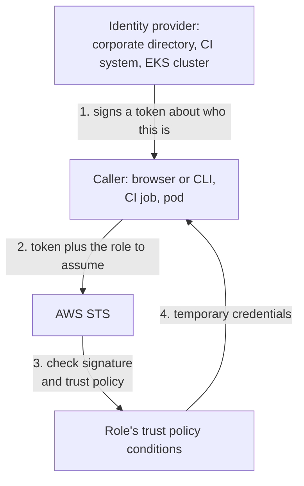
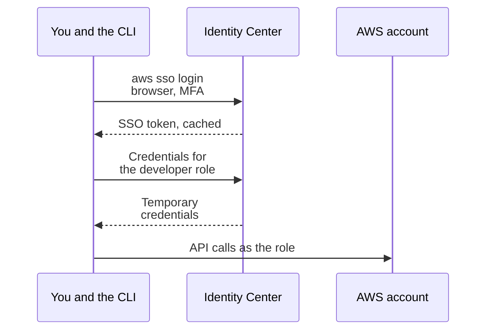

# Federation and SSO

> **Status: AI draft, 2026-11-16.** Not yet verified by me. Commands are from the official documentation and were not run; output is illustrative.

## In one line

Federation lets identities that live outside AWS (employees in a corporate directory, a CI system, a Kubernetes service account) get temporary AWS credentials by assuming a role, instead of each having an IAM user. IAM Identity Center does this for people across many accounts with permission sets; SAML and OIDC providers do it for the rest.

## The plain idea

Your company already knows who its employees are: there is a directory with their accounts, groups and passwords, and a joiner-mover-leaver process. Creating a second set of identities in every AWS account means two places to keep in sync, and an employee who leaves may keep AWS access long after their laptop is returned.

**Federation** means AWS trusts the company's identity system instead. The person signs in there, the identity system vouches for them with a signed statement, and AWS exchanges that statement for temporary credentials for a role. Remove the person from the directory and their AWS access is gone too. The same idea works for machines: a CI system or a Kubernetes cluster can vouch for its own jobs with signed tokens, so they never need stored AWS keys.

## How it works

### The common shape



AWS must know the provider in advance (its signing keys), and the role's trust policy decides which tokens are accepted, usually with conditions on claims such as the audience and subject ([IAM roles and STS](iam-roles-and-sts.md)).

| Protocol | STS call | Typical provider | Typical use |
|---|---|---|---|
| SAML 2.0 | `AssumeRoleWithSAML` | Corporate identity providers | People signing in to the console |
| OIDC | `AssumeRoleWithWebIdentity` | CI systems, EKS clusters, other OIDC issuers | Machines and workloads ([OAuth 2.0, OIDC and JWTs](../security/oauth-oidc-jwt.md)) |
| IAM Identity Center | Handled for you | Its own directory, or an external provider connected to it | People across many accounts |

### IAM Identity Center

**IAM Identity Center** (formerly AWS SSO) is the recommended way to give people access across an organisation.

1. Identity Center gets its users and groups from its own directory or from an external provider, often kept in sync automatically with **SCIM** provisioning.
2. You define **permission sets**: a named bundle of policies, such as "read-only" or "developer".
3. You **assign** a group plus a permission set to one or more accounts.
4. Identity Center creates a matching IAM role in each assigned account and manages its trust policy for you.
5. People sign in once at the **access portal**, see the accounts and roles assigned to them, and open the console or get CLI credentials for any of them.



Groups map to access, so a joiner gets the right access by joining the right group, and a leaver loses everything when disabled in the directory.

### OIDC for workloads

An **OIDC provider** registered in IAM tells AWS to trust tokens signed by an issuer URL, such as a CI platform or an EKS cluster. A role's trust policy then pins which tokens it accepts:

```json
{
  "Effect": "Allow",
  "Principal": { "Federated": "arn:aws:iam::123456789012:oidc-provider/token.actions.githubusercontent.com" },
  "Action": "sts:AssumeRoleWithWebIdentity",
  "Condition": {
    "StringEquals": { "token.actions.githubusercontent.com:aud": "sts.amazonaws.com" },
    "StringLike": { "token.actions.githubusercontent.com:sub": "repo:example-org/sample-app:ref:refs/heads/main" }
  }
}
```

The `sub` (subject) condition is what stops every repository on that platform from assuming your role. The details for pipelines are in [OIDC from pipelines to AWS](../cicd/oidc-to-aws.md); for pods, [Cluster access, IRSA and Pod Identity](../eks/access-and-pod-identity.md).

## A concrete example

A team of 40 engineers works across 12 accounts. Today each account has IAM users, some with access keys older than a year.

1. Enable IAM Identity Center in the management account and connect the company's identity provider with SCIM, so groups sync automatically.
2. Create permission sets: read-only, developer, on-call (developer plus a few production actions), and administrator.
3. Assign groups: `platform-team` gets administrator in non-production and on-call in production; `app-team` gets developer in their own accounts only.
4. Engineers configure `aws configure sso` once and use `aws sso login`; console access comes from the access portal.
5. Delete the old IAM users and their keys after a transition period, watching CloudTrail for remaining use.
6. An engineer leaving the company is disabled in the directory, and loses all AWS access at the next sync, in every account.

## Why not just...?

- **...create IAM users per person per account?** Twelve accounts times 40 people is 480 identities to create, rotate, audit and delete, with long-lived keys spread across laptops.
- **...share one admin user's keys within the team?** Nobody can tell who did what, the keys never expire, and removing one person means rotating the keys for everyone.
- **...trust an OIDC provider without a `sub` condition?** Then any token from that issuer works: for a public CI platform, that can mean any repository of any customer.

## Commands to know

| Command | What it does |
|---|---|
| `aws configure sso` | Set up an SSO session and profile interactively ([Accounts, regions and the CLI](accounts-regions-cli.md)). |
| `aws sso login --profile <profile>` | Sign in through the browser and cache a token. |
| `aws sso logout` | Remove cached SSO tokens. |
| `aws sts get-caller-identity --profile <profile>` | Shows an ARN like `arn:aws:sts::123456789012:assumed-role/<permission-set-role>/<user>`. |
| `aws iam list-open-id-connect-providers` | OIDC providers this account trusts. |
| `aws iam list-saml-providers` | SAML providers this account trusts. |
| `aws sso-admin list-permission-sets --instance-arn <arn>` | Permission sets, from the Identity Center administrator account. |

## How it breaks

| Symptom | Layer | Check | Likely cause |
|---|---|---|---|
| Account missing from the access portal | Assignment | Group membership; assignments in Identity Center | User not in the assigned group, or the group not synced |
| `The SSO session associated with this profile has expired` | Token | Session duration | Run `aws sso login` again |
| `Not authorized to perform sts:AssumeRoleWithWebIdentity` | Trust policy conditions | Decode the token's `aud` and `sub` claims; compare with the trust policy | Audience or subject does not match, or the provider is not registered |
| `InvalidIdentityToken` | Provider registration | The OIDC provider in IAM | Wrong issuer URL, or the token expired |
| A leaver still has access | Identity source | Remaining IAM users or long-lived keys | Old IAM users not removed after the move to federation |
| Permission changes do not apply | Provisioning | Is the permission set provisioned to the accounts? | Permission set edited but not re-provisioned |

## Interview questions

**1. What is federation in AWS, and why is it preferred over IAM users?**

<details markdown="1">
<summary>Answer</summary>

- AWS trusts an external identity provider and exchanges its signed assertion or token for temporary role credentials.
- No long-lived AWS credentials per person or workload.
- Access follows the source directory, so leavers lose access centrally, and actions are attributed to real identities.

</details>

**2. How does IAM Identity Center grant access to many accounts?**

<details markdown="1">
<summary>Answer</summary>

- Users and groups come from its directory or an external provider (often with SCIM).
- Permission sets define policies; assigning a group and permission set to accounts creates matching roles there.
- People sign in once and get temporary credentials for any assigned role.

</details>

**3. What is the difference between SAML and OIDC federation?**

<details markdown="1">
<summary>Answer</summary>

- SAML uses XML assertions, mostly for people signing in through a browser; STS call `AssumeRoleWithSAML`.
- OIDC uses signed JSON tokens (JWTs), common for CI systems and Kubernetes; STS call `AssumeRoleWithWebIdentity`.
- Both end in temporary credentials for a role whose trust policy names the provider.

</details>

**4. Why must a trust policy for a CI OIDC provider check the `sub` claim?**

<details markdown="1">
<summary>Answer</summary>

- The issuer signs tokens for every repository and job on the platform.
- Without a subject condition, any of them could assume your role.
- Pin `sub` to your repository and branch or environment, and `aud` to `sts.amazonaws.com`.

</details>

**5. An engineer leaves. How do you make sure their AWS access is gone?**

<details markdown="1">
<summary>Answer</summary>

- Disable them in the identity provider; Identity Center access ends with the sync, and cached sessions expire.
- Check for any IAM users or access keys they created, and remove them.
- Review CloudTrail for their recent activity.

</details>

**6. A pipeline can assume its AWS role from feature branches, but it should only work from `main`. What is wrong and how do you fix it?**

<details markdown="1">
<summary>Answer</summary>

- The trust policy's `sub` condition is too broad, for example a wildcard over all refs or no subject condition at all.
- Pin the subject to the main branch (or a protected environment) with `StringEquals` or a narrow `StringLike`.
- Check the exact subject format the CI platform puts in its tokens.

</details>

## Try it

*Untested: written from documentation.* A paper exercise, about 10 minutes.

**Step 1.** Design permission sets for three groups (developers, on-call engineers, auditors) across development and production accounts. Write which policies each permission set has and which accounts each group gets.

**Step 2.** Write the trust policy condition block for a CI role that only the `main` branch of `example-org/sample-app` may assume, using the subject format shown above.

**Step 3.** List what changes on the day a developer moves from the app team to the platform team, and who does it.

## Zoom out

Federation is how people, pipelines and pods all reach AWS without stored keys; the underlying mechanism is always a role assumed through STS ([IAM roles and STS](iam-roles-and-sts.md)). The token formats it relies on are covered in [OAuth 2.0, OIDC and JWTs](../security/oauth-oidc-jwt.md). The principle to carry: keep identities in one source of truth, and turn them into short-lived AWS credentials only when needed.

## Sources

- [IAM documentation: identity providers and federation](https://docs.aws.amazon.com/IAM/latest/UserGuide/id_roles_providers.html)
- [IAM Identity Center documentation: what is IAM Identity Center](https://docs.aws.amazon.com/singlesignon/latest/userguide/what-is.html)
- [IAM Identity Center documentation: permission sets](https://docs.aws.amazon.com/singlesignon/latest/userguide/permissionsetsconcept.html)
- [IAM Identity Center documentation: automatic provisioning with SCIM](https://docs.aws.amazon.com/singlesignon/latest/userguide/provision-automatically.html)
- [STS API reference: AssumeRoleWithWebIdentity](https://docs.aws.amazon.com/STS/latest/APIReference/API_AssumeRoleWithWebIdentity.html)
- [STS API reference: AssumeRoleWithSAML](https://docs.aws.amazon.com/STS/latest/APIReference/API_AssumeRoleWithSAML.html)
- [IAM documentation: creating OIDC identity providers](https://docs.aws.amazon.com/IAM/latest/UserGuide/id_roles_providers_create_oidc.html)
