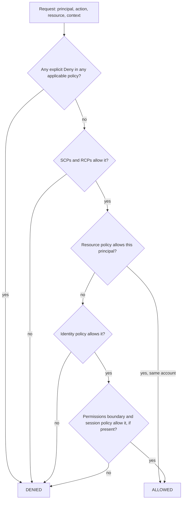

# IAM policies and how they are evaluated

> **Status: AI draft, 2026-11-16.** Not yet verified by me. Commands are from the official documentation and were not run; output is illustrative.

## In one line

Every AWS request is denied unless a policy allows it, and any explicit deny wins over every allow. Identity policies say what a user or role may do; resource policies say who may use a resource; SCPs, permissions boundaries and session policies can only narrow what the others allow.

## The plain idea

Every call to AWS, from the console, the CLI or an application, is a request: **who** (the principal) wants to do **what** (the action) to **which thing** (the resource), under **which circumstances** (conditions such as source address or MFA). AWS answers by reading every policy that applies.

The rules are short. Start from "no". Look for any statement that says "allow" for this request. Then look for any statement that says "deny": if one exists, the answer is "no", however many allows there are. A policy is just a JSON document of such statements. Most "permission denied" puzzles are solved by finding which document said no, or which one never said yes.

## How it works

### Who can be a principal

| Principal | What it is |
|---|---|
| IAM user | A long-lived identity in one account, with a password and/or access keys. Use sparingly. |
| IAM role | An identity with permissions but no long-lived credentials; assumed for temporary credentials ([IAM roles and STS](iam-roles-and-sts.md)). |
| Federated identity | A person or workload from an outside identity provider, acting through a role ([Federation and SSO](federation-and-sso.md)). |
| AWS service | A service acting for you, such as Lambda reading a queue, identified as `lambda.amazonaws.com`. |
| Root user | The account owner; not restricted by identity policies. |

### Anatomy of a policy

```json
{
  "Version": "2012-10-17",
  "Statement": [
    {
      "Sid": "ReadAppBucket",
      "Effect": "Allow",
      "Action": ["s3:GetObject", "s3:ListBucket"],
      "Resource": [
        "arn:aws:s3:::sample-app-data",
        "arn:aws:s3:::sample-app-data/*"
      ],
      "Condition": {
        "Bool": { "aws:SecureTransport": "true" }
      }
    }
  ]
}
```

| Element | Meaning |
|---|---|
| `Version` | The policy language version. Always `2012-10-17`; without it, policy variables do not work. |
| `Statement` | A list of rules. |
| `Sid` | An optional name for the statement. |
| `Effect` | `Allow` or `Deny`. |
| `Action` | API actions, as `service:Operation`. Wildcards are allowed: `s3:Get*`. `NotAction` means "every action except these". |
| `Resource` | The ARNs it applies to. `ListBucket` acts on the bucket ARN, `GetObject` on object ARNs (`bucket/*`): forgetting one of the two is a classic mistake. |
| `Condition` | Extra tests: `StringEquals`, `ArnLike`, `IpAddress`, `Bool`, `NumericLessThan` and more, on **condition keys** such as `aws:SourceIp`, `aws:PrincipalOrgID`, `aws:MultiFactorAuthPresent`. |
| `Principal` | Only in resource-based policies and trust policies: who the statement is about. |

An **ARN** (Amazon Resource Name) names any resource: `arn:aws:service:region:account-id:resource`. Some services leave region or account empty, as S3 bucket ARNs do.

**Policy variables** fill in values per request, for example `"Resource": "arn:aws:s3:::sample-app-home/${aws:username}/*"` gives each user a folder.

### Policy types

| Type | Attached to | Grants? | Typical use |
|---|---|---|---|
| **Identity-based**: AWS managed, customer managed, or inline | A user, group or role | Yes | What this role may do |
| **Resource-based** | A resource: S3 bucket, KMS key, SQS queue, Lambda function | Yes, can name principals in other accounts | Who may use this resource |
| **Trust policy** (a resource policy on a role) | A role | Who may assume it | Cross-account and service roles |
| **Permissions boundary** | A user or role | No, caps identity policies | Let teams create roles without escalating |
| **SCP** and **RCP** | Organisation root, OU, account | No, caps | Organisation guardrails ([Organizations, SCPs and multi-account](organizations-and-scps.md)) |
| **Session policy** | Passed when assuming a role | No, caps that session | Hand out a narrower slice of a role |

**Managed** policies are standalone and reusable; AWS managed ones are maintained by AWS and can change. **Inline** policies are embedded in one identity and deleted with it. Prefer customer managed policies for anything you write.

### The evaluation logic



This is simplified from the AWS documentation, which covers more cases. The key rules:

1. **Default deny.** Nothing is allowed unless something allows it (an implicit deny).
2. **Explicit deny wins.** One `Deny` in any applicable policy beats every `Allow`.
3. **Guardrails only narrow.** SCPs, RCPs, boundaries and session policies must also allow the action; they never grant it.
4. **Same account:** an allow in either the identity policy or the resource policy is enough (a resource policy naming a role can grant on its own, though boundaries and session policies still apply).
5. **Cross account:** both sides must agree. The identity policy in the caller's account must allow the action, **and** the resource policy in the other account must allow the caller (or the caller assumes a role in the other account).

KMS keys are a notable exception: the key policy must allow access, even within the same account; an IAM policy alone is not enough unless the key policy delegates to IAM ([KMS, Secrets Manager and Parameter Store](../aws-services/kms-and-secrets.md)).

## A concrete example

A Lambda function in account `123456789012` must read objects from a bucket in account `111122223333`.

1. The function's execution role gets an identity policy allowing `s3:GetObject` on `arn:aws:s3:::partner-bucket/*`. Alone, this is not enough: the bucket is in another account.
2. The bucket owner adds a bucket policy allowing that role:

```json
{
  "Version": "2012-10-17",
  "Statement": [{
    "Effect": "Allow",
    "Principal": { "AWS": "arn:aws:iam::123456789012:role/sample-app-reader" },
    "Action": "s3:GetObject",
    "Resource": "arn:aws:s3:::partner-bucket/*"
  }]
}
```

3. Now both sides allow it, and the reads succeed.
4. If the objects are encrypted with a customer managed KMS key in the bucket owner's account, the key policy must also allow the role to `kms:Decrypt`. Without that, the error is about KMS, not S3.

## Why not just...?

- **...attach a policy with `"Action": "*", "Resource": "*"` to get things working?** It works, and turns any bug or leaked credential in that workload into full control of the account. Start narrow and widen with evidence ([Least privilege and AccessDenied](least-privilege-and-accessdenied.md)).
- **...use `NotAction` with `Allow` to mean "everything except IAM"?** It also allows every new service AWS launches. `NotAction` is safer with `Deny`.
- **...write inline policies on each role?** They cannot be reused or reviewed in one place, and they vanish with the role. Customer managed policies are versioned and attachable to many roles.

## Commands to know

| Command | What it does |
|---|---|
| `aws iam list-attached-role-policies --role-name <role>` | Managed policies attached to a role. |
| `aws iam list-role-policies --role-name <role>` | Inline policy names on a role. |
| `aws iam get-policy --policy-arn <arn>`, then `get-policy-version --version-id <v>` | A managed policy's current document. |
| `aws iam simulate-principal-policy --policy-source-arn <role-arn> --action-names s3:GetObject --resource-arns arn:aws:s3:::sample-app-data/report.csv` | Ask the policy simulator whether this role's identity policies allow the action. |
| `aws s3api get-bucket-policy --bucket <bucket>` | A bucket's resource policy. |
| `aws accessanalyzer validate-policy --policy-type IDENTITY_POLICY --policy-document file://policy.json` | Check a policy for errors and risky patterns before using it. |

Simulator output looks like this:

```json
{
  "EvaluationResults": [
    {
      "EvalActionName": "s3:GetObject",
      "EvalResourceName": "arn:aws:s3:::sample-app-data/report.csv",
      "EvalDecision": "allowed"
    }
  ]
}
```

`EvalDecision` is `allowed`, `explicitDeny` or `implicitDeny`. The simulator covers identity policies, boundaries and, optionally, SCPs; it does not see every resource policy, so a real call can still fail.

## How it breaks

| Symptom | Layer | Check | Likely cause |
|---|---|---|---|
| `AccessDenied ... no identity-based policy allows` | Identity policy | Simulate the action for the role | Missing action, wrong resource ARN, or a condition not met |
| `... with an explicit deny in ...` | A deny somewhere | The policy type named in the message | SCP, boundary, resource policy or identity policy with `Deny` |
| `ListBucket` works, `GetObject` denied (or the reverse) | Resource ARN | Compare the ARNs in the policy | Bucket ARN versus `bucket/*` object ARN |
| Cross-account call denied, same call works in-account | Two-sided evaluation | Both the caller's policy and the resource policy | One side does not allow it |
| S3 read fails with a KMS error | Key policy | The KMS key policy | The role lacks `kms:Decrypt` in the key policy |
| Policy change has no effect | Wrong identity, or caching | `aws sts get-caller-identity`; wait briefly | Changed a different role, or the session predates the change |

## Interview questions

**1. Explain how AWS evaluates whether a request is allowed.**

<details markdown="1">
<summary>Answer</summary>

- Everything starts as an implicit deny.
- An explicit deny in any applicable policy wins.
- Otherwise the request needs an allow, and any guardrails in play (SCPs, permissions boundary, session policy) must also allow it.
- Cross-account requests need an allow on both sides.

</details>

**2. What is the difference between an identity-based and a resource-based policy?**

<details markdown="1">
<summary>Answer</summary>

- Identity-based policies attach to users, groups or roles and say what they can do.
- Resource-based policies attach to resources (S3 buckets, KMS keys, queues) and say who can use them, with a `Principal` element.
- Resource policies can grant access to principals in other accounts.

</details>

**3. What is a permissions boundary, and when would you use one?**

<details markdown="1">
<summary>Answer</summary>

- A managed policy that sets the maximum permissions an identity's own policies can give it; it grants nothing.
- Used to let developers create roles for their applications without being able to create more powerful roles than allowed.
- Effective permissions are the intersection of the identity policy and the boundary.

</details>

**4. What does an explicit deny in an SCP mean for an account administrator?**

<details markdown="1">
<summary>Answer</summary>

- They cannot perform that action, whatever their IAM policies say.
- Only changing the SCP from the management account removes it.
- Explicit denies beat all allows in every policy type.

</details>

**5. A role can list a bucket but not read objects in it. Why?**

<details markdown="1">
<summary>Answer</summary>

- `s3:ListBucket` applies to the bucket ARN; `s3:GetObject` applies to object ARNs (`bucket/*`).
- The policy probably lists only one of the two resources.
- Also check the bucket policy, object ownership and any KMS key policy.

</details>

**6. How do you give a role in account A read access to an S3 bucket in account B?**

<details markdown="1">
<summary>Answer</summary>

- Account A: an identity policy on the role allowing the S3 actions on that bucket.
- Account B: a bucket policy allowing that role as principal.
- If encrypted with a customer managed KMS key, B's key policy must allow the role to decrypt.
- Alternatively, A assumes a role in B that has the access.

</details>

**7. Why is `"Effect": "Allow"` with `NotAction` risky?**

<details markdown="1">
<summary>Answer</summary>

- It allows every action except those listed, including every future service and action.
- Permissions grow silently as AWS adds services.
- Use `NotAction` mainly with `Deny`, for guardrails.

</details>

## Try it

*Untested: written from documentation.* A paper exercise first; the CLI step needs an AWS account but makes no changes.

**Step 1.** For each request, predict allowed or denied, and name the deciding rule. A role has an identity policy allowing `s3:*` on `sample-app-data` and `sample-app-data/*`.

- `s3:GetObject` on `sample-app-data/a.txt`, no other policies.
- The same, with an SCP denying `s3:GetObject` when `aws:SecureTransport` is `false`, and the request sent over HTTPS.
- `s3:DeleteBucket` on `sample-app-data`, with a permissions boundary that allows only `s3:Get*` and `s3:List*`.
- `s3:GetObject` on `other-team-bucket/a.txt` in another account, with no bucket policy.

**Step 2.** With an AWS account, ask the simulator about a role you have.

```bash
aws iam simulate-principal-policy \
  --policy-source-arn arn:aws:iam::123456789012:role/<your-role> \
  --action-names s3:ListAllMyBuckets ec2:TerminateInstances
```

## Zoom out

Every other permission topic builds on this evaluation logic: roles and trust ([IAM roles and STS](iam-roles-and-sts.md)), pods getting AWS access ([Cluster access, IRSA and Pod Identity](../eks/access-and-pod-identity.md)), pipelines assuming roles ([OIDC from pipelines to AWS](../cicd/oidc-to-aws.md)), and S3, KMS and Secrets Manager resource policies. The principle to carry: find the one policy that said deny, or the one that never said allow.

## Sources

- [IAM documentation: policy evaluation logic](https://docs.aws.amazon.com/IAM/latest/UserGuide/reference_policies_evaluation-logic.html)
- [IAM documentation: cross-account policy evaluation](https://docs.aws.amazon.com/IAM/latest/UserGuide/reference_policies_evaluation-logic-cross-account.html)
- [IAM documentation: JSON policy elements reference](https://docs.aws.amazon.com/IAM/latest/UserGuide/reference_policies_elements.html)
- [IAM documentation: policies and permissions](https://docs.aws.amazon.com/IAM/latest/UserGuide/access_policies.html)
- [IAM documentation: permissions boundaries](https://docs.aws.amazon.com/IAM/latest/UserGuide/access_policies_boundaries.html)
- [IAM documentation: global condition context keys](https://docs.aws.amazon.com/IAM/latest/UserGuide/reference_policies_condition-keys.html)
- [IAM documentation: testing policies with the policy simulator](https://docs.aws.amazon.com/IAM/latest/UserGuide/access_policies_testing-policies.html)
