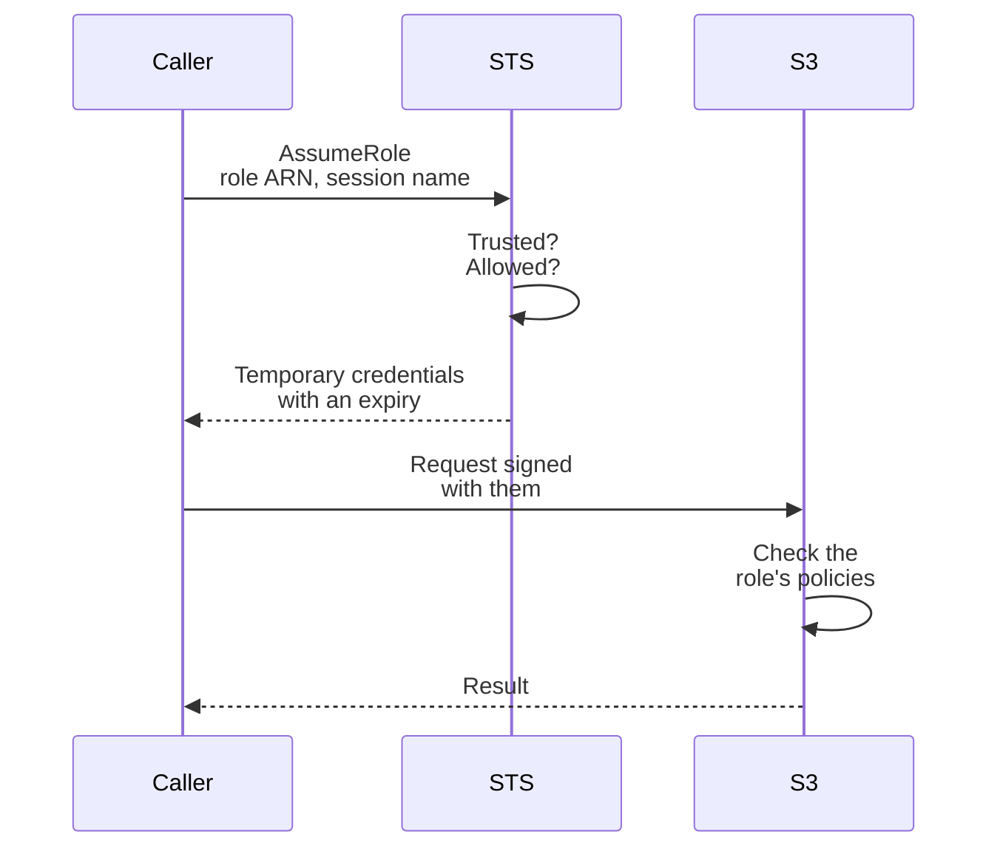

# IAM roles and STS

> **Status: AI draft, 2026-11-16.** Not yet verified by me. Commands are from the official documentation and were not run; output is illustrative.

## In one line

A role is an identity with permissions but no password or keys; anyone its trust policy allows can assume it through STS and receive temporary credentials. The trust policy says who may become the role, the permissions policies say what the role may do, and `iam:PassRole` controls who may hand a role to a service.

## The plain idea

Long-lived keys are a liability: they get copied into scripts, laptops and repositories, and they work for anyone who finds them. A **role** removes them. It is like a visitor badge that a guard hands out at the door: the badge opens certain rooms, it expires at the end of the day, and the guard checks your identity before handing it over.

The guard is **STS**, the AWS Security Token Service. The list the guard checks is the role's **trust policy**. The rooms the badge opens are the role's **permissions policies**. EC2 instances, Lambda functions, pods, CI pipelines, people signing in through SSO and other AWS accounts all get their AWS access this way.

## How it works

### Two policies on every role

```json
{
  "Version": "2012-10-17",
  "Statement": [{
    "Effect": "Allow",
    "Principal": { "Service": "ec2.amazonaws.com" },
    "Action": "sts:AssumeRole"
  }]
}
```

That is a **trust policy**: EC2 may assume this role. The role's **permissions policies** are ordinary identity policies ([IAM policies and how they are evaluated](iam-policies.md)). Both are required: a role nobody can assume is useless, and a role with no permissions can do nothing.

| Trust policy principal | Who may assume the role |
|---|---|
| `{"Service": "lambda.amazonaws.com"}` | An AWS service acting for you |
| `{"AWS": "arn:aws:iam::111122223333:root"}` | Any identity in account `111122223333` whose own policies allow `sts:AssumeRole` on this role |
| `{"AWS": "arn:aws:iam::111122223333:role/deployer"}` | One specific role in another account |
| `{"Federated": "arn:aws:iam::123456789012:oidc-provider/..."}` | Identities from an OIDC or SAML provider, such as a CI system or EKS ([Federation and SSO](federation-and-sso.md)) |

`:root` in a principal ARN means "the account", not the root user. The other account's administrators then decide which of their identities may use the role.

### AssumeRole, step by step



The credentials have three parts: an access key ID (starting `ASIA` for temporary keys, `AKIA` for long-term ones), a secret key, and a **session token**, which must be sent too. They expire: one hour by default, configurable from 15 minutes up to the role's maximum session duration, which can be set to as much as 12 hours. In CloudTrail, actions appear under the role and the **session name**, so choose session names that identify who or what assumed it.

**Role chaining** (using a role's credentials to assume another role) is allowed, but the chained session is limited to one hour.

### Roles for compute

- **EC2:** an **instance profile** is the container that attaches a role to an instance. The SDKs fetch rotating credentials from the instance metadata service (`169.254.169.254`); use IMDSv2, which requires a session token and blocks some theft techniques ([EC2](../aws-services/ec2.md)).
- **Lambda:** the function's **execution role**.
- **ECS tasks:** a **task role** for the application, and a separate **task execution role** for ECS itself to pull images and write logs ([ECS and Fargate](../serverless/ecs-and-fargate.md)).
- **Kubernetes pods on EKS:** IRSA or EKS Pod Identity give each service account its own role ([Cluster access, IRSA and Pod Identity](../eks/access-and-pod-identity.md)).

### iam:PassRole

When you create a Lambda function or launch an EC2 instance with a role, you are giving that role to a service. AWS checks that **you** have `iam:PassRole` for that role. Without the check, anyone allowed to create a function could attach the most powerful role in the account and use it through the function. Scope `iam:PassRole` to specific role ARNs, never `*`.

### Cross-account roles and the confused deputy

A third-party service (a monitoring vendor, for example) is given a role in your account. If its trust policy allowed the vendor's whole account with nothing else, another customer of the same vendor could trick the vendor into using **your** role: the vendor would be a **confused deputy**. The fix is an **external ID**: a value unique to you, required by a condition in the trust policy:

```json
"Condition": { "StringEquals": { "sts:ExternalId": "<value-the-vendor-gave-you>" } }
```

### Service-linked roles

Some AWS services create roles in your account that they own, with permissions AWS defines, named `AWSServiceRoleFor...`. You cannot edit their permissions. They exist so the service can manage resources on your behalf, for example an Auto Scaling group launching instances.

## A concrete example

A deploy pipeline in a tools account (`111122223333`) must deploy into the production account (`123456789012`).

1. In production, create role `sample-app-deployer` with only the permissions a deploy needs.
2. Its trust policy allows exactly the pipeline's role in the tools account:

```json
{
  "Version": "2012-10-17",
  "Statement": [{
    "Effect": "Allow",
    "Principal": { "AWS": "arn:aws:iam::111122223333:role/ci-pipeline" },
    "Action": "sts:AssumeRole"
  }]
}
```

3. In the tools account, the pipeline's role gets an identity policy allowing `sts:AssumeRole` on `arn:aws:iam::123456789012:role/sample-app-deployer`.
4. The pipeline calls `aws sts assume-role` with session name `deploy-<build-number>`, receives one-hour credentials, and deploys. CloudTrail in production records each action under that session name.
5. Nothing long-lived exists in production for the pipeline to leak.

## Why not just...?

- **...create an IAM user with access keys for the pipeline?** The keys never expire unless rotated, work from anywhere, and are often copied into many places. A role assumed per run gives one-hour credentials and a clear audit trail.
- **...trust the whole other account with `:root` and no conditions?** Any identity there that is allowed `sts:AssumeRole` can use the role. Name the exact role, or add conditions.
- **...give the developer role `iam:PassRole` on `*`?** They can then attach any role, including administrator roles, to a function they control: a classic privilege escalation path ([Least privilege and AccessDenied](least-privilege-and-accessdenied.md)).

## Commands to know

Assume a role and see what comes back:

```console
$ aws sts assume-role --role-arn arn:aws:iam::123456789012:role/sample-app-deployer --role-session-name deploy-1042
{
    "Credentials": {
        "AccessKeyId": "<temporary-key-id>",
        "SecretAccessKey": "<secret>",
        "SessionToken": "<session-token>",
        "Expiration": "2026-11-16T10:12:04+00:00"
    },
    "AssumedRoleUser": {
        "AssumedRoleId": "<role-id>:deploy-1042",
        "Arn": "arn:aws:sts::123456789012:assumed-role/sample-app-deployer/deploy-1042"
    }
}
```

Most of the time you let the CLI do this through a profile instead:

```ini
[profile prod-deploy]
role_arn = arn:aws:iam::123456789012:role/sample-app-deployer
source_profile = tools
role_session_name = deploy-manual
```

| Command | What it does |
|---|---|
| `aws iam get-role --role-name <role>` | The role, including its trust policy and maximum session duration. |
| `aws iam update-assume-role-policy --role-name <role> --policy-document file://trust.json` | Replace the trust policy. |
| `aws sts get-caller-identity` | After assuming, confirm you are the role. |
| `aws iam list-instance-profiles-for-role --role-name <role>` | Instance profiles that wrap the role. |
| `aws sts decode-authorization-message --encoded-message <msg>` | Decode the detail in some encoded `AccessDenied` messages, if allowed. |

## How it breaks

| Symptom | Layer | Check | Likely cause |
|---|---|---|---|
| `not authorized to perform: sts:AssumeRole on resource: <role>` | Trust or caller policy | The role's trust policy, then the caller's identity policy | Caller not trusted, or not allowed `sts:AssumeRole` on that ARN |
| `iam:PassRole` denied when creating a function or instance | PassRole | The creator's identity policy | `iam:PassRole` missing for that role ARN |
| Instance's application gets `Unable to locate credentials` | Instance profile, IMDS | Is a role attached? Can the instance reach the metadata service? IMDSv2 hop limit in containers? | No profile, or metadata blocked or hop limit too low for containers |
| Long job fails after an hour | Session length | Session duration, role chaining | Credentials expired; chained sessions cap at one hour |
| Vendor integration denied after a change | Trust conditions | `sts:ExternalId` condition | External ID missing or changed |
| Actions in CloudTrail cannot be traced to a person or build | Session names | The `assumed-role/<role>/<session>` ARN | Generic or reused session names |

## Interview questions

**1. What is the difference between an IAM user and an IAM role?**

<details markdown="1">
<summary>Answer</summary>

- A user is a long-lived identity with a password and/or access keys.
- A role has no long-lived credentials; trusted principals assume it and get temporary credentials from STS.
- Roles are preferred for workloads, services, cross-account access and federated people.

</details>

**2. What is a trust policy, and how does it differ from a permissions policy?**

<details markdown="1">
<summary>Answer</summary>

- The trust policy is the role's resource policy: who may assume it (`sts:AssumeRole`, or the web identity and SAML variants).
- Permissions policies say what the role may do once assumed.
- Both are needed; cross-account, the caller's own policy must also allow the assume.

</details>

**3. What does `iam:PassRole` protect against?**

<details markdown="1">
<summary>Answer</summary>

- Handing a role to a service (EC2, Lambda, ECS) requires `iam:PassRole` on that role.
- Without it, a user could attach a more powerful role to a resource they control and act through it.
- Scope it to specific role ARNs.

</details>

**4. How do temporary credentials from STS differ from access keys?**

<details markdown="1">
<summary>Answer</summary>

- They include a session token and expire, by default after an hour.
- Their key IDs start with `ASIA` rather than `AKIA`.
- Actions are logged with the role and session name, which helps attribution.

</details>

**5. What is the confused deputy problem, and how does an external ID help?**

<details markdown="1">
<summary>Answer</summary>

- A third party trusted by many customers could be tricked into using one customer's role on another's behalf.
- The external ID is a value unique to each customer, required by a condition in the trust policy.
- The third party sends it when assuming the role, so a request for another customer's role fails.

</details>

**6. An application on EC2 cannot get AWS credentials. What do you check?**

<details markdown="1">
<summary>Answer</summary>

- An instance profile with the right role is attached.
- The application can reach the instance metadata service; with IMDSv2 in containers, the hop limit may need raising.
- No environment variables or credential files override the instance role.
- The role's permissions cover the calls.

</details>

## Try it

*Untested: written from documentation.* This needs an AWS account; it creates a role with no permissions, which costs nothing, and deletes it at the end.

**Step 1.** Create a role that only your own account may assume.

```bash
ACCOUNT=$(aws sts get-caller-identity --query Account --output text)
cat > trust.json <<EOF
{"Version":"2012-10-17","Statement":[{"Effect":"Allow","Principal":{"AWS":"arn:aws:iam::${ACCOUNT}:root"},"Action":"sts:AssumeRole"}]}
EOF
aws iam create-role --role-name notes-demo-role --assume-role-policy-document file://trust.json
```

**Step 2.** Assume it, and predict what `get-caller-identity` will show with the new credentials.

```bash
aws sts assume-role --role-arn arn:aws:iam::${ACCOUNT}:role/notes-demo-role --role-session-name notes-test --query Credentials
```

**Step 3.** Delete the role.

```bash
aws iam delete-role --role-name notes-demo-role
```

## Zoom out

Roles and STS are how every non-human workload in AWS gets access: instances, functions, containers, pods and pipelines ([Federation and SSO](federation-and-sso.md), [OIDC from pipelines to AWS](../cicd/oidc-to-aws.md)). They also make cross-account designs possible without sharing keys. The principle to carry: grant access by letting the right identity assume a narrowly scoped role, for a short time, with a session name you can trace.

## Sources

- [IAM documentation: IAM roles](https://docs.aws.amazon.com/IAM/latest/UserGuide/id_roles.html)
- [STS API reference: AssumeRole](https://docs.aws.amazon.com/STS/latest/APIReference/API_AssumeRole.html)
- [IAM documentation: granting a user permissions to pass a role](https://docs.aws.amazon.com/IAM/latest/UserGuide/id_roles_use_passrole.html)
- [IAM documentation: the confused deputy problem](https://docs.aws.amazon.com/IAM/latest/UserGuide/confused-deputy.html)
- [IAM documentation: using an IAM role to grant permissions to applications on EC2 instances](https://docs.aws.amazon.com/IAM/latest/UserGuide/id_roles_use_switch-role-ec2.html)
- [IAM documentation: service-linked roles](https://docs.aws.amazon.com/IAM/latest/UserGuide/id_roles_create-service-linked-role.html)
