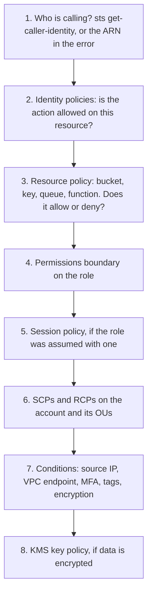

# Least privilege and AccessDenied

> **Status: AI draft, 2026-11-16.** Not yet verified by me. Commands are from the official documentation and were not run; output is illustrative.

## In one line

Least privilege means each identity gets only the actions and resources it needs, found from evidence (CloudTrail, last-accessed data, Access Analyzer) rather than guesses. When a call fails with `AccessDenied`, read the message for the principal, action, resource and policy type, then walk the policy types in a fixed order.

## The plain idea

Every permission you grant is something an attacker gets if that identity is compromised, and something a bug can misuse. **Least privilege** shrinks that: give each role exactly what its job needs and nothing more. The hard part is knowing what it needs. Guessing tends to go wrong in both directions: too narrow breaks things, too broad stays broad forever because nobody wants to break things.

The practical approach is a loop: start narrow, let real failures tell you what is missing, add exactly that, and periodically remove what is not used. That loop runs on `AccessDenied` errors, so being able to read them quickly is half the skill.

## How it works

### Reading an AccessDenied message

```text
User: arn:aws:sts::123456789012:assumed-role/sample-app-task/abc123 is not authorized to perform:
s3:PutObject on resource: arn:aws:s3:::sample-app-uploads/2026/11/report.csv
because no identity-based policy allows the s3:PutObject action
```

| Part | Tells you |
|---|---|
| `User: ...assumed-role/sample-app-task/...` | **Who** made the call: here a role, through a session. Is it the identity you expected? |
| `s3:PutObject` | The exact **action**, ready to paste into a policy. |
| `on resource: arn:aws:s3:::...` | The exact **resource** ARN. |
| `because no identity-based policy allows` | **Which policy type** decided. Other endings name an explicit deny in a service control policy, a permissions boundary, a session policy or a resource-based policy. |

Many services include the policy type in the message. Some older ones return a shorter error, and some return an encoded message that `aws sts decode-authorization-message` can expand.

### A checklist, in order



The order follows likelihood: wrong identity and a missing identity-policy action explain most failures. Conditions are the subtle ones: a policy can allow the action and still not match because the request came from outside the expected VPC endpoint, without MFA, or without the required encryption header ([IAM policies and how they are evaluated](iam-policies.md)).

### Finding what an identity really needs

| Tool | What it gives you |
|---|---|
| **CloudTrail** | Every API call with its identity, action, resource and result; `errorCode` shows denials ([CloudTrail, Athena and Config](../aws-services/cloudtrail-and-config.md)). |
| **Last-accessed information** | For a role or policy, which services (and for some services, which actions) were last used and when. Unused for 90 days usually means removable. |
| **IAM Access Analyzer policy generation** | Builds a policy from a role's actual CloudTrail activity over a period. A starting point to review, not to paste blindly. |
| **IAM Access Analyzer findings** | Resources shared outside your account or organisation, and unused roles, keys and permissions. |
| **Policy simulator** | "Would this identity be allowed to do X?" without doing it. |
| **Access Analyzer policy validation** | Errors, warnings and overly broad patterns in a policy you are about to apply. |

### Tightening a broad policy

1. Turn on or confirm CloudTrail coverage, and let the workload run through its normal cycle, including monthly jobs.
2. Generate a policy from the activity, or read last-accessed data to see which services and actions were used.
3. Replace `*` actions with the specific actions, and `*` resources with ARNs or ARN patterns.
4. Add conditions where they make sense: the organisation (`aws:PrincipalOrgID`), a VPC endpoint (`aws:SourceVpce`), tags.
5. Deploy to a non-production account first and watch for denials; fix them one by one.
6. Repeat periodically: permissions drift as code changes.

### Privilege escalation paths

Some permissions are as good as administrator, because they let an identity give itself more:

| Permission | Why it escalates |
|---|---|
| `iam:CreatePolicyVersion`, `iam:SetDefaultPolicyVersion` | Rewrite a policy attached to yourself |
| `iam:AttachUserPolicy`, `iam:AttachRolePolicy`, `iam:PutRolePolicy` | Attach or write any policy, including full access |
| `iam:UpdateAssumeRolePolicy` | Make a powerful role trust you |
| `iam:PassRole` on `*` plus `lambda:CreateFunction` or `ec2:RunInstances` | Run code as a more powerful role ([IAM roles and STS](iam-roles-and-sts.md)) |
| `iam:CreateAccessKey` on other users | Get keys for someone with more access |

Treat these as administrator permissions. **Permissions boundaries** are the standard way to let teams create roles for their own applications without opening these paths: every role they create must carry a boundary that caps it.

## A concrete example

An ECS task writing uploads to S3 fails after a security hardening change.

1. The application log shows the `AccessDenied` message above: role `sample-app-task`, action `s3:PutObject`, bucket `sample-app-uploads`, "no identity-based policy allows".
2. The task role's policy was tightened from `s3:*` to `s3:GetObject` and `s3:ListBucket`, based on 30 days of CloudTrail data. The upload feature only runs at month end, so it never appeared in that window.
3. Add `s3:PutObject` on `arn:aws:s3:::sample-app-uploads/*` only.
4. The next upload fails again, now with `kms:GenerateDataKey` denied: the bucket encrypts with a customer managed key, and writing needs that permission, which reading did not ([KMS, Secrets Manager and Parameter Store](../aws-services/kms-and-secrets.md)).
5. Add `kms:GenerateDataKey` on that key ARN (and confirm the key policy allows the role). Uploads work.
6. Lesson for the next tightening: use an observation window that covers the workload's full cycle.

## Why not just...?

- **...grant `*` and tighten later?** "Later" rarely comes, and the broad grant is what an attacker uses in the meantime. Start narrow; the errors tell you exactly what to add.
- **...add permissions until the error goes away, without reading it?** You may add the wrong thing in the wrong place, for example an identity-policy allow when the denial came from an SCP, and leave extra permissions behind. Read which policy type decided.
- **...use the AWS managed read-only or power-user policies for applications?** They are broad, they change as AWS adds actions, and they cover services the application never touches. They suit people's sessions better than workload roles.

## Commands to know

| Command | What it does |
|---|---|
| `aws sts get-caller-identity` | Confirm the identity that is actually making calls. |
| `aws iam simulate-principal-policy --policy-source-arn <role-arn> --action-names s3:PutObject --resource-arns <arn>` | Would the identity's policies allow it? |
| `aws iam generate-service-last-accessed-details --arn <role-arn>`, then `get-service-last-accessed-details --job-id <id>` | Which services the role has used, and when. |
| `aws accessanalyzer start-policy-generation ...` | Generate a policy from CloudTrail activity (needs a trail and a role for Access Analyzer). |
| `aws accessanalyzer validate-policy --policy-type IDENTITY_POLICY --policy-document file://p.json` | Lint a policy before applying it. |
| `aws cloudtrail lookup-events --lookup-attributes AttributeKey=Username,AttributeValue=<session> --max-results 20` | Recent management events by that session. Data events such as S3 object calls need a trail and Athena or CloudTrail Lake. |
| `aws sts decode-authorization-message --encoded-message <msg>` | Expand an encoded denial (needs permission to call it). |

## How it breaks

| Symptom | Layer | Check | Likely cause |
|---|---|---|---|
| `no identity-based policy allows` | Identity policy | Simulate the action; read the role's policies | Action or resource missing |
| `with an explicit deny in a service control policy` | SCP | SCPs on the account and parents | An organisation guardrail; IAM changes cannot help |
| `... in a permissions boundary` | Boundary | The role's boundary | The boundary does not include the action |
| `... in a resource-based policy` | Resource policy | Bucket, key or queue policy | A deny statement, often a condition such as a VPC endpoint or TLS requirement |
| Denied only from some places | Conditions | `aws:SourceIp`, `aws:SourceVpce`, `aws:SourceVpc` in policies | The request came from a different network path |
| S3 or Secrets Manager works for reads, fails for writes | KMS | The key policy and `kms:GenerateDataKey` | Encryption key permissions differ for writing |
| A tightened role breaks weeks later | Observation window | The workload's schedule | Rare jobs not seen while the policy was being built |

## Interview questions

**1. What is least privilege, and how do you apply it in practice on AWS?**

<details markdown="1">
<summary>Answer</summary>

- Each identity gets only the actions and resources its job needs.
- Start narrow and add from evidence: CloudTrail, last-accessed data, Access Analyzer policy generation.
- Use specific ARNs and conditions, and review periodically to remove unused permissions.

</details>

**2. Walk me through debugging an `AccessDenied` error.**

<details markdown="1">
<summary>Answer</summary>

- Read the message: principal, action, resource and which policy type decided.
- Confirm the identity is the expected one.
- Check identity policies, then resource policy, boundary, session policy, SCPs, conditions, and the KMS key policy for encrypted data.
- Use the simulator and CloudTrail to confirm.

</details>

**3. Name some IAM permissions that allow privilege escalation.**

<details markdown="1">
<summary>Answer</summary>

- Writing or attaching policies: `iam:CreatePolicyVersion`, `iam:AttachRolePolicy`, `iam:PutRolePolicy`.
- Changing trust: `iam:UpdateAssumeRolePolicy`.
- Broad `iam:PassRole` combined with creating functions or instances.
- Creating access keys for other users.

</details>

**4. How would you let developers create IAM roles for their applications without letting them escalate?**

<details markdown="1">
<summary>Answer</summary>

- Require a permissions boundary on every role they create, enforced with a condition on `iam:PermissionsBoundary` in their own policy.
- Restrict role names or paths they may create and pass.
- Deny them changes to the boundary policy itself.

</details>

**5. A role was tightened using 30 days of CloudTrail data and broke a month later. What went wrong?**

<details markdown="1">
<summary>Answer</summary>

- A rarely run job (month-end, quarterly) did not appear in the observation window.
- Use a window that covers the full cycle, include known schedules, and test those paths.
- Monitor denials after tightening and fix quickly.

</details>

**6. An application can read an encrypted S3 object but not write one. Why?**

<details markdown="1">
<summary>Answer</summary>

- Writing with SSE-KMS needs `kms:GenerateDataKey`; reading needs `kms:Decrypt`.
- The role or the key policy allows only one of them.
- Check the error for the KMS action and the key ARN.

</details>

## Try it

*Untested: written from documentation.* A paper exercise, about 10 minutes.

**Step 1.** For each error ending, name the policy type to check first and one likely fix:

- `because no identity-based policy allows the sqs:SendMessage action`
- `with an explicit deny in a service control policy`
- `with an explicit deny in a resource-based policy` (on an S3 bucket with a VPC endpoint condition)

**Step 2.** Rewrite this statement to least privilege for a function that only reads `config/*.json` from `sample-app-data`:

```json
{ "Effect": "Allow", "Action": "s3:*", "Resource": "*" }
```

**Step 3.** List which of these permissions you would treat as administrator: `iam:PassRole` on `*`, `s3:GetObject` on one bucket, `iam:PutRolePolicy`, `logs:CreateLogStream`.

## Zoom out

Least privilege applies at every layer covered in these notes: Linux permissions ([Users, groups and permissions](../linux/permissions.md)), Kubernetes RBAC ([RBAC and service accounts](../kubernetes/rbac-and-service-accounts.md)), and pipeline credentials ([Pipeline security](../cicd/pipeline-security.md)). The method is the same everywhere: start narrow, grant from evidence, review. The principle to carry: read the denial before you widen anything.

## Sources

- [IAM documentation: troubleshooting access denied error messages](https://docs.aws.amazon.com/IAM/latest/UserGuide/troubleshoot_access-denied.html)
- [IAM documentation: security best practices, apply least-privilege permissions](https://docs.aws.amazon.com/IAM/latest/UserGuide/best-practices.html)
- [IAM documentation: refining permissions using last accessed information](https://docs.aws.amazon.com/IAM/latest/UserGuide/access_policies_last-accessed.html)
- [IAM Access Analyzer documentation: policy generation](https://docs.aws.amazon.com/IAM/latest/UserGuide/access-analyzer-policy-generation.html)
- [IAM Access Analyzer documentation: policy validation](https://docs.aws.amazon.com/IAM/latest/UserGuide/access-analyzer-policy-validation.html)
- [IAM documentation: permissions boundaries](https://docs.aws.amazon.com/IAM/latest/UserGuide/access_policies_boundaries.html)
