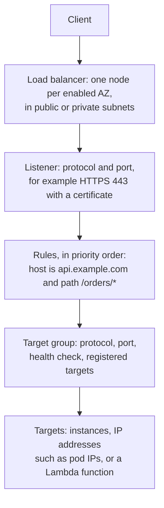

# ALB and NLB

> **Status: AI draft, 2026-11-16.** Not yet verified by me. Commands are from the official documentation and were not run; output is illustrative.

## In one line

An Application Load Balancer is AWS's L7 balancer: listeners and rules route HTTP by host, path and headers to target groups of instances, IPs or Lambda functions. A Network Load Balancer is L4: very high throughput, static addresses, client IP preserved, any TCP or UDP protocol. Target health decides who gets traffic, and the 5xx codes say which side failed.

## The plain idea

The general ideas of load balancing are on [Load balancers and proxies](../networking/load-balancers-and-proxies.md). AWS offers them as managed services, so you do not run the balancer yourself: you describe what it should listen on, where to send traffic and how to check backends, and AWS runs it across several Availability Zones.

The choice between the two main types is the L7 against L4 choice. If the traffic is HTTP and you want to route by URL or host name, terminate TLS centrally, or authenticate users at the edge, use an **ALB**. If it is any other TCP or UDP protocol, or you need fixed IP addresses, the client's real address at the backend, or very high connection rates, use an **NLB**.

## How it works

### The pieces



| Piece | What it does |
|---|---|
| **Listener** | Accepts connections on a protocol and port. An HTTPS listener holds certificates from ACM ([Route 53 and ACM](route53-and-acm.md)) and chooses one by SNI. |
| **Rule** (ALB) | Conditions (host header, path pattern, HTTP header, method, query string, source IP) and an action (forward, redirect, fixed response, or authenticate with OIDC or Cognito). Evaluated in priority order; a default rule catches the rest. |
| **Target group** | A set of targets with one protocol, port and health check. Target types: `instance`, `ip`, or `lambda` (ALB only). |
| **Health check** | A request to each target on a schedule: path, port, interval, timeout, healthy and unhealthy thresholds, and the success codes that count as healthy. |

### ALB features worth knowing

- **Host and path routing:** one ALB serves many services, which is how the AWS Load Balancer Controller can share one ALB between many Kubernetes Ingresses ([AWS Load Balancer Controller](../eks/load-balancer-controller.md)).
- **`X-Forwarded-For`, `X-Forwarded-Proto`, `X-Forwarded-Port`** headers tell targets the original client details.
- **Idle timeout** (60 seconds by default): a connection with no data for that long is closed. Long-running requests need it raised, or keep-alive settings aligned with the backends.
- **Deregistration delay** (connection draining), 300 seconds by default: how long a target being removed keeps serving in-flight requests.
- **Stickiness** with a load-balancer cookie or an application cookie.
- **Access logs** to S3, with fields that separate time spent in the balancer from time spent in the target (`request_processing_time`, `target_processing_time`, `response_processing_time`), and the status codes from both.

### NLB features worth knowing

- **One static IP address per AZ**, or Elastic IPs you choose: useful when clients must allow-list addresses.
- **Client IP preservation:** targets can see the client's own address instead of the load balancer's (automatic for instance targets; configurable for IP targets). Otherwise, the PROXY protocol can pass it.
- **TLS**: pass encrypted traffic through to targets, or terminate TLS on a TLS listener.
- **Cross-zone load balancing** is off by default on NLBs (on by default on ALBs); with it off, each AZ's node sends only to targets in its own AZ, so uneven targets per AZ means uneven load.
- Security groups can be attached to NLBs, which simplifies target rules.
- An NLB is also what PrivateLink endpoint services sit behind ([NAT, endpoints and PrivateLink](nat-endpoints-privatelink.md)).

### Choosing

| Need | ALB | NLB |
|---|---|---|
| HTTP routing by host or path | Yes | No |
| Any TCP or UDP protocol | No | Yes |
| Static IP addresses | No | Yes |
| Client IP at the target | Via `X-Forwarded-For` | Directly |
| Authenticate users at the load balancer | Yes | No |
| Lambda targets | Yes | No |
| Very high connection rates, lowest latency | Good | Best |

**Global Accelerator** sits in front of either: it gives two static anycast IP addresses served from AWS's edge locations and routes users over AWS's network to healthy regional endpoints, failing over between regions. **Gateway Load Balancers** are a third type, for inserting network appliances such as firewalls into traffic paths.

### Where the 5xx codes come from

| Code | ALB meaning, in general | First check |
|---|---|---|
| `502` | The target closed the connection, reset it, or sent a malformed response; or a Lambda target returned something invalid | Target logs; keep-alive timeouts; crashes |
| `503` | No healthy registered targets for the rule | Target health; health check settings |
| `504` | The target did not respond in time (including failing to connect) | Target latency; idle timeout; security group from LB to target |
| `460` | The client closed the connection before the ALB could respond | Client timeouts shorter than the request takes |
| `ELB` 5xx metric against target 5xx metric | Whether the load balancer or the target generated the error | CloudWatch metrics `HTTPCode_ELB_5XX_Count` and `HTTPCode_Target_5XX_Count` |

## A concrete example

`api.example.com` and `www.example.com` share one ALB.

1. HTTPS listener on 443 with certificates for both names; HTTP listener on 80 with a redirect to HTTPS.
2. Rule 10: host `api.example.com` and path `/orders/*` forwards to target group `tg-orders` (IP targets on port 8080, health check `GET /healthz` expecting `200`).
3. Rule 20: host `api.example.com` forwards to `tg-api`.
4. Rule 30: host `www.example.com` forwards to `tg-web`.
5. Default rule: fixed response `404`.
6. During a deploy, new targets register and must pass the health check before receiving traffic; old ones drain for the deregistration delay. Lowering the delay to slightly above the longest request speeds deploys without cutting requests ([Deployment strategies](../cicd/deployment-strategies.md)).

## Why not just...?

- **...use an NLB for HTTP to save money?** You lose host and path routing, HTTP-aware health checks and `X-Forwarded-For`, and each service may need its own load balancer. ALBs exist for HTTP.
- **...set the health check to `/` of the application?** If `/` is heavy, health checks add load, and if it depends on many services, a small dependency blip can mark every target unhealthy at once. Use a light, dedicated health endpoint.
- **...raise the idle timeout to the maximum to stop 504s?** It hides slow backends and holds connections longer. Fix the latency, and only raise the timeout for routes that are legitimately long.

## Commands to know

| Command | What it does |
|---|---|
| `aws elbv2 describe-load-balancers --names <name>` | Type, scheme, DNS name, AZs and security groups. |
| `aws elbv2 describe-listeners --load-balancer-arn <arn>` | Listeners and their certificates. |
| `aws elbv2 describe-rules --listener-arn <arn>` | Rules with priorities, conditions and actions. |
| `aws elbv2 describe-target-health --target-group-arn <arn>` | Each target's state and the reason if unhealthy. |
| `aws elbv2 describe-target-group-attributes --target-group-arn <arn>` | Deregistration delay, stickiness, slow start. |
| `aws elbv2 describe-load-balancer-attributes --load-balancer-arn <arn>` | Idle timeout, access logs, cross-zone settings. |

Target health output, illustrative:

```json
{
  "TargetHealthDescriptions": [
    { "Target": { "Id": "10.0.37.12", "Port": 8080 },
      "TargetHealth": { "State": "healthy" } },
    { "Target": { "Id": "10.0.66.40", "Port": 8080 },
      "TargetHealth": { "State": "unhealthy", "Reason": "Target.ResponseCodeMismatch",
                        "Description": "Health checks failed with these codes: [500]" } }
  ]
}
```

The `Reason` field is usually the fastest answer: `Target.Timeout` points at the network or a slow target, `Target.ResponseCodeMismatch` at the application, `Target.FailedHealthChecks` at either.

## How it breaks

| Symptom | Layer | Check | Likely cause |
|---|---|---|---|
| `503` from the load balancer | Targets | `describe-target-health` | No healthy targets: failing health checks, wrong port, or none registered |
| Targets `unhealthy` with `Target.Timeout` | Network | Target security group allows the LB's group on the health check port? | Security group, NACL, or the app not listening on that port |
| `502` during deploys | Draining | Deregistration delay; app shutdown handling | Targets stopping before deregistration completes |
| Random `502` under load | Keep-alive | Target keep-alive timeout against the LB idle timeout | Target closes idle connections the LB reuses; set target keep-alive longer than the LB idle timeout |
| `504` on long requests | Timeouts | Access log `target_processing_time` | Idle timeout shorter than the request |
| Uneven traffic across AZs on an NLB | Cross-zone | Cross-zone setting; targets per AZ | Cross-zone off with unequal targets per AZ |
| Backend logs show only LB addresses | Client IP | `X-Forwarded-For` handling, or NLB preservation settings | App not reading forwarded headers, or preservation off |

## Interview questions

**1. When would you choose an ALB over an NLB, and the reverse?**

<details markdown="1">
<summary>Answer</summary>

- ALB for HTTP and HTTPS: host and path routing, TLS termination, authentication, Lambda targets.
- NLB for non-HTTP TCP or UDP, static IPs, client IP preservation, very high throughput and low latency, and PrivateLink.
- Both can terminate TLS.

</details>

**2. What are listeners, rules and target groups?**

<details markdown="1">
<summary>Answer</summary>

- A listener accepts connections on a protocol and port.
- Rules (ALB) match host, path, headers and more, in priority order, and pick an action.
- A target group holds the targets with their protocol, port and health check.

</details>

**3. An ALB returns `503`. What does it mean and what do you check?**

<details markdown="1">
<summary>Answer</summary>

- No healthy targets for that rule.
- Check target health and its reason codes, the health check path, port and expected codes.
- Check the security group allows the load balancer to reach targets, and that targets are registered.

</details>

**4. How do you avoid dropping requests during a deploy behind an ALB?**

<details markdown="1">
<summary>Answer</summary>

- New targets must pass health checks before receiving traffic.
- Set the deregistration delay above the longest request, and make the app finish in-flight work on SIGTERM.
- In Kubernetes, pod readiness gates and a `preStop` pause align pod shutdown with deregistration.

</details>

**5. Why might targets behind an ALB return intermittent `502`s?**

<details markdown="1">
<summary>Answer</summary>

- The target's keep-alive timeout is shorter than the ALB's idle timeout, so the ALB reuses a connection the target already closed.
- Targets crashing or being OOM-killed.
- Malformed responses or targets being stopped before deregistration.

</details>

**6. What does Global Accelerator add on top of a regional load balancer?**

<details markdown="1">
<summary>Answer</summary>

- Two static anycast IP addresses served from AWS edge locations.
- User traffic enters AWS's network close to the user.
- Health-based routing and failover between regional endpoints.

</details>

## Try it

*Untested: written from documentation.* A paper exercise, about 10 minutes. Load balancers are billed by the hour, so do not create one just to practise.

**Step 1.** Design the listeners and rules for one ALB serving `app.example.com` (web), `app.example.com/api/*` (API) and `admin.example.com` (admin, only from `198.51.100.0/24`).

**Step 2.** For each target group, write the health check path, success codes and target type you would use for pods on EKS.

**Step 3.** For each symptom, name the most likely cause: all targets `Target.Timeout` after a security group change; `502` only during deploys; `504` only on report downloads.

## Zoom out

ALBs and NLBs are the front door in [One request, end to end](../start/request-path.md); in Kubernetes they are created from Ingress and Service objects by a controller ([AWS Load Balancer Controller](../eks/load-balancer-controller.md)). Their health checks, timeouts and error codes follow the general rules in [Load balancers and proxies](../networking/load-balancers-and-proxies.md). The principle to carry: target health and the `ELB` against `Target` 5xx split tell you which side to investigate.

## Sources

- [Elastic Load Balancing documentation: Application Load Balancers](https://docs.aws.amazon.com/elasticloadbalancing/latest/application/introduction.html)
- [Elastic Load Balancing documentation: listener rules](https://docs.aws.amazon.com/elasticloadbalancing/latest/application/listener-update-rules.html)
- [Elastic Load Balancing documentation: target group health checks](https://docs.aws.amazon.com/elasticloadbalancing/latest/application/target-group-health-checks.html)
- [Elastic Load Balancing documentation: troubleshoot Application Load Balancers](https://docs.aws.amazon.com/elasticloadbalancing/latest/application/load-balancer-troubleshooting.html)
- [Elastic Load Balancing documentation: Network Load Balancers](https://docs.aws.amazon.com/elasticloadbalancing/latest/network/introduction.html)
- [Elastic Load Balancing documentation: access logs for Application Load Balancers](https://docs.aws.amazon.com/elasticloadbalancing/latest/application/load-balancer-access-logs.html)
- [AWS Global Accelerator documentation](https://docs.aws.amazon.com/global-accelerator/latest/dg/what-is-global-accelerator.html)
