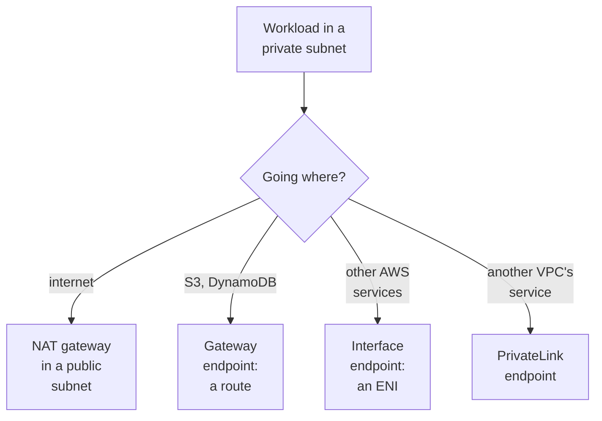

# NAT, endpoints and PrivateLink

> **Status: AI draft, 2026-11-16.** Not yet verified by me. Commands are from the official documentation and were not run; output is illustrative.

## In one line

Private subnets reach the internet through a NAT gateway, which is billed per hour and per gigabyte processed. VPC endpoints reach AWS services privately instead: gateway endpoints (S3, DynamoDB) are route-table entries and free, interface endpoints (most other services) are network interfaces in your subnets. PrivateLink uses the same mechanism to expose your own service to other VPCs.

## The plain idea

A server in a private subnet still needs to call things outside: package mirrors, third-party APIs, and above all AWS's own services such as S3, ECR and Secrets Manager. The simplest way out is a **NAT gateway**: a managed device in a public subnet that sends traffic out using its own public address ([Routing and NAT](../networking/routing-and-nat.md)).

But sending traffic for S3 or ECR out to the public internet and back, just to reach a service in the same region, is wasteful: it costs NAT processing charges and depends on the NAT path. **VPC endpoints** give private subnets a direct, private road to AWS services, without the NAT. **PrivateLink** is the same road built for your own services, so another VPC or account can call your API without the two networks being connected at all.

## How it works

### Three ways out of a private subnet



### NAT gateway

- Lives in **one** public subnet and AZ, with an Elastic IP for its public address. Private subnets' route tables send `0.0.0.0/0` to it.
- Managed and scales automatically; no instances to patch.
- **Cost:** an hourly charge per gateway plus a charge per gigabyte processed (see the VPC pricing page). Heavy traffic to S3, ECR or logging services through NAT is a common, avoidable cost ([Cost optimisation](../operations/cost-optimisation.md)).
- **Resilience:** an AZ failure takes its NAT gateway with it. Use one per AZ, with each private subnet routed to the NAT in its own AZ.
- **Connection limits:** each NAT address supports a limited number of simultaneous connections to any single destination; a busy service hitting one endpoint can exhaust it. The `ErrorPortAllocation` metric shows it; adding addresses to the NAT gateway raises the limit. Check the NAT gateway documentation for the current figures.

**When a NAT gateway is deleted**, the routes pointing at it stay, in a `blackhole` state. Because a blackhole route still matches `0.0.0.0/0`, traffic is dropped rather than going anywhere else: every outbound connection from those subnets times out.

### Gateway endpoints: S3 and DynamoDB

A **gateway endpoint** adds a route to your chosen route tables. The destination is a **prefix list**: an AWS-managed list of the service's address ranges in that region. Traffic to S3 then goes straight to S3 over AWS's network.

- No hourly or data charge.
- Same-region service only.
- Not reachable from outside the VPC (on-premises or peered VPCs cannot use it).

### Interface endpoints (PrivateLink to AWS services)

An **interface endpoint** creates an elastic network interface with a private IP in each subnet you choose. With **private DNS** enabled, the service's normal name (such as `secretsmanager.ap-south-1.amazonaws.com`) resolves inside the VPC to those private addresses, so applications need no code change.

- Hourly charge per endpoint per AZ, plus a per-gigabyte charge.
- Protected by a **security group**: allow HTTPS (443) from your workloads.
- Reachable from peered VPCs and on-premises networks through the right routing and DNS.
- Many services need several: pulling images from ECR uses the `ecr.api` and `ecr.dkr` interface endpoints **and** the S3 gateway endpoint, because image layers come from S3.

### Endpoint policies

An endpoint can carry an **endpoint policy**, a resource-style policy limiting what can be done through it, for example "only these buckets". Bucket policies can in turn require that requests arrive through a specific endpoint with the `aws:SourceVpce` condition, which is a strong way to keep data inside the network ([S3 security](../aws-services/s3-security.md)).

### PrivateLink for your own services

To offer a service to other VPCs or accounts privately, put it behind a Network Load Balancer and create an **endpoint service**. Consumers create an interface endpoint to it in their own VPC.

- Traffic flows one way: consumers can call the service; the provider cannot reach into consumers' networks.
- The two VPCs' address ranges may overlap, because nothing is routed between them.
- The provider can require approval for each consumer.

Many SaaS vendors and managed databases are offered this way.

## A concrete example

The monthly bill shows the NAT gateway as one of the largest network costs, mostly "data processed". Workloads are EKS nodes in private subnets.

1. Flow logs or NAT metrics show most traffic going to S3 and ECR addresses: container image pulls and log uploads.
2. Add an **S3 gateway endpoint** to the private route tables. Free, and S3 traffic stops passing through NAT.
3. Add **interface endpoints** for `ecr.api`, `ecr.dkr`, and the logging service, with private DNS on and a security group allowing 443 from the nodes.
4. Image pulls now go through the endpoints (manifests through ECR's interface endpoints, layers through the S3 gateway endpoint).
5. NAT data processed drops sharply. The interface endpoints have their own hourly cost, so compare before and after on the bill rather than assuming savings.

## Why not just...?

- **...route private subnets straight to the internet gateway?** Resources without public addresses cannot use it, and giving them public addresses exposes them. NAT keeps them unreachable from outside.
- **...use one NAT gateway to save money?** Fine for non-production, but an AZ failure then cuts outbound access everywhere, and traffic from other AZs pays cross-AZ charges.
- **...peer every VPC that needs one service?** Peering connects whole networks, needs non-overlapping ranges, and opens far more than one API. PrivateLink exposes just the service ([Peering, Transit Gateway and VPN](vpc-connectivity.md)).

## Commands to know

| Command | What it does |
|---|---|
| `aws ec2 describe-nat-gateways --query 'NatGateways[].[NatGatewayId,State,SubnetId,ConnectivityType]' --output table` | NAT gateways, their state and subnet. |
| `aws ec2 describe-route-tables --filters Name=route.state,Values=blackhole` | Route tables containing blackhole routes. |
| `aws ec2 describe-vpc-endpoints --query 'VpcEndpoints[].[VpcEndpointId,ServiceName,VpcEndpointType,State]' --output table` | Endpoints in the account. |
| `aws ec2 describe-prefix-lists` | Managed prefix lists, including the S3 and DynamoDB ones used by gateway endpoints. |
| `aws ec2 create-vpc-endpoint --vpc-id vpc-0123456789abcdef0 --service-name com.amazonaws.ap-south-1.s3 --route-table-ids <rtb-id>` | Create an S3 gateway endpoint. |
| `aws ec2 describe-vpc-endpoint-services --service-names com.amazonaws.ap-south-1.ecr.dkr` | Details of an endpoint service, including which AZs it supports. |

A route table after a NAT gateway was deleted, illustrative:

```json
{ "DestinationCidrBlock": "0.0.0.0/0", "NatGatewayId": "<deleted-nat-id>", "State": "blackhole" }
```

## How it breaks

| Symptom | Layer | Check | Likely cause |
|---|---|---|---|
| All outbound calls from private subnets time out | NAT path | Route state; NAT gateway state | NAT deleted (blackhole route) or failed AZ |
| Lambda in a VPC cannot reach AWS APIs | Path to services | Route table, endpoints, security groups | No NAT and no interface endpoint for that service |
| Image pulls hang with ECR endpoints in place | Endpoints | S3 gateway endpoint present? Endpoint security groups allow 443? | Missing S3 gateway endpoint for layers, or blocked ENIs |
| Service name still resolves to public addresses | Private DNS | `dig <service-name>` from inside the VPC | Private DNS off on the endpoint, or VPC DNS attributes off |
| `AccessDenied` only through the endpoint | Endpoint policy | The endpoint policy | Policy too narrow for that bucket or action |
| NAT bill high | Traffic pattern | Flow logs, NAT metrics | AWS-service traffic going through NAT instead of endpoints |
| Intermittent connection failures to one popular destination | NAT ports | `ErrorPortAllocation` metric | Too many simultaneous connections to one destination per NAT address |

## Interview questions

**1. Why do private subnets need a NAT gateway, and where does it live?**

<details markdown="1">
<summary>Answer</summary>

- Private resources have no public address, so they cannot use the internet gateway directly.
- A NAT gateway in a public subnet translates their outbound traffic to its own public address.
- Use one per AZ for resilience.

</details>

**2. What is the difference between a gateway endpoint and an interface endpoint?**

<details markdown="1">
<summary>Answer</summary>

- Gateway endpoints (S3, DynamoDB) are route-table entries to a prefix list; free; usable only from inside the VPC.
- Interface endpoints are network interfaces in your subnets with private IPs and private DNS; charged hourly and per GB; protected by security groups; reachable over peering and VPN.

</details>

**3. A NAT gateway was deleted by mistake. What do workloads see, and why?**

<details markdown="1">
<summary>Answer</summary>

- Outbound connections time out.
- The route to the NAT remains as a blackhole; it still matches `0.0.0.0/0`, so packets are dropped instead of using another path.
- Fix by recreating the NAT and pointing the routes at it; endpoints for AWS services reduce the dependency.

</details>

**4. How would you reduce a high NAT gateway bill?**

<details markdown="1">
<summary>Answer</summary>

- Find what the traffic is (flow logs, metrics).
- Add an S3 gateway endpoint (free) and interface endpoints for heavy AWS services such as ECR and logging.
- Reduce or compress the traffic itself, and compare the endpoints' own cost.

</details>

**5. What is PrivateLink, and how is it different from VPC peering?**

<details markdown="1">
<summary>Answer</summary>

- PrivateLink exposes one service (behind an NLB) to consumers through interface endpoints in their VPCs.
- It is one-directional, needs no routing between the networks, and works with overlapping ranges.
- Peering connects whole VPCs both ways and needs non-overlapping ranges.

</details>

**6. How do you make sure an S3 bucket is only used from inside your VPC?**

<details markdown="1">
<summary>Answer</summary>

- Bucket policy denying requests whose `aws:SourceVpce` is not your endpoint.
- An endpoint policy limiting what the endpoint may access.
- Block public access, and test that legitimate paths still work before enforcing.

</details>

## Try it

*Untested: written from documentation.* A paper exercise; reading endpoints and route states with the CLI is free.

**Step 1.** For a private EKS cluster with no NAT gateway, list every endpoint the nodes need to start pods from ECR images and send logs to the cloud's logging service. Mark each as gateway or interface.

**Step 2.** Draw the route table and DNS answers a node sees for `<account>.dkr.ecr.ap-south-1.amazonaws.com` with and without private DNS on the endpoint.

**Step 3.** With an AWS account, check whether any blackhole routes exist:

```bash
aws ec2 describe-route-tables --filters Name=route.state,Values=blackhole --query 'RouteTables[].RouteTableId'
```

## Zoom out

Outbound design decides cost, resilience and data paths for everything in private subnets: EKS nodes ([Networking with the VPC CNI](../eks/vpc-cni.md)), functions in a VPC ([Lambda networking and permissions](../serverless/lambda-networking-and-permissions.md)) and anything pulling images ([ECR](../aws-services/ecr.md)). The blackhole behaviour is a good example of longest-prefix routing producing silent drops. The principle to carry: send AWS-service traffic through endpoints, internet traffic through a NAT per AZ, and know which is which.

## Sources

- [Amazon VPC documentation: NAT gateways](https://docs.aws.amazon.com/vpc/latest/userguide/vpc-nat-gateway.html)
- [Amazon VPC documentation: troubleshoot NAT gateways](https://docs.aws.amazon.com/vpc/latest/userguide/nat-gateway-troubleshooting.html)
- [AWS PrivateLink documentation: gateway endpoints](https://docs.aws.amazon.com/vpc/latest/privatelink/gateway-endpoints.html)
- [AWS PrivateLink documentation: interface endpoints](https://docs.aws.amazon.com/vpc/latest/privatelink/create-interface-endpoint.html)
- [AWS PrivateLink documentation: share your services through PrivateLink](https://docs.aws.amazon.com/vpc/latest/privatelink/privatelink-share-your-services.html)
- [Amazon ECR documentation: interface VPC endpoints](https://docs.aws.amazon.com/AmazonECR/latest/userguide/vpc-endpoints.html)
- [Amazon VPC pricing](https://aws.amazon.com/vpc/pricing/)
