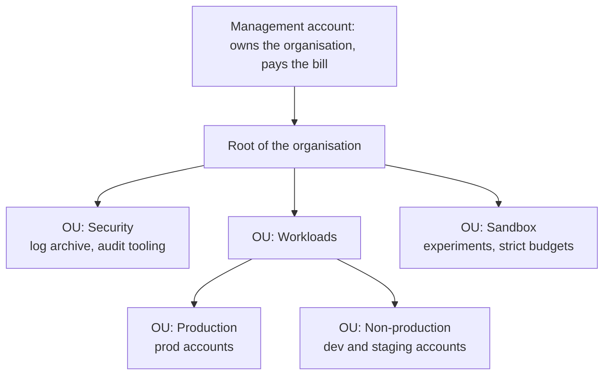

# Organizations, SCPs and multi-account

> **Status: AI draft, 2026-11-16.** Not yet verified by me. Commands are from the official documentation and were not run; output is illustrative.

## In one line

AWS Organizations groups accounts into a tree of organisational units under one management account, with consolidated billing. Service control policies (SCPs) set the maximum permissions for every identity in member accounts: they never grant anything, they only cap what IAM policies can allow.

## The plain idea

Once a company has more than a few AWS accounts, it needs someone to own them all: create new ones, pay one bill, and set rules that no account can break, however its own administrators configure it. That is **AWS Organizations**.

The rules are **service control policies**. Picture a ceiling over each account. Inside, IAM policies decide what each person or role may do, but nobody can reach above the ceiling. An SCP that says "nothing may disable CloudTrail" holds even for an account's own administrator. The ceiling grants nothing by itself: an action must be both under the ceiling and allowed by IAM.

## How it works

### The tree



| Part | What it is |
|---|---|
| **Management account** | The account that created the organisation. It pays for every member and manages the structure. Keep workloads out of it. |
| **Member accounts** | Every other account. Each is fully isolated from the others by default. |
| **Root** | The top of the tree. Policies attached here apply to every member account. |
| **Organisational unit (OU)** | A folder of accounts and other OUs. Policies attached to an OU apply to everything below it. |

**Consolidated billing** combines usage across accounts on one bill, so volume discounts and Savings Plans can apply across the organisation ([Cost optimisation](../operations/cost-optimisation.md)).

### What an SCP does and does not do

- **Does:** limit the actions any IAM user or role in a member account can perform, including the member account's root user.
- **Does not:** grant permissions. With an SCP allowing S3 and no IAM policy allowing S3, nothing works.
- **Does not apply to:** the management account, or service-linked roles that AWS services use.
- **Inheritance:** an action must be allowed by the SCPs at every level from the root down to the account. A deny at any level wins.

By default every level has the `FullAWSAccess` SCP attached, which allows everything, so nothing changes until you attach a more restrictive policy. Teams use SCPs in one of two styles: **deny lists** (keep `FullAWSAccess`, add `Deny` statements for specific dangers) or **allow lists** (replace it with a list of allowed services). Deny lists are easier to live with.

**Resource control policies** (RCPs) are a newer, related policy type that caps the permissions on resources in member accounts, such as who outside the organisation may access their S3 buckets. SCPs cap what your identities can do; RCPs cap what can be done to your resources.

### Where SCPs sit in policy evaluation

When a role in a member account makes a request, AWS checks every policy type ([IAM policies and how they are evaluated](iam-policies.md)). An explicit deny anywhere wins. After that the request needs an allow from the SCPs **and** from the identity's own policies (and from any permissions boundary or session policy in play).

### Working across accounts

People and pipelines do not get users in every account. They sign in once and **assume a role** in the target account, whose trust policy names who may assume it ([IAM roles and STS](iam-roles-and-sts.md)). IAM Identity Center automates this for people with permission sets ([Federation and SSO](federation-and-sso.md)).

### A common account layout

| Account | Purpose |
|---|---|
| Management | Organisation, billing, SCPs. Nothing else. |
| Log archive | Central, write-only copies of CloudTrail and other logs, so a compromised workload account cannot erase its tracks. |
| Security or audit | Security tooling with read access across accounts: GuardDuty, Security Hub delegated administrator ([GuardDuty, Security Hub and Inspector](../aws-services/security-services.md)). |
| Shared services | CI runners, artifact registries, central DNS or networking. |
| Workload accounts | One or more per application and environment, for example `sample-app-dev`, `sample-app-prod`. |
| Sandbox | Free experimentation with tight budgets and SCPs. |

AWS Control Tower can build this structure (a **landing zone**) with preconfigured guardrails.

## A concrete example

The security team wants three rules for every workload account: no one may disable CloudTrail, accounts may not leave the organisation, and only two regions may be used.

```json
{
  "Version": "2012-10-17",
  "Statement": [
    {
      "Sid": "ProtectCloudTrail",
      "Effect": "Deny",
      "Action": ["cloudtrail:StopLogging", "cloudtrail:DeleteTrail", "cloudtrail:UpdateTrail"],
      "Resource": "*"
    },
    {
      "Sid": "StayInTheOrganisation",
      "Effect": "Deny",
      "Action": "organizations:LeaveOrganization",
      "Resource": "*"
    },
    {
      "Sid": "AllowedRegionsOnly",
      "Effect": "Deny",
      "NotAction": ["iam:*", "organizations:*", "route53:*", "cloudfront:*", "sts:*", "support:*"],
      "Resource": "*",
      "Condition": {
        "StringNotEquals": { "aws:RequestedRegion": ["ap-south-1", "us-east-1"] }
      }
    }
  ]
}
```

1. Attach it to the Workloads OU. Every account below inherits it.
2. The region statement uses `NotAction` to exempt global services, whose calls are made through a fixed region and would otherwise be blocked. Check the current list of global services in the AWS example policies before relying on this one.
3. Test it in a sandbox OU first: an over-broad deny SCP can break every account under it at once.
4. An administrator in a workload account now tries `cloudtrail:StopLogging` and gets `AccessDenied`, even with full administrator permissions, and the error mentions a service control policy.

## Why not just...?

- **...rely on IAM policies inside each account?** An account administrator can change those. SCPs are set from outside the account, so they hold even when an account's own admin is careless or compromised.
- **...put workloads in the management account?** SCPs do not apply to it, and it controls the whole organisation. Anything compromised there is compromised everywhere.
- **...use allow-list SCPs to be as strict as possible?** Every new service then needs an SCP change before anyone can use it, and the policy size limits make long lists awkward. Deny lists for real dangers are usually the better balance.

## Commands to know

These run in the management account, or a delegated administrator account.

| Command | What it does |
|---|---|
| `aws organizations describe-organization` | The organisation's ID and management account. |
| `aws organizations list-accounts` | Every account and its status. |
| `aws organizations list-roots`, then `list-organizational-units-for-parent --parent-id <id>` | Walk the OU tree. |
| `aws organizations list-policies --filter SERVICE_CONTROL_POLICY` | All SCPs. |
| `aws organizations list-policies-for-target --target-id <ou-or-account-id> --filter SERVICE_CONTROL_POLICY` | SCPs attached directly to one OU or account (inherited ones are not shown). |
| `aws organizations describe-policy --policy-id <id>` | One SCP's document. |
| `aws sts assume-role --role-arn arn:aws:iam::123456789012:role/OrganizationAccountAccessRole --role-session-name admin` | Step into a member account through the role that Organizations creates in accounts it creates. |

## How it breaks

| Symptom | Layer | Check | Likely cause |
|---|---|---|---|
| `AccessDenied ... with an explicit deny in a service control policy` | SCP | SCPs on the account and every parent OU | A deny SCP matches; the IAM policy cannot override it |
| Admin role can do nothing in a new account | SCP allow list | Does every level allow the service? | An allow-list SCP somewhere in the path omits the service |
| Global actions (IAM, Route 53) fail after a region restriction | SCP conditions | The region-deny statement | Global services not exempted with `NotAction` |
| SCP has no effect on one account | Scope | Is it the management account? | SCPs do not apply to the management account |
| A workload account's logs were deleted | Log design | Where CloudTrail logs are stored | Logs kept only in the same account, with no SCP protection |

## Interview questions

**1. What is a service control policy, and does it grant permissions?**

<details markdown="1">
<summary>Answer</summary>

- A policy attached to the organisation root, an OU or an account that sets the maximum permissions for identities in member accounts.
- It never grants: an action must also be allowed by IAM policies.
- An explicit deny in any SCP on the path wins.

</details>

**2. Who is affected by SCPs, and who is not?**

<details markdown="1">
<summary>Answer</summary>

- All IAM users and roles in member accounts, including the member account's root user.
- Not the management account, and not service-linked roles.
- That is a reason to keep workloads out of the management account.

</details>

**3. How do SCPs combine across OUs?**

<details markdown="1">
<summary>Answer</summary>

- An action must be allowed at every level from the root down to the account.
- A deny at any level blocks it for everything below.
- Each level starts with `FullAWSAccess` unless it is replaced.

</details>

**4. Design an account structure for a company with two products, each with dev and prod.**

<details markdown="1">
<summary>Answer</summary>

- A management account with nothing else in it.
- Security OU: log archive and security tooling accounts.
- Workloads OU split into production and non-production, with one account per product per environment.
- A sandbox OU; SCP guardrails per OU; IAM Identity Center for access.

</details>

**5. How do you restrict an organisation to two regions without breaking global services?**

<details markdown="1">
<summary>Answer</summary>

- A deny SCP with a condition on `aws:RequestedRegion` not in the allowed list.
- Use `NotAction` to exempt global services such as IAM, Organizations, Route 53, CloudFront and STS.
- Test in a sandbox OU before attaching broadly.

</details>

**6. An administrator in a member account gets `AccessDenied` for an action their policy allows. How do you investigate?**

<details markdown="1">
<summary>Answer</summary>

- Read the error: it usually names the policy type, such as a service control policy.
- Check SCPs on the account and every parent OU from the management account.
- Also check permissions boundaries, session policies and resource policies ([Least privilege and AccessDenied](least-privilege-and-accessdenied.md)).

</details>

## Try it

*Untested: written from documentation.* SCPs need an organisation, so this is a paper exercise.

**Step 1.** Write a deny-list SCP that stops anyone deleting VPC flow logs (`ec2:DeleteFlowLogs`) and disabling GuardDuty (`guardduty:DeleteDetector`).

**Step 2.** Decide where to attach it: root, an OU, or single accounts. Write one sentence on why.

**Step 3.** For each of these, predict allowed or denied: an account administrator deleting flow logs in a workload account; the same in the management account; a role in a workload account creating flow logs.

## Zoom out

Organizations and SCPs are the outermost layer of AWS access control; inside each account, IAM policies, roles and permissions boundaries do the detailed work ([IAM policies and how they are evaluated](iam-policies.md)). A multi-account layout is also the foundation for central logging, security tooling and cost reporting. The principle to carry: put guardrails where the people they constrain cannot remove them.

## Sources

- [AWS Organizations documentation: terminology and concepts](https://docs.aws.amazon.com/organizations/latest/userguide/orgs_getting-started_concepts.html)
- [AWS Organizations documentation: service control policies](https://docs.aws.amazon.com/organizations/latest/userguide/orgs_manage_policies_scps.html)
- [AWS Organizations documentation: example SCPs](https://docs.aws.amazon.com/organizations/latest/userguide/orgs_manage_policies_scps_examples.html)
- [AWS Organizations documentation: resource control policies](https://docs.aws.amazon.com/organizations/latest/userguide/orgs_manage_policies_rcps.html)
- [IAM documentation: policy evaluation logic](https://docs.aws.amazon.com/IAM/latest/UserGuide/reference_policies_evaluation-logic.html)
- [AWS whitepaper: organizing your AWS environment using multiple accounts](https://docs.aws.amazon.com/whitepapers/latest/organizing-your-aws-environment/organizing-your-aws-environment.html)
