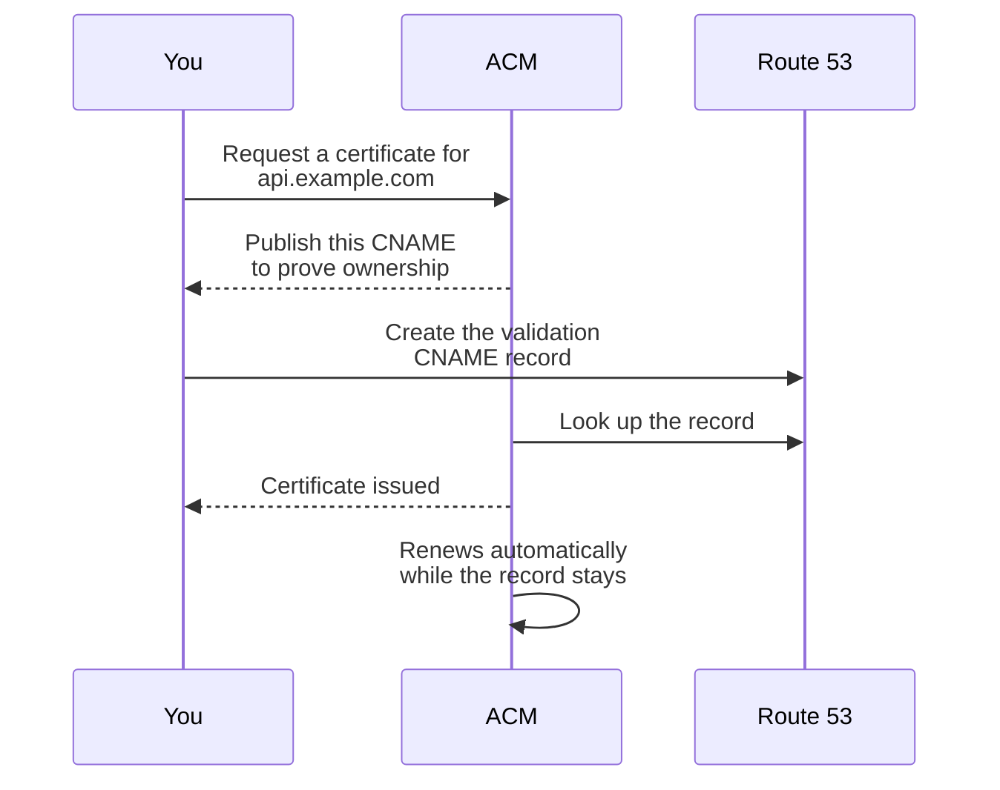

# Route 53 and ACM

> **Status: AI draft, 2026-11-16.** Not yet verified by me. Commands are from the official documentation and were not run; output is illustrative.

## In one line

Route 53 hosts DNS zones: public zones answer the internet, private zones answer only inside associated VPCs, alias records point names (even the zone apex) at AWS resources, and routing policies with health checks steer traffic. ACM issues and automatically renews TLS certificates for AWS services, validated through a DNS record; certificates are regional, and CloudFront's must be in `us-east-1`.

## The plain idea

The general DNS mechanics are on [DNS](../networking/dns.md). **Route 53** is AWS's authoritative DNS service: you keep your zones there, and it answers queries for them from servers around the world. It adds a few AWS-specific abilities: names that follow AWS resources whose addresses change, answers that depend on health or location, and zones visible only inside your VPCs.

Certificates go with names. **ACM** (AWS Certificate Manager) issues the TLS certificates that load balancers, CloudFront and API Gateway present ([TLS and certificates](../networking/tls.md)). It proves you own the domain by asking you to publish a DNS record, and then renews the certificate before it expires, as long as that record stays in place. Most expired-certificate outages simply cannot happen with it.

## How it works

### Hosted zones

| Zone type | Answers | Used for |
|---|---|---|
| **Public hosted zone** | Anyone on the internet | `example.com` and its public records |
| **Private hosted zone** | Only queries from VPCs associated with it, through the VPC resolver | Internal names such as `db.internal.example.com` |

For a public zone to take effect, the domain's registrar must list the zone's four Route 53 name servers as the domain's `NS` records. That is **delegation**; until it is done, Route 53 answers nobody.

Using the same name in a public and a private zone gives **split-horizon** DNS: inside the VPC, `api.example.com` resolves to a private address; outside, to a public one.

### Alias records

An **alias record** is a Route 53 extension that points a name at an AWS resource (a load balancer, a CloudFront distribution, an API Gateway, an S3 website, another record) instead of at an address.

- It follows the resource's changing addresses automatically.
- It works at the **zone apex** (`example.com` itself), where a CNAME is not allowed.
- Route 53 does not charge for queries to alias records that point at AWS resources.
- Its TTL comes from the target, not from your setting.

### Routing policies

| Policy | Use it for |
|---|---|
| Simple | One resource |
| Weighted | Gradual migrations and canaries between two endpoints |
| Latency | Several regions; send users to the fastest |
| Failover | Active-passive disaster recovery ([Backup and disaster recovery](../operations/backup-and-dr.md)) |
| Geolocation, geoproximity | Content or compliance by location |
| Multivalue answer | Up to several healthy addresses, as simple client-side balancing |

**Health checks** test an endpoint (HTTP, HTTPS or TCP) from several locations, or watch a CloudWatch alarm, or combine other checks. Records linked to a failing check stop being returned. DNS failover is still limited by caching: clients keep the old answer until its TTL expires.

### Resolving between VPCs and on-premises

Each VPC uses the **Route 53 Resolver** ([VPC basics](vpc-basics.md)). To let on-premises servers resolve private zones, create an **inbound endpoint**; to let VPCs resolve on-premises names, create an **outbound endpoint** with **forwarding rules** for those domains ([Peering, Transit Gateway and VPN](vpc-connectivity.md)).

### ACM



- **DNS validation** is the recommended method: one CNAME per name, and it keeps renewals automatic. Email validation also exists but needs a human for every renewal.
- **Public certificates** from ACM have no charge when used with integrated services; the private key stays in AWS and is used by the load balancer, CloudFront or API Gateway. Check the current ACM documentation for export options and pricing.
- **Certificates are regional.** A load balancer in `ap-south-1` needs a certificate requested in `ap-south-1`. **CloudFront** uses certificates from `us-east-1` only.
- A certificate can cover several names (SANs) and wildcards such as `*.example.com`.
- **AWS Private CA** issues private certificates for internal services and mTLS.

## A concrete example

Move `api.example.com` from an old load balancer to a new one with no downtime and a rollback.

1. Request an ACM certificate for `api.example.com` in the new load balancer's region; add the validation CNAME to the public zone. It is issued within minutes.
2. Attach it to the new load balancer's HTTPS listener, and test with `curl --resolve api.example.com:443:<new-lb-ip> https://api.example.com/` before DNS changes ([curl -v, line by line](../networking/curl-v-annotated.md)).
3. Days before, lower the record's TTL so changes spread quickly. (Alias records use the target's TTL.)
4. Create two weighted alias records for `api.example.com`: old load balancer weight 90, new weight 10. Watch errors and latency on the new one.
5. Shift to 50/50, then 0/100. Rollback at any step is a weight change.
6. Remove the old record and, later, the old load balancer.

## Why not just...?

- **...use a CNAME to the load balancer's DNS name?** Fine for subdomains, but a CNAME is not allowed at the zone apex, and each CNAME adds a lookup. An alias record works everywhere and costs nothing for AWS targets.
- **...rely on DNS failover for instant recovery?** Clients and resolvers cache answers for the TTL, and some ignore short TTLs. DNS failover takes minutes; for faster failover, use load balancers or Global Accelerator in front ([ALB and NLB](load-balancers.md)).
- **...upload certificates bought elsewhere to the load balancer?** It works, but renewal becomes your job again, and forgetting it is a classic outage. ACM-issued certificates renew themselves.

## Commands to know

| Command | What it does |
|---|---|
| `aws route53 list-hosted-zones` | Zones, with public or private flag. |
| `aws route53 list-resource-record-sets --hosted-zone-id <zone-id> --query "ResourceRecordSets[?Name=='api.example.com.']"` | The records for one name, including routing policy and alias target. |
| `aws route53 get-hosted-zone --id <zone-id>` | The zone's name servers, to compare with the registrar's `NS` records. |
| `aws route53 test-dns-answer --hosted-zone-id <zone-id> --record-name api.example.com --record-type A` | What Route 53 would answer, without caches in between. |
| `aws acm list-certificates --region ap-south-1` | Certificates in a region. |
| `aws acm describe-certificate --certificate-arn <arn>` | Names, status, validation records, renewal eligibility and which resources use it. |
| `dig NS example.com`, `dig @<route53-ns> api.example.com` | Check delegation and ask Route 53 directly ([DNS](../networking/dns.md)). |

## How it breaks

| Symptom | Layer | Check | Likely cause |
|---|---|---|---|
| New public zone records not visible anywhere | Delegation | `dig NS example.com` against the zone's name servers | Registrar still points at the old name servers |
| Private zone name does not resolve in a VPC | Association, VPC DNS | Zone's associated VPCs; `enableDnsSupport` and `enableDnsHostnames` | VPC not associated, or DNS attributes off |
| Different answers inside and outside | Split-horizon | Query from both sides | Public and private zones with the same name |
| Certificate stuck in `Pending validation` | Validation | `describe-certificate` for the CNAME | Validation record missing or wrong |
| Certificate failed to renew | Renewal | Validation record still present? | Record deleted, or email validation not answered |
| CloudFront cannot find your certificate | Region | Where the certificate was requested | Must be in `us-east-1` |
| Failover did not happen | Health checks | Health check status; record configuration | Records not linked to a health check, or checks probing the wrong path |

## Interview questions

**1. What is an alias record, and how does it differ from a CNAME?**

<details markdown="1">
<summary>Answer</summary>

- A Route 53 record that points at an AWS resource and returns its current addresses.
- It works at the zone apex, where a CNAME cannot.
- Queries to AWS targets are free, and the TTL follows the target.

</details>

**2. What is the difference between a public and a private hosted zone?**

<details markdown="1">
<summary>Answer</summary>

- A public zone answers the internet once delegated at the registrar.
- A private zone answers only queries from associated VPCs.
- Both with the same name give split-horizon DNS.

</details>

**3. Name Route 53 routing policies and a use for each.**

<details markdown="1">
<summary>Answer</summary>

- Weighted for gradual migrations and canaries.
- Latency for multi-region performance.
- Failover with health checks for active-passive DR.
- Geolocation for location-based content or compliance; simple for one resource.

</details>

**4. How does ACM validate and renew certificates?**

<details markdown="1">
<summary>Answer</summary>

- DNS validation: you publish a CNAME that proves domain control.
- ACM checks it, issues the certificate, and renews automatically before expiry while the record remains.
- Email validation needs manual approval at each renewal.

</details>

**5. Why does a CloudFront distribution not see a certificate you created in `ap-south-1`?**

<details markdown="1">
<summary>Answer</summary>

- ACM certificates are regional.
- CloudFront only uses certificates from `us-east-1`.
- Request or import the certificate there.

</details>

**6. How would you migrate a domain to a new load balancer with a safe rollback?**

<details markdown="1">
<summary>Answer</summary>

- Issue the certificate and test the new endpoint directly with `curl --resolve`.
- Lower TTLs ahead of time.
- Use weighted records to shift traffic in steps, watching metrics.
- Roll back by changing weights; remove the old target when stable.

</details>

## Try it

*Untested: written from documentation.* The DNS part runs without an AWS account.

**Step 1.** Find who answers for a domain and confirm delegation.

```bash
dig +short NS example.com
dig +short @$(dig +short NS example.com | head -1) example.com A
```

**Step 2.** On paper, write the records for `example.com` (apex) and `www.example.com` pointing at one load balancer, using alias records, and a weighted pair for `api.example.com` sending 10% to a new load balancer.

**Step 3.** Write the steps to request an ACM certificate for `example.com` and `*.example.com` for a load balancer in `ap-south-1` and for CloudFront, and say how many certificates and in which regions.

## Zoom out

Route 53 and ACM are the first two hops of [One request, end to end](../start/request-path.md): name to address, and the certificate that proves it. Both build on the general mechanisms in [DNS](../networking/dns.md) and [TLS and certificates](../networking/tls.md), and both are also where many outages begin: a deleted record, an expired certificate, a missed delegation. The principle to carry: automate certificate renewal, keep TTLs short before changes, and verify DNS from where users actually are.

## Sources

- [Route 53 documentation: working with hosted zones](https://docs.aws.amazon.com/Route53/latest/DeveloperGuide/hosted-zones-working-with.html)
- [Route 53 documentation: choosing between alias and non-alias records](https://docs.aws.amazon.com/Route53/latest/DeveloperGuide/resource-record-sets-choosing-alias-non-alias.html)
- [Route 53 documentation: choosing a routing policy](https://docs.aws.amazon.com/Route53/latest/DeveloperGuide/routing-policy.html)
- [Route 53 documentation: creating health checks and configuring DNS failover](https://docs.aws.amazon.com/Route53/latest/DeveloperGuide/dns-failover.html)
- [ACM documentation: DNS validation](https://docs.aws.amazon.com/acm/latest/userguide/dns-validation.html)
- [ACM documentation: managed certificate renewal](https://docs.aws.amazon.com/acm/latest/userguide/managed-renewal.html)
- [CloudFront documentation: requirements for using SSL/TLS certificates](https://docs.aws.amazon.com/AmazonCloudFront/latest/DeveloperGuide/cnames-and-https-requirements.html)
