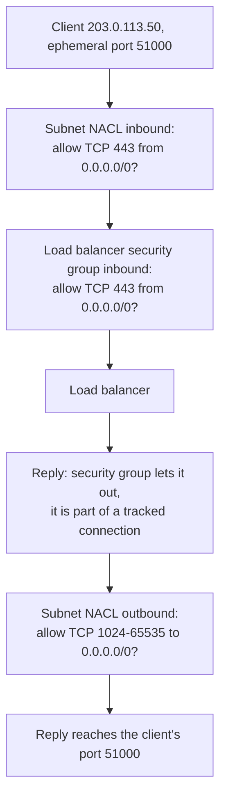

# Security groups and NACLs

> **Status: AI draft, 2026-11-16.** Not yet verified by me. Commands are from the official documentation and were not run; output is illustrative.

## In one line

Security groups are stateful, allow-only firewalls on each network interface, and can reference other security groups; network ACLs are stateless, ordered allow-and-deny rules on each subnet boundary. Because NACLs are stateless, return traffic to ephemeral ports must be allowed explicitly, which is the most common NACL mistake.

## The plain idea

AWS gives you two firewalls in two places. The **security group** is a guard at each server's own door: it remembers who it let in, so the reply goes back out without a separate rule. The **network ACL** is a guard at the gate of a whole subnet, with a numbered checklist and no memory: every packet, in or out, is checked again, including replies.

Most teams do almost all their filtering with security groups and leave NACLs at their permissive default, using them only for broad subnet-level blocks. Knowing why ("stateful" against "stateless", from [Firewalls and connection tracking](../networking/firewalls.md)) is a favourite interview question.

## How it works

### Side by side

| | Security group | Network ACL |
|---|---|---|
| Applies to | Network interfaces (instances, load balancers, endpoints, Lambda in a VPC, pods with their own ENIs) | Every packet crossing the subnet boundary |
| State | **Stateful**: replies to allowed traffic are allowed automatically | **Stateless**: replies are checked like any other packet |
| Rule types | Allow only | Allow and deny |
| Evaluation | All rules together; any match allows | In number order, lowest first; first match wins |
| Source or destination | CIDR ranges, prefix lists, or **other security groups** | CIDR ranges only |
| Default for a new one | No inbound, all outbound allowed | A custom NACL denies everything until you add rules |
| Default one in each VPC | Allows all traffic from members of the same group, all outbound | Allows all traffic in and out |

### Security group references

A rule can name another security group instead of an address range: "allow port 5432 from members of `sg-app`". Any interface in `sg-app` may then connect, whatever its IP. When instances scale up and down or pods get new addresses, the rule stays right. This is the main reason security groups do most of the work.

### Tracing one request through both



The NACL outbound rule is the one people forget: the reply goes to the client's **ephemeral port**, not to 443. A NACL that allows only 443 out drops every reply, and the client sees a timeout. AWS recommends allowing ports 1024 to 65535 for return traffic, because different clients choose ephemeral ports from different ranges.

### Writing good security group rules

- Inbound only from what needs it: the load balancer's group to the app's group on the app port, the app's group to the database's group on the database port.
- Avoid `0.0.0.0/0` inbound except on internet-facing load balancers on 80 and 443. Never on SSH, RDP or database ports ([Hardening and benchmarks](../security/hardening-and-benchmarks.md)).
- Outbound: the default allows all. Restricting egress is stronger but must include DNS, NTP, AWS endpoints and anything the application calls.
- Use descriptions on rules, so the next person knows why each exists.

## A concrete example

A three-tier application: an internet-facing load balancer, app instances, and a database.

| Security group | Inbound rule | Why |
|---|---|---|
| `sg-lb` | TCP 443 from `0.0.0.0/0` | Public HTTPS |
| `sg-app` | TCP 8080 from `sg-lb` | Only the load balancer reaches the app |
| `sg-db` | TCP 5432 from `sg-app` | Only app instances reach the database |

1. New app instances join `sg-app` and can reach the database immediately; no address ranges to update.
2. Someone adds a NACL to the database subnets allowing inbound 5432 from the app subnets. Connections start timing out.
3. The NACL has no outbound rule for the replies to the app instances' ephemeral ports. Add outbound TCP 1024-65535 to the app subnets.
4. Better still: leave that NACL permissive, since the security groups already express the intent precisely.

## Why not just...?

- **...use NACLs for everything because they can deny?** Without state and without group references, every flow needs rules in both directions with address ranges that change as subnets change. They suit coarse blocks, such as denying a known bad range, not per-application rules.
- **...open `0.0.0.0/0` on the database port "for testing"?** Internet scanners find open database ports within minutes. Use a security group reference, or a bastion or Session Manager for access.
- **...allow everything inside the VPC with a `10.0.0.0/16` rule?** Then any compromised instance reaches every port of every other. Group-to-group rules on specific ports limit the blast radius.

## Commands to know

| Command | What it shows |
|---|---|
| `aws ec2 describe-security-groups --group-ids sg-0123456789abcdef0` | A group's inbound (`IpPermissions`) and outbound (`IpPermissionsEgress`) rules. |
| `aws ec2 describe-security-group-rules --filters Name=group-id,Values=sg-0123456789abcdef0` | One entry per rule, with rule IDs and descriptions. |
| `aws ec2 describe-network-interfaces --filters Name=group-id,Values=sg-0123456789abcdef0 --query 'NetworkInterfaces[].[NetworkInterfaceId,Description,PrivateIpAddress]'` | Everything currently using the group. |
| `aws ec2 describe-network-acls --filters Name=association.subnet-id,Values=subnet-0123456789abcdef0` | The NACL of a subnet, with its numbered entries. |
| `aws ec2 describe-security-groups --filters Name=ip-permission.cidr,Values=0.0.0.0/0 --query 'SecurityGroups[].[GroupId,GroupName]'` | Groups with a rule open to the world, a common audit check. |

A security group rule that references another group, illustrative:

```json
{
  "IpProtocol": "tcp", "FromPort": 5432, "ToPort": 5432,
  "UserIdGroupPairs": [{ "GroupId": "<sg-app-id>", "Description": "app tier to database" }]
}
```

A NACL entry list, illustrative. Rule `*` is the final implicit deny:

```text
Rule  Type    Protocol  Ports        Source       Allow/Deny
100   Custom  TCP       443          0.0.0.0/0    ALLOW
200   Custom  TCP       1024-65535   0.0.0.0/0    ALLOW
*     All     All       All          0.0.0.0/0    DENY
```

## How it breaks

| Symptom | Layer | Check | Likely cause |
|---|---|---|---|
| Connection times out to an instance | Security group | Inbound rules on the target's group: port and source | Port not allowed, or the source group or range is wrong |
| Requests arrive (seen in logs) but clients time out | NACL outbound | NACL outbound rules for ephemeral ports | Stateless NACL dropping replies |
| Works from one subnet, not another | NACL | NACLs on both subnets, both directions | A subnet with a custom NACL missing rules |
| Instance cannot reach the internet, though routes are fine | Security group egress | Outbound rules | Egress restricted without the needed destinations |
| Database reachable from the internet | Exposure | Rules with `0.0.0.0/0` | An overly open rule, possibly added for a test |
| Rule references a group but traffic still fails | Group membership | Is the source interface actually in that group? | The caller uses a different group, or traffic goes through NAT or a proxy with another address |

## Interview questions

**1. What is the difference between a security group and a network ACL?**

<details markdown="1">
<summary>Answer</summary>

- Security groups are stateful, allow-only, attached to network interfaces, and can reference other security groups.
- NACLs are stateless, have ordered allow and deny rules, apply at the subnet boundary, and use CIDR ranges.
- Security groups do most filtering; NACLs give coarse subnet-level controls.

</details>

**2. Why do NACLs need rules for ephemeral ports?**

<details markdown="1">
<summary>Answer</summary>

- NACLs are stateless, so a reply is checked like a new packet.
- Replies go to the client's ephemeral port, not to the service port.
- Without an outbound allow for the ephemeral range (AWS suggests 1024-65535), replies are dropped and clients time out.

</details>

**3. Why reference security groups instead of IP ranges?**

<details markdown="1">
<summary>Answer</summary>

- Membership, not addresses, decides access, so scaling, replacements and changing pod IPs need no rule changes.
- Rules describe intent ("app may reach database") rather than network layout.
- It keeps access narrow without maintaining address lists.

</details>

**4. How would you secure a three-tier application with security groups?**

<details markdown="1">
<summary>Answer</summary>

- Load balancer group: 443 from the internet.
- App group: app port from the load balancer group only.
- Database group: database port from the app group only.
- No SSH from the internet; use Session Manager.

</details>

**5. A client gets timeouts. You can see its requests in the server's access log. What is the likely cause?**

<details markdown="1">
<summary>Answer</summary>

- The requests arrive, so inbound rules are fine; the replies are being dropped.
- A NACL without an outbound rule for ephemeral ports, or asymmetric routing.
- Check NACL outbound rules on the server's subnet and inbound on the client's.

</details>

**6. How do you find security groups exposed to the internet?**

<details markdown="1">
<summary>Answer</summary>

- Filter security groups for rules with `0.0.0.0/0` or `::/0`, then check the ports.
- Use AWS Config rules or Security Hub controls that flag open ports ([GuardDuty, Security Hub and Inspector](../aws-services/security-services.md)).
- Check which interfaces use each group to judge the real exposure.

</details>

## Try it

*Untested: written from documentation.* A paper exercise, about 10 minutes.

**Step 1.** For the three-tier example, write each security group's inbound rules, using group references.

**Step 2.** Now add a custom NACL to the app subnets. Write the minimum inbound and outbound NACL rules so that the load balancer can reach the app on 8080, the app can reach the database on 5432, and every reply gets back.

**Step 3.** For each of these, predict the result: an engineer's laptop tries 5432 on the database; a new app instance joins `sg-app` and connects to the database; the app calls an external API over 443 with the default egress rules.

## Zoom out

Security groups and NACLs are where the general firewall ideas meet AWS: stateful against stateless, default deny, least privilege ([Firewalls and connection tracking](../networking/firewalls.md)). Kubernetes adds its own layer with NetworkPolicy and security groups for pods ([Pod networking and NetworkPolicy](../kubernetes/pod-networking-and-network-policy.md)). The principle to carry: express access as "which group may reach which group on which port", and remember that stateless rules must allow the reply.

## Sources

- [Amazon VPC documentation: security groups](https://docs.aws.amazon.com/vpc/latest/userguide/vpc-security-groups.html)
- [Amazon VPC documentation: security group rules](https://docs.aws.amazon.com/vpc/latest/userguide/security-group-rules.html)
- [Amazon VPC documentation: network ACLs](https://docs.aws.amazon.com/vpc/latest/userguide/vpc-network-acls.html)
- [Amazon VPC documentation: network ACL rules and ephemeral ports](https://docs.aws.amazon.com/vpc/latest/userguide/nacl-rules.html)
- [Amazon VPC documentation: compare security groups and network ACLs](https://docs.aws.amazon.com/vpc/latest/userguide/infrastructure-security.html)
- [Amazon EC2 documentation: security group connection tracking](https://docs.aws.amazon.com/AWSEC2/latest/UserGuide/security-group-connection-tracking.html)
