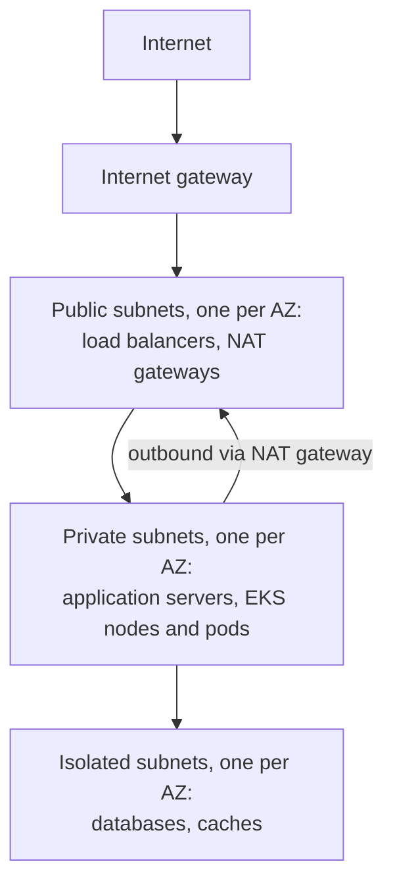

# VPC basics

> **Status: AI draft, 2026-11-16.** Not yet verified by me. Commands are from the official documentation and were not run; output is illustrative.

## In one line

A VPC is your private network in one region, with an address range you choose. Subnets slice it per Availability Zone, and each subnet's route table decides where its traffic can go: a subnet is "public" only because its route table sends `0.0.0.0/0` to an internet gateway.

## The plain idea

When you create servers in AWS, they need a network: addresses, a way to reach each other, and rules about what can reach the outside world. A **VPC** (virtual private cloud) is that network, built in software, isolated from every other customer's.

You give the VPC an address range, then divide it into **subnets**, each living in one Availability Zone. What makes a subnet public or private is not a setting with that name. It is one line in its route table: if traffic for "anywhere" goes to an **internet gateway**, resources there can be reached from the internet (if they also have a public address). If not, they cannot. Everything else about VPC networking follows from route tables and the firewall rules on top ([Security groups and NACLs](security-groups-and-nacls.md)).

## How it works

### The pieces

| Piece | What it is | Scope |
|---|---|---|
| **VPC** | An address range, such as `10.0.0.0/16`, and everything built in it | One region |
| **Subnet** | A slice of the VPC range, such as `10.0.32.0/19` | One Availability Zone |
| **Route table** | Rules for where traffic leaving a subnet goes | Associated with subnets; one per subnet at a time |
| **Internet gateway** (IGW) | The VPC's door to the internet, for resources with public addresses | One per VPC |
| **NAT gateway** | Lets private resources start connections out, without being reachable in ([NAT, endpoints and PrivateLink](nat-endpoints-privatelink.md)) | One AZ |
| **Elastic network interface** (ENI) | A virtual network card with a private address, attached to an instance, a load balancer, a Lambda function or a pod | One subnet |

The VPC range must be between `/16` and `/28` in size ([IP addresses and subnetting](../networking/ip-and-subnetting.md)). You can add secondary ranges later, but you cannot change the first one, so plan it so it never overlaps a network you may connect to ([Peering, Transit Gateway and VPN](vpc-connectivity.md)).

### Reserved addresses

AWS reserves 5 addresses in every subnet. In `10.0.1.0/24`:

| Address | Reserved for |
|---|---|
| `10.0.1.0` | Network address |
| `10.0.1.1` | The VPC router |
| `10.0.1.2` | The DNS server (by convention, the VPC base plus two) |
| `10.0.1.3` | Future use |
| `10.0.1.255` | Broadcast (not supported, but reserved) |

So a `/24` gives 251 usable addresses, and a `/28` only 11.

### Route tables decide public and private

Every route table has a `local` route for the VPC's own range, which cannot be removed: everything in the VPC can route to everything else in it. Then:

| Subnet type | Route for `0.0.0.0/0` | Result |
|---|---|---|
| **Public** | Internet gateway | Resources with a public IP can reach and be reached from the internet |
| **Private** | NAT gateway | Resources can start connections out, but cannot be reached from outside |
| **Isolated** | None | No internet at all; only VPC traffic and VPC endpoints |

A resource also needs a **public IPv4 address** (assigned at launch, or an **Elastic IP**) to use the internet gateway. AWS charges for public IPv4 addresses; check the VPC pricing page rather than relying on a remembered number.

### A standard three-tier layout



Only the load balancer is reachable from the internet. Applications sit in private subnets and reach out through NAT. Databases have no route to the internet at all. Each tier is repeated in at least two, usually three, AZs.

### DNS inside the VPC

The VPC has a built-in DNS resolver, the **Route 53 Resolver**, reachable at the VPC range's base plus two (such as `10.0.0.2`) and at `169.254.169.253`. Two VPC attributes control it: `enableDnsSupport` turns the resolver on, and `enableDnsHostnames` gives instances with public IPs public DNS names. Private hosted zones and VPC endpoints' private DNS depend on both being on ([Route 53 and ACM](route53-and-acm.md)).

### The default VPC

Each region in a new account has a default VPC with a public subnet in every AZ, so instances launched without choices get public addresses. It is convenient for experiments and a poor fit for production: use VPCs you design, and many organisations delete the default ones.

## A concrete example

Build a VPC for `sample-app` in `ap-south-1` across three AZs.

1. VPC: `10.0.0.0/16`.
2. Public subnets: `10.0.0.0/22`, `10.0.4.0/22`, `10.0.8.0/22` (1,019 usable addresses each after the 5 reserved), one per AZ. Route table: `10.0.0.0/16 local`, `0.0.0.0/0` to the internet gateway.
3. Private subnets: `10.0.32.0/19`, `10.0.64.0/19`, `10.0.96.0/19`, large because EKS pods take VPC addresses. Each has its own route table with `0.0.0.0/0` to the NAT gateway in the same AZ, so losing one AZ does not cut the others' internet.
4. Isolated subnets: `10.0.128.0/22`, `10.0.132.0/22`, `10.0.136.0/22` for the database, with only the local route.
5. Leave `10.0.140.0` upwards free for later.

## Why not just...?

- **...put everything in public subnets with public IPs?** Then every instance is one security-group mistake away from being exposed. Private subnets make "not reachable from the internet" the default.
- **...use one NAT gateway for all AZs to save money?** It works, but if that AZ fails, every private subnet loses its internet path, and cross-AZ traffic to the NAT costs extra. One per AZ is the resilient design; one in total is a cost choice for non-production.
- **...make subnets as small as possible?** EKS pods, Lambda functions in VPCs and load balancers all consume addresses. A subnet cannot be resized, only replaced.

## Commands to know

| Command | What it shows |
|---|---|
| `aws ec2 describe-vpcs --query 'Vpcs[].[VpcId,CidrBlock,IsDefault]' --output table` | VPCs and their ranges. |
| `aws ec2 describe-subnets --filters Name=vpc-id,Values=vpc-0123456789abcdef0 --query 'Subnets[].[SubnetId,AvailabilityZone,CidrBlock,AvailableIpAddressCount,MapPublicIpOnLaunch]' --output table` | Subnets, their AZ, range and free addresses. |
| `aws ec2 describe-route-tables --filters Name=association.subnet-id,Values=subnet-0123456789abcdef0` | The route table of one subnet. No result means it uses the VPC's main route table. |
| `aws ec2 describe-internet-gateways --filters Name=attachment.vpc-id,Values=vpc-0123456789abcdef0` | The VPC's internet gateway. |
| `aws ec2 describe-vpc-attribute --vpc-id vpc-0123456789abcdef0 --attribute enableDnsHostnames` | A DNS attribute. |

Part of a route table for a public subnet, illustrative:

```json
{
  "Routes": [
    { "DestinationCidrBlock": "10.0.0.0/16", "GatewayId": "local", "State": "active" },
    { "DestinationCidrBlock": "0.0.0.0/0", "GatewayId": "<internet-gateway-id>", "State": "active" }
  ]
}
```

## How it breaks

| Symptom | Layer | Check | Likely cause |
|---|---|---|---|
| Instance in a "public" subnet unreachable from the internet | Routes or address | Route table has `0.0.0.0/0` to the IGW? Instance has a public IP? | Missing route, no public IP, or a security group or NACL blocking |
| Private instance cannot reach the internet | NAT path | Private route table's default route; the NAT gateway's state and subnet | No route to NAT, NAT in a subnet without an IGW route, or NAT deleted |
| `InsufficientFreeAddressesInSubnet` or pods stuck without IPs | Sizing | `AvailableIpAddressCount` | Subnet too small |
| Private DNS names do not resolve | VPC DNS | `enableDnsSupport` and `enableDnsHostnames` | DNS attributes off |
| Subnet behaves differently from its neighbours | Route table association | Which route table it uses | Associated with a different table, or falling back to the main table |
| Cannot connect two VPCs | Address plan | Compare ranges | Overlapping CIDRs |

## Interview questions

**1. What makes a subnet public or private?**

<details markdown="1">
<summary>Answer</summary>

- Its route table: a public subnet sends `0.0.0.0/0` to an internet gateway.
- A private subnet sends it to a NAT gateway, or has no default route.
- Resources also need a public IP to be reachable through the internet gateway.

</details>

**2. How many usable addresses does a `/24` subnet have in AWS, and why?**

<details markdown="1">
<summary>Answer</summary>

- 251: 256 minus 5 reserved.
- Reserved: network address, VPC router (+1), DNS (+2), future use (+3), and the last address.

</details>

**3. Draw a production VPC for a web application.**

<details markdown="1">
<summary>Answer</summary>

- Public subnets per AZ with load balancers and NAT gateways.
- Private subnets per AZ for application servers or EKS nodes, defaulting to the NAT in the same AZ.
- Isolated subnets per AZ for databases.
- At least two AZs, non-overlapping address plan, room to grow.

</details>

**4. What is the difference between an internet gateway and a NAT gateway?**

<details markdown="1">
<summary>Answer</summary>

- An internet gateway lets resources with public IPs communicate with the internet in both directions.
- A NAT gateway lets private resources start outbound connections using the NAT's public address, while staying unreachable from outside.
- NAT gateways live in public subnets and route out through the internet gateway.

</details>

**5. An instance in a private subnet cannot download packages. Walk through the checks.**

<details markdown="1">
<summary>Answer</summary>

- The subnet's route table: `0.0.0.0/0` to a NAT gateway that exists and is available.
- The NAT gateway is in a public subnet whose route table points at the internet gateway.
- Security group egress and NACL rules in both directions, including ephemeral ports.
- DNS resolution works in the VPC.

</details>

**6. Why plan VPC ranges across the whole organisation?**

<details markdown="1">
<summary>Answer</summary>

- Peering, Transit Gateway and VPNs need non-overlapping ranges.
- The primary range cannot be changed after creation.
- A central plan avoids renumbering later, which means rebuilding subnets.

</details>

## Try it

*Untested: written from documentation.* A paper exercise, about 10 minutes.

**Step 1.** Design a VPC in `10.0.0.0/16` with public, private and isolated subnets in three AZs, where each private subnet must hold at least 4,000 addresses. Write every subnet's range.

**Step 2.** Write the route table for each tier.

**Step 3.** With an AWS account, read the default VPC's route tables, which are free to inspect, and decide whether its subnets are public or private from the routes alone.

```bash
aws ec2 describe-route-tables --filters Name=vpc-id,Values=$(aws ec2 describe-vpcs --filters Name=is-default,Values=true --query 'Vpcs[0].VpcId' --output text) --query 'RouteTables[].Routes'
```

## Zoom out

Every AWS network question builds on this page: outbound paths ([NAT, endpoints and PrivateLink](nat-endpoints-privatelink.md)), firewalls ([Security groups and NACLs](security-groups-and-nacls.md)), connections between VPCs ([Peering, Transit Gateway and VPN](vpc-connectivity.md)), and pods getting VPC addresses ([Networking with the VPC CNI](../eks/vpc-cni.md)). The routing logic is the same longest-prefix match as any router ([Routing and NAT](../networking/routing-and-nat.md)). The principle to carry: read the route table first, because it decides what a subnet really is.

## Sources

- [Amazon VPC documentation: how Amazon VPC works](https://docs.aws.amazon.com/vpc/latest/userguide/how-it-works.html)
- [Amazon VPC documentation: subnet CIDR blocks and reserved addresses](https://docs.aws.amazon.com/vpc/latest/userguide/subnet-sizing.html)
- [Amazon VPC documentation: route tables](https://docs.aws.amazon.com/vpc/latest/userguide/VPC_Route_Tables.html)
- [Amazon VPC documentation: internet gateways](https://docs.aws.amazon.com/vpc/latest/userguide/VPC_Internet_Gateway.html)
- [Amazon VPC documentation: DNS attributes for your VPC](https://docs.aws.amazon.com/vpc/latest/userguide/AmazonDNS-concepts.html)
- [Amazon VPC pricing](https://aws.amazon.com/vpc/pricing/)
