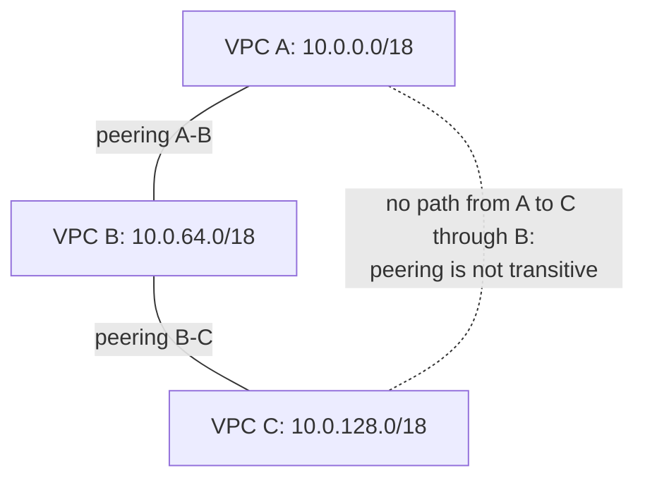
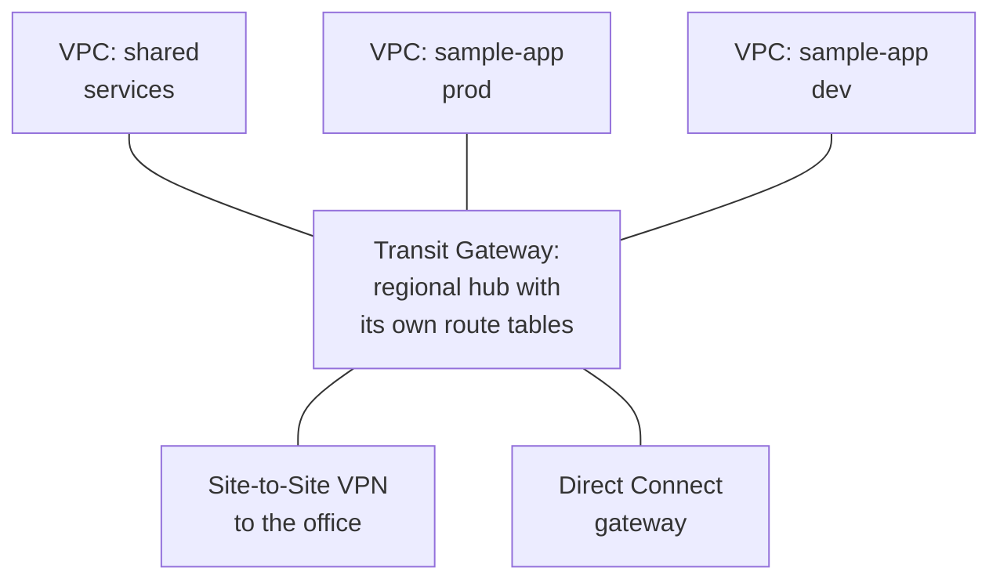

# Peering, Transit Gateway and VPN

> **Status: AI draft, 2026-11-16.** Not yet verified by me. Commands are from the official documentation and were not run; output is illustrative.

## In one line

VPC peering joins exactly two VPCs and is not transitive; Transit Gateway is a regional hub that many VPCs and VPNs attach to, with its own route tables. Site-to-Site VPN and Direct Connect link VPCs to on-premises networks. All of them need non-overlapping address ranges and routes on both sides.

## The plain idea

VPCs are isolated by default, which is the point. Sooner or later some of them must talk: a shared-services VPC with CI runners, an application VPC calling a data VPC, the office network reaching internal tools. There are a few ways to connect them, and they differ in how they scale.

**Peering** is a private cable between two VPCs. It is simple and cheap, but each pair needs its own cable, and traffic cannot hop from one peered VPC through another. **Transit Gateway** is a central hub: every VPC plugs into it once and the hub routes between them. **VPN** and **Direct Connect** extend the hub (or a single VPC) to networks outside AWS. Whichever you use, the rule from [Routing and NAT](../networking/routing-and-nat.md) holds: both directions need a route, and overlapping address ranges cannot be routed.

## How it works

### VPC peering

- A **peering connection** links two VPCs, in the same or different accounts and regions.
- Each side adds routes for the other's range, pointing at the peering connection. Without the route on both sides, traffic goes one way and replies go nowhere.
- **Not transitive:** A can reach B and B can reach C, but A cannot reach C through B. A needs its own peering with C.
- Ranges must not overlap.
- Security groups in the same region can reference security groups in the peered VPC.
- No hourly charge for the connection itself; data transfer charges apply, including across AZs (see pricing).

With many VPCs, the number of peering connections grows quickly: full mesh for 10 VPCs is 45 connections, each with routes on both sides.

### Transit Gateway

- Each VPC, VPN or Direct Connect connection is an **attachment** to the Transit Gateway.
- The Transit Gateway has its own **route tables**. Each attachment is **associated** with one route table (which table routes its traffic) and can **propagate** its routes into route tables (making itself reachable from them).
- Separate route tables segment the network: for example, dev and prod both reach shared services, but not each other.
- VPC route tables still need routes pointing at the Transit Gateway for the destinations.
- Charged per attachment per hour and per gigabyte processed (see pricing). Transit Gateways in different regions can be peered.

### Reaching on-premises networks

| Option | What it is | Trade-offs |
|---|---|---|
| **Site-to-Site VPN** | IPsec tunnels over the internet between an AWS VPN endpoint (on a virtual private gateway or a Transit Gateway) and your office router, the **customer gateway**. Each connection has two tunnels for redundancy. | Quick to set up and cheap; throughput and latency depend on the internet path. |
| **Direct Connect** | A dedicated private line from your data centre or a colocation site into AWS. | Consistent latency and high bandwidth; takes time to provision and costs more. Often backed up by a VPN. |
| **Client VPN** | A managed VPN for individual users' laptops into a VPC. | For people, not networks. |

Routes for on-premises ranges can be static or learned dynamically with **BGP**, the routing protocol networks use to exchange routes.

### DNS across connected networks

Connecting the networks does not connect their DNS. Private hosted zones must be associated with each VPC that should resolve them, and on-premises resolvers need **Route 53 Resolver endpoints** (inbound and outbound) with forwarding rules to resolve names in either direction ([Route 53 and ACM](route53-and-acm.md)).

### Choosing

| Need | Use |
|---|---|
| Two VPCs, simple, rarely more | Peering |
| Many VPCs, central control, segmentation, on-premises links | Transit Gateway |
| One service shared with many consumers, possibly overlapping ranges | PrivateLink ([NAT, endpoints and PrivateLink](nat-endpoints-privatelink.md)) |
| Office or data centre, quickly | Site-to-Site VPN |
| Data centre, steady high bandwidth | Direct Connect, with VPN backup |

## A concrete example

A company has a shared-services VPC (`10.0.0.0/18`) with CI runners and an artifact registry, plus production (`10.0.64.0/18`) and development (`10.0.128.0/18`) VPCs. Development must never reach production.

1. Create a Transit Gateway with two route tables: `shared` and `workloads`.
2. Attach all three VPCs. Associate production and development with `workloads`; associate shared services with `shared`.
3. Propagate shared services' routes into `workloads`, and both workload VPCs' routes into `shared`.
4. In each workload VPC's route tables, add `10.0.0.0/18` via the Transit Gateway. In shared services, add `10.0.64.0/18` and `10.0.128.0/18` via the Transit Gateway.
5. Result: both workload VPCs reach shared services and get replies; the `workloads` route table has no routes to `10.0.64.0/18` or `10.0.128.0/18`, so development and production cannot reach each other.
6. Test from each side, both directions, and check security groups allow the specific traffic.

## Why not just...?

- **...peer everything with everything?** It works for a handful of VPCs. Beyond that, the number of connections and route entries becomes unmanageable, and there is no central place to segment or inspect traffic.
- **...rely on transitive routing through a peered VPC?** Peering does not forward traffic onward. A design that needs A to reach C via B needs a Transit Gateway, or a proxy in B.
- **...give every VPC the same range because they will never connect?** Most eventually do, and overlapping ranges can only be joined through NAT or PrivateLink. Plan ranges centrally ([IP addresses and subnetting](../networking/ip-and-subnetting.md)).

## Commands to know

| Command | What it does |
|---|---|
| `aws ec2 describe-vpc-peering-connections --query 'VpcPeeringConnections[].[VpcPeeringConnectionId,Status.Code,RequesterVpcInfo.CidrBlock,AccepterVpcInfo.CidrBlock]' --output table` | Peering connections, their state and the two ranges. |
| `aws ec2 describe-transit-gateway-attachments` | What is attached to Transit Gateways. |
| `aws ec2 search-transit-gateway-routes --transit-gateway-route-table-id <tgw-rtb-id> --filters Name=type,Values=static,propagated` | Routes in a Transit Gateway route table. |
| `aws ec2 get-transit-gateway-route-table-associations --transit-gateway-route-table-id <tgw-rtb-id>` | Which attachments use that route table. |
| `aws ec2 describe-vpn-connections --query 'VpnConnections[].VgwTelemetry'` | State of each VPN tunnel (`UP` or `DOWN`). |

## How it breaks

| Symptom | Layer | Check | Likely cause |
|---|---|---|---|
| Traffic one way only, replies time out | Routes | Route tables on both sides | Return route missing |
| A cannot reach C through B over peering | Design | Peering connections | Peering is not transitive |
| Peering cannot be created or routed | Address plan | Both VPC ranges | Overlapping CIDRs |
| Transit Gateway attached, still no traffic | TGW routing | Association, propagation, and the VPC's own routes to the TGW | Attachment associated with the wrong table, routes not propagated, or VPC route missing |
| Names do not resolve across VPCs | DNS | Private zone associations; Resolver rules | DNS not shared along with the network |
| VPN works, then drops intermittently | Tunnels | Tunnel telemetry; customer gateway logs | Only one tunnel configured on-premises, or idle timeouts |
| Connected, but connections still time out | Firewalls | Security groups and NACLs on both sides | Rules allow only the old ranges |

## Interview questions

**1. What does "VPC peering is not transitive" mean?**

Answer

- If A peers with B and B peers with C, A still cannot reach C through B.
- Each pair that needs to talk needs its own peering, or a hub such as Transit Gateway.

**2. When would you choose Transit Gateway over peering?**

Answer

- When many VPCs (and on-premises networks) need connecting: one attachment each instead of a mesh.
- When you need central routing control and segmentation with separate route tables.
- Peering stays simpler and cheaper for a few VPCs.

**3. Explain association and propagation in Transit Gateway route tables.**

Answer

- Association: which TGW route table is used to route traffic arriving from an attachment.
- Propagation: an attachment publishes its routes into a route table, making it reachable from attachments using that table.
- Combining them creates segments, such as dev and prod both reaching shared services but not each other.

**4. What are the options for connecting an office to AWS, and how do they differ?**

Answer

- Site-to-Site VPN: encrypted tunnels over the internet; quick and cheap, variable performance; two tunnels per connection.
- Direct Connect: dedicated line; consistent latency and bandwidth; slower to set up, more expensive.
- Often Direct Connect with VPN as backup.

**5. Two VPCs are peered and routes are added, but connections still time out. What do you check?**

Answer

- Routes on both sides, in every subnet route table that is involved.
- Security groups allow the traffic from the other VPC's range or security group; NACLs allow it both ways.
- The peering connection is active, and DNS resolves to private addresses.

**6. Two teams' VPCs overlap and they need one API between them. What do you do?**

Answer

- Use PrivateLink: an endpoint service on the provider side behind an NLB, an interface endpoint on the consumer side.
- No routing between the VPCs is needed, so the overlap does not matter.
- For broader connectivity, re-address one VPC or use NAT.

## Try it

*Untested: written from documentation.* A paper exercise, about 10 minutes.

**Step 1.** Draw four VPCs (shared, prod, staging, dev) and an office connected through a Transit Gateway. Write the TGW route tables, associations and propagations so that every VPC reaches shared services, the office reaches staging and prod, and dev reaches nothing else.

**Step 2.** Write the VPC route table entries each VPC needs.

**Step 3.** Count the peering connections the same design would need without a Transit Gateway, and the route entries.

## Zoom out

Connectivity design multiplies the effects of every earlier choice: address plans ([IP addresses and subnetting](../networking/ip-and-subnetting.md)), route tables ([VPC basics](vpc-basics.md)) and firewall rules ([Security groups and NACLs](security-groups-and-nacls.md)). When something cannot be reached, [VPC troubleshooting](vpc-troubleshooting.md) walks the path. The principle to carry: connect only what must talk, route both directions, and never let ranges overlap.

## Sources

- [Amazon VPC documentation: VPC peering](https://docs.aws.amazon.com/vpc/latest/peering/what-is-vpc-peering.html)
- [Amazon VPC documentation: VPC peering limitations](https://docs.aws.amazon.com/vpc/latest/peering/vpc-peering-basics.html)
- [Amazon VPC Transit Gateways documentation: how transit gateways work](https://docs.aws.amazon.com/vpc/latest/tgw/how-transit-gateways-work.html)
- [AWS Site-to-Site VPN documentation](https://docs.aws.amazon.com/vpn/latest/s2svpn/VPC_VPN.html)
- [AWS Direct Connect documentation](https://docs.aws.amazon.com/directconnect/latest/UserGuide/Welcome.html)
- [Route 53 Resolver documentation: resolving DNS queries between VPCs and your network](https://docs.aws.amazon.com/Route53/latest/DeveloperGuide/resolver.html)
