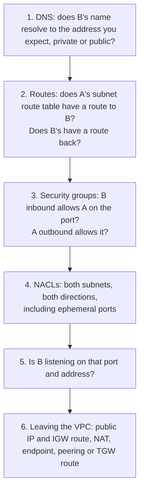

# VPC troubleshooting

> **Status: AI draft, 2026-11-16.** Not yet verified by me. Commands are from the official documentation and were not run; output is illustrative.

## In one line

When A cannot reach B inside AWS, check in order: DNS, the route table on each side, security groups (B's inbound, A's outbound), NACLs in both directions, whether B is listening, and the path to the internet (public IP or NAT). Refused against timeout narrows it immediately, and VPC Flow Logs and Reachability Analyzer show where packets stop.

## The plain idea

A connection inside a VPC crosses up to six independent controls, owned by different settings: name resolution, routing, two firewalls, the subnet boundary, and the program itself. Any one of them can silently drop the traffic, and most failures look the same from the client: a timeout.

So, as with the general [debugging walk](../start/debugging-walk.md), follow a fixed order and check both directions. AWS adds two tools that see what you cannot: **Flow Logs**, which record accepted and rejected traffic per network interface, and **Reachability Analyzer**, which analyses the configuration between two resources and tells you which component blocks the path.

## How it works

### The checklist



| Step | Questions | Where to look |
|---|---|---|
| 1. DNS | Private or public address? Split-horizon? Endpoint private DNS? | `dig` from A ([DNS](../networking/dns.md)) |
| 2. Routes | Route to B's range from A's subnet; route back from B's subnet; blackholes | Route tables of both subnets ([VPC basics](vpc-basics.md)) |
| 3. Security groups | B's inbound: port and source (A's address or group); A's outbound | Both groups ([Security groups and NACLs](security-groups-and-nacls.md)) |
| 4. NACLs | Inbound and outbound on both subnets; ephemeral ports for replies | Both subnets' NACLs |
| 5. The target | Process running and listening on the right address | `ss -tlnp` on B, or the service's health |
| 6. Leaving the VPC | Public IP plus IGW route; NAT gateway available; endpoint; peering or TGW routes on both sides | The outbound path ([NAT, endpoints and PrivateLink](nat-endpoints-privatelink.md), [Peering, Transit Gateway and VPN](vpc-connectivity.md)) |

### Refused or timeout

From A, run `nc -vz -w3 <B> <port>` ([TCP and UDP](../networking/tcp-and-udp.md)):

- **Refused**: the packet reached B's operating system and nothing listens there. Routing and firewalls are fine; look at the service (step 5).
- **Timeout**: something dropped the packet or the reply. Look at steps 2 to 4 and 6. Security groups and NACLs never send refusals: they always drop silently.

### VPC Flow Logs

Flow Logs record IP traffic for a VPC, subnet or network interface, delivered to CloudWatch Logs, S3 or Firehose. Each record in the default format has these fields:

```text
version account-id interface-id srcaddr dstaddr srcport dstport protocol packets bytes start end action log-status
```

Two records for one failed connection, illustrative:

```text
2 123456789012 <eni-of-B> 10.0.37.12 10.0.130.20 51000 5432 6 3 180 <start> <end> ACCEPT OK
2 123456789012 <eni-of-B> 10.0.130.20 10.0.37.12 5432 51000 6 3 180 <start> <end> REJECT OK
```

How to read them:

- The first record: traffic from A (`10.0.37.12`) to B's port 5432 was **accepted** at B's interface. So B's security group and the inbound NACL allowed it.
- The second record: B's reply to A's ephemeral port 51000 was **rejected**. Security groups are stateful and would have allowed the reply, so the reject comes from a NACL outbound rule missing the ephemeral range.
- Protocol `6` is TCP, `17` is UDP, `1` is ICMP.

Flow Logs record metadata only, never contents, and not every type of traffic (for example, traffic to the VPC's DNS resolver and the instance metadata service is not logged).

### Reachability Analyzer

Reachability Analyzer takes a source and a destination (instances, interfaces, gateways, endpoints and more), a protocol and a port, and analyses the configuration. It answers "reachable" or names the blocking component: "security group sg-... has no inbound rule for port 5432", "no route in route table rtb-...". It does not send any traffic, so it is safe to run in production, and it is charged per analysis.

## A concrete example

A Lambda function in a VPC times out calling `https://api.partner.example.com`.

1. **DNS**: the function's logs show it resolved the name to a public address. Fine.
2. **Routes**: the function's subnets are private; their route table sends `0.0.0.0/0` to a NAT gateway, and the route state is `active`.
3. **Security groups**: the function's group allows all outbound. Nothing to check inbound for an outbound call (replies are tracked).
4. **NACLs**: the private subnets use the default NACL, which allows everything.
5. **Leaving the VPC**: the NAT gateway is in a subnet whose route table has **no** route to the internet gateway. It was placed in a private subnet by mistake, so its own traffic has nowhere to go.
6. Recreate the NAT gateway in a public subnet and point the private route tables at it. A Reachability Analyzer run from the function's network interface to the internet gateway would have named the missing route directly.

## Why not just...?

- **...open the security group to `0.0.0.0/0` on all ports to test?** It might change the result, but it also exposes the resource, and if the real block is a NACL or route, it changes nothing. Read the configuration, or ask Reachability Analyzer.
- **...check only the side that seems broken?** Replies need a path back. Routes, NACLs and stateful devices on the return path cause as many failures as the outbound side.
- **...rely on ping?** Security groups often do not allow ICMP, so ping fails between hosts that can talk on the real port. Test the actual protocol and port.

## Commands to know

| Command | What it does |
|---|---|
| `aws ec2 describe-route-tables --filters Name=association.subnet-id,Values=<subnet-id>` | The route table of a subnet (none means the main table). |
| `aws ec2 describe-security-groups --group-ids <sg-id>` | Rules of a group. |
| `aws ec2 describe-network-acls --filters Name=association.subnet-id,Values=<subnet-id>` | The NACL of a subnet. |
| `aws ec2 describe-network-interfaces --filters Name=addresses.private-ip-address,Values=10.0.130.20` | Which interface, subnet and groups own an address. |
| `aws ec2 create-flow-logs --resource-type Subnet --resource-ids <subnet-id> --traffic-type ALL --log-destination-type cloud-watch-logs --log-group-name vpc-flow --deliver-logs-permission-arn <role-arn>` | Start flow logs for a subnet. |
| `aws ec2 create-network-insights-path --source <id> --destination <id> --protocol tcp --destination-port 5432`, then `start-network-insights-analysis --network-insights-path-id <id>` | Run Reachability Analyzer. |

CloudWatch Logs Insights query for rejected traffic to one port, illustrative:

```text
fields @timestamp, srcAddr, dstAddr, srcPort, dstPort, action
| filter dstPort = 5432 and action = "REJECT"
| sort @timestamp desc
| limit 20
```

## How it breaks

| Symptom | Layer | Check | Likely cause |
|---|---|---|---|
| Private instance cannot reach the internet | Outbound path | Route to NAT; NAT's subnet routes to the IGW; NAT state | No NAT route, NAT in a private subnet, or NAT deleted (blackhole) |
| Lambda in a VPC times out on AWS API calls | Path to AWS services | NAT or interface endpoints | No NAT and no endpoint for that service |
| Cross-VPC call fails | Routing both sides | Peering or TGW routes in both VPCs; security group sources | Return route missing, or rules allow only the old range |
| ALB targets unhealthy with timeouts | Security groups | Target group's port allowed from the ALB's group? | Missing inbound rule on the target ([ALB and NLB](load-balancers.md)) |
| Flow Logs show ACCEPT in, REJECT on the reply | NACL | Outbound NACL rules | Ephemeral ports not allowed |
| Name resolves to a public address from inside the VPC | DNS | Private hosted zone association; endpoint private DNS | Split-horizon not set up; endpoint without private DNS |
| Works for one instance, not another in the same subnet | Interface-level | Security groups attached to each | Different groups on the two instances |

## Interview questions

**1. An EC2 instance in a private subnet cannot reach the internet. Walk through your checks.**

<details markdown="1">
<summary>Answer</summary>

- Subnet route table: `0.0.0.0/0` to a NAT gateway, route active, not blackhole.
- NAT gateway: available, in a public subnet whose route table points at the internet gateway.
- Security group egress and NACLs in both directions, including ephemeral ports.
- DNS resolution working in the VPC.

</details>

**2. What do VPC Flow Logs record, and what do they not record?**

<details markdown="1">
<summary>Answer</summary>

- Per-interface metadata: addresses, ports, protocol, packets, bytes, time window, and ACCEPT or REJECT.
- Not packet contents, and not some traffic such as to the VPC DNS resolver or instance metadata.
- Used to find where traffic is rejected and who talks to whom.

</details>

**3. Flow Logs show the request accepted at the server but the reply rejected. What is the cause?**

<details markdown="1">
<summary>Answer</summary>

- A stateless NACL blocking the reply to the client's ephemeral port.
- Security groups are stateful, so they would not reject the reply.
- Add an outbound NACL rule for the ephemeral range (or the matching inbound on the client side).

</details>

**4. What does Reachability Analyzer do?**

<details markdown="1">
<summary>Answer</summary>

- Analyses the network configuration between a source and destination for a protocol and port, without sending traffic.
- Reports whether the path is reachable, or which component blocks it: a route, a security group, a NACL.
- Good for quick answers in complex VPCs.

</details>

**5. Why does a timeout point to different causes than "connection refused" inside a VPC?**

<details markdown="1">
<summary>Answer</summary>

- Security groups and NACLs drop silently, so filtering problems show as timeouts, as do missing routes.
- Refused means the packet reached the target host and nothing listens on that port.
- So refused sends you to the service; timeouts send you to routes and firewalls.

</details>

**6. Two VPCs are peered, but an application in one cannot reach a database in the other. List the places to check.**

<details markdown="1">
<summary>Answer</summary>

- Routes to the peer's range in both VPCs' relevant route tables.
- The database security group allows the application's range or peered security group on the port.
- NACLs on both subnets, both directions.
- DNS returns the private address, and the database listens on it.

</details>

## Try it

*Untested: written from documentation.* A paper exercise, about 10 minutes.

**Step 1.** For each scenario, name the step of the checklist that fails and the fix:

- An internet-facing ALB's targets show `Target.Timeout`; the targets' security group allows port 8080 from `10.0.0.0/16`, and the ALB is in subnets inside that range.
- An instance in a public subnet cannot be reached on 443 from the internet; it has no public IP.
- After a cost clean-up, every private workload's outbound calls time out.

**Step 2.** Read these two flow log records and say which control rejected what.

```text
2 123456789012 <eni-of-app> 10.0.64.15 10.0.130.20 41000 5432 6 2 120 <start> <end> REJECT OK
2 123456789012 <eni-of-db>  10.0.64.15 10.0.130.20 41000 5432 6 2 120 <start> <end> REJECT OK
```

## Zoom out

This page ties together everything in the section: routes ([VPC basics](vpc-basics.md)), firewalls ([Security groups and NACLs](security-groups-and-nacls.md)), outbound paths ([NAT, endpoints and PrivateLink](nat-endpoints-privatelink.md)) and connections between networks ([Peering, Transit Gateway and VPN](vpc-connectivity.md)). The same reasoning applies inside a cluster with pod networking and NetworkPolicy. The principle to carry: check both directions, and let Flow Logs and Reachability Analyzer tell you where the packets stop instead of guessing.

## Sources

- [Amazon VPC documentation: VPC Flow Logs](https://docs.aws.amazon.com/vpc/latest/userguide/flow-logs.html)
- [Amazon VPC documentation: flow log records and fields](https://docs.aws.amazon.com/vpc/latest/userguide/flow-log-records.html)
- [Amazon VPC documentation: flow log limitations](https://docs.aws.amazon.com/vpc/latest/userguide/flow-logs-limitations.html)
- [Reachability Analyzer documentation](https://docs.aws.amazon.com/vpc/latest/reachability/what-is-reachability-analyzer.html)
- [Amazon VPC documentation: troubleshoot NAT gateways](https://docs.aws.amazon.com/vpc/latest/userguide/nat-gateway-troubleshooting.html)
- [CloudWatch Logs Insights query syntax](https://docs.aws.amazon.com/AmazonCloudWatch/latest/logs/CWL_QuerySyntax.html)
