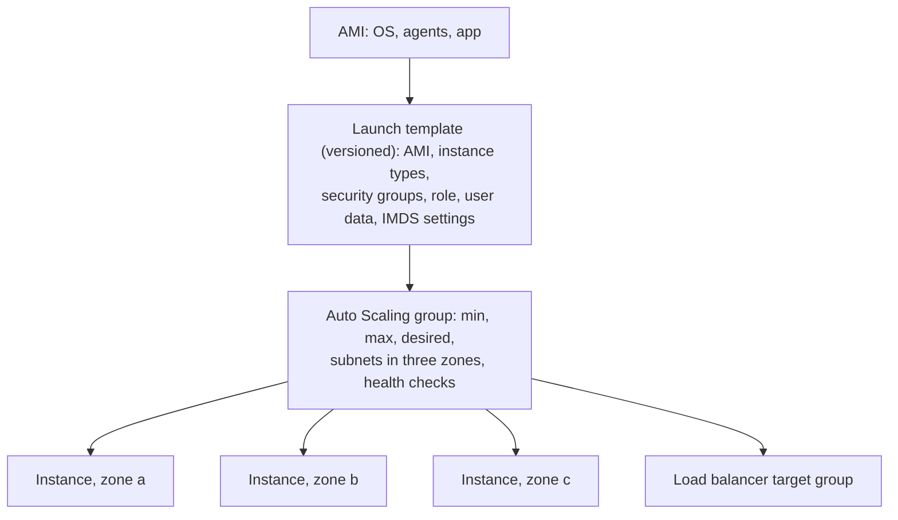

# Auto Scaling and AMIs

> **Status: AI draft, 2026-11-16.** Not yet verified by me. Written from the Amazon EC2 Auto Scaling User Guide, the EC2 User Guide and EC2 Image Builder documentation; no AWS calls were made.

## In one line

An AMI is the image an instance boots from and a launch template the full launch settings; an Auto Scaling group keeps a desired number of instances across zones, replaces unhealthy ones, scales with policies, and rolls out new AMIs with instance refresh.

## The plain idea

Instead of building servers one by one, you define **what one server looks like** (the image and launch settings) and **how many you want** (the group). AWS then keeps that many running, spread over zones, replaces any that fail, adds more when load rises, and lets you roll a new image across the fleet. Servers become interchangeable copies: you never fix one by hand, you replace it ([High availability and failure domains](../operations/high-availability.md)).

## How it works

### AMIs: golden images vs bootstrapping

| Approach | How | Trade-off |
|---|---|---|
| **Golden image** | Bake the OS, patches, agents and the app into the AMI (EC2 Image Builder, Packer) | Fast, predictable launches; every change needs a new image, so build them in a pipeline |
| **Bootstrap at launch** | A base AMI plus user data or configuration management installs everything at boot ([Ansible and configuration management](../iac/ansible.md)) | Flexible; slow and fragile launches that depend on package repositories being up |
| **Mix** | Base OS and agents baked; app version and config fetched at boot | Common compromise |

AMIs are regional; copy them to other regions, share them with accounts, and deregister old ones (with their snapshots) on a schedule ([Vulnerability and patch management](../security/vulnerability-and-patch-management.md)).

### Launch templates and the group

- **Desired** is the target; **min** and **max** bound it; scaling policies change desired.
- The group balances instances across the zones of its subnets and rebalances when zones become uneven.
- A **mixed instances policy** lets one group use several instance types and Spot plus On-Demand ([Cost optimisation](../operations/cost-optimisation.md)).

### Health checks

- **EC2 health checks** (default): status checks. An instance that fails them is replaced ([EC2](ec2.md)).
- **Load balancer health checks** (opt-in): the instance is also replaced if the target group marks it unhealthy, catching an app that is up but broken.
- A **health check grace period** stops new instances being judged before they finish starting.

### Scaling policies

| Policy | How | Fits |
|---|---|---|
| **Target tracking** | Keep a metric near a target (average CPU 50%, requests per target) | Most cases; like a thermostat |
| **Step scaling** | Add or remove amounts depending on how far an alarm is breached | Fine-grained reactions |
| **Scheduled** | Change min, max or desired at set times | Known daily or weekly patterns |
| **Predictive** | Forecast load from history and scale ahead | Regular cyclical traffic |

### Lifecycle hooks, instance refresh, warm pools, protection

- **Lifecycle hooks** pause an instance in `Pending:Wait` or `Terminating:Wait` so you can run work: register with a system, drain connections, copy logs before termination.
- **Instance refresh** replaces instances in rolling batches after a launch template change (a new AMI), keeping a minimum healthy percentage, with optional checkpoints and automatic rollback.
- **Warm pools** keep pre-initialised (stopped or running) instances ready, cutting scale-out time for slow-starting apps.
- **Scale-in protection** stops specific instances being chosen when the group shrinks (for example, while a long job runs).

## A concrete example

Rolling a patched AMI across `sample-app`'s fleet:

1. Image Builder's monthly pipeline produces a new AMI with OS patches and agents; it is scanned and tested in staging ([Quality and security gates](../cicd/quality-and-security-gates.md)).
2. The launch template gets a new version pointing at the AMI.
3. Instance refresh on the production group: minimum healthy 90%, a checkpoint at 25% to watch errors, rollback enabled.
4. A lifecycle hook on termination deregisters each instance from the load balancer and waits for connections to drain.
5. Old AMIs older than 90 days and their snapshots are deregistered by a scheduled job.

## Why not just...?

- **...patch running instances in place?** Instances drift apart, and a replacement from the old AMI brings the vulnerability back. Bake a new image and replace ([Systems Manager](systems-manager.md) Patch Manager suits long-lived servers that cannot be replaced).
- **...use only EC2 health checks behind a load balancer?** An instance whose app has crashed still passes EC2 status checks and is never replaced. Enable load balancer health checks.
- **...scale on CPU for a queue worker?** Workers can wait on a full queue with low CPU. Scale on queue depth per instance ([SQS, SNS and EventBridge](messaging.md)).

## Commands to know

These were not run for this page.

| Command | What it does |
|---|---|
| `aws autoscaling describe-auto-scaling-groups --auto-scaling-group-names sample-app` | Desired, min, max, instances and their health. |
| `aws autoscaling describe-scaling-activities --auto-scaling-group-name sample-app` | Why instances were launched or terminated, with errors. |
| `aws autoscaling start-instance-refresh --auto-scaling-group-name sample-app --preferences '{"MinHealthyPercentage":90}'` | Roll the fleet to the latest launch template. |
| `aws autoscaling set-instance-protection --instance-ids <id> --auto-scaling-group-name sample-app --protected-from-scale-in` | Protect an instance from scale-in. |
| `aws ec2 describe-images --owners self --query 'Images[].{id:ImageId,name:Name,date:CreationDate}'` | Your AMIs. |
| `aws ec2 create-launch-template-version --launch-template-name sample-app --source-version 4 --launch-template-data '{"ImageId":"<ami-id>"}'` | New template version with a new AMI. |

## How it breaks

| Symptom | Layer | Check | Likely cause |
|---|---|---|---|
| Group cannot launch instances | Launch | Scaling activities | Invalid AMI or subnet, missing role permissions, no capacity for the type, service quota |
| Instances launched and terminated in a loop | Health | Health check type, grace period, app logs | App fails to start, or grace period shorter than start-up time |
| Scaling too slow for spikes | Policy and start time | Instance start duration | Long bootstrap; use golden AMIs or warm pools |
| Instance refresh stalls | Health | Refresh status | New instances never become healthy; rollback triggered |
| Unbalanced zones | Capacity | Instances per zone | Capacity shortage in one zone; more instance types help |

## Interview questions

**1. What is the difference between an AMI and a launch template?**

Answer

- An AMI is the disk image to boot from.
- A launch template is the full launch configuration: AMI, instance types, network, security groups, role, user data, metadata settings.
- Templates are versioned; groups point at a version.

**2. EC2 vs load balancer health checks in an Auto Scaling group?**

Answer

- EC2 checks only see instance status checks.
- Load balancer checks also catch an app that is running but failing requests.
- Use both behind a load balancer, with a grace period for start-up.

**3. Which scaling policy would you choose and why?**

Answer

- Target tracking for most services: keep a metric near a target.
- Scheduled or predictive for known patterns; step scaling for fine control.
- Pick the metric that reflects load: requests per target or queue depth, not always CPU.

**4. How do you roll out a new AMI to a running group without downtime?**

Answer

- New launch template version, then instance refresh with a minimum healthy percentage.
- Load balancer health checks and lifecycle hooks for draining.
- Checkpoints and automatic rollback.

**5. Golden images or bootstrapping?**

Answer

- Golden images: fast, consistent launches; needs an image pipeline.
- Bootstrapping: flexible but slower and dependent on external repositories.
- Common: bake the base and agents, fetch app config at boot.

**6. An Auto Scaling group keeps replacing instances every few minutes. What do you check?**

Answer

- Scaling activities for the reason: failed health checks.
- Health check type and grace period against the app's start-up time.
- The app's logs on a new instance (Session Manager) and the target group's health check path.

## Try it

Without AWS:

1. Write a launch template (JSON) for a Graviton instance with IMDSv2 required, an instance role and a short user data script.
2. Choose min, max, desired and a target-tracking metric for a web service that runs 6 instances at peak and 2 at night.
3. Design the lifecycle hook flow for draining connections before termination.

## Zoom out

Auto Scaling groups are the EC2 version of a Kubernetes Deployment plus HPA, and managed node groups and Cluster Autoscaler use them underneath ([Deployments and rollouts](../kubernetes/deployments-and-rollouts.md), [Cluster Autoscaler vs Karpenter](../eks/cluster-autoscaler-vs-karpenter.md)). Immutable images make patching and scaling the same operation: launch new, retire old.

## Sources

- [Amazon EC2 Auto Scaling User Guide: what is EC2 Auto Scaling](https://docs.aws.amazon.com/autoscaling/ec2/userguide/what-is-amazon-ec2-auto-scaling.html)
- [Amazon EC2 Auto Scaling User Guide: launch templates](https://docs.aws.amazon.com/autoscaling/ec2/userguide/launch-templates.html)
- [Amazon EC2 Auto Scaling User Guide: health checks](https://docs.aws.amazon.com/autoscaling/ec2/userguide/ec2-auto-scaling-health-checks.html)
- [Amazon EC2 Auto Scaling User Guide: target tracking](https://docs.aws.amazon.com/autoscaling/ec2/userguide/as-scaling-target-tracking.html)
- [Amazon EC2 Auto Scaling User Guide: lifecycle hooks](https://docs.aws.amazon.com/autoscaling/ec2/userguide/lifecycle-hooks.html)
- [Amazon EC2 Auto Scaling User Guide: instance refresh](https://docs.aws.amazon.com/autoscaling/ec2/userguide/asg-instance-refresh.html)
- [Amazon EC2 Auto Scaling User Guide: warm pools](https://docs.aws.amazon.com/autoscaling/ec2/userguide/ec2-auto-scaling-warm-pools.html)
- [Amazon EC2 User Guide: AMIs](https://docs.aws.amazon.com/AWSEC2/latest/UserGuide/AMIs.html)
- [EC2 Image Builder](https://docs.aws.amazon.com/imagebuilder/latest/userguide/what-is-image-builder.html)
