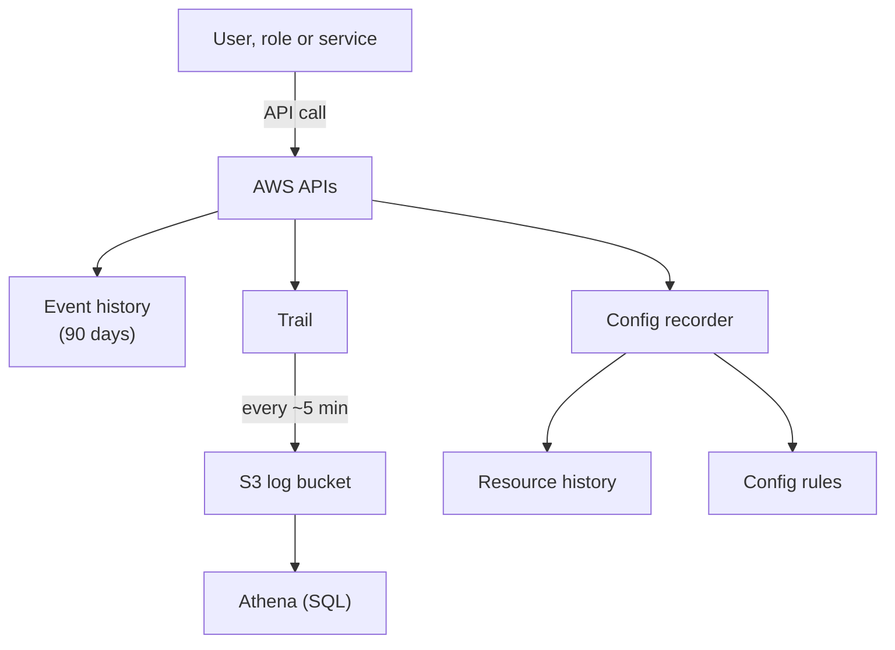

# CloudTrail, Athena and Config

> **Status: AI draft, 2026-11-16.** Not yet verified by me. Written from the CloudTrail, Athena and AWS Config guides; no AWS calls were made.

## In one line

CloudTrail records API calls: who did what, when, from where, and whether it worked. Event history keeps 90 days of management events; a trail delivers events to S3 for as long as you keep them, and Athena queries them with SQL. AWS Config records how each resource's configuration changed over time and checks it against rules.

## The plain idea

Two kinds of memory for an AWS account:

- **CloudTrail** is the visitor log at reception: every request to AWS, with the caller's badge, the time, the address it came from and the answer it got.
- **AWS Config** is a photo album of every resource: what this security group looked like on Monday, what it looked like after Tuesday's change, and whether it broke a house rule.

In an investigation you use both: Config says *what* changed, CloudTrail says *who* changed it.

## How it works



### CloudTrail: event types

| Type | What | Default |
|---|---|---|
| Management events | Control-plane calls: `CreateBucket`, `PutBucketPolicy`, `RunInstances`, `AssumeRole`, console sign-ins | In event history; trails log them by default |
| Data events | Object and data operations: S3 `GetObject`, Lambda `Invoke`, DynamoDB item calls | Off; enable per trail, charged |
| Insights events | Unusual rates of API calls or errors | Off; charged |

- Management events are split into **read** (`Describe*`, `Get*`, `List*`) and **write** events; trails can log either or both.

### Event history versus a trail

- **Event history** is on for every account: 90 days of management events per Region, searchable in the console. No data events.
- A **trail** delivers log files (JSON, gzipped) to an S3 bucket about every 5 minutes, and optionally to CloudWatch Logs. Retention is whatever you set on the bucket.
- An **organization trail**, created from the management or delegated administrator account, logs every account in the organization, usually into a bucket in a separate log archive account ([Organizations and SCPs](../aws-core/organizations-and-scps.md)).
- **Log file integrity validation**: every hour CloudTrail writes a signed **digest file** with hashes of the log files, so you can prove files were not changed or deleted.
- **CloudTrail Lake** (SQL event data stores) stopped accepting new customers on 31 May 2026; existing customers keep it. For new setups, use trails with Athena.

### Reading one event

```json
{
  "eventTime": "2026-11-16T03:12:44Z",
  "eventSource": "ec2.amazonaws.com",
  "eventName": "AuthorizeSecurityGroupIngress",
  "awsRegion": "eu-west-1",
  "sourceIPAddress": "203.0.113.10",
  "userAgent": "aws-cli/2.x",
  "userIdentity": {
    "type": "AssumedRole",
    "arn": "arn:aws:sts::123456789012:assumed-role/platform-admin/alex",
    "sessionContext": { "sessionIssuer": { "userName": "platform-admin" } }
  },
  "requestParameters": { "groupId": "sg-0123456789abcdef0" },
  "errorCode": null,
  "readOnly": false
}
```

- **Who**: `userIdentity` (an assumed role session; the session name `alex` often names the person or tool).
- **What**: `eventSource` + `eventName` + `requestParameters`.
- **When**: `eventTime` (UTC).
- **From where**: `sourceIPAddress`, `userAgent` (console, CLI, SDK, Terraform).
- **Did it work**: `errorCode` and `errorMessage` (for example `AccessDenied`) ([Least privilege and AccessDenied](../aws-core/least-privilege-and-accessdenied.md)).

### Athena over CloudTrail

Create a table once with **partition projection**, so Athena works out the S3 paths by date and no partitions need loading. Abridged from the Athena guide (the full column list is there):

```sql
CREATE EXTERNAL TABLE cloudtrail_logs_pp (
  eventversion STRING,
  useridentity STRUCT<type:STRING, principalid:STRING, arn:STRING, accountid:STRING>,
  eventtime STRING, eventsource STRING, eventname STRING, awsregion STRING,
  sourceipaddress STRING, useragent STRING, errorcode STRING, errormessage STRING,
  requestparameters STRING, responseelements STRING
)
PARTITIONED BY (`timestamp` string)
ROW FORMAT SERDE 'org.apache.hive.hcatalog.data.JsonSerDe'
STORED AS INPUTFORMAT 'com.amazon.emr.cloudtrail.CloudTrailInputFormat'
OUTPUTFORMAT 'org.apache.hadoop.hive.ql.io.HiveIgnoreKeyTextOutputFormat'
LOCATION 's3://sample-app-trail/AWSLogs/123456789012/CloudTrail/eu-west-1'
TBLPROPERTIES (
  'projection.enabled'='true',
  'projection.timestamp.format'='yyyy/MM/dd',
  'projection.timestamp.interval'='1',
  'projection.timestamp.interval.unit'='DAYS',
  'projection.timestamp.range'='2026/01/01,NOW',
  'projection.timestamp.type'='date',
  'storage.location.template'='s3://sample-app-trail/AWSLogs/123456789012/CloudTrail/eu-west-1/${timestamp}'
);
```

Who opened security groups this week, filtered by the partition so Athena scans only those days:

```sql
SELECT eventtime, useridentity.arn, sourceipaddress, requestparameters
FROM cloudtrail_logs_pp
WHERE "timestamp" >= '2026/11/10'
  AND eventname = 'AuthorizeSecurityGroupIngress'
ORDER BY eventtime DESC;
```

Athena charges by data scanned, so always filter on the partition column.

### AWS Config

- The **configuration recorder** records **configuration items** for the resource types in scope whenever they change; the **delivery channel** sends snapshots and history to S3.
- The **resource timeline** shows each configuration with the CloudTrail events that changed it, plus relationships (this volume is attached to that instance in that security group).
- **Config rules** evaluate resources: **managed rules** (for example "S3 buckets must block public access", "EBS volumes encrypted") or **custom rules** written in Lambda or Guard. Results: compliant or noncompliant.
- **Conformance packs** bundle rules (for example a CIS benchmark); **aggregators** combine results across accounts and Regions.
- **Remediation** runs Systems Manager Automation documents to fix noncompliant resources ([Systems Manager](systems-manager.md)).
- Config is charged per configuration item recorded and per rule evaluation, so scope the recorder deliberately.

### Using them together

1. An alert says a security group allows `0.0.0.0/0` on port 22.
2. Config's timeline for the group shows the rule appeared at 03:12 UTC, and the previous configuration.
3. The linked CloudTrail event (`AuthorizeSecurityGroupIngress`) shows the role session, source IP and tool.
4. Athena finds everything else that session did that day.
5. Fix, then add a Config rule (or an SCP) so it cannot recur silently ([Incident response](../operations/incident-response.md)).

## A concrete example

Organization for `sample-app`:

1. An organization trail for all Regions, management events (read and write) plus S3 data events for sensitive buckets, delivered to `sample-app-trail` in the log archive account; log file validation on.
2. The bucket has Object Lock and a lifecycle to Glacier after 90 days; only the security team can read it ([S3 security](s3-security.md)).
3. The trail also feeds a CloudWatch Logs group with metric filters and alarms for root sign-ins, `StopLogging`, `DeleteTrail`, IAM policy changes and security group changes ([CloudWatch](cloudwatch.md)).
4. Athena tables with partition projection for investigations.
5. AWS Config in every account with an aggregator in the security account and a conformance pack for the team's baseline.

## Why not just...?

- **...rely on event history?** 90 days, management events only, one Region and account at a time. Investigations and audits need longer and wider.
- **...keep trail logs in the same account they describe?** An attacker with admin rights there can delete them. Use a separate log archive account with tight access and Object Lock.
- **...turn on data events for every bucket?** High-volume buckets can produce enormous logs and costs. Choose the buckets and functions that hold sensitive data.
- **...use Config instead of CloudTrail?** Config shows state and change over time but not every API call (reads, failed attempts, sign-ins). You need both.

## Commands to know

These were not run for this page.

| Command | What it does |
|---|---|
| `aws cloudtrail lookup-events --lookup-attributes AttributeKey=EventName,AttributeValue=DeleteBucket --max-results 20` | Search the 90-day event history. |
| `aws cloudtrail describe-trails` | Trails, buckets, multi-Region and organization flags. |
| `aws cloudtrail get-trail-status --name <trail>` | Whether logging is on and the last delivery or error. |
| `aws cloudtrail get-event-selectors --trail-name <trail>` | Which management and data events are logged. |
| `aws cloudtrail validate-logs --trail-arn <arn> --start-time <t>` | Check log file integrity against digests. |
| `aws configservice describe-configuration-recorder-status` | Whether Config is recording. |
| `aws configservice get-resource-config-history --resource-type AWS::EC2::SecurityGroup --resource-id sg-0123456789abcdef0` | Configuration history for one resource. |
| `aws configservice describe-compliance-by-config-rule` | Compliance per rule. |

## How it breaks

| Symptom | Layer | Check | Likely cause |
|---|---|---|---|
| No trail files in S3 | Delivery | `get-trail-status` `LatestDeliveryError` | Bucket policy does not allow CloudTrail, or KMS key policy blocks it |
| An event is missing | Scope | Event selectors, Region | Data events not enabled, wrong Region, or a global service logged in `us-east-1` |
| Athena query scans terabytes | Query | `WHERE` on `timestamp` | No partition filter |
| Athena returns nothing | Table | `LOCATION` and template paths | Path does not match the real prefix (organization trails add the organization ID) |
| Config shows no history | Recorder | Recorder status and scope | Recorder off, or resource type not recorded |
| Config bill unexpectedly high | Recorder scope | Configuration items per type | Recording frequently changing types (for example in busy EKS clusters) |

## Interview questions

**1. Someone deleted an S3 bucket last night. How do you find out who?**

<details markdown="1">
<summary>Answer</summary>

- `DeleteBucket` is a management event: search event history (if within 90 days) or the trail with Athena.
- Read `userIdentity` (role session, session name), `sourceIPAddress`, `userAgent`, time.
- Then see what else that session did, and check how its credentials were obtained (`AssumeRole` events).

</details>

**2. Management versus data events?**

<details markdown="1">
<summary>Answer</summary>

- Management: control-plane calls on resources (create, delete, policy changes, sign-ins); logged by default.
- Data: operations on the data itself (object reads and writes, function invokes); opt-in, high volume, charged.

</details>

**3. How do you protect CloudTrail logs from tampering?**

<details markdown="1">
<summary>Answer</summary>

- Organization trail into a separate log archive account; tight bucket policy; Object Lock.
- Log file integrity validation with signed hourly digests.
- SCPs denying `StopLogging`, `DeleteTrail` and `UpdateTrail` in member accounts; alarms on those events.

</details>

**4. How do you query months of CloudTrail logs efficiently?**

<details markdown="1">
<summary>Answer</summary>

- Athena table with partition projection by date (and Region or account where needed).
- Always filter on the partition column; select only needed columns.

</details>

**5. What does AWS Config give you that CloudTrail does not?**

<details markdown="1">
<summary>Answer</summary>

- The configuration state of each resource over time and its relationships.
- Rules that continuously evaluate compliance, conformance packs, aggregation across accounts, automatic remediation.

</details>

**6. You get `AccessDenied` in an app. How can CloudTrail help?**

<details markdown="1">
<summary>Answer</summary>

- Find the failed event: `errorCode` `AccessDenied`, the exact action, the resource and the identity that called it.
- Compare with the policies of that identity and the resource ([Least privilege and AccessDenied](../aws-core/least-privilege-and-accessdenied.md)).

</details>

**7. What would you alarm on from CloudTrail?**

<details markdown="1">
<summary>Answer</summary>

- Root account use, console sign-in failures, MFA changes.
- Trail changes (`StopLogging`, `DeleteTrail`), IAM policy changes, security group and NACL changes, KMS key disable or deletion.
- Delivered through CloudWatch Logs metric filters or EventBridge rules.

</details>

## Try it

Without AWS:

1. Write an Athena query listing the top 10 identities by number of `AccessDenied` errors in the last 7 days.
2. From the sample event above, write a one-paragraph incident note: who, what, when, from where, result.
3. Choose five Config managed rules for a new account baseline and explain each in one line.

## Zoom out

CloudTrail and Config are the audit backbone of an AWS organization: detection services such as GuardDuty and Security Hub build on them ([GuardDuty, Security Hub and Inspector](security-services.md)). Logs are only useful if they are complete, protected and queryable when the incident happens.

## Sources

- [CloudTrail User Guide: event history (90 days)](https://docs.aws.amazon.com/awscloudtrail/latest/userguide/view-cloudtrail-events.html)
- [CloudTrail User Guide: how CloudTrail works](https://docs.aws.amazon.com/awscloudtrail/latest/userguide/how-cloudtrail-works.html)
- [CloudTrail User Guide: management events](https://docs.aws.amazon.com/awscloudtrail/latest/userguide/logging-management-events-with-cloudtrail.html)
- [CloudTrail User Guide: organization trails](https://docs.aws.amazon.com/awscloudtrail/latest/userguide/creating-trail-organization.html)
- [CloudTrail User Guide: log file integrity validation](https://docs.aws.amazon.com/awscloudtrail/latest/userguide/cloudtrail-log-file-validation-intro.html)
- [CloudTrail User Guide: CloudTrail Lake (availability change)](https://docs.aws.amazon.com/awscloudtrail/latest/userguide/cloudtrail-lake.html)
- [Athena User Guide: CloudTrail table with partition projection](https://docs.aws.amazon.com/athena/latest/ug/create-cloudtrail-table-partition-projection.html)
- [AWS Config Developer Guide: what is AWS Config](https://docs.aws.amazon.com/config/latest/developerguide/WhatIsConfig.html)
- [AWS Config Developer Guide: concepts](https://docs.aws.amazon.com/config/latest/developerguide/config-concepts.html)
- [AWS Config Developer Guide: rules](https://docs.aws.amazon.com/config/latest/developerguide/evaluate-config.html)
- [AWS Config Developer Guide: custom rules (Lambda and Guard)](https://docs.aws.amazon.com/config/latest/developerguide/evaluate-config_develop-rules.html)
- [AWS Config Developer Guide: remediation](https://docs.aws.amazon.com/config/latest/developerguide/remediation.html)
