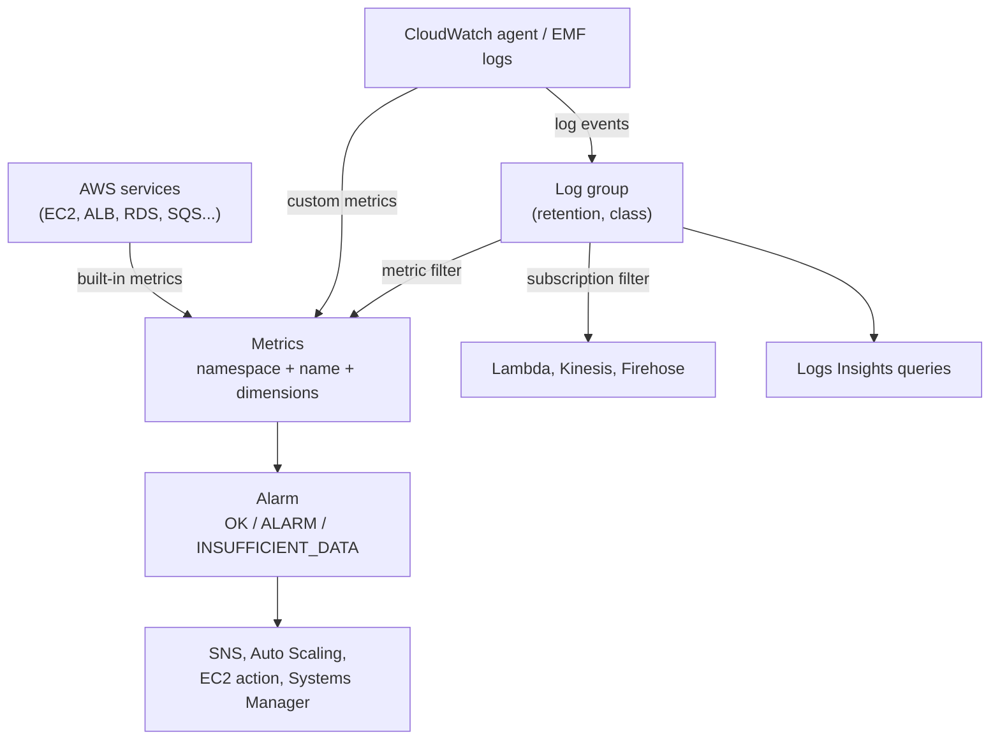

# CloudWatch

> **Status: AI draft, 2026-11-16.** Not yet verified by me. Written from the Amazon CloudWatch and CloudWatch Logs user guides; no AWS calls were made.

## In one line

CloudWatch is AWS's built-in monitoring: metrics identified by namespace, name and dimensions; alarms that evaluate a metric over periods and act; and Logs, with log groups, retention, metric filters, subscriptions and Logs Insights queries. The usual cost traps are high-cardinality custom metrics and logs that never expire.

## The plain idea

Every AWS service already reports numbers about itself: CPU, requests, errors, queue depth. CloudWatch is where those numbers land, where you can add your own, and where something watches them and raises a hand when a line crosses a threshold. Logs are the same idea for text. It is the AWS-native answer to Prometheus and a log stack, and many teams use both ([Signals and methods](../observability/signals-and-methods.md)).

## How it works



### Metrics

- A metric is identified by **namespace** (`AWS/EC2`, `AWS/ApplicationELB`, or your own like `SampleApp`), **name** (`CPUUtilization`) and **dimensions** (name/value pairs such as `InstanceId=i-1234567890abcdef0`). Each unique combination is a separate metric, and custom metrics are billed per metric.
- A **statistic** (Average, Sum, Minimum, Maximum, SampleCount, percentiles such as p99) is computed over a **period**.
- **Retention** rolls up with age: data under 60 seconds (high-resolution custom metrics) for 3 hours, 1-minute data for 15 days, 5-minute for 63 days, 1-hour for 455 days (15 months).
- EC2 sends basic metrics every 5 minutes (detailed monitoring: 1 minute, charged). **Memory and disk usage are not built-in**: the hypervisor cannot see inside the guest. Install the **CloudWatch agent** to publish `mem_used_percent`, `disk_used_percent` and logs ([EC2](ec2.md)).

### Custom metrics: PutMetricData or EMF

- `PutMetricData` API calls publish metrics directly.
- The **embedded metric format (EMF)** writes structured JSON log lines; CloudWatch extracts metrics from them asynchronously. Good for Lambda: no extra API calls, and the log line keeps the detail.
- **Cardinality** is the cost trap: a dimension like `UserId` or `RequestId` creates one billed metric per value.

### Alarms

- States: **OK**, **ALARM**, **INSUFFICIENT_DATA**.
- Settings: period, **evaluation periods** (N) and **datapoints to alarm** (M): "M out of N" avoids alerting on one spike.
- **Missing data** can be treated as `missing` (the default), `notBreaching`, `breaching` or `ignore`. An error-count metric that only reports when errors happen should use `notBreaching`; a heartbeat metric that stops reporting should use `breaching`.
- **Composite alarms** combine alarms with AND/OR to cut noise. **Anomaly detection** alarms use a learned band instead of a fixed threshold.
- Actions: SNS notifications, Auto Scaling policies, EC2 stop/reboot/recover, Systems Manager incidents ([Alerting](../observability/alerting.md)).

### Logs

- **Log group** (one per app or source: retention, encryption, access) contains **log streams** (one per source instance or container) of **log events**.
- **Retention** defaults to **never expire**. Set it on every group, or storage grows forever.
- **Log classes**: **Standard** (all features) and **Essentials** (formerly Infrequent Access): cheaper ingestion, a subset of features (for example no subscription filters or Live Tail).
- **Metric filters** turn matching log lines into metrics (count of `ERROR`), which alarms can watch.
- **Subscription filters** stream events in near real time to Lambda, Kinesis Data Streams or Firehose (for example to OpenSearch or S3) ([OpenSearch](../observability/opensearch.md)).
- **Logs Insights** queries log groups with its own query language, or OpenSearch PPL or SQL.

```text
fields @timestamp, @message
| filter @message like /ERROR/
| stats count(*) as errors by bin(5m)
| sort errors desc
```

### Dashboards

Dashboards combine graphs, numbers, alarms and Logs Insights results, across Regions and accounts. Prefer a few dashboards built around user-facing signals over one per resource ([Grafana](../observability/grafana.md) can read CloudWatch too).

## A concrete example

`sample-app` on ECS and RDS:

1. Built-in metrics: ALB `HTTPCode_Target_5XX_Count` and `TargetResponseTime`, RDS `CPUUtilization` and `FreeStorageSpace`, SQS `ApproximateAgeOfOldestMessage`.
2. The app writes EMF log lines with `OrdersPlaced` (dimension `Service` only, not per customer).
3. Log groups `/ecs/sample-app` with 30-day retention; a subscription filter streams to Firehose and on to S3 for a year.
4. Alarms: p99 latency above 1 second for 3 out of 5 one-minute periods; 5XX rate above 1 percent; DLQ depth above 0. All go to SNS, which pages on-call.
5. A composite alarm suppresses the latency alarm while a deploy alarm is active.
6. A dashboard per service shows the four golden signals.

## Why not just...?

- **...use Prometheus and skip CloudWatch?** Many AWS service metrics only exist in CloudWatch (ALB, RDS, SQS, Lambda). Prometheus can pull them with an exporter, but CloudWatch stays the source.
- **...alarm on every metric at a fixed threshold?** Noise. Alarm on symptoms users feel, use M-of-N, and route causes to dashboards ([SLOs](../observability/slos.md)).
- **...keep all logs forever in CloudWatch?** Costly. Set retention per group and archive to S3 for long-term needs.
- **...add `UserId` as a dimension to see per-user latency?** Every user becomes a billed metric. Put the ID in the log line and query it with Logs Insights.

## Commands to know

These were not run for this page.

| Command | What it does |
|---|---|
| `aws cloudwatch list-metrics --namespace AWS/EC2 --metric-name CPUUtilization` | Metrics and their dimensions. |
| `aws cloudwatch get-metric-statistics --namespace AWS/EC2 --metric-name CPUUtilization --dimensions Name=InstanceId,Value=i-1234567890abcdef0 --start-time <t1> --end-time <t2> --period 300 --statistics Average Maximum` | Datapoints for one metric. |
| `aws cloudwatch describe-alarms --state-value ALARM` | Alarms currently firing. |
| `aws cloudwatch describe-alarm-history --alarm-name <name>` | When an alarm changed state and why. |
| `aws logs describe-log-groups --query "logGroups[?!retentionInDays].logGroupName"` | Log groups that never expire. |
| `aws logs put-retention-policy --log-group-name <g> --retention-in-days 30` | Set retention. |
| `aws logs tail /ecs/sample-app --follow --since 10m` | Follow a log group live. |
| `aws logs start-query --log-group-name <g> --start-time <epoch> --end-time <epoch> --query-string '<query>'` | Run a Logs Insights query (then `get-query-results`). |

## How it breaks

| Symptom | Layer | Check | Likely cause |
|---|---|---|---|
| Alarm stuck in `INSUFFICIENT_DATA` | Data | Metric datapoints, dimensions | Metric not published, wrong dimensions, or sparse metric with `missing` treatment |
| Alarm never fires during an outage | Alarm config | Statistic, period, missing data | Average hides spikes; missing data treated as not breaching |
| No memory metric for EC2 | Collection | Agent installed and running | Memory needs the CloudWatch agent |
| CloudWatch bill jumps | Cost | Cost Explorer by usage type | High-cardinality custom metrics, verbose logs, never-expiring log groups, frequent API polling |
| Logs missing from a container | Shipping | Log driver or agent, IAM permissions | Task role or node role lacks `logs:PutLogEvents`; wrong group name ([Fluent Bit](../observability/fluent-bit.md)) |
| Logs Insights query times out | Query | Time range, log group size | Range too wide; filter early, narrow time |

## Interview questions

**1. What uniquely identifies a CloudWatch metric?**

<details markdown="1">
<summary>Answer</summary>

- Namespace, metric name and the full set of dimensions.
- A different dimension set is a different metric (and a separate charge for custom metrics).

</details>

**2. Why can't you see memory usage for an EC2 instance by default, and how do you fix it?**

<details markdown="1">
<summary>Answer</summary>

- Built-in EC2 metrics come from the hypervisor, which cannot see inside the guest OS.
- Install the CloudWatch agent with a config that collects memory and disk metrics, with an IAM role that allows publishing.

</details>

**3. Explain alarm evaluation: period, evaluation periods, datapoints to alarm and missing data.**

<details markdown="1">
<summary>Answer</summary>

- Each period produces one datapoint (a statistic).
- The alarm looks at the last N periods and fires when M breach (M out of N).
- Missing data treatment decides whether gaps count as breaching, not breaching, are ignored or leave the alarm in its state.

</details>

**4. Your CloudWatch bill doubled. Where do you look?**

<details markdown="1">
<summary>Answer</summary>

- Cost Explorer by usage type: custom metrics count, log ingestion, log storage, API requests.
- High-cardinality dimensions; debug logging left on; log groups with no retention; dashboards or tools polling `GetMetricData` often.

</details>

**5. How do you get application logs from CloudWatch into OpenSearch or S3?**

<details markdown="1">
<summary>Answer</summary>

- A subscription filter on the log group to Firehose (to S3 or OpenSearch) or to Lambda or Kinesis for custom processing.
- Or ship from the source with Fluent Bit to both destinations.

</details>

**6. What is the embedded metric format and when is it useful?**

<details markdown="1">
<summary>Answer</summary>

- Structured JSON log lines that CloudWatch turns into metrics asynchronously.
- No `PutMetricData` calls in the hot path; good for Lambda and containers; the detailed log line remains for queries.

</details>

**7. How would you alert on errors that only appear in logs?**

<details markdown="1">
<summary>Answer</summary>

- A metric filter matching the error pattern, producing a count metric.
- An alarm on that metric with `notBreaching` for missing data, M out of N periods.

</details>

## Try it

Without AWS:

1. Write a Logs Insights query that shows the top 10 URL paths returning 5XX in the last hour, from JSON logs with fields `path` and `status`.
2. Design alarms for an SQS worker: which metrics, statistics, periods, M out of N, and missing data treatment.
3. Estimate how many custom metrics are created by one metric with dimensions `Service` (5 values), `Endpoint` (40 values) and `StatusCode` (6 values).

## Zoom out

CloudWatch is the default observability layer for AWS-managed services; Prometheus, Grafana and OpenSearch often sit beside it for Kubernetes and application detail. The design ideas are the same everywhere: few good alerts on symptoms, cheap high-volume logs with retention, and care with cardinality ([Prometheus](../observability/prometheus.md)).

## Sources

- [CloudWatch User Guide: metrics concepts and retention](https://docs.aws.amazon.com/AmazonCloudWatch/latest/monitoring/cloudwatch_concepts.html)
- [CloudWatch User Guide: alarms](https://docs.aws.amazon.com/AmazonCloudWatch/latest/monitoring/CloudWatch_Alarms.html)
- [CloudWatch User Guide: missing data in alarms](https://docs.aws.amazon.com/AmazonCloudWatch/latest/monitoring/alarms-and-missing-data.html)
- [CloudWatch User Guide: embedded metric format](https://docs.aws.amazon.com/AmazonCloudWatch/latest/monitoring/CloudWatch_Embedded_Metric_Format.html)
- [CloudWatch User Guide: metrics collected by the agent](https://docs.aws.amazon.com/AmazonCloudWatch/latest/monitoring/metrics-collected-by-CloudWatch-agent.html)
- [EC2 User Guide: instance metrics](https://docs.aws.amazon.com/AWSEC2/latest/UserGuide/viewing_metrics_with_cloudwatch.html)
- [CloudWatch Logs User Guide: log groups and streams](https://docs.aws.amazon.com/AmazonCloudWatch/latest/logs/Working-with-log-groups-and-streams.html)
- [CloudWatch Logs User Guide: log classes](https://docs.aws.amazon.com/AmazonCloudWatch/latest/logs/CloudWatch_Logs_Log_Classes.html)
- [CloudWatch Logs User Guide: subscriptions](https://docs.aws.amazon.com/AmazonCloudWatch/latest/logs/Subscriptions.html)
- [CloudWatch Logs User Guide: Logs Insights](https://docs.aws.amazon.com/AmazonCloudWatch/latest/logs/AnalyzingLogData.html)
