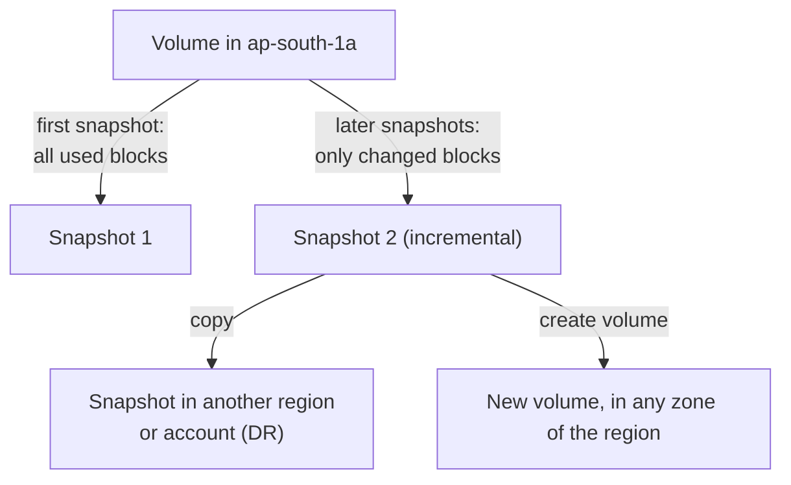

# EBS

> **Status: AI draft, 2026-11-16.** Not yet verified by me. Written from the Amazon EBS User Guide; the filesystem-grow output is real, from a loop device in a throwaway `ubuntu:24.04` container standing in for an EBS volume. No AWS calls were made.

## In one line

EBS volumes are network block devices for EC2 that live in one Availability Zone, come in types tuned for IOPS or throughput (gp3 is the default general-purpose choice), are backed up with incremental snapshots you can copy across regions, are encrypted with KMS, and can be grown online: modify the volume, then grow the partition and filesystem.

## The plain idea

An EBS volume is a disk you plug into an instance over the network. Because it is not physically inside the server, it survives instance stops and replacements, can be detached and attached elsewhere (in the same zone), and can be snapshotted while in use. Because it travels over the network and has limits per volume and per instance, its performance is something you choose and pay for ([Disks and filesystems](../linux/disks-and-filesystems.md)).

## How it works

### Volume types

| Type | Kind | For |
|---|---|---|
| **gp3** | General-purpose SSD; a baseline of 3,000 IOPS included regardless of size, with IOPS and throughput adjustable separately from size | Most workloads: boot volumes, databases of moderate load |
| gp2 | Older SSD; IOPS tied to size, with burst credits for small volumes | Legacy; usually migrate to gp3 |
| **io2** / io1 | Provisioned IOPS SSD | Latency-sensitive, high-IOPS databases; Multi-Attach |
| **st1** | Throughput-optimised HDD | Large sequential reads and writes: logs, data processing |
| sc1 | Cold HDD | Rarely accessed sequential data |

**IOPS** is operations per second (matters for small random reads and writes, such as databases); **throughput** is MiB per second (matters for large sequential transfers). Each volume type and each instance type has maximums; check the volume types page and the instance's EBS bandwidth before blaming the volume ([Performance triage](../linux/performance-triage.md)).

### Snapshots



- Snapshots are incremental and stored by AWS outside any single zone; deleting an older snapshot keeps whatever later ones still need.
- A volume created from a snapshot loads blocks lazily on first access, so first reads are slower unless the volume is initialised or Fast Snapshot Restore is enabled.
- Snapshots are crash-consistent; for databases, use the database's own backup or flush and freeze first ([Backup and disaster recovery](../operations/backup-and-dr.md)).
- Copying snapshots to another region or account is how volumes move between them and how you protect against a regional problem; AWS Backup automates schedules and copies.

### Encryption

Volumes and their snapshots are encrypted with a KMS key (AWS managed or customer managed); encryption by default can be turned on per region per account. An unencrypted volume is encrypted by copying a snapshot with encryption and creating a new volume ([KMS, Secrets Manager and Parameter Store](kms-and-secrets.md)).

### Growing a volume online

1. Modify the volume (size, type, IOPS, throughput) while attached; it keeps working.
2. If the disk has partitions, grow the partition (`growpart`).
3. Grow the filesystem: `resize2fs` for ext4, `xfs_growfs` for XFS.

The same sequence on a loop device standing in for a volume: the device grows, but the filesystem only uses the new space after step 3.

```console
# a 1 GiB device with ext4, mounted at /data
$ df -h /data
/dev/loop0     974M   24K  907M   1% /data
# step 1: the device grows to 2 GiB (on AWS: modify-volume)
$ lsblk -no NAME,SIZE /dev/loop0
loop0   2G
$ df -h /data
/dev/loop0     974M   24K  907M   1% /data
# step 3: grow the filesystem
$ resize2fs /dev/loop0
The filesystem on /dev/loop0 is now 524288 (4k) blocks long.
$ df -h /data
/dev/loop0     2.0G   24K  1.9G   1% /data
```

Volumes can only grow, not shrink, and AWS limits how soon a volume can be modified again after a change (see the modification requirements page).

### Multi-Attach

Only Provisioned IOPS volumes (io1, io2) can attach to several instances, all in the same zone. A normal filesystem such as ext4 or XFS will be corrupted if mounted read-write by several hosts; Multi-Attach needs a cluster-aware filesystem or an application that coordinates writes. For shared files, use EFS ([EFS](efs.md)).

## A concrete example

A PostgreSQL instance's data volume is filling up and slowing down:

1. CloudWatch shows `VolumeQueueLength` high and read IOPS near the gp3 baseline ([CloudWatch](cloudwatch.md)).
2. Modify the gp3 volume: 200 GiB to 400 GiB, IOPS 3,000 to 6,000, throughput up, all online.
3. Once the modification is optimising, `growpart` and `xfs_growfs` on the instance; `df` confirms the space.
4. A daily snapshot policy (AWS Backup) copies to the DR region; the database's own point-in-time backups remain the primary recovery path ([RDS and Aurora](rds-and-aurora.md) would remove most of this work).

## Why not just...?

- **...keep using gp2?** gp3 decouples IOPS from size and usually costs less for the same performance. Migrate with a type change, online.
- **...rely on snapshots for database backups?** They are crash-consistent only. Use database-aware backups, and snapshots as a second layer.
- **...share an EBS volume between instances to share files?** Without a cluster filesystem, simultaneous writers corrupt it. Use EFS or S3.

## Commands to know

These were not run against AWS for this page.

| Command | What it does |
|---|---|
| `aws ec2 describe-volumes --filters Name=attachment.instance-id,Values=<id>` | Volumes attached to an instance. |
| `aws ec2 modify-volume --volume-id <id> --size 400 --iops 6000 --throughput 250` | Grow and retune a gp3 volume. |
| `aws ec2 describe-volumes-modifications --volume-ids <id>` | Progress of a modification. |
| `aws ec2 create-snapshot --volume-id <id> --description "before upgrade"` | Take a snapshot. |
| `aws ec2 copy-snapshot --source-region ap-south-1 --source-snapshot-id <id> --region <dr-region> --encrypted` | Copy a snapshot to another region. |
| `lsblk`, `growpart /dev/nvme1n1 1`, `xfs_growfs /data` | On the instance: see the new size, grow partition and filesystem. |

## How it breaks

| Symptom | Layer | Check | Likely cause |
|---|---|---|---|
| Volume bigger in AWS but `df` unchanged | Filesystem | `lsblk` vs `df` | Partition or filesystem not grown yet |
| Cannot attach a volume to an instance | Zone | Volume and instance zones | They are in different zones; snapshot and recreate |
| Slow I/O, high queue length | Performance | IOPS and throughput vs limits | Volume or instance EBS limits reached; burst credits exhausted on gp2 |
| Slow first reads on a restored volume | Lazy loading | Volume age | Blocks loaded on first access |
| Corrupted filesystem with Multi-Attach | Sharing | Filesystem type | Non-cluster filesystem mounted by several hosts |
| Pod stuck on `volume node affinity conflict` | Kubernetes | PV zone | EBS volume pinned to a zone with no node ([EBS and EFS CSI drivers](../eks/storage.md)) |

## Interview questions

**1. What is EBS and how is it different from instance store?**

<details markdown="1">
<summary>Answer</summary>

- EBS: network block storage that persists independently of the instance, in one zone, snapshottable.
- Instance store: local disks lost on stop or terminate, fast, for scratch data.
- EBS for anything you need to keep.

</details>

**2. gp3 vs io2 vs st1?**

<details markdown="1">
<summary>Answer</summary>

- gp3: general-purpose SSD, baseline 3,000 IOPS included, IOPS and throughput tunable independently.
- io2: provisioned IOPS for demanding databases, supports Multi-Attach.
- st1: HDD for large sequential throughput, not for random I/O.

</details>

**3. How do you grow a volume without downtime?**

<details markdown="1">
<summary>Answer</summary>

- Modify the volume online.
- Grow the partition (`growpart`) if any, then the filesystem (`resize2fs` or `xfs_growfs`).
- Volumes cannot shrink.

</details>

**4. How do snapshots work, and how are they used for DR?**

<details markdown="1">
<summary>Answer</summary>

- Incremental copies of changed blocks, stored by AWS beyond one zone.
- New volumes can be created in any zone of the region; copies go to other regions or accounts.
- Crash-consistent only: use application-aware backups for databases.

</details>

**5. Why can a pod's volume not follow it to another zone?**

<details markdown="1">
<summary>Answer</summary>

- An EBS volume exists in one zone and attaches only to instances there.
- The PV carries that zone as node affinity.
- Moving zones means snapshot and restore, or replication at the application level.

</details>

**6. A database volume is slow. How do you investigate?**

<details markdown="1">
<summary>Answer</summary>

- CloudWatch: IOPS, throughput, queue length, burst balance (gp2).
- Compare with the volume's and the instance's EBS limits.
- On the host: `iostat` for latency and utilisation; then retune the volume or instance type.

</details>

## Try it

1. In a privileged `ubuntu:24.04` container, repeat the loop-device grow above, but with XFS (`mkfs.xfs`, `xfs_growfs`) after installing `xfsprogs`.
2. Work out the IOPS a 200 GiB gp2 volume gets and compare with a gp3 volume's baseline (use the volume types page for gp2's ratio).
3. Write the steps to move an unencrypted volume to an encrypted one with minimal downtime.

## Zoom out

EBS is the block storage under EC2 and EKS persistent volumes; EFS and S3 cover shared files and objects ([EFS](efs.md), [S3](s3.md), [EBS and EFS CSI drivers](../eks/storage.md)). Snapshots tie into backup and DR planning ([Backup and disaster recovery](../operations/backup-and-dr.md)).

## Sources

- [Amazon EBS User Guide: volume types](https://docs.aws.amazon.com/ebs/latest/userguide/ebs-volume-types.html)
- [Amazon EBS User Guide: General Purpose SSD volumes](https://docs.aws.amazon.com/ebs/latest/userguide/general-purpose.html)
- [Amazon EBS User Guide: snapshots](https://docs.aws.amazon.com/ebs/latest/userguide/ebs-snapshots.html)
- [Amazon EBS User Guide: copy a snapshot](https://docs.aws.amazon.com/ebs/latest/userguide/ebs-copy-snapshot.html)
- [Amazon EBS User Guide: encryption](https://docs.aws.amazon.com/ebs/latest/userguide/ebs-encryption.html)
- [Amazon EBS User Guide: modify a volume](https://docs.aws.amazon.com/ebs/latest/userguide/ebs-modify-volume.html)
- [Amazon EBS User Guide: requirements for volume modifications](https://docs.aws.amazon.com/ebs/latest/userguide/modify-volume-requirements.html)
- [Amazon EBS User Guide: extend the filesystem after resizing](https://docs.aws.amazon.com/ebs/latest/userguide/recognize-expanded-volume-linux.html)
- [Amazon EBS User Guide: Multi-Attach](https://docs.aws.amazon.com/ebs/latest/userguide/ebs-volumes-multi.html)
