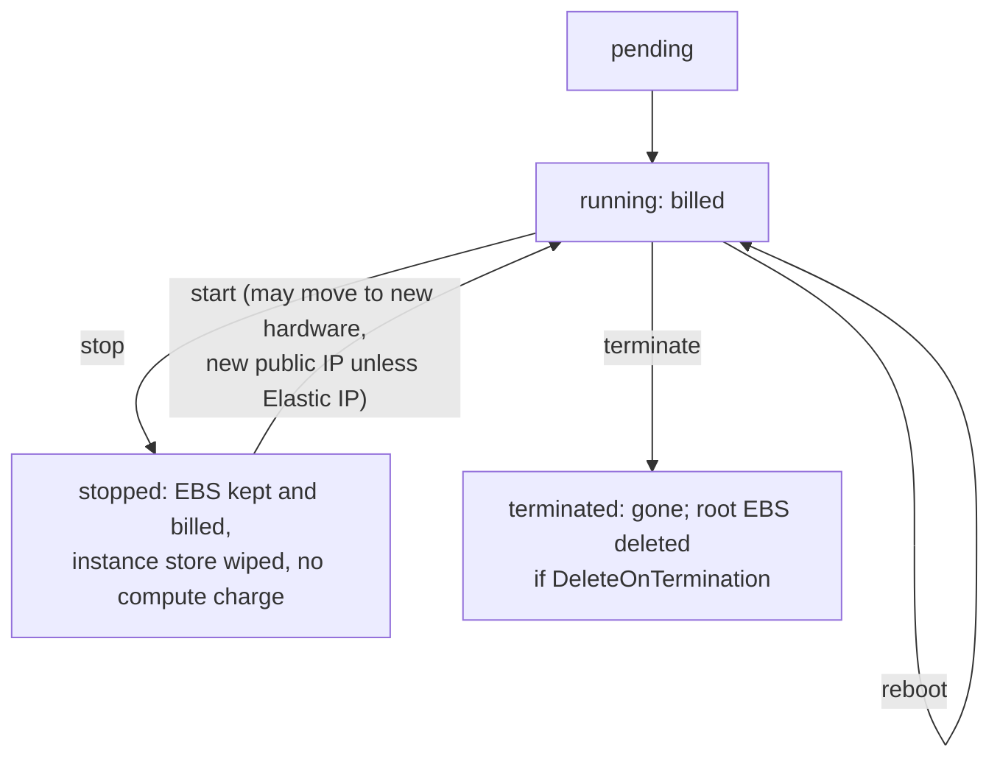

# EC2

> **Status: AI draft, 2026-11-16.** Not yet verified by me. Written from the Amazon EC2 User Guide; no AWS calls were made.

## In one line

EC2 rents virtual machines: pick an instance family and size (or Graviton for Arm), a purchase option (On-Demand, Spot, Savings Plans), an AMI and user data for setup; the instance reads its identity and role credentials from the metadata service (use IMDSv2), is reached through Session Manager rather than SSH keys, and loses instance-store data when stopped.

## The plain idea

An EC2 instance is a computer in an AWS data centre that you start from an image (AMI), in one subnet of your VPC, with a size you choose. You pay while it runs. It behaves like any Linux server ([Shell and filesystem](../linux/shell-and-filesystem.md)), with a few cloud specifics: it learns about itself (and gets temporary AWS credentials) from a local metadata endpoint, it can be replaced in minutes, and anything not on a persistent volume can vanish.

## How it works

### Instance types

Names like `m7g.large` read as **family** (`m`, general purpose), **generation** (`7`), **attributes** (`g` = Graviton Arm processor, `i` Intel, `a` AMD, `d` local NVMe instance store, `n` extra networking), and **size** (`large`, `xlarge`, `2xlarge`...).

| Family | For |
|---|---|
| `t` (burstable) | Low average CPU with occasional bursts; CPU credits accrue below baseline and are spent above it |
| `m` (general purpose) | Balanced CPU and memory: most services |
| `c` (compute optimised) | CPU-heavy work |
| `r`, `x` (memory optimised) | Caches, in-memory databases |
| `i`, `d` (storage optimised) | Fast local NVMe |
| `g`, `p` and others (accelerated) | GPUs and ML chips |

**Graviton** (Arm) instances often give better price-performance; they need Arm builds of your software and multi-architecture container images ([Images and Dockerfiles](../containers/images-and-dockerfiles.md)).

Purchase options (On-Demand, Spot, Savings Plans, Reserved Instances) are compared on [Cost optimisation](../operations/cost-optimisation.md).

### Lifecycle

- **Instance store** volumes are physically attached disks; their data survives a reboot but not stop, hibernate or terminate. Use them only for caches and scratch data ([Disks and filesystems](../linux/disks-and-filesystems.md)).
- **EBS** volumes persist independently of the instance ([EBS](ebs.md)).

### User data and cloud-init

User data is a script or cloud-init configuration passed at launch; cloud-init runs it on first boot (install packages, write config, join a cluster). Long user data slows every launch and fails silently if not logged; golden AMIs move most of it into the image ([Auto Scaling and AMIs](auto-scaling-and-amis.md)).

### The instance metadata service (IMDS)

- At `http://169.254.169.254/` the instance reads its ID, region, network details and the **temporary credentials of its instance role** ([IAM roles and STS](../aws-core/iam-roles-and-sts.md)).
- **IMDSv2** requires a session token obtained with a `PUT` request first, which blocks many SSRF attacks that trick an application into fetching a URL. Require it (`HttpTokens=required`); accounts can set IMDSv2-only as the default for new instances.
- The **hop limit** controls how many network hops the token response may travel. 1 keeps it on the instance; 2 lets containers in their own network namespace reach it. On EKS nodes, a hop limit of 1 stops pods from using the node role ([Cluster access, IRSA and Pod Identity](../eks/access-and-pod-identity.md)).

### Access: key pairs vs Session Manager

Key pairs give SSH access with a private key that must be stored and rotated, and port 22 must be reachable. **Session Manager** opens a shell through the SSM agent with IAM permissions, no inbound ports, and logging of sessions ([Systems Manager](systems-manager.md), [SSH](../linux/ssh.md)).

### Placement groups

**Cluster** placement packs instances close together for low-latency networking (HPC); **spread** puts each instance on distinct hardware to limit correlated failures; **partition** spreads groups of instances across separate racks for large distributed systems such as Kafka or HDFS.

### Status checks

EC2 reports several status check types: **system** (AWS's hardware and network; fix by stop and start to move hosts, or automatic recovery), **instance** (your OS: failed boot, full disk, wrong network config; fix inside), **attached EBS**, plus newer application and performance checks. CloudWatch alarms on them can trigger recovery or reboot.

## A concrete example

A bastion-less, hardened worker fleet for `sample-app`:

1. `m7g.large` (Graviton) from a golden AMI with the app's Arm build; user data only fetches config.
2. Launch template: IMDSv2 required, hop limit 1, encrypted gp3 root volume, instance role with Session Manager and the app's narrow permissions.
3. No key pair, no inbound SSH rule; engineers connect with Session Manager, and sessions are logged.
4. Auto Scaling group across three zones; Spot for half of the capacity with several instance types ([Auto Scaling and AMIs](auto-scaling-and-amis.md)).
5. CloudWatch alarms on status checks with automatic recovery.

## Why not just...?

- **...keep IMDSv1 because some old tool needs it?** IMDSv1 lets any SSRF bug read the instance role's credentials. Update the tool or SDK; require IMDSv2.
- **...use one big instance instead of a fleet?** It is a single point of failure and cannot scale out. Several smaller instances across zones survive failures ([High availability and failure domains](../operations/high-availability.md)).
- **...SSH in to fix things on running instances?** Changes made by hand drift and vanish on replacement. Fix the AMI or the automation, then replace instances.

## Commands to know

These were not run for this page.

| Command | What it does |
|---|---|
| `aws ec2 describe-instances --filters Name=tag:app,Values=sample-app --query 'Reservations[].Instances[].{id:InstanceId,state:State.Name,type:InstanceType}'` | Instances for an app. |
| `aws ec2 describe-instance-status --instance-ids <id>` | System and instance status checks. |
| `aws ec2 modify-instance-metadata-options --instance-id <id> --http-tokens required --http-put-response-hop-limit 1` | Require IMDSv2, hop limit 1. |
| `TOKEN=$(curl -sX PUT http://169.254.169.254/latest/api/token -H "X-aws-ec2-metadata-token-ttl-seconds: 300")` | Get an IMDSv2 token on the instance. |
| `curl -s -H "X-aws-ec2-metadata-token: $TOKEN" http://169.254.169.254/latest/meta-data/instance-id` | Read metadata with the token. |
| `aws ssm start-session --target <instance-id>` | Shell through Session Manager. |

## How it breaks

| Symptom | Layer | Check | Likely cause |
|---|---|---|---|
| Instance status check failed | OS | System log (`get-console-output`) | Boot failure, full disk, bad fstab or network config |
| System status check failed | AWS hardware | Status check type | Underlying host problem; stop and start or recover |
| Data missing after stop and start | Storage | Volume types | Data was on instance store |
| App gets no credentials | IMDS | Hop limit, IMDSv2 support | Containerised app with hop limit 1, or an SDK without IMDSv2 support |
| Burstable instance slow | CPU credits | `CPUCreditBalance` | Credits exhausted in standard mode |
| `InsufficientInstanceCapacity` at launch | Capacity | Type and zone | Try other types or zones (a reason for diversification) |

## Interview questions

**1. What is the difference between stopping and terminating an instance?**

Answer

- Stop: compute ends, EBS volumes remain (and are billed), instance store data is lost; start may land on new hardware.
- Terminate: the instance is gone; the root EBS volume is deleted if set to delete on termination.
- Neither keeps instance store data.

**2. Why use IMDSv2, and what does the hop limit do?**

Answer

- IMDSv2 requires a token from a `PUT` request, blocking common SSRF credential theft.
- The hop limit sets how far the token response travels; 1 keeps it on the host, 2 allows containers.
- On EKS nodes, hop limit 1 stops pods from using the node role.

**3. How do you get shell access without SSH keys?**

Answer

- Session Manager: the SSM agent connects out to Systems Manager; access is controlled by IAM.
- No inbound ports, no keys to manage, sessions can be logged.
- The instance needs the agent, a role with the SSM policy, and a network path to the SSM endpoints.

**4. When would you choose Graviton instances?**

Answer

- For better price-performance when the software runs on Arm (most Linux stacks, managed runtimes).
- Container images must be multi-architecture or Arm builds.
- Test performance and dependencies first.

**5. What do system and instance status check failures mean?**

Answer

- System: a problem with AWS hardware or networking under the instance; stop and start or recover.
- Instance: a problem inside the guest OS; fix the configuration, disk or boot problem.
- Alarms on both can trigger automatic actions.

**6. A T-family instance becomes slow every afternoon. Why?**

Answer

- It runs above its baseline long enough to exhaust CPU credits, then is held at the baseline.
- Check `CPUCreditBalance`; switch to unlimited mode or a non-burstable family.
- Right-size based on sustained, not average, usage.

## Try it

Without an AWS account:

1. Decode the instance type names `c7i.2xlarge`, `r7g.large` and `m6id.xlarge`.
2. Write the two `curl` commands for IMDSv2 and explain why the first is a `PUT`.
3. Write a launch template's metadata options for an EKS node and for a VM running a single app.

## Zoom out

EC2 underlies most other AWS compute (EKS nodes, ECS on EC2, many managed services). The Linux skills transfer directly; the AWS-specific parts are IMDS and roles, images and fleets, and storage lifetimes ([Auto Scaling and AMIs](auto-scaling-and-amis.md), [EBS](ebs.md), [Systems Manager](systems-manager.md)).

## Sources

- [Amazon EC2 User Guide: instance types](https://docs.aws.amazon.com/AWSEC2/latest/UserGuide/instance-types.html)
- [Amazon EC2 User Guide: instance lifecycle](https://docs.aws.amazon.com/AWSEC2/latest/UserGuide/ec2-instance-lifecycle.html)
- [Amazon EC2 User Guide: instance store lifetime](https://docs.aws.amazon.com/AWSEC2/latest/UserGuide/instance-store-lifetime.html)
- [Amazon EC2 User Guide: instance metadata service](https://docs.aws.amazon.com/AWSEC2/latest/UserGuide/configuring-instance-metadata-service.html)
- [Amazon EC2 User Guide: IMDS defaults for new instances](https://docs.aws.amazon.com/AWSEC2/latest/UserGuide/configuring-IMDS-new-instances.html)
- [Amazon EC2 User Guide: user data](https://docs.aws.amazon.com/AWSEC2/latest/UserGuide/user-data.html)
- [Amazon EC2 User Guide: burstable performance instances](https://docs.aws.amazon.com/AWSEC2/latest/UserGuide/burstable-performance-instances.html)
- [Amazon EC2 User Guide: placement groups](https://docs.aws.amazon.com/AWSEC2/latest/UserGuide/placement-groups.html)
- [Amazon EC2 User Guide: status checks](https://docs.aws.amazon.com/AWSEC2/latest/UserGuide/monitoring-system-instance-status-check.html)
- [AWS Graviton](https://aws.amazon.com/ec2/graviton/)
