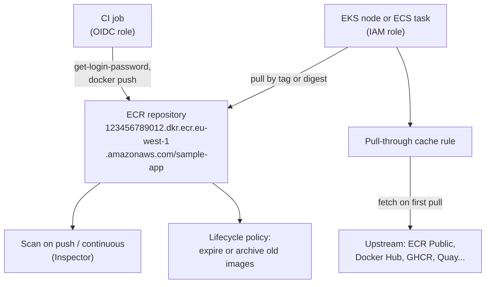

# ECR

> **Status: AI draft, 2026-11-16.** Not yet verified by me. Written from the Amazon ECR User Guide; no AWS calls were made.

## In one line

ECR is a private container registry per account and Region. IAM issues 12-hour login tokens; repository policies allow cross-account pulls; tag immutability, scanning, lifecycle policies and pull-through caches keep images trustworthy, cheap and available.

## How it works

- **Registry and repositories**: every account has one private registry per Region, at `<account>.dkr.ecr.<region>.amazonaws.com`. Repositories (`sample-app`) hold images by tag and digest ([Registries and image security](../containers/registries-and-image-security.md)).
- **Authentication**: `GetAuthorizationToken` returns a token valid for **12 hours**, with the permissions of the IAM principal that asked. `aws ecr get-login-password --region eu-west-1` piped into `docker login --username AWS --password-stdin <registry>` is the usual form; the ECR credential helper does it automatically.
- **Who pulls**: EKS nodes use the node role's ECR read permissions (kubelet's credential provider fetches tokens); ECS uses the task execution role; for Lambda container images, either the execution role or the repository policy must allow `ecr:BatchGetImage` and `ecr:GetDownloadUrlForLayer`. CI pushes through a role assumed with OIDC, not stored keys ([OIDC from pipelines to AWS](../cicd/oidc-to-aws.md)).
- **Repository policies** are resource policies: allow another account's role to pull (`ecr:BatchGetImage`, `ecr:GetDownloadUrlForLayer`, `ecr:BatchCheckLayerAvailability`). The other account's role also needs IAM permissions, including `ecr:GetAuthorizationToken`. Registry-level policies control replication and pull-through cache.
- **Tag immutability**: pushing an existing tag fails with `ImageTagAlreadyExistsException`. Exclusion filters can leave a few tags (such as `latest`) mutable while the rest are immutable.
- **Scanning**: **basic** scanning (AWS-native, on push or manual, OS packages) or **enhanced** scanning through Amazon Inspector (OS and language packages, on push and continuously as new CVEs appear) ([GuardDuty, Security Hub and Inspector](security-services.md)).
- **Lifecycle policies**: rules by tag status, tag prefix or pattern, image count (`imageCountMoreThan`) or age (`sinceImagePushed`, and newer criteria such as `sinceImagePulled`) that **expire** images or move them to an **archive** storage class. Storage is billed per GB-month, so CI repositories without a policy grow forever.
- **Pull-through cache**: a rule maps a prefix in your registry to an upstream registry (ECR Public, the Kubernetes registry and Quay without credentials; Docker Hub, GitHub Container Registry, Azure Container Registry and GitLab with credentials in Secrets Manager). The first pull fetches and stores the image; later pulls come from ECR, which avoids public rate limits and outages.
- **Replication** copies images to other Regions or accounts; images are encrypted at rest (AES-256 by default, or KMS).

## Interview questions

**1. Pods on EKS show `ImagePullBackOff` with an ECR image. What do you check?**

Answer

- The exact error in `kubectl describe pod`: not found (wrong tag, Region or account) or unauthorized.
- Node role has ECR read permissions; for another account, the repository policy allows the node role and KMS permissions if a KMS key is used.
- Network path from nodes to ECR (NAT or the `ecr.api`, `ecr.dkr` and S3 gateway endpoints) ([Pods](../kubernetes/pods.md)).

**2. How does CI push to ECR without long-lived keys?**

Answer

- The CI provider's OIDC token is exchanged for a role session with `AssumeRoleWithWebIdentity`.
- The role allows `GetAuthorizationToken` and push actions on the one repository; `get-login-password` then `docker push`.

**3. Why turn on tag immutability, and what is the catch?**

Answer

- A tag then always means the same image, so deploys and rollbacks are reproducible and a tag cannot be silently replaced.
- Catch: workflows that re-push `latest` or `dev` break; use exclusion filters for those or deploy by digest.

**4. The ECR bill keeps growing. What do you do?**

Answer

- Lifecycle policies: expire untagged images after a few days, keep the last N images per branch prefix, archive old releases instead of deleting.
- Check replication to many Regions and large base layers.

**5. Why use a pull-through cache for public base images?**

Answer

- Avoids Docker Hub and other public rate limits and outages during deploys and node scale-out.
- Images can be scanned in ECR and pulled through VPC endpoints like any private image.

## Sources

- [ECR User Guide: private registry authentication (12-hour tokens)](https://docs.aws.amazon.com/AmazonECR/latest/userguide/registry_auth.html)
- [ECR User Guide: tag mutability and exclusions](https://docs.aws.amazon.com/AmazonECR/latest/userguide/image-tag-mutability.html)
- [ECR User Guide: image scanning](https://docs.aws.amazon.com/AmazonECR/latest/userguide/image-scanning.html)
- [ECR User Guide: lifecycle policies](https://docs.aws.amazon.com/AmazonECR/latest/userguide/LifecyclePolicies.html)
- [ECR User Guide: pull-through cache](https://docs.aws.amazon.com/AmazonECR/latest/userguide/pull-through-cache.html)
- [Lambda Developer Guide: container images and ECR permissions](https://docs.aws.amazon.com/lambda/latest/dg/images-create.html)
