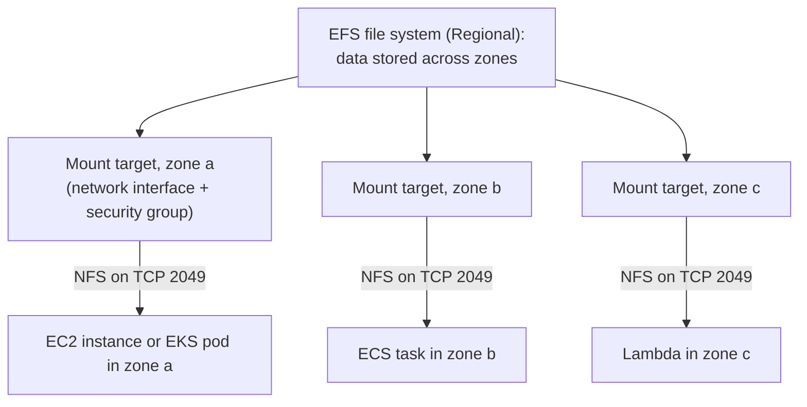

# EFS

> **Status: AI draft, 2026-11-16.** Not yet verified by me. Written from the Amazon EFS User Guide; no AWS calls were made.

## In one line

EFS is a managed NFS file system that many instances, containers and Lambda functions in different Availability Zones can mount at once. Clients connect through a mount target in their zone on NFS port 2049; throughput modes, storage classes with lifecycle rules, access points (fixed POSIX user and root directory) and TLS in transit tune cost, performance and isolation.

## The plain idea

Some data needs to be read and written by many machines at the same time: uploaded files, shared content, home directories. An EBS volume belongs to one instance in one zone ([EBS](ebs.md)); S3 is object storage with its own API ([S3](s3.md)). EFS is a shared folder in the classic sense: mount it with NFS and every client sees the same files, with normal file permissions, from any zone ([Disks and filesystems](../linux/disks-and-filesystems.md)).

## How it works

### Mount targets and security groups

- A **mount target** is a network interface in one subnet per zone. Clients mount through the target in their own zone, using the file system's DNS name.
- The mount target's security group must allow **inbound TCP 2049** from the clients' security groups; the clients must be allowed outbound to it ([Security groups and NACLs](../aws-core/security-groups-and-nacls.md)).
- **One Zone** file systems store data in a single zone at lower cost, with lower durability across zones.

### Performance and throughput

| Setting | Options | Notes |
|---|---|---|
| Performance mode | **General Purpose** (default, lowest latency) or Max I/O (higher per-operation latency) | General Purpose fits nearly every workload |
| Throughput mode | **Elastic** (scales with demand, pay per use), **Provisioned** (fixed throughput), **Bursting** (scales with stored size, with credits) | Elastic suits spiky or unpredictable workloads; Bursting can run out of credits on small file systems |

NFS adds latency per operation: workloads with many small files or metadata operations (`npm install`, Git checkouts, small random writes) are slow on any network file system.

### Storage classes and lifecycle

Files move between **Standard**, **Infrequent Access (IA)** and **Archive** by lifecycle policies based on time since last access, and can move back to Standard when accessed again. Cold data then costs much less, with higher per-access charges ([Cost optimisation](../operations/cost-optimisation.md)).

### Access points

An access point is an entry into the file system with:

- a **root directory** (the client sees only that subtree, created if missing with given ownership and permissions);
- an **enforced POSIX user and group** for every request, whatever user the client claims.

One access point per application isolates applications on a shared file system, and makes file ownership predictable for containers that run as arbitrary users. The EFS CSI driver creates one per persistent volume claim ([EBS and EFS CSI drivers](../eks/storage.md)).

### Encryption

- **At rest**: enabled at creation with a KMS key.
- **In transit**: mount with the EFS mount helper's TLS option (`-o tls`), which sets up a TLS tunnel for the NFS traffic; IAM authorisation (`-o iam`) can also be enforced with file system policies.

### EFS vs EBS vs S3

| | EFS | EBS | S3 |
|---|---|---|---|
| Access | NFS file system, many clients | Block device, one instance (Multi-Attach aside) | HTTP object API |
| Zones | All zones of the region (Regional) | One zone | Regional |
| Latency | Low milliseconds | Lowest | Higher per request |
| Pricing | Per GB stored (by class) plus throughput mode | Per GB provisioned plus IOPS and throughput | Per GB stored plus requests and transfer |
| Best for | Shared files, content, home directories | Databases, boot volumes, single-writer state | Objects, backups, static assets, data lakes |

## A concrete example

`sample-app`'s web pods share uploaded documents:

1. A Regional EFS file system, Elastic throughput, encrypted with a KMS key; mount targets in the three private subnets.
2. Security group `sg-efs` allows TCP 2049 from the node security group.
3. The EFS CSI driver's StorageClass creates an access point per claim under `/apps`, with the app's uid and gid.
4. A lifecycle policy moves files untouched for 30 days to IA, and back on access.
5. Pods mount with TLS in transit enabled.

## Why not just...?

- **...run a database on EFS for multi-zone storage?** NFS latency and locking semantics hurt databases. Use EBS with database replication, or a managed database ([RDS and Aurora](rds-and-aurora.md)).
- **...use EFS for build caches and dependency folders?** Thousands of small-file operations over NFS are slow. Use local disk or EBS, and EFS for genuinely shared data.
- **...skip access points and rely on client users?** Containers often run as different uids, leading to permission errors or overly open permissions. Access points enforce one owner per app.

## Commands to know

These were not run for this page.

| Command | What it does |
|---|---|
| `aws efs describe-file-systems` | File systems, throughput mode, size. |
| `aws efs describe-mount-targets --file-system-id <id>` | Mount targets per subnet and their state. |
| `aws efs describe-access-points --file-system-id <id>` | Access points, root directories, POSIX users. |
| `sudo mount -t efs -o tls <fs-id>:/ /mnt/efs` | Mount with the EFS mount helper and TLS. |
| `sudo mount -t efs -o tls,accesspoint=<ap-id> <fs-id>:/ /mnt/app` | Mount through an access point. |
| `nc -vz <mount-target-ip> 2049` | Test the NFS port from a client ([Network tools on Linux](../networking/network-tools.md)). |

## How it breaks

| Symptom | Layer | Check | Likely cause |
|---|---|---|---|
| Mount hangs or times out | Network | Security groups, mount target in the zone | TCP 2049 blocked, or no mount target in the client's zone |
| `mount.nfs4: access denied` or `Permission denied` | Permissions | File system policy, access point, POSIX owner | IAM or file system policy denies, or the user does not own the directory |
| Writes slow on small files | Workload fit | Operation pattern | Metadata-heavy workload on NFS |
| Throughput dropped after days of activity | Bursting credits | `BurstCreditBalance` | Bursting mode credits exhausted; switch to Elastic |
| DNS name does not resolve | VPC DNS | VPC DNS settings | DNS resolution or hostnames disabled in the VPC ([DNS](../networking/dns.md)) |

## Interview questions

**1. When would you choose EFS over EBS?**

Answer

- When several clients, possibly in different zones, must read and write the same files.
- EBS is for one instance's block storage in one zone, lower latency.
- For objects and static assets, S3 often beats both.

**2. What is a mount target and what does it need?**

Answer

- A network interface for the file system in one subnet per zone.
- Its security group must allow TCP 2049 from clients.
- Clients use the target in their own zone through the file system's DNS name.

**3. What is an EFS access point for?**

Answer

- A per-application entry with its own root directory and an enforced POSIX user and group.
- Isolates apps on one file system and fixes ownership problems with containers.
- The EFS CSI driver creates one per claim.

**4. An EFS mount hangs from a new node group. What do you check?**

Answer

- Security groups: TCP 2049 from the new nodes' security group to the mount targets.
- A mount target exists in the nodes' zones and subnets.
- DNS resolution of the file system name and NACLs.

**5. Elastic, Provisioned or Bursting throughput?**

Answer

- Elastic: scales automatically, pay for what you use; good for spiky or unknown loads.
- Provisioned: fixed throughput independent of size, for steady high demand.
- Bursting: tied to stored size with credits; small file systems can run out.

**6. How do you reduce EFS storage cost?**

Answer

- Lifecycle policies to Infrequent Access and Archive for cold files.
- One Zone where cross-zone durability is not needed.
- Delete or move data that belongs in S3.

## Try it

Without AWS:

1. Write the security group rules (inbound and outbound) for an EFS file system used by one node group.
2. Design access points for three applications sharing one file system, with uid, gid and root directories.
3. For three workloads you know, choose EFS, EBS or S3 and justify each in one line.

## Zoom out

EFS completes the AWS storage trio with EBS and S3, and is the usual answer for ReadWriteMany volumes on EKS and shared storage for ECS and Lambda ([EBS and EFS CSI drivers](../eks/storage.md), [ECS and Fargate](../serverless/ecs-and-fargate.md)).

## Sources

- [Amazon EFS User Guide: what is Amazon EFS](https://docs.aws.amazon.com/efs/latest/ug/whatisefs.html)
- [Amazon EFS User Guide: performance](https://docs.aws.amazon.com/efs/latest/ug/performance.html)
- [Amazon EFS User Guide: lifecycle management](https://docs.aws.amazon.com/efs/latest/ug/lifecycle-management-efs.html)
- [Amazon EFS User Guide: access points](https://docs.aws.amazon.com/efs/latest/ug/efs-access-points.html)
- [Amazon EFS User Guide: encryption in transit](https://docs.aws.amazon.com/efs/latest/ug/encryption-in-transit.html)
- [Amazon EFS User Guide: security groups and NFS port 2049](https://docs.aws.amazon.com/efs/latest/ug/network-access.html)
- [Amazon EFS User Guide: troubleshooting mounting](https://docs.aws.amazon.com/efs/latest/ug/troubleshooting-efs-mounting.html)
