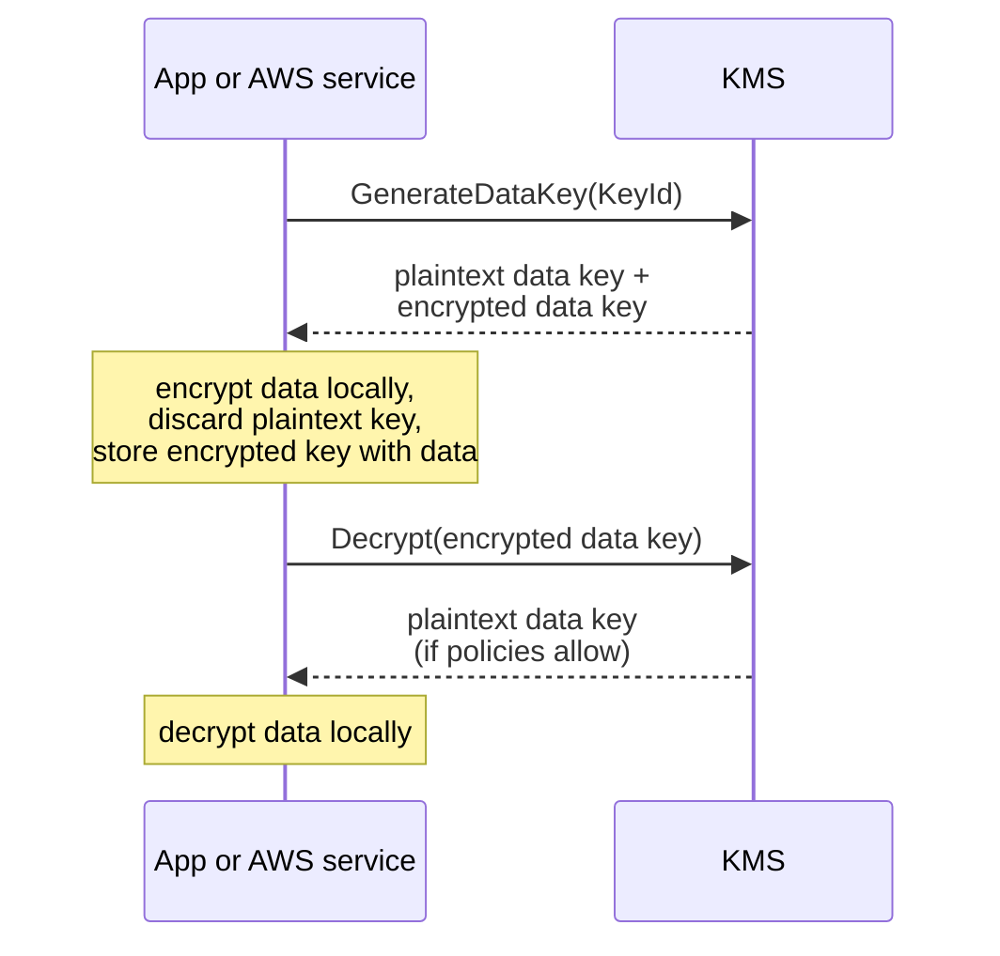

# KMS, Secrets Manager and Parameter Store

> **Status: AI draft, 2026-11-16.** Not yet verified by me. Written from the AWS KMS, Secrets Manager and Systems Manager guides; no AWS calls were made.

## In one line

KMS holds encryption keys that never leave it and encrypts data keys for services (envelope encryption), with access controlled by key policies, IAM and grants. Secrets Manager stores secrets with versions and automatic rotation; Parameter Store holds configuration and SecureString values more cheaply, without built-in rotation.

## The plain idea

A bank keeps the master key to the vault in the vault itself; you never take it home. When you need to lock a box, the bank cuts you a small key, gives you a copy, and also hands you that small key locked with the master key. You lock your box, throw away your copy, and keep the locked small key next to the box. To open it later, you ask the bank to unlock the small key. That is **envelope encryption**, and the bank is **KMS**.

A **secret store** is a different job: a safe place for passwords and API tokens that applications fetch at runtime instead of keeping them in code or config files ([Secrets management](../security/secrets-management.md)).

## How it works

### KMS keys

| Type | Who manages | Notes |
|---|---|---|
| Customer managed key | You | Your key policy, optional rotation, can disable or delete; a monthly charge per key |
| AWS managed key (`aws/s3`, `aws/ebs`...) | AWS on your behalf | Rotated every year; you cannot change its policy, so no cross-account use |
| AWS owned key | AWS, shared | Invisible to you; used by default by some services |

- Most keys are **symmetric** (AES-256) and never leave KMS. **Asymmetric** keys sign or encrypt with a public key you can download.
- `Encrypt` handles at most 4,096 bytes directly; anything larger uses a **data key** (envelope encryption). Services such as S3, EBS and RDS do this for you.
- **Rotation**: automatic rotation creates new key material every year by default (a custom period is possible) and keeps old material to decrypt old data; the key ID stays the same. On-demand rotation is also possible.
- **Deletion** needs a waiting period of 7 to 30 days (default 30). Data encrypted under a deleted key is lost for good, so **disable** first and watch for failures.
- **Multi-Region keys** share key material across Regions for data that moves between them.

### Who can use a key

- The **key policy** is the primary control; every key has exactly one. The default policy's first statement gives the account (`arn:aws:iam::123456789012:root`) full access, which **lets IAM policies grant use of the key**. Remove that statement and IAM policies alone no longer work.
- **IAM policies** grant `kms:Decrypt`, `kms:GenerateDataKey` and others, if the key policy allows IAM.
- **Grants** give a specific principal temporary, narrow permissions; services such as EBS create them when they attach an encrypted volume.
- **Cross-account**: the key policy must name the other account, and that account's IAM policy must allow the actions.
- Every use is a CloudTrail event, which makes KMS an audit trail for data access ([CloudTrail, Athena and Config](cloudtrail-and-config.md)).

### Secrets Manager

- Stores a **secret** (a string or JSON, usually credentials) encrypted with a KMS key.
- **Versions** carry labels: `AWSCURRENT` (what reads return), `AWSPREVIOUS` (the last one) and `AWSPENDING` (during rotation).
- **Rotation**: **managed rotation** for supported services (no Lambda to maintain), or a **rotation Lambda** that creates a new credential, sets it in the database, tests it and moves `AWSCURRENT`.
- **Resource policies** allow cross-account access; replication copies secrets to other Regions.
- Deleting a secret starts a **recovery window** of at least seven days, during which it can be restored.

### Parameter Store

- Part of Systems Manager. Hierarchical names such as `/sample-app/prod/db-host`; types **String**, **StringList** and **SecureString** (encrypted with KMS).
- **Standard tier**: up to 10,000 parameters, values up to 4 KB, no extra charge. **Advanced tier**: up to 100,000 parameters, 8 KB values, parameter policies (such as expiry), charged.
- No built-in rotation. Good for configuration and for secrets you rotate yourself.

### Comparison

| Need | Secrets Manager | Parameter Store |
|---|---|---|
| Automatic rotation | Yes | No |
| Cost | Per secret per month plus API calls | Standard tier free |
| Value size | Larger (credentials, certificates) | 4 KB standard, 8 KB advanced |
| Cross-account sharing | Resource policy | Advanced parameters can be shared through AWS RAM |
| Typical use | Database passwords, API keys | Configuration, feature flags, simple secrets |

### Reading secrets in an application

- Fetch at startup or through a cache, not on every request: calls cost money and can throttle. Lambda can use the **Parameters and Secrets Lambda Extension**, which caches values.
- On Kubernetes, sync secrets into the cluster with External Secrets Operator or the Secrets Store CSI driver ([Secrets from AWS into pods](../eks/secrets.md)).
- Never log secret values; mask them in CI ([Pipeline security](../cicd/pipeline-security.md)).
- Handle rotation: on an authentication failure, re-read the secret once and reconnect.

## A concrete example

`sample-app` in account `123456789012`:

1. A customer managed key `alias/sample-app` with rotation on; key policy allows the account (so IAM works) and names the app role for `kms:Decrypt`.
2. S3, EBS and the database use the key; the app role cannot schedule deletion.
3. The database password lives in Secrets Manager with managed rotation every 30 days.
4. Non-secret configuration (`/sample-app/prod/feature-x`) lives in Parameter Store, standard tier.
5. Pods read the password through External Secrets Operator with a refresh interval; the app reconnects on authentication failure.
6. A CloudWatch alarm watches for `kms:ScheduleKeyDeletion` and `DisableKey` events.

## Why not just...?

- **...put secrets in environment variables in the task definition or Helm values?** They end up in source control, in `describe` output and in logs. Store a reference and fetch at runtime.
- **...use AWS managed keys everywhere?** Simple, but you cannot edit the key policy, share across accounts or control rotation. Use customer managed keys for anything shared or sensitive.
- **...delete an unused key straight away?** Anything still encrypted under it becomes unreadable forever. Disable it, watch CloudTrail for failed uses, then schedule deletion.
- **...use Secrets Manager for all configuration?** It costs per secret; plain configuration belongs in Parameter Store or config files.

## Commands to know

These were not run for this page.

| Command | What it does |
|---|---|
| `aws kms list-aliases` | Keys by alias, including AWS managed `aws/...` keys. |
| `aws kms describe-key --key-id alias/sample-app` | State, type, manager, origin. |
| `aws kms get-key-policy --key-id <id> --policy-name default --output text` | The key policy. |
| `aws kms get-key-rotation-status --key-id <id>` | Whether automatic rotation is on, and the period. |
| `aws kms list-grants --key-id <id>` | Grants on the key. |
| `aws secretsmanager describe-secret --secret-id <name>` | Versions, labels, rotation settings (no value). |
| `aws secretsmanager get-secret-value --secret-id <name> --query SecretString --output text` | Read the current value; avoid in shared terminals. |
| `aws secretsmanager rotate-secret --secret-id <name>` | Rotate now. |
| `aws ssm get-parameters-by-path --path /sample-app/prod --with-decryption` | Read a tree of parameters. |

## How it breaks

| Symptom | Layer | Check | Likely cause |
|---|---|---|---|
| `AccessDeniedException` calling `kms:Decrypt` | Key policy or IAM | Key policy, caller's IAM policy | Key policy does not allow the caller or IAM; cross-account side missing |
| S3 or EBS access denied only for encrypted resources | KMS | Key used by the resource | Caller lacks permissions on that key ([S3 security](s3-security.md)) |
| `KMSInvalidStateException` | Key state | `describe-key` | Key disabled or pending deletion |
| App fails after rotation | Rotation | Secret versions, rotation logs | App cached the old password and never re-reads; rotation Lambda failed mid-way |
| `ThrottlingException` from KMS or Secrets Manager | Request rate | CloudTrail call counts | Fetching on every request; no caching; no S3 Bucket Key |
| Secret visible in logs | Application | Log search | App or CI printed it; rotate it now |

## Interview questions

**1. Explain envelope encryption.**

Answer

- KMS generates a data key, returning it in plaintext and encrypted under the KMS key.
- Data is encrypted locally with the plaintext key, which is then discarded; the encrypted key is stored with the data.
- To read, KMS decrypts the data key (after checking policy). The KMS key never leaves KMS, and large data never goes to KMS.

**2. How do key policies and IAM policies interact?**

Answer

- The key policy is primary; IAM policies only work if the key policy allows the account (the default "Enable IAM User Permissions" statement).
- Explicit denies in either still apply.
- Cross-account needs both the key policy and the other account's IAM policy.

**3. Secrets Manager or Parameter Store?**

Answer

- Secrets Manager for credentials needing rotation, cross-account sharing or replication.
- Parameter Store for configuration and simple secrets; free standard tier, no rotation.

**4. What happens when a KMS key is rotated, and when it is deleted?**

Answer

- Rotation adds new key material; old material stays to decrypt old data; the key ID and ARN do not change; nothing needs re-encrypting.
- Deletion after a 7 to 30 day wait destroys the key; data under it cannot be decrypted. Disable first to find users.

**5. How does a rotated database password reach running applications without an outage?**

Answer

- Rotation creates the new credential, updates the database, tests, then moves `AWSCURRENT`; the previous version stays as `AWSPREVIOUS`.
- Apps cache with a short refresh and re-read on authentication errors.
- Alternating-user rotation keeps the old user valid while apps catch up.

**6. A team wants to share an encrypted S3 bucket with another account. What must change on the KMS side?**

Answer

- The bucket must use a customer managed key; AWS managed keys cannot be shared.
- Key policy grants the other account `kms:Decrypt` (and `GenerateDataKey` for writes).
- The other account's IAM policy allows the same on the key ARN.

**7. How do you keep secrets out of logs and repositories?**

Answer

- Store references, fetch at runtime; never commit values.
- Secret scanning in pre-commit hooks and CI; masked CI variables.
- If a secret leaks: rotate first, then clean history.

## Try it

Without AWS, with OpenSSL on any Linux machine or in an `ubuntu:24.04` container:

1. Imitate envelope encryption: generate a "master" key file and a random data key; encrypt a file with the data key; encrypt the data key with the master key; delete the plaintext data key; then reverse the steps.
2. Write a key policy for `alias/sample-app` that lets account `111122223333`'s role `reporting` decrypt only.
3. Decide Secrets Manager or Parameter Store for: database password, log level, third-party API token, list of allowed origins.

## Zoom out

KMS is the shared foundation of encryption across AWS services; secret stores are how applications get credentials without baking them in. Read with [Secrets management](../security/secrets-management.md) for the patterns, and [Secrets from AWS into pods](../eks/secrets.md) for Kubernetes.

## Sources

- [AWS KMS Developer Guide: data keys](https://docs.aws.amazon.com/kms/latest/developerguide/data-keys.html)
- [AWS KMS Developer Guide: cryptography essentials (envelope encryption)](https://docs.aws.amazon.com/kms/latest/developerguide/kms-cryptography.html)
- [AWS KMS API Reference: Encrypt (4,096-byte limit)](https://docs.aws.amazon.com/kms/latest/APIReference/API_Encrypt.html)
- [AWS KMS Developer Guide: default key policy](https://docs.aws.amazon.com/kms/latest/developerguide/key-policy-default.html)
- [AWS KMS Developer Guide: grants](https://docs.aws.amazon.com/kms/latest/developerguide/grants.html)
- [AWS KMS Developer Guide: rotating keys](https://docs.aws.amazon.com/kms/latest/developerguide/rotate-keys.html)
- [AWS KMS Developer Guide: deleting keys](https://docs.aws.amazon.com/kms/latest/developerguide/deleting-keys.html)
- [Secrets Manager User Guide: what is in a secret (versions and labels)](https://docs.aws.amazon.com/secretsmanager/latest/userguide/whats-in-a-secret.html)
- [Secrets Manager User Guide: rotation](https://docs.aws.amazon.com/secretsmanager/latest/userguide/rotating-secrets.html)
- [Secrets Manager User Guide: deleting a secret](https://docs.aws.amazon.com/secretsmanager/latest/userguide/manage_delete-secret.html)
- [Secrets Manager User Guide: Lambda extension with caching](https://docs.aws.amazon.com/secretsmanager/latest/userguide/retrieving-secrets_lambda.html)
- [Systems Manager User Guide: Parameter Store tiers](https://docs.aws.amazon.com/systems-manager/latest/userguide/parameter-store-advanced-parameters.html)
- [Systems Manager User Guide: shared parameters through AWS RAM](https://docs.aws.amazon.com/systems-manager/latest/userguide/parameter-store-shared-parameters.html)
