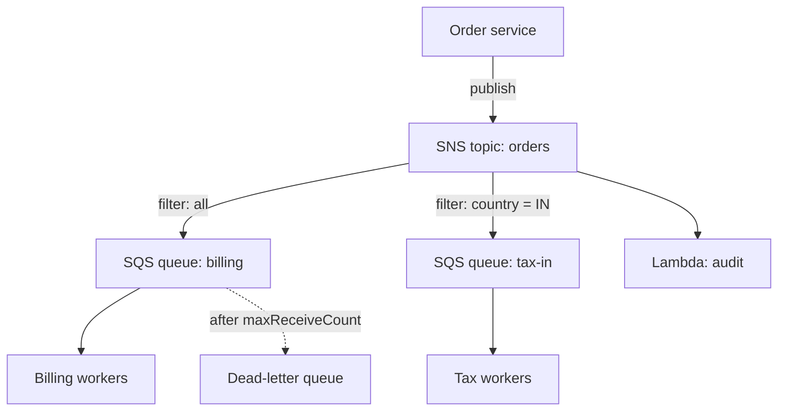

# SQS, SNS and EventBridge

> **Status: AI draft, 2026-11-16.** Not yet verified by me. Written from the SQS, SNS and EventBridge developer guides; no AWS calls were made.

## In one line

SQS is a queue: one consumer group pulls and deletes each message. SNS is a topic that pushes each message to every subscriber. EventBridge is an event bus that routes events by pattern to targets. All deliver at least once, so consumers must be idempotent; dead-letter queues catch messages that keep failing.

## The plain idea

Three ways to pass a note between programs:

- **Queue (SQS):** a tray of work. Producers drop jobs in; workers take one, do it, then throw it away. If a worker dies mid-job, the job goes back in the tray.
- **Topic (SNS):** a loudspeaker. One announcement reaches everyone subscribed, right now.
- **Event bus (EventBridge):** a mail room with sorting rules. Events arrive from many senders; rules look at what each event says and forward it to whoever cares.

All three let the sender and receiver work at different speeds and fail independently. That is called **decoupling**.

## How it works

### SQS

- **Standard queue:** nearly unlimited throughput, at-least-once delivery, best-effort order.
- **FIFO queue:** order kept within a **message group**, no duplicates introduced by SQS (5-minute deduplication window on send), 300 transactions per second per partition and API action without high-throughput mode.
- **Visibility timeout:** a received message is hidden from others for this long (default 30 seconds, maximum 12 hours). Delete it when done; otherwise it reappears. Set it longer than the processing time, and extend it with `ChangeMessageVisibility` for long jobs.
- **Dead-letter queue (DLQ):** after `maxReceiveCount` receives without a delete, the message moves to the DLQ. **Redrive** moves messages back once the bug is fixed.
- **Long polling:** `WaitTimeSeconds` up to 20 seconds returns as soon as a message arrives and avoids paying for empty receives.
- Limits: message body up to 1 MiB; retention 1 minute to 14 days (default 4 days); delivery delay up to 15 minutes.
- **Fair queues** reduce one noisy tenant's effect on others' wait times in a shared standard queue, keyed by `MessageGroupId`.

### SNS

- Publishers send to a **topic**; SNS pushes copies to every **subscription**: SQS, Lambda, HTTPS endpoints, email, SMS, Firehose.
- **Filter policies** on a subscription (matching message attributes or the payload) deliver only the messages that subscriber wants.
- SNS does not store messages for later reading; if a subscriber is down, SNS retries according to its delivery policy. Putting an SQS queue behind the topic gives each consumer a buffer.
- **FIFO topics** keep order and deduplicate, delivering to SQS queues (FIFO queues where order must hold end to end).

### EventBridge

- An **event bus** receives events: from AWS services (the default bus), your applications (custom buses), or SaaS partners.
- A **rule** has an **event pattern** (JSON that matches fields such as `source`, `detail-type` and values in `detail`) and one or more **targets** (Lambda, SQS, Step Functions, another bus, API destinations).
- On target failure EventBridge retries, by default for 24 hours and up to 185 times with backoff; configure a DLQ on the target for what still fails.
- **Archive and replay** keep events to resend later.
- Scheduled rules are now a legacy feature; **EventBridge Scheduler** is the recommended way to run things on a schedule.

### At-least-once and idempotency

Standard SQS, SNS, EventBridge and S3 notifications may deliver a message more than once. A consumer is **idempotent** when processing the same message twice has the same effect as once: store processed message IDs, use conditional writes, or make operations naturally repeatable ("set status to paid" rather than "add 100").

### Choosing

| Need | Use |
|---|---|
| Work queue, buffering, retry, rate smoothing | SQS |
| One message to many consumers now | SNS (usually with SQS behind it) |
| Route events by content from many sources, including AWS services | EventBridge |
| Strict order per key | SQS FIFO, or SNS FIFO to SQS FIFO |
| Run something every hour | EventBridge Scheduler |
| Multi-step process with state | Step Functions ([Step Functions](../serverless/step-functions.md)) |
| Very high-volume ordered streams with replay by many readers | Kinesis or Kafka (not covered here) |

## A concrete example

`sample-app` handles orders:

1. The order service publishes `OrderPlaced` to SNS topic `orders` with attribute `country`.
2. Subscriptions: SQS `billing` (all orders), SQS `tax-in` with a filter policy on `country`, Lambda `audit`.
3. `billing` has visibility timeout 120 seconds (work takes up to 40), long polling 20 seconds, and a DLQ with `maxReceiveCount` 5.
4. Workers record each processed order ID in a table with a conditional insert, so a duplicate delivery is skipped.
5. An EventBridge rule on the default bus matches EC2 instance state changes and sends them to the ops Slack integration.
6. An alarm fires when the DLQ has any messages ([CloudWatch](cloudwatch.md)).

## Why not just...?

- **...have the order service call billing over HTTP?** If billing is slow or down, orders fail. A queue absorbs the spike and retries later.
- **...use SNS alone without queues?** A subscriber that is down or slow loses its buffer; SQS behind SNS gives each consumer its own backlog and DLQ.
- **...use FIFO everywhere for safety?** Lower throughput per group, and a stuck message blocks its group. Most work only needs idempotency, not strict order.
- **...set a huge visibility timeout so messages never reappear?** A crashed worker's message then waits hours to be retried. Match it to processing time and extend while working.

## Commands to know

These were not run for this page.

| Command | What it does |
|---|---|
| `aws sqs get-queue-attributes --queue-url <url> --attribute-names All` | Backlog counts, visibility timeout, redrive policy. |
| `aws sqs receive-message --queue-url <url> --wait-time-seconds 20 --max-number-of-messages 10` | Long-poll up to 10 messages. |
| `aws sqs delete-message --queue-url <url> --receipt-handle <handle>` | Delete after processing (needs the receipt handle from receive). |
| `aws sqs start-message-move-task --source-arn <dlq-arn>` | Redrive messages from a DLQ back to the source queue. |
| `aws sns list-subscriptions-by-topic --topic-arn <arn>` | Who receives the topic's messages. |
| `aws sns get-subscription-attributes --subscription-arn <arn>` | Filter policy and delivery settings. |
| `aws events list-rules --event-bus-name default` | Rules on a bus. |
| `aws events test-event-pattern --event-pattern file://pattern.json --event file://event.json` | Check a pattern matches an event before deploying. |

Key metrics: `ApproximateNumberOfMessagesVisible` and `ApproximateAgeOfOldestMessage` for SQS, `NumberOfNotificationsFailed` for SNS, `FailedInvocations` for EventBridge rules.

## How it breaks

| Symptom | Layer | Check | Likely cause |
|---|---|---|---|
| Same message processed twice | Delivery | Message IDs in logs | At-least-once delivery, or visibility timeout shorter than processing |
| Backlog grows, oldest message ages | Consumers | `ApproximateAgeOfOldestMessage`, worker count and errors | Too few consumers, slow downstream, poison message retries |
| Messages pile up in the DLQ | Processing | DLQ messages and worker logs | Bug or bad input; fix, then redrive |
| FIFO queue stuck for one customer | Ordering | Message group in flight | One failing message blocks its group until DLQ |
| SNS to SQS delivers nothing | Permissions | SQS queue policy, KMS key policy | Queue policy does not allow the topic, or encrypted queue key does not allow SNS |
| EventBridge rule never fires | Pattern | `test-event-pattern`, `MatchedEvents` | Pattern does not match the real event shape |
| Lambda consumer throttled, messages retried | Concurrency | Lambda concurrency and errors | Batch failures retried; use partial batch responses ([Lambda](../serverless/lambda.md)) |

## Interview questions

**1. Queue, topic or event bus: when do you use which?**

Answer

- Queue: work for one consumer group, with buffering and retries.
- Topic: same message to many subscribers at once.
- Event bus: routing by event content from many sources, including AWS service events.

**2. What is the visibility timeout, and what goes wrong if it is too short?**

Answer

- The time a received message stays hidden while a consumer works on it.
- Too short: the message reappears and another worker processes it again (duplicates).
- Set above processing time; extend during long work; delete on success.

**3. How do you make a consumer idempotent?**

Answer

- Record processed message or business IDs with a conditional write; skip ones already done.
- Design operations to be repeatable (set a value rather than increment).
- Use FIFO deduplication only where order and dedup on send matter.

**4. Explain the SNS to SQS fan-out pattern and why it is common.**

Answer

- Publish once to a topic; each consumer has its own queue subscribed.
- Each queue buffers, retries and has its own DLQ; consumers scale and fail independently.
- Filter policies send each queue only what it needs.

**5. Messages are landing in the DLQ. Walk me through it.**

Answer

- Read a few DLQ messages and the worker logs for the same IDs.
- Find whether it is bad input (poison message) or a downstream failure.
- Fix, then redrive back to the source queue; alarm on DLQ depth so it is noticed sooner.

**6. Standard or FIFO queue?**

Answer

- Standard: highest throughput, at-least-once, best-effort order.
- FIFO: order within a message group and deduplication, with throughput limits per partition.
- Choose FIFO only where per-key order is a real requirement.

**7. An EventBridge rule is not triggering its Lambda. What do you check?**

Answer

- The pattern against a real event with `test-event-pattern`; the right bus.
- `MatchedEvents` and `FailedInvocations` metrics.
- The Lambda resource policy allowing EventBridge to invoke it; a DLQ on the target.

## Try it

Without AWS:

1. Write an EventBridge event pattern that matches EC2 instance state changes to `stopped` or `terminated`.
2. Write an SNS filter policy that sends only orders with `country` `IN` and `amount` above 1000.
3. For a job that takes 2 to 50 seconds, choose a visibility timeout, `maxReceiveCount` and long-poll wait, and justify each.

## Zoom out

Queues and events are how distributed systems stay up when parts are slow or down. The same ideas (buffering, retries, dead letters, idempotency) appear in Kafka, RabbitMQ and Kubernetes controllers. See [Lambda](../serverless/lambda.md) for event source mappings and [High availability](../operations/high-availability.md) for why decoupling matters.

## Sources

- [SQS Developer Guide: visibility timeout](https://docs.aws.amazon.com/AWSSimpleQueueService/latest/SQSDeveloperGuide/sqs-visibility-timeout.html)
- [SQS Developer Guide: dead-letter queues](https://docs.aws.amazon.com/AWSSimpleQueueService/latest/SQSDeveloperGuide/sqs-dead-letter-queues.html)
- [SQS Developer Guide: short and long polling](https://docs.aws.amazon.com/AWSSimpleQueueService/latest/SQSDeveloperGuide/sqs-short-and-long-polling.html)
- [SQS Developer Guide: message quotas](https://docs.aws.amazon.com/AWSSimpleQueueService/latest/SQSDeveloperGuide/quotas-messages.html)
- [SQS Developer Guide: FIFO exactly-once processing](https://docs.aws.amazon.com/AWSSimpleQueueService/latest/SQSDeveloperGuide/FIFO-queues-exactly-once-processing.html)
- [SQS Developer Guide: fair queues](https://docs.aws.amazon.com/AWSSimpleQueueService/latest/SQSDeveloperGuide/sqs-fair-queues.html)
- [SNS Developer Guide: message filtering](https://docs.aws.amazon.com/sns/latest/dg/sns-message-filtering.html)
- [SNS Developer Guide: fan-out to SQS](https://docs.aws.amazon.com/sns/latest/dg/sns-sqs-as-subscriber.html)
- [EventBridge User Guide: rules](https://docs.aws.amazon.com/eventbridge/latest/userguide/eb-rules.html)
- [EventBridge User Guide: event patterns](https://docs.aws.amazon.com/eventbridge/latest/userguide/eb-event-patterns.html)
- [EventBridge User Guide: retry policy](https://docs.aws.amazon.com/eventbridge/latest/userguide/eb-rule-retry-policy.html)
- [EventBridge User Guide: scheduled rules (legacy) and Scheduler](https://docs.aws.amazon.com/eventbridge/latest/userguide/eb-create-rule-schedule.html)
