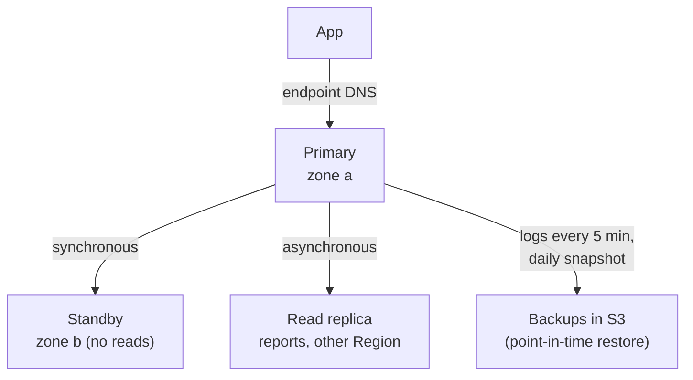
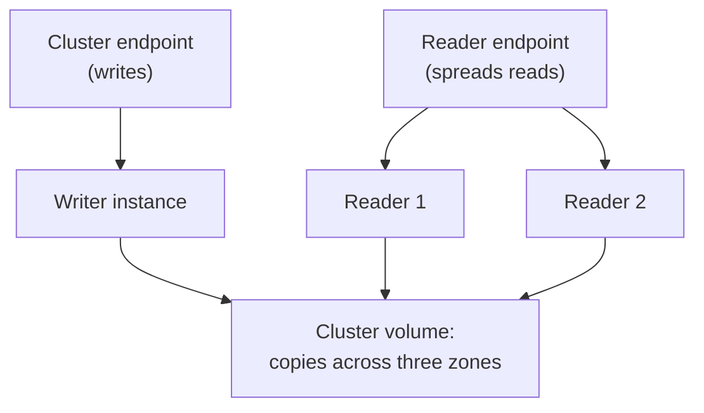

# RDS and Aurora

> **Status: AI draft, 2026-11-16.** Not yet verified by me. Written from the Amazon RDS and Aurora user guides; no AWS calls were made.

## In one line

RDS runs PostgreSQL, MySQL and other engines for you: provisioning, patching, backups and failover. Multi-AZ gives high availability, read replicas give read scaling, and point-in-time restore uses backups. Aurora separates compute from a shared storage volume copied across three zones, with writer and reader endpoints and fast failover.

## The plain idea

Running a database yourself means installing it, patching it, taking backups, testing restores, and waking up when the disk dies. RDS hands those chores to AWS. You still own the parts that need knowledge of your data: the schema, queries and indexes, sizing, connection handling, parameter tuning, who can connect, and whether your restore plan actually works ([PostgreSQL for operators](../data/postgres-for-operators.md)).

## How it works

### What AWS does and what you own

| AWS (managed) | You |
|---|---|
| Hardware, OS, engine installation | Instance class and storage size |
| Minor version patching in the maintenance window | When to apply major upgrades, and testing them |
| Automated backups and transaction log upload | Retention period, restore tests, manual snapshots |
| Failover to a standby | Connection retry and DNS caching in the app |
| Monitoring metrics | Alarms, slow query analysis, indexes |

### Multi-AZ versus read replicas

| Aspect | Multi-AZ DB instance | Multi-AZ DB cluster | Read replica |
|---|---|---|---|
| Purpose | High availability | High availability and reads | Read scaling, reporting, DR copy |
| Replication | Synchronous to one standby | Semisynchronous to two readable standbys | Asynchronous (can lag) |
| Can serve reads | No, the standby is not readable | Yes | Yes |
| Failover | Automatic; endpoint DNS points to the standby | Automatic | Manual: promote to standalone |
| Other Region | No | No | Yes (cross-Region replica) |

### Backups and point-in-time recovery

- **Automated backups**: a daily snapshot of the whole instance plus transaction logs uploaded to S3 every five minutes. Retention is 0 to 35 days (0 turns backups off); 1 to 35 for Multi-AZ DB clusters.
- **Point-in-time restore** creates a **new** instance at any second within retention, up to `LatestRestorableTime`. It never overwrites the existing one: the app must be pointed at the new endpoint.
- **Manual snapshots** stay until you delete them; copy them to another Region or account for disaster recovery ([Backup and DR](../operations/backup-and-dr.md)).

### Parameter groups

- Engine settings (`max_connections`, `work_mem`, logging) live in a **parameter group**; default groups cannot be edited, so create a custom one.
- **Dynamic** parameters apply at once; **static** ones wait for a reboot (the instance shows `pending-reboot`).
- Aurora has both **cluster** parameter groups (shared) and **instance** parameter groups.

### Aurora architecture

- Compute (instances) and storage (the **cluster volume**) are separate. Readers attach to the same volume, so there is no data copy to wait for on failover.
- The volume holds copies across three zones and grows automatically, up to 256 TiB on some engine versions.
- Up to 15 **Aurora Replicas** (readers). On failure, Aurora promotes a reader (by priority tier) and moves the **cluster endpoint** to it.
- Endpoints: **cluster** (the writer), **reader** (spreads connections across readers), **custom** (a chosen subset), **instance** (one instance, for diagnostics).
- **Aurora Serverless** instances scale in fractions of capacity units (ACUs) within a minimum and maximum you set, and can scale to zero with automatic pause and resume. Mixing serverless and provisioned instances in one cluster is allowed.

### Connections and RDS Proxy

- Each database connection costs memory, and `max_connections` is finite. Many short-lived clients (Lambda, autoscaling pods) can exhaust it.
- **RDS Proxy** keeps a pool of connections and lets many clients share them, keeps client connections open during failover, and can enforce IAM authentication with credentials in Secrets Manager ([Lambda networking and permissions](../serverless/lambda-networking-and-permissions.md)).

### Maintenance and upgrades

- A weekly 30-minute **maintenance window** runs pending patches; most finish inside it. A Multi-AZ instance may fail over to complete one.
- Major version upgrades are your decision. **Blue/Green Deployments** build a synchronised copy (green) for testing, then switch over, typically in under a minute.

## A concrete example

`sample-app` runs on Aurora PostgreSQL in `10.0.0.0/16`:

1. A DB subnet group with three private subnets; security group allows 5432 only from the app's security group.
2. One writer and two readers in different zones; the app uses the cluster endpoint for writes and the reader endpoint for reports.
3. Backups kept 14 days; a weekly manual snapshot is copied to a second Region.
4. A custom cluster parameter group sets `log_min_duration_statement` to log slow queries.
5. Lambda functions connect through RDS Proxy with IAM authentication.
6. Upgrades: Blue/Green Deployment, test the green copy, switch over in a quiet hour.

## Why not just...?

- **...run PostgreSQL on EC2 or in Kubernetes?** You can, and you take on backups, failover, patching and storage. Worth it only when you need extensions, versions or control RDS does not offer.
- **...use read replicas for high availability?** Replication is asynchronous, so promotion can lose recent writes, and promotion is manual. Multi-AZ or Aurora is the HA answer.
- **...rely on automated backups alone?** They are deleted with the instance unless you keep them, and live in the same account. Take manual snapshots and copy them out.
- **...always choose Aurora?** It costs more per instance hour and bills I/O differently; for small or steady workloads plain RDS can be cheaper.

## Commands to know

These were not run for this page.

| Command | What it does |
|---|---|
| `aws rds describe-db-instances --query "DBInstances[].[DBInstanceIdentifier,MultiAZ,DBInstanceStatus]"` | Instances, Multi-AZ flag and status. |
| `aws rds describe-db-clusters` | Aurora clusters, members, writer and endpoints. |
| `aws rds describe-db-instances --db-instance-identifier <id> --query "DBInstances[0].LatestRestorableTime"` | Latest point you can restore to. |
| `aws rds restore-db-instance-to-point-in-time --source-db-instance-identifier <id> --target-db-instance-identifier <new> --restore-time <iso-time>` | Point-in-time restore into a new instance. |
| `aws rds failover-db-cluster --db-cluster-identifier <id>` | Force an Aurora failover (test it before you need it). |
| `aws rds describe-pending-maintenance-actions` | Patches waiting for the maintenance window. |
| `aws rds describe-events --duration 1440` | Failovers, reboots and maintenance in the last 24 hours. |
| `psql "host=<endpoint> port=5432 dbname=app user=app sslmode=require"` | Connect with TLS ([PostgreSQL for operators](../data/postgres-for-operators.md)). |

## How it breaks

| Symptom | Layer | Check | Likely cause |
|---|---|---|---|
| App errors for a minute or two, then recovers | Failover | `describe-events` | Multi-AZ or Aurora failover; app cached old DNS or did not retry |
| `too many connections` | Connections | `DatabaseConnections` metric, `max_connections` | Connection leak, no pooling, Lambda scale-out |
| Reports show stale data | Replication | `ReplicaLag` | Asynchronous replica behind the primary |
| Parameter change "did nothing" | Parameter group | Status `pending-reboot` | Static parameter needs a reboot |
| Storage full, writes fail | Storage | `FreeStorageSpace` | Growth, logs or bloat; storage autoscaling off (RDS) |
| Connection times out | Network | Security group, subnet group, public access | Port not allowed from the app's security group ([VPC troubleshooting](../aws-core/vpc-troubleshooting.md)) |
| Restored database "has no data from today" | Recovery | Restore time used | Restored to an older time, or app still pointing to the old instance |

## Interview questions

**1. Multi-AZ versus read replica: what is each for?**

Answer

- Multi-AZ DB instance: synchronous standby in another zone for availability; not readable; automatic failover.
- Read replica: asynchronous copy for reads or DR, possibly in another Region; manual promotion; can lag.
- Multi-AZ DB cluster: two readable standbys, both purposes.

**2. Someone dropped a table at 14:05. How do you recover?**

Answer

- Point-in-time restore to 14:04 into a new instance.
- Export the table from the new instance and import it into production, or switch the app if the whole database should go back.
- Check `LatestRestorableTime` and retention first; afterwards, review who had DROP permission.

**3. Explain Aurora's architecture and why failover is fast.**

Answer

- Instances share one cluster volume replicated across three zones.
- Readers already see the same data, so promoting one needs no data copy.
- The cluster endpoint moves to the new writer; apps reconnect.

**4. Lambda functions keep hitting "too many connections" on RDS. What do you do?**

Answer

- Put RDS Proxy in front to pool and share connections.
- Reuse connections across invocations (create outside the handler).
- Limit Lambda concurrency if needed; check for leaks.

**5. How does an app survive a database failover?**

Answer

- Connect by endpoint name, not IP; keep DNS TTL caching low.
- Retry with backoff on connection errors; make writes idempotent where possible.
- RDS Proxy or smart drivers shorten the outage.

**6. You changed `shared_buffers` and nothing happened. Why?**

Answer

- It is a static parameter: the instance shows `pending-reboot`.
- Reboot in a quiet window (Multi-AZ can fail over during reboot).

**7. How would you do a major version upgrade with little downtime?**

Answer

- Blue/Green Deployment: create green, upgrade it, test, switch over (typically under a minute).
- Before: snapshot, check extension compatibility, rehearse on a restored copy.

## Try it

Without AWS:

1. Write the RTO and RPO you would promise for: single-AZ RDS, Multi-AZ RDS, Aurora with two readers, and a cross-Region read replica. Explain each.
2. Draw the endpoints an app should use for writes, reports and a one-off diagnostic query in Aurora.
3. List five things you still own after moving a self-managed database to RDS.

## Zoom out

RDS and Aurora turn database operations into configuration, but data modelling, query performance and recovery testing stay with you. High availability and recovery patterns are compared in [High availability](../operations/high-availability.md) and [Backup and DR](../operations/backup-and-dr.md).

## Sources

- [RDS User Guide: Multi-AZ deployments](https://docs.aws.amazon.com/AmazonRDS/latest/UserGuide/Concepts.MultiAZ.html)
- [RDS User Guide: Multi-AZ DB instance deployments](https://docs.aws.amazon.com/AmazonRDS/latest/UserGuide/Concepts.MultiAZSingleStandby.html)
- [RDS User Guide: Multi-AZ DB cluster deployments](https://docs.aws.amazon.com/AmazonRDS/latest/UserGuide/multi-az-db-clusters-concepts.html)
- [RDS User Guide: read replicas](https://docs.aws.amazon.com/AmazonRDS/latest/UserGuide/USER_ReadRepl.html)
- [RDS User Guide: automated backups](https://docs.aws.amazon.com/AmazonRDS/latest/UserGuide/USER_WorkingWithAutomatedBackups.html)
- [RDS User Guide: backup retention period](https://docs.aws.amazon.com/AmazonRDS/latest/UserGuide/USER_WorkingWithAutomatedBackups.BackupRetention.html)
- [RDS User Guide: point-in-time restore](https://docs.aws.amazon.com/AmazonRDS/latest/UserGuide/USER_PIT.html)
- [RDS User Guide: parameter groups](https://docs.aws.amazon.com/AmazonRDS/latest/UserGuide/parameter-groups-overview.html)
- [RDS User Guide: maintenance window](https://docs.aws.amazon.com/AmazonRDS/latest/UserGuide/USER_UpgradeDBInstance.Maintenance.html)
- [RDS User Guide: Blue/Green Deployments](https://docs.aws.amazon.com/AmazonRDS/latest/UserGuide/blue-green-deployments-overview.html)
- [RDS User Guide: RDS Proxy](https://docs.aws.amazon.com/AmazonRDS/latest/UserGuide/rds-proxy.html)
- [Aurora User Guide: overview](https://docs.aws.amazon.com/AmazonRDS/latest/AuroraUserGuide/Aurora.Overview.html)
- [Aurora User Guide: storage](https://docs.aws.amazon.com/AmazonRDS/latest/AuroraUserGuide/Aurora.Overview.StorageReliability.html)
- [Aurora User Guide: endpoints](https://docs.aws.amazon.com/AmazonRDS/latest/AuroraUserGuide/Aurora.Overview.Endpoints.html)
- [Amazon Aurora Serverless product page (scale to zero)](https://aws.amazon.com/rds/aurora/serverless/)
