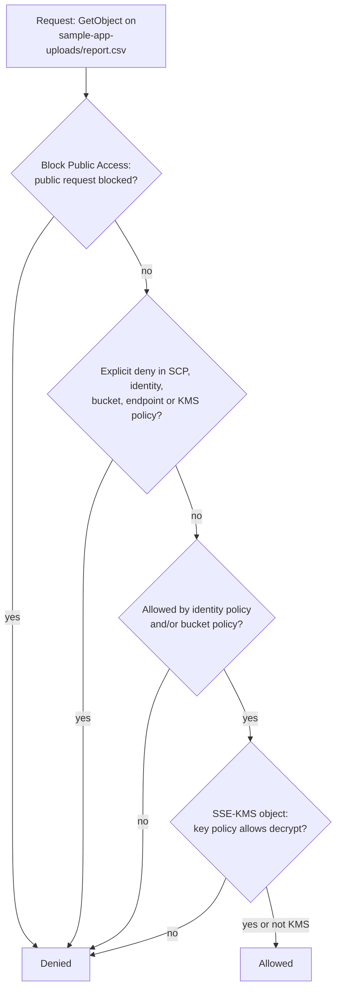

# S3 security

> **Status: AI draft, 2026-11-16.** Not yet verified by me. Written from the Amazon S3 User Guide; no AWS calls were made.

## In one line

S3 access is decided by IAM policies, the bucket policy, Block Public Access and KMS key policies together: an explicit deny wins, and cross-account access needs an allow on both sides. Encrypt by default, enforce TLS in the bucket policy, protect data with versioning and Object Lock, and audit with Access Analyzer and logs.

## The plain idea

A bucket is a locked room in a shared building. To get in you need a badge from your own employer (an IAM policy) and, if the room belongs to another company, their permission too (the bucket policy). The building has a master rule that no room may be left open to the street (Block Public Access). Some boxes in the room have their own padlock with a separate keyholder (a KMS key). Any single "no" from any of them keeps you out. Most S3 data leaks are a room someone deliberately left open to the street.

## How it works



### The layers that decide access

| Layer | Attached to | Notes |
|---|---|---|
| Identity policy | User, role, group | Your side of the request ([IAM policies and evaluation](../aws-core/iam-policies.md)) |
| Bucket policy | Bucket | Resource policy; can name other accounts or `"*"` (anyone) |
| Block Public Access | Bucket, account, access point, organization | Four settings that override any public grant; the most restrictive level wins |
| ACLs | Buckets and objects (legacy) | Disabled by default: Object Ownership is **Bucket owner enforced**, so the bucket owner owns every object |
| Access point policy | Access point | Named entry points with their own policy, for shared datasets |
| VPC endpoint policy | Gateway or interface endpoint | Limits what can be reached through the endpoint ([NAT, endpoints and PrivateLink](../aws-core/nat-endpoints-privatelink.md)) |
| SCPs and RCPs | Organization | Ceilings over every account ([Organizations and SCPs](../aws-core/organizations-and-scps.md)) |
| KMS key policy | KMS key | Needed for SSE-KMS objects ([KMS and secrets stores](kms-and-secrets.md)) |

- **Same account:** an allow in either the identity policy or the bucket policy is enough, if nothing denies.
- **Cross-account:** the bucket policy (in account A) must allow the other account's principal, **and** that principal's own identity policy (in account B) must allow the action. With SSE-KMS, the key policy must also allow the other account.
- New buckets block public access and disable ACLs by default. Leaks today usually come from someone turning these off.

### Encryption at rest

| Option | Who holds the key | Notes |
|---|---|---|
| SSE-S3 | S3 | Applied to every new object since 5 January 2023 at no extra cost; existing unencrypted objects were not changed |
| SSE-KMS | A KMS key you control | Key policy decides who can decrypt; every use is logged in CloudTrail; KMS request charges apply |
| DSSE-KMS | KMS, two layers | Dual-layer encryption for rules that require it |
| SSE-C | You send the key with each request | Disabled for new writes on new general purpose buckets since April 2026 |
| Client-side | You, before upload | S3 only ever sees ciphertext |

- **S3 Bucket Keys** make S3 use a bucket-level key derived from the KMS key, cutting KMS request costs by up to 99 percent. Turn them on with SSE-KMS.
- A bucket's **default encryption** setting applies when a request does not say otherwise; a bucket policy can also deny uploads that do not use the required encryption.

### Encryption in transit

S3 endpoints accept HTTP and HTTPS. A bucket policy denies plain HTTP with the `aws:SecureTransport` condition:

```json
{
  "Version": "2012-10-17",
  "Statement": [
    {
      "Sid": "DenyInsecureTransport",
      "Effect": "Deny",
      "Principal": "*",
      "Action": "s3:*",
      "Resource": [
        "arn:aws:s3:::sample-app-uploads",
        "arn:aws:s3:::sample-app-uploads/*"
      ],
      "Condition": { "Bool": { "aws:SecureTransport": "false" } }
    }
  ]
}
```

The same pattern with `aws:SourceVpce` restricts a bucket to requests through one VPC endpoint. A deny with `"Principal": "*"` applies to everyone, including administrators, so test it before applying.

### Protecting against deletion

- **Versioning** keeps old versions; deletes add markers ([S3](s3.md)).
- **Object Lock** (write once, read many) needs versioning and protects object versions:
    - **Governance mode:** only users with `s3:BypassGovernanceRetention`, sending the bypass header, can shorten or remove the lock.
    - **Compliance mode:** nobody can overwrite or delete the version until the retention date; the only way out early is closing the account.
    - **Legal hold:** no end date; stays until removed.
- **Replication to another account** survives a compromised source account ([Backup and DR](../operations/backup-and-dr.md)).

### Logging and auditing

| Tool | Records | Notes |
|---|---|---|
| CloudTrail management events | Bucket-level calls (policy changes, create, delete) | First copy free |
| CloudTrail data events | Object-level calls (GetObject, PutObject, DeleteObject) with the caller's identity | Paid; delivered about every 5 minutes ([CloudTrail, Athena and Config](cloudtrail-and-config.md)) |
| Server access logs | Detailed request records: requester, operation, key, status, bytes | Delivered to a bucket or CloudWatch Logs, within a few hours |
| IAM Access Analyzer for S3 | Buckets shared publicly or with other accounts | Findings per bucket, with the policy or ACL that grants it |
| Macie, Security Hub | Sensitive data in buckets; configuration checks | [GuardDuty, Security Hub and Inspector](security-services.md) |

## A concrete example

Account `123456789012` owns `sample-app-uploads`; a reporting role in account `111122223333` must read `reports/`:

1. Account-level Block Public Access on; Object Ownership is Bucket owner enforced.
2. Default encryption SSE-KMS with a customer managed key and Bucket Keys on.
3. Bucket policy: deny without TLS; allow `s3:GetObject` on `reports/*` to the role `arn:aws:iam::111122223333:role/reporting`.
4. KMS key policy: allow that role `kms:Decrypt`.
5. In account `111122223333`, the role's identity policy allows `s3:GetObject` on the same resource and `kms:Decrypt` on the key.
6. CloudTrail data events on the bucket; Access Analyzer shows one expected cross-account finding, archived with a note.

Miss step 4 or 5 and the reporting job gets `AccessDenied`, even though the bucket policy looks right.

## Why not just...?

- **...make one bucket public for convenience?** Every object becomes readable by anyone who guesses a key. Use CloudFront with Origin Access Control for public content, and presigned URLs for one-off sharing ([CloudFront and WAF](../aws-core/cloudfront-and-waf.md)).
- **...use ACLs to grant access?** They are legacy, hard to audit and disabled by default. Use bucket and identity policies.
- **...rely on SSE-S3 alone?** It protects against lost disks, not against someone with S3 permissions. SSE-KMS adds a second permission check (the key policy) and a log of every decryption.
- **...grant cross-account access with `"Principal": {"AWS": "111122223333"}`?** That trusts every principal in the account whose own policies allow it. Name the role you mean, or add conditions such as `aws:PrincipalOrgID`.

## Commands to know

These were not run for this page.

| Command | What it does |
|---|---|
| `aws s3control get-public-access-block --account-id 123456789012` | Account-level Block Public Access settings. |
| `aws s3api get-public-access-block --bucket <b>` | Bucket-level Block Public Access. |
| `aws s3api get-bucket-policy --bucket <b> --query Policy --output text` | The bucket policy as JSON. |
| `aws s3api get-bucket-policy-status --bucket <b>` | Whether S3 considers the policy public. |
| `aws s3api get-bucket-ownership-controls --bucket <b>` | Object Ownership setting (ACLs on or off). |
| `aws s3api get-bucket-encryption --bucket <b>` | Default encryption and Bucket Key setting. |
| `aws s3api get-object-lock-configuration --bucket <b>` | Object Lock mode and default retention. |
| `aws s3api head-object --bucket <b> --key <k>` | Shows `ServerSideEncryption` and the KMS key ID used for one object. |
| `aws accessanalyzer list-findings --analyzer-arn <arn>` | Public and cross-account access findings. |

## How it breaks

| Symptom | Layer | Check | Likely cause |
|---|---|---|---|
| `AccessDenied` although the IAM policy allows it | Other policies | Bucket policy denies, SCPs, VPC endpoint policy | An explicit deny elsewhere, such as a TLS or `aws:SourceVpce` condition |
| Cross-account GET denied | Two sides | Bucket policy and the caller's identity policy | Only one side allows |
| `AccessDenied` only on SSE-KMS objects | KMS | Key policy, `kms:Decrypt` in the caller's policy | Key policy does not include the caller or its account |
| `PutBucketPolicy` fails with access denied | Block Public Access | `get-public-access-block` | The policy is public and `BlockPublicPolicy` is on |
| Locked out of your own bucket | Bucket policy | Policy with a broad deny | A deny for `"*"` without an exception; the root user can remove a bucket policy that denies all principals |
| Old objects found unencrypted in an audit | History | Inventory report, encryption column | Uploaded before 5 January 2023; copy in place to re-encrypt |
| Access Analyzer shows a public bucket | Policy or ACL | Finding details | Someone turned off Block Public Access and added `"*"` |

## Interview questions

**1. Walk through how S3 decides whether a request is allowed.**

<details markdown="1">
<summary>Answer</summary>

- Block Public Access can reject public access first.
- Any explicit deny (SCP, identity, bucket, endpoint, key policy) wins.
- Then an allow is needed: identity or bucket policy in the same account, both for cross-account.
- For SSE-KMS objects, the KMS key policy must also allow decrypt.

</details>

**2. A role in another account gets `AccessDenied` reading your bucket. What do you check?**

<details markdown="1">
<summary>Answer</summary>

- Bucket policy allows that role ARN for the action and resource (object ARNs end in `/*`).
- The role's own identity policy allows the action.
- If SSE-KMS: key policy and the role's `kms:Decrypt`.
- SCPs, permission boundaries, VPC endpoint policies, and TLS or VPC conditions in the bucket policy.

</details>

**3. SSE-S3 or SSE-KMS: which and why?**

<details markdown="1">
<summary>Answer</summary>

- SSE-S3 is free and default; it protects storage media.
- SSE-KMS adds a key policy as a second gate, CloudTrail records each use, and you can disable or rotate the key.
- KMS costs per request; Bucket Keys reduce that.

</details>

**4. How do you make sure a bucket is never reached over plain HTTP?**

<details markdown="1">
<summary>Answer</summary>

- A bucket policy statement that denies all `s3:*` when `aws:SecureTransport` is false.
- Covers both the bucket ARN and the objects ARN.

</details>

**5. How would you protect backups from deletion by ransomware or a compromised admin?**

<details markdown="1">
<summary>Answer</summary>

- Versioning plus Object Lock in compliance mode for the retention period.
- Replication to a separate account with its own restricted access.
- MFA delete or SCPs that deny deleting versions and changing lock settings.

</details>

**6. How do you find public or shared buckets across an account?**

<details markdown="1">
<summary>Answer</summary>

- IAM Access Analyzer for S3 lists buckets shared publicly or with other accounts.
- Account-level and organization-level Block Public Access to prevent it.
- Security Hub and Config checks for drift; Macie for sensitive data.

</details>

**7. Governance mode versus compliance mode in Object Lock?**

<details markdown="1">
<summary>Answer</summary>

- Governance: users with `s3:BypassGovernanceRetention` can override with a header; good for testing and most needs.
- Compliance: nobody can delete or shorten retention until it expires, not even the root user.
- Legal hold: no expiry, placed and removed explicitly.

</details>

**8. What is the difference between CloudTrail data events and S3 server access logs?**

<details markdown="1">
<summary>Answer</summary>

- CloudTrail data events: object API calls with full identity details, JSON, delivered within minutes, charged.
- Server access logs: detailed request records (requester, operation, status, bytes), space-delimited text in a bucket, delivered within hours, no extra charge beyond storage when delivered to a bucket.
- For investigations use CloudTrail; for traffic analysis and cost, access logs.

</details>

## Try it

Without AWS:

1. Write a bucket policy that allows one role in `111122223333` to read `reports/*`, denies non-TLS requests, and denies requests not coming through VPC endpoint `<vpce-id>`. Then ask: would the VPC condition also block the console?
2. Write the matching identity policy for the role in `111122223333`, including the KMS permission.
3. For each layer in the access table, name one way it can deny a request that every other layer allows.

## Zoom out

S3 security is IAM evaluation applied to a resource with its own policy, plus a few S3-specific switches (Block Public Access, Object Ownership, Object Lock). Read it with [IAM policies and evaluation](../aws-core/iam-policies.md) and [Least privilege and AccessDenied](../aws-core/least-privilege-and-accessdenied.md).

## Sources

- [Amazon S3 User Guide: Block Public Access](https://docs.aws.amazon.com/AmazonS3/latest/userguide/access-control-block-public-access.html)
- [Amazon S3 User Guide: Object Ownership](https://docs.aws.amazon.com/AmazonS3/latest/userguide/about-object-ownership.html)
- [Amazon S3 User Guide: cross-account bucket permissions walkthrough](https://docs.aws.amazon.com/AmazonS3/latest/userguide/example-walkthroughs-managing-access-example2.html)
- [Amazon S3 User Guide: server-side encryption (SSE-C default change)](https://docs.aws.amazon.com/AmazonS3/latest/userguide/serv-side-encryption.html)
- [Amazon S3 User Guide: default encryption FAQ](https://docs.aws.amazon.com/AmazonS3/latest/userguide/default-encryption-faq.html)
- [Amazon S3 User Guide: S3 Bucket Keys](https://docs.aws.amazon.com/AmazonS3/latest/userguide/bucket-key.html)
- [Amazon S3 User Guide: security best practices](https://docs.aws.amazon.com/AmazonS3/latest/userguide/security-best-practices.html)
- [Amazon S3 User Guide: bucket policies for VPC endpoints](https://docs.aws.amazon.com/AmazonS3/latest/userguide/example-bucket-policies-vpc-endpoint.html)
- [Amazon S3 User Guide: Object Lock](https://docs.aws.amazon.com/AmazonS3/latest/userguide/object-lock.html)
- [Amazon S3 User Guide: logging options](https://docs.aws.amazon.com/AmazonS3/latest/userguide/logging-with-S3.html)
- [Amazon S3 User Guide: IAM Access Analyzer for S3](https://docs.aws.amazon.com/AmazonS3/latest/userguide/access-analyzer.html)
- [IAM User Guide: root user tasks (removing a bucket policy that denies everyone)](https://docs.aws.amazon.com/IAM/latest/UserGuide/id_root-user.html)
