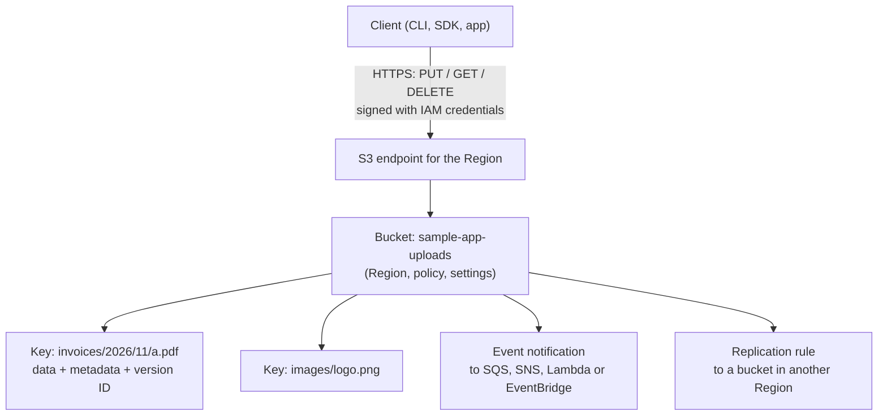
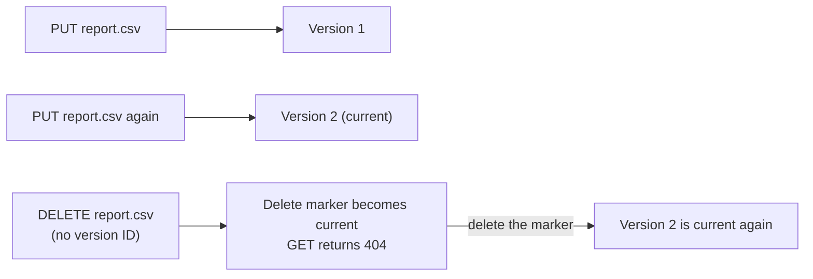

# S3

> **Status: AI draft, 2026-11-16.** Not yet verified by me. Written from the Amazon S3 User Guide; no AWS calls were made.

## In one line

S3 stores objects (bytes plus metadata) under keys in buckets, with strong read-after-write consistency. Storage classes and lifecycle rules trade cost for access speed; versioning, replication and event notifications protect and react to data; multipart upload and presigned URLs handle large files and temporary access.

## The plain idea

Imagine a huge coat check. You hand over a coat (a file), get a ticket with a name on it (the key), and later hand back the ticket to get the coat. There are no shelves or folders inside, only tickets and coats; a "folder" is just a common start of ticket names. You never modify a coat in place: you hand in a new one under the same ticket. That is **object storage**, and S3 is AWS's version of it ([Disks and filesystems](../linux/disks-and-filesystems.md) explains the block and file alternatives).

## How it works

### Buckets, objects and keys

- A **bucket** lives in one Region. General purpose bucket names share a global namespace within a partition: once taken, nobody else can create that name. An optional **account regional namespace** reserves names only your account can create.
- An **object** is the data plus metadata (content type, user metadata, tags, storage class). Its **key** is the full name, such as `invoices/2026/11/a.pdf`. The `/` is just a character; the console shows it as folders.
- Objects are replaced, not edited. A single PUT uploads up to 5 GB; larger objects need **multipart upload**. The current quota table lists a maximum object size of 48.8 TiB.

### Consistency

- S3 gives **strong read-after-write consistency** for PUT and DELETE of objects, in all Regions. This covers new objects, overwrites and deletes. Metadata reads (HEAD), tags and ACLs are strongly consistent too.
- Updates to one key are atomic, but there are no transactions across keys.
- **Bucket configuration** (for example turning on versioning, or deleting a bucket) is eventually consistent: it can take a short time to take effect everywhere.
- **Conditional writes** (`If-None-Match`, `If-Match` headers) stop one writer silently overwriting another.

### Storage classes and lifecycle

| Class | For | Catch |
|---|---|---|
| Standard | Frequently read data | Highest storage price |
| Intelligent-Tiering | Unknown or changing access | Small monitoring charge per object; moves objects between tiers for you |
| Standard-IA, One Zone-IA | Read rarely but needed fast | Retrieval charge; minimum 30 days and 128 KB billed; One Zone keeps one zone only |
| Glacier Instant Retrieval | Archive read about once a quarter, in milliseconds | Minimum 90 days |
| Glacier Flexible Retrieval | Archive restored in minutes to hours | Restore before reading |
| Glacier Deep Archive | Archive read less than once a year | Restore takes hours; minimum 180 days |

A **lifecycle configuration** holds rules of two kinds: **transition** actions move objects to a cheaper class after some days, and **expiration** actions delete them. Rules can target a prefix or tags, and noncurrent versions separately. A rule to abort incomplete multipart uploads stops paying for parts nobody finished.

### Versioning and delete markers

- A bucket is **unversioned** (default), **versioning-enabled** or **versioning-suspended**. Once enabled, it can never return to unversioned, only be suspended.
- Each write creates a full new version, and every version is billed.
- A DELETE without a version ID adds a **delete marker**; a GET then returns 404, but older versions remain. Deleting the marker restores the object. Deleting a specific version ID removes that version permanently.
- Objects that existed before versioning was enabled have version ID `null`.
- **MFA delete** and **Object Lock** add protection against deletion ([S3 security](s3-security.md)).

### Replication

- Rules copy new objects to another bucket in the same Region (SRR) or another Region (CRR). **Both buckets must have versioning enabled**, and S3 uses an IAM role you provide.
- Replication covers objects written after the rule exists. For existing objects, use **S3 Batch Replication**.
- **Replication Time Control** replicates 99.99 percent of new objects within 15 minutes, backed by an SLA.
- Uses: disaster recovery copies, compliance, data close to users, separate accounts for backups ([Backup and DR](../operations/backup-and-dr.md)).

### Event notifications

- S3 can send events (object created, removed, restored, replicated and more) to SNS, SQS, Lambda or EventBridge.
- Delivery is **at least once**, so consumers must handle duplicates ([SQS, SNS and EventBridge](messaging.md)).
- SQS FIFO queues are not direct destinations; route through EventBridge.
- Classic pattern: upload lands in S3, event triggers a Lambda that processes it ([Lambda](../serverless/lambda.md)).

### Multipart upload and presigned URLs

- **Multipart upload** splits an object into up to 10,000 parts of 5 MiB to 5 GiB (the last part can be smaller). Parts upload in parallel and retry independently. AWS recommends it from 100 MB.
- A **presigned URL** carries a signature made with someone's credentials, giving time-limited access to one object without sharing the credentials. With IAM user credentials it can last up to 7 days; the console allows up to 12 hours. It can never grant more than the signer could do, and it stops working if the signer's credentials expire first.

### Request rates

S3 scales automatically; a single prefix supports at least 3,500 PUT/COPY/POST/DELETE or 5,500 GET/HEAD requests per second, and more prefixes multiply that. A sudden burst can still meet `503 Slow Down` while S3 scales; SDK retries with backoff handle it.

### Static websites

- S3 **website endpoints** serve `index.html` and error pages, but **do not support HTTPS**, and the bucket must be publicly readable.
- The usual production setup is a **private bucket behind CloudFront** with Origin Access Control: HTTPS with an ACM certificate, caching, WAF, and no public bucket ([CloudFront and WAF](../aws-core/cloudfront-and-waf.md)).

### Costs

You pay for storage (per GB-month, by class), requests (per thousand, with writes priced above reads), retrievals from IA and Glacier classes, and data transfer out to the internet or other Regions. Exact prices are on the pricing page; [Cost optimisation](../operations/cost-optimisation.md) covers the habits.

## A concrete example

`sample-app` stores user uploads:

1. Bucket `sample-app-uploads-123456789012` in `eu-west-1`, versioning enabled, Block Public Access on, default encryption with SSE-KMS ([S3 security](s3-security.md)).
2. The app gets a presigned PUT URL from its API (valid 15 minutes) so browsers upload straight to S3 without going through the servers.
3. An `ObjectCreated` event goes to an SQS queue; workers scan and resize the files, handling duplicate events by key and version.
4. Lifecycle rules: transition to Standard-IA after 30 days, Glacier Flexible Retrieval after 180, expire noncurrent versions after 90 days, abort incomplete multipart uploads after 7 days.
5. CRR copies objects to a bucket in a second Region in a separate backup account.
6. The public site loads images through CloudFront with OAC; the bucket itself stays private.

## Why not just...?

- **...mount S3 like a disk?** S3 has no in-place edits, no file locks and no rename; tools that pretend otherwise behave badly with databases and editors. Use [EBS](ebs.md) or [EFS](efs.md) when you need a file system.
- **...make the bucket public for the website?** You lose HTTPS on the website endpoint and expose every object. CloudFront with OAC gives HTTPS, caching and a private bucket.
- **...rely on versioning as a backup?** Versions live in the same bucket and account; deleting the bucket or a compromised account can still lose them. Replicate to another account, and consider Object Lock.
- **...put everything in Glacier to save money?** Minimum durations, retrieval charges and per-object overheads can cost more than Standard for small or frequently read objects. Intelligent-Tiering suits unknown patterns.

## Commands to know

These were not run for this page.

| Command | What it does |
|---|---|
| `aws s3 ls s3://<bucket>/<prefix>/ --recursive --human-readable --summarize` | List objects with sizes and a total. |
| `aws s3 cp <file> s3://<bucket>/<key>` | Upload; the CLI switches to multipart for large files on its own. |
| `aws s3 sync ./site s3://<bucket>/ --delete` | Make the bucket match a folder; `--delete` removes extra objects, so run with `--dryrun` first. |
| `aws s3 presign s3://<bucket>/<key> --expires-in 900` | Presigned GET URL valid 15 minutes. |
| `aws s3api head-object --bucket <b> --key <k>` | Metadata, size, storage class, encryption, without downloading. |
| `aws s3api list-object-versions --bucket <b> --prefix <k>` | All versions and delete markers for a key. |
| `aws s3api get-bucket-versioning --bucket <b>` | Versioning state. |
| `aws s3api get-bucket-lifecycle-configuration --bucket <b>` | Lifecycle rules. |
| `aws s3api list-multipart-uploads --bucket <b>` | Unfinished uploads still being billed. |

`aws s3` is the high-level command set (cp, sync, ls); `aws s3api` maps one-to-one to API operations and shows every field ([Accounts, regions and the CLI](../aws-core/accounts-regions-cli.md)).

## How it breaks

| Symptom | Layer | Check | Likely cause |
|---|---|---|---|
| `AccessDenied` on GET or PUT | Permissions | Identity policy, bucket policy, KMS key policy, Block Public Access | Missing allow, explicit deny, or no access to the KMS key ([S3 security](s3-security.md)) |
| Object "deleted" but storage bill unchanged | Versioning | `list-object-versions` | Delete markers hide old versions that are still billed |
| Storage cost keeps growing | Lifecycle | `list-multipart-uploads`, noncurrent versions | Incomplete multipart parts or no expiry for noncurrent versions |
| `503 Slow Down` | Request rate | Request metrics per prefix | Sudden burst on one prefix; retry with backoff, spread keys |
| Website returns 403 | Access | Bucket policy, OAC, index document | Private bucket without OAC, or wrong index or error document |
| Replication not copying | Replication | Rule status, versioning, role, KMS permissions | Versioning off, role lacks permissions, or objects predate the rule |
| Lambda processes the same object twice | Events | Event IDs, idempotency | At-least-once delivery |
| Lambda writes back to the same bucket and triggers itself | Events | Notification prefix filters | Recursive loop; write to another prefix or bucket |

## Interview questions

**1. What consistency does S3 provide today?**

Answer

- Strong read-after-write for PUTs (new and overwrites) and DELETEs of objects, in all Regions; metadata reads too.
- Single-key updates are atomic; no transactions across keys.
- Bucket configuration changes are eventually consistent.

**2. A user deleted an important file from a versioned bucket. How do you recover it?**

Answer

- A simple DELETE created a delete marker; older versions still exist.
- `list-object-versions` to find the marker, then delete the marker (or copy the previous version back as current).
- If someone deleted a specific version ID, that version is gone; restore from a replica or backup.

**3. How do you cut the S3 bill for a bucket that keeps growing?**

Answer

- Find what is growing: Storage Lens or Inventory by prefix, storage class and version.
- Lifecycle transitions to cheaper classes, or Intelligent-Tiering for unknown patterns.
- Expire noncurrent versions; abort incomplete multipart uploads.
- Watch minimum durations, small objects and retrieval fees before moving to archive classes.

**4. How would you let browsers upload large files without passing them through your servers?**

Answer

- The backend generates presigned URLs (or presigned multipart part URLs) with a short expiry, scoped to one key.
- Browsers upload directly to S3; CORS on the bucket allows the site's origin.
- An event notification triggers processing after upload.

**5. What does replication need, and what does it not do by default?**

Answer

- Versioning on both buckets, an IAM role, and KMS permissions if objects use SSE-KMS.
- It does not copy existing objects; use Batch Replication.
- RTC gives a 15-minute SLA for 99.99 percent of new objects.

**6. Why serve a static site through CloudFront instead of the S3 website endpoint?**

Answer

- The website endpoint has no HTTPS and needs a public bucket.
- CloudFront with OAC keeps the bucket private and adds HTTPS, caching, custom domains with ACM and WAF.

**7. What is a presigned URL, and what limits it?**

Answer

- A URL with a signature from someone's credentials, giving time-limited access to one object operation.
- Limited by the expiry (CLI up to 7 days, console up to 12 hours), by the signer's permissions, and by the signer's credential lifetime (a role session's URL dies with the session).

**8. Your Lambda, triggered by S3 uploads, is processing some files twice. Why, and what do you do?**

Answer

- S3 notifications are at-least-once; Lambda async invocations also retry on errors.
- Make processing idempotent: key on bucket, key and version ID or ETag, and skip work already done.
- Check for a recursive trigger if the function writes back into the watched prefix.

## Try it

Without AWS:

1. Write a lifecycle configuration in JSON for: logs to Standard-IA at 30 days, Glacier Deep Archive at 180, expire at 400; noncurrent versions expire after 30 days; abort multipart uploads after 7 days.
2. Draw the version stack for a key after PUT, PUT, DELETE, then deleting the delete marker.
3. For a 20 GB upload, work out the smallest part size that keeps the part count under 10,000, and why you would still choose larger parts.

## Zoom out

S3 is the default home for objects in AWS and sits under many other services: Terraform state ([State](../iac/state.md)), CloudTrail logs, backups and static sites. Access control is its own topic, and the most common cause of S3 incidents ([S3 security](s3-security.md)).

## Sources

- [Amazon S3 User Guide: what is Amazon S3 (consistency model)](https://docs.aws.amazon.com/AmazonS3/latest/userguide/Welcome.html)
- [Amazon S3 User Guide: general purpose buckets overview (global and account regional namespaces)](https://docs.aws.amazon.com/AmazonS3/latest/userguide/UsingBucket.html)
- [Amazon S3 User Guide: storage classes](https://docs.aws.amazon.com/AmazonS3/latest/userguide/storage-class-intro.html)
- [Amazon S3 User Guide: lifecycle management](https://docs.aws.amazon.com/AmazonS3/latest/userguide/object-lifecycle-mgmt.html)
- [Amazon S3 User Guide: versioning](https://docs.aws.amazon.com/AmazonS3/latest/userguide/Versioning.html)
- [Amazon S3 User Guide: delete markers](https://docs.aws.amazon.com/AmazonS3/latest/userguide/DeleteMarker.html)
- [Amazon S3 User Guide: replication](https://docs.aws.amazon.com/AmazonS3/latest/userguide/replication.html)
- [Amazon S3 User Guide: replication requirements](https://docs.aws.amazon.com/AmazonS3/latest/userguide/replication-requirements.html)
- [Amazon S3 User Guide: event types, destinations and duplicate events](https://docs.aws.amazon.com/AmazonS3/latest/userguide/notification-how-to-event-types-and-destinations.html)
- [Amazon S3 User Guide: multipart upload](https://docs.aws.amazon.com/AmazonS3/latest/userguide/mpuoverview.html)
- [Amazon S3 User Guide: multipart upload limits](https://docs.aws.amazon.com/AmazonS3/latest/userguide/qfacts.html)
- [Amazon S3 User Guide: uploading objects](https://docs.aws.amazon.com/AmazonS3/latest/userguide/upload-objects.html)
- [Amazon S3 User Guide: presigned URLs and their expiry](https://docs.aws.amazon.com/AmazonS3/latest/userguide/using-presigned-url.html)
- [Amazon S3 User Guide: conditional writes](https://docs.aws.amazon.com/AmazonS3/latest/userguide/conditional-writes.html)
- [Amazon S3 User Guide: performance guidelines](https://docs.aws.amazon.com/AmazonS3/latest/userguide/optimizing-performance.html)
- [Amazon S3 User Guide: website with a custom domain (website endpoints do not support HTTPS)](https://docs.aws.amazon.com/AmazonS3/latest/userguide/website-hosting-custom-domain-walkthrough.html)
- [Amazon S3 pricing](https://aws.amazon.com/s3/pricing/)
