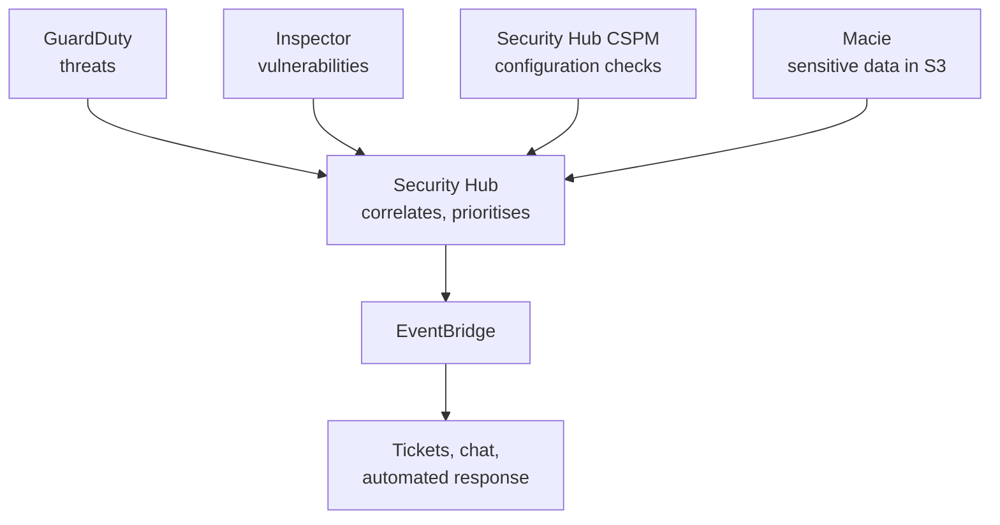

# GuardDuty, Security Hub and Inspector

> **Status: AI draft, 2026-11-16.** Not yet verified by me. Written from the GuardDuty, Security Hub, Inspector and Detective guides; no AWS calls were made.

## In one line

GuardDuty detects threats from logs and runtime signals; Inspector finds software vulnerabilities and network exposure in EC2, ECR images and Lambda; Security Hub CSPM checks configuration against standards; the newer Security Hub correlates all of these into prioritised exposures. Triage asks: is it exploitable, is it exposed, then fix or suppress with a reason.

## The plain idea

Three different security questions, three tools:

- **Is someone attacking us right now?** A burglar alarm: GuardDuty watches activity (API calls, network flows, DNS lookups, process behaviour) for signs of attack.
- **Do we have known holes?** A locksmith's inspection: Inspector checks installed packages and images against vulnerability databases (CVEs) and checks what is reachable from the internet.
- **Is everything configured the way it should be?** A building-code inspector: Security Hub CSPM runs checks such as "S3 buckets block public access" against standards.

Then someone has to look at all the reports together and decide what matters first: that is what Security Hub's correlation is for ([Vulnerability and patch management](../security/vulnerability-and-patch-management.md)).

## How it works

| Service | Looks at | Finds | Example finding |
|---|---|---|---|
| GuardDuty | CloudTrail management events, VPC flow logs, DNS logs; optional S3, EKS, runtime, RDS, Lambda, malware scans | Threats and suspicious behaviour | An instance talking to a known command-and-control address; credentials used from an unusual location |
| Inspector | EC2 instances, ECR images, Lambda functions | Vulnerable packages (CVEs), unintended network reachability | `openssl` with a critical CVE in an image running in production |
| Security Hub CSPM | Resource configuration through Config | Failed controls against standards | Security group allows 0.0.0.0/0 to port 22 |
| Macie | Objects in S3 | Sensitive data (personal data, credentials) and bucket exposure | A bucket containing files with card numbers |
| Detective | GuardDuty findings and logs as a behaviour graph | Context for investigation | Everything a role did around the time of a finding |
| Security Hub | Findings from all of the above (OCSF format) | Exposures: correlated risks per resource | A public EC2 instance with an exploitable CVE and an over-privileged role |

### GuardDuty

- Turn it on and it starts analysing **foundational data sources**: CloudTrail management events, VPC flow logs from EC2, and DNS logs. You do not need to enable those logs yourself for GuardDuty.
- **Protection plans** add coverage: S3 Protection (data events), EKS Protection (audit logs), **Runtime Monitoring** (an agent for EKS, EC2 and ECS including Fargate), Malware Protection for EC2 and for S3, RDS Protection (login activity), Lambda Protection (network activity).
- **Extended Threat Detection** (on by default, no extra cost) links related signals into **attack sequence** findings that describe a multi-stage attack.
- Findings carry a type (for example `UnauthorizedAccess:IAMUser/...`), severity, the resource and the evidence.

### Inspector

- Discovers and continually rescans **EC2 instances**, **ECR container images** and **Lambda functions**; rescans when a new CVE is published, not only on deploy.
- Scores findings with CVSS plus context (is a fix available, is there a known exploit, is the resource reachable).
- Sends findings to EventBridge and Security Hub. ECR scanning can replace or complement scanning in CI ([Registries and image security](../containers/registries-and-image-security.md), [ECR](ecr.md)).

### Security Hub CSPM and Security Hub

- **Security Hub CSPM** (Cloud Security Posture Management; the original Security Hub, renamed when the newer Security Hub arrived) runs **controls** grouped into **standards**: AWS Foundational Security Best Practices, CIS AWS Foundations Benchmark, NIST SP 800-53, PCI DSS. It relies on AWS Config recording ([CloudTrail, Athena and Config](cloudtrail-and-config.md)).
- **Security Hub** (the newer service) takes findings from CSPM, GuardDuty, Inspector and Macie in the **OCSF** format and **correlates** them into **exposure findings**, so you see "this instance is public, has an exploitable CVE and a role that can read every bucket" as one item. It also flags unused access with suggested least-privilege policies.
- Both support a **delegated administrator** account in the organization that aggregates every account and Region ([Organizations and SCPs](../aws-core/organizations-and-scps.md)).

### Finding lifecycle and triage

1. **New** finding arrives (severity from low to critical).
2. **Triage**: Is it real? Is the resource exposed (internet-facing, sensitive data, privileged role)? Is the weakness exploitable (known exploit, fix available)?
3. **Act**: fix (patch, rebuild image, change config), or **suppress** with a written reason and expiry (accepted risk, false positive, compensating control).
4. **Resolve** and verify the next scan or check passes.
5. **Automate** the repeatable ones: EventBridge rules to tickets or chat, and auto-remediation for safe fixes.

Track time-to-fix by severity; suppressions without reasons are how real issues get buried.

## A concrete example

`sample-app`'s organization:

1. GuardDuty, Inspector and Security Hub CSPM enabled organization-wide with the security account as delegated administrator; Runtime Monitoring on the EKS clusters.
2. CSPM standards: AWS Foundational Security Best Practices and CIS.
3. Security Hub correlates them; exposure findings of high and critical severity open a ticket for the owning team through EventBridge.
4. Inspector flags a critical CVE in `sample-app:1.4.2` in ECR, running in production: rebuild on a patched base image, redeploy, confirm the finding closes.
5. A CSPM control fails on a test bucket that is meant to be public for a demo site: suppressed with a reason, owner and review date.
6. GuardDuty reports an EC2 instance querying a crypto-mining domain: isolate with a quarantine security group, snapshot for forensics, replace the instance ([Incident response](../operations/incident-response.md)).

## Why not just...?

- **...turn everything on and alert on every finding?** Thousands of findings, nobody reads them. Route by severity and exposure; review the rest in a weekly queue.
- **...rely on image scanning in CI only?** New CVEs are published after the build. Inspector rescans what is deployed.
- **...treat a passing CSPM score as "secure"?** Controls check configuration, not threats or application bugs. You still need GuardDuty, patching and review.
- **...run a third-party CNAPP instead?** Many teams do; the AWS services are still the cheapest way to get baseline coverage everywhere, and most tools ingest their findings.

## Commands to know

These were not run for this page.

| Command | What it does |
|---|---|
| `aws guardduty list-detectors` | Detector ID for the Region (needed by other calls). |
| `aws guardduty list-findings --detector-id <id> --finding-criteria '{"Criterion":{"severity":{"Gte":7}}}'` | High-severity finding IDs. |
| `aws guardduty get-findings --detector-id <id> --finding-ids <ids>` | Full finding details. |
| `aws inspector2 list-findings --filter-criteria '{"severity":[{"comparison":"EQUALS","value":"CRITICAL"}]}'` | Critical vulnerabilities. |
| `aws inspector2 list-coverage` | Which instances, images and functions are being scanned. |
| `aws securityhub get-findings --filters '{"SeverityLabel":[{"Value":"CRITICAL","Comparison":"EQUALS"}]}'` | Critical findings in Security Hub CSPM format. |
| `aws securityhub get-enabled-standards` | Standards turned on. |
| `aws securityhub batch-update-findings --finding-identifiers <ids> --workflow Status=SUPPRESSED --note Text="<reason>",UpdatedBy=<you>` | Suppress with a reason. |

## How it breaks

| Symptom | Layer | Check | Likely cause |
|---|---|---|---|
| Thousands of open findings nobody reads | Process | Findings by severity and age | No routing, no owners, no suppression rules |
| CSPM controls show "no data" | Dependencies | AWS Config recorder status | Config not recording the needed resource types |
| Inspector shows no findings for an instance | Coverage | `list-coverage`, SSM agent status | EC2 scanning not enabled, or the instance is not managed by Systems Manager; the coverage entry gives the reason ([Systems Manager](systems-manager.md)) |
| A known attack produced no GuardDuty finding | Coverage | Enabled protection plans, Region | Plan not enabled (runtime, S3 data events), or GuardDuty off in that Region |
| Same issue reported by three tools | Duplication | Finding sources | Expected; use Security Hub correlation and one owner queue |
| Member account findings missing in the admin account | Organization | Delegated admin, member status | Account not associated, or Region not enabled for aggregation |

## Interview questions

**1. What is the difference between GuardDuty, Inspector and Security Hub?**

Answer

- GuardDuty: threat detection from activity (logs, network, runtime).
- Inspector: vulnerabilities and network exposure in EC2, ECR images and Lambda.
- Security Hub CSPM: configuration checks against standards; Security Hub: correlates everything into prioritised exposures.

**2. GuardDuty reports an EC2 instance communicating with a known malicious IP. What do you do?**

Answer

- Confirm the finding details; contain by swapping to a quarantine security group (keep it running for forensics) and revoke its role sessions.
- Snapshot volumes; collect logs; use Detective or CloudTrail for what the role did.
- Replace the instance from a clean image; find the entry point (vulnerable package, leaked key).

**3. How do you prioritise 500 critical CVE findings?**

Answer

- Exposure first: internet-facing and running in production before internal or unused images.
- Exploitability: known exploits, fix available.
- Group by base image or package: one base image rebuild can close hundreds.

**4. When is it acceptable to suppress a finding?**

Answer

- False positive, accepted risk with an owner, or a compensating control.
- Always with a written reason, who decided, and a review date.

**5. How do you run these across 50 accounts?**

Answer

- Delegated administrator in a security account; auto-enable for new accounts; cross-Region aggregation.
- Central routing through EventBridge; per-team ownership by account or tag.

**6. Why might a CSPM control show failed even though the resource is fine?**

Answer

- The control does not know the context (a deliberately public website bucket).
- Config data stale or recorder scope missing.
- Suppress with a reason or disable that control for that account.

## Try it

Without AWS:

1. Write a triage note template: finding, resource, exposure, exploitability, decision, owner, due date.
2. For ten findings you might see (public bucket, root login, critical CVE in an unused image...), assign a priority and justify each in one line.
3. Write an EventBridge pattern that matches only critical GuardDuty findings.

## Zoom out

These services are AWS's built-in detection and posture layer. They only help with owners, routing and a habit of closing findings; the same lifecycle applies to any scanner or CNAPP ([Hardening and benchmarks](../security/hardening-and-benchmarks.md)).

## Sources

- [GuardDuty User Guide: what is GuardDuty](https://docs.aws.amazon.com/guardduty/latest/ug/what-is-guardduty.html)
- [Inspector User Guide: what is Amazon Inspector](https://docs.aws.amazon.com/inspector/latest/user/what-is-inspector.html)
- [Security Hub User Guide: Security Hub (correlation, exposures, OCSF)](https://docs.aws.amazon.com/securityhub/latest/userguide/what-is-securityhub-v2.html)
- [Security Hub User Guide: exposure findings](https://docs.aws.amazon.com/securityhub/latest/userguide/exposure-findings.html)
- [Security Hub User Guide: Security Hub CSPM](https://docs.aws.amazon.com/securityhub/latest/userguide/what-is-securityhub.html)
- [Security Hub User Guide: CSPM standards reference](https://docs.aws.amazon.com/securityhub/latest/userguide/standards-reference.html)
- [Detective User Guide: what is Detective](https://docs.aws.amazon.com/detective/latest/userguide/what-is-detective.html)
