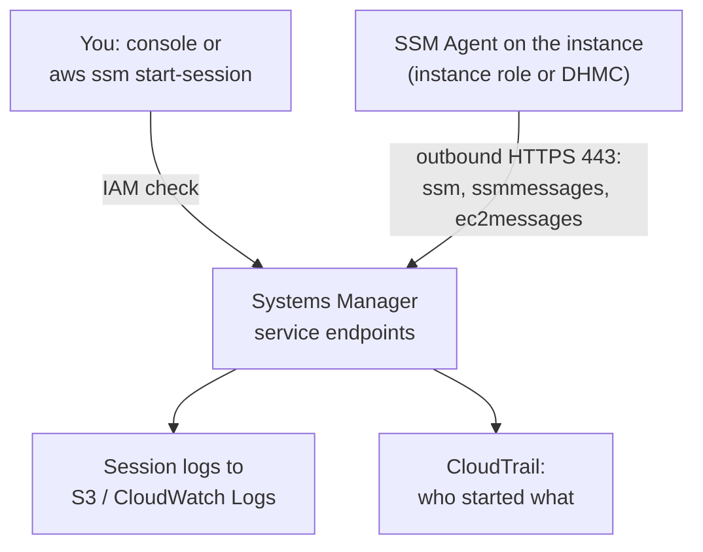

# Systems Manager

> **Status: AI draft, 2026-11-16.** Not yet verified by me. Written from the AWS Systems Manager User Guide; no AWS calls were made.

## In one line

Systems Manager manages servers through the SSM Agent, which connects outward over HTTPS, so no inbound ports are needed. Session Manager replaces SSH and bastions with IAM-controlled, logged shells; Run Command runs documents across many nodes; Patch Manager scans and patches against baselines; Parameter Store, State Manager and Automation round it out.

## The plain idea

SSH works by opening a door on every server and handing out keys. Systems Manager turns it around: a small agent on each server phones home to AWS and asks "any work for me?". To run a command or open a shell, you ask AWS, AWS checks your IAM permissions, and the agent does it. No open ports, no shared SSH keys, and every session can be recorded ([SSH](../linux/ssh.md)).

## How it works

### What makes a node "managed"

Three things, and most problems are one of them:

1. **Agent**: SSM Agent installed and running (preinstalled on many AWS-provided AMIs such as Amazon Linux and Ubuntu Server).
2. **Identity**: an instance profile with `AmazonSSMManagedInstanceCore`, or **Default Host Management Configuration (DHMC)**, which gives instances permissions without a per-instance profile (it requires IMDSv2).
3. **Network path**: outbound HTTPS (443) to `ssm`, `ssmmessages` and `ec2messages` endpoints for the Region, through a NAT gateway or **interface VPC endpoints** for private subnets ([NAT, endpoints and PrivateLink](../aws-core/nat-endpoints-privatelink.md)).

On-premises servers and VMs can be managed too, through **hybrid activations**.

### Session Manager

- An interactive shell (browser or CLI) with **no inbound ports, bastion hosts or SSH keys**. Access is IAM policy: which users can start sessions on which instances (by tag), and with which documents.
- **Session logging** to S3 or CloudWatch Logs, and CloudTrail records who started each session. When you tunnel SSH through Session Manager, the SSH traffic is encrypted end to end, so session content is not logged.
- **Port forwarding** reaches a port on the instance or, through it, a remote host such as a private database: `AWS-StartPortForwardingSessionToRemoteHost`.

### Run Command and documents

- An **SSM document** defines actions: `AWS-RunShellScript`, `AWS-RunPatchBaseline`, `AWS-ConfigureAWSPackage`, or your own (YAML or JSON).
- **Run Command** runs a document on targets selected by instance ID or **tags**, with rate controls (**concurrency** and **error threshold**) so a bad command stops before it reaches the whole fleet. Output goes to the console, S3 or CloudWatch Logs.

### Patch Manager

- A **patch baseline** says which patches are approved: by classification and severity, auto-approval delay (for example 7 days after release), explicit approvals and rejections.
- Operations: **Scan** (report missing patches) or **Scan and install**, through `AWS-RunPatchBaseline`.
- **Patch policies** (in Quick Setup) are now the recommended way to configure patching across accounts and Regions: baseline, schedule, targets and reboot behaviour in one place. Older setups use patch groups with **maintenance windows**.
- Compliance results show which nodes are missing which patches ([Vulnerability and patch management](../security/vulnerability-and-patch-management.md)).

### The rest of the toolbox, briefly

| Tool | What it does |
|---|---|
| Parameter Store | Configuration and SecureString values ([KMS, Secrets Manager and Parameter Store](kms-and-secrets.md)) |
| State Manager | Keeps nodes in a defined state on a schedule (agent installed, setting applied) |
| Automation | Multi-step runbooks across AWS APIs: create an AMI, restart an instance, remediate a Config finding |
| Inventory | Collects installed software, files and settings from nodes |
| Fleet Manager | Console view of nodes: file system, processes, logs |

## A concrete example

`sample-app`'s EC2 fleet in private subnets of `10.0.0.0/16`:

1. AMIs include SSM Agent; DHMC is on for the account, and IMDSv2 is required ([EC2](ec2.md)).
2. Interface endpoints for `ssm`, `ssmmessages` and `ec2messages` in the private subnets; their security group allows 443 from the VPC.
3. Security groups have **no** inbound port 22. Engineers use `aws ssm start-session`; IAM allows sessions only on instances tagged `team=platform`.
4. Session logs go to an S3 bucket in the log archive account and to CloudWatch Logs.
5. A patch policy scans daily and installs on Sundays at 02:00 with an auto-approval delay of 7 days; production patches a week after staging.
6. Run Command with concurrency 10 percent and error threshold 1 rotates a config file across the fleet.

## Why not just...?

- **...keep SSH with a bastion host?** Keys to distribute and revoke, an internet-facing host to patch, port 22 to defend, and no central audit of what was typed. Session Manager removes all four.
- **...patch with `unattended-upgrades` on each box?** Works for one server; across a fleet you want baselines, approval delays, a schedule and a compliance report.
- **...use Ansible instead?** A good fit for configuration management, and it can run over Session Manager; SSM still gives you access, patching and inventory without managing SSH ([Ansible and configuration management](../iac/ansible.md)).
- **...SSH into containers or pods this way?** For ECS use ECS Exec, for Kubernetes `kubectl exec`; Session Manager is for nodes ([ECS and Fargate](../serverless/ecs-and-fargate.md)).

## Commands to know

These were not run for this page.

| Command | What it does |
|---|---|
| `aws ssm describe-instance-information` | Managed nodes, agent version, ping status. |
| `aws ssm start-session --target i-1234567890abcdef0` | Shell on an instance (needs the Session Manager plugin for the CLI). |
| `aws ssm start-session --target i-1234567890abcdef0 --document-name AWS-StartPortForwardingSessionToRemoteHost --parameters host=db.internal.example.com,portNumber=5432,localPortNumber=15432` | Reach a private database through the instance. |
| `aws ssm send-command --document-name AWS-RunShellScript --targets Key=tag:team,Values=platform --parameters commands="uptime" --max-concurrency 10% --max-errors 1` | Run a command across tagged instances safely. |
| `aws ssm list-command-invocations --command-id <id> --details` | Per-instance status and output. |
| `aws ssm describe-instance-patch-states --instance-ids i-1234567890abcdef0` | Missing, installed and failed patch counts. |
| `systemctl status amazon-ssm-agent` (on the instance) | Is the agent running? On Ubuntu installed by snap, the unit is `snap.amazon-ssm-agent.amazon-ssm-agent`. |
| `sudo tail -f /var/log/amazon/ssm/amazon-ssm-agent.log` (on the instance) | Agent errors: credentials, endpoints, registration. |

## How it breaks

| Symptom | Layer | Check | Likely cause |
|---|---|---|---|
| Instance missing from managed nodes | Identity | Instance profile or DHMC, IMDSv2 | No role with `AmazonSSMManagedInstanceCore`, or DHMC with IMDSv1 |
| Same, role is fine | Network | Route to NAT or endpoints, endpoint security group, DNS | Private subnet with no NAT and no interface endpoints; endpoint SG blocks 443 ([VPC troubleshooting](../aws-core/vpc-troubleshooting.md)) |
| Same, network is fine | Agent | Agent service and log | Agent not installed, stopped or very old |
| `start-session` says `TargetNotConnected` | Any of the three | `describe-instance-information` ping status | One of agent, identity or network |
| `AccessDeniedException` on `StartSession` | IAM | User's policy, tag conditions | Not allowed on that instance or document |
| Run Command stops early | Rate control | Error threshold | Errors exceeded `--max-errors` (working as designed) |
| Patching shows non-compliant after install | Reboot | Patch state `InstalledPendingReboot` | Reboot skipped by the policy |

## Interview questions

**1. Why use Session Manager instead of SSH?**

Answer

- No inbound ports or bastions; no SSH keys to manage.
- Access controlled by IAM (including by tag); sessions logged and recorded in CloudTrail.
- Port forwarding covers database access too.

**2. An instance does not appear in Systems Manager. How do you debug it?**

Answer

- Identity: instance profile with `AmazonSSMManagedInstanceCore`, or DHMC (needs IMDSv2).
- Network: outbound 443 to `ssm`, `ssmmessages`, `ec2messages`, via NAT or interface endpoints with DNS.
- Agent: installed, running, logs in `/var/log/amazon/ssm/`.

**3. How do you patch 500 instances safely?**

Answer

- Patch baselines with an approval delay; a patch policy or maintenance windows by environment.
- Staging first, production later; rate controls; reboot handling.
- Compliance reports and alarms on failures; immutable alternative: rebuild AMIs and replace instances ([Auto Scaling and AMIs](auto-scaling-and-amis.md)).

**4. How would you reach a private RDS database from your laptop without a bastion?**

Answer

- Session Manager port forwarding to a remote host through a managed instance in the VPC.
- Connect your client to the local port; IAM and logging still apply.

**5. What are concurrency and error thresholds in Run Command for?**

Answer

- Concurrency limits how many targets run at once; the error threshold stops the run after N failures.
- Together they limit the blast radius of a bad command.

**6. What is in an SSM document, and give examples.**

Answer

- A YAML or JSON definition of steps and parameters, versioned.
- `AWS-RunShellScript`, `AWS-RunPatchBaseline`, port forwarding documents, and Automation runbooks such as restarting an instance.

## Try it

Without AWS:

1. Write the security group rules and VPC endpoints a private subnet needs for Session Manager with no NAT gateway.
2. Write an IAM policy that allows `ssm:StartSession` only on instances tagged `team=platform`, and only with the default shell document.
3. Plan a patch schedule for dev, staging and production with approval delays, and say what happens when a patch breaks staging.

## Zoom out

Systems Manager is AWS's operations layer for servers: access, commands, patching and configuration without opening the network. In container-heavy setups it still manages the nodes underneath ([EKS architecture and node options](../eks/architecture.md)).

## Sources

- [Systems Manager User Guide: Session Manager](https://docs.aws.amazon.com/systems-manager/latest/userguide/session-manager.html)
- [Systems Manager User Guide: session logging](https://docs.aws.amazon.com/systems-manager/latest/userguide/session-manager-logging.html)
- [Systems Manager User Guide: VPC endpoints for Systems Manager](https://docs.aws.amazon.com/systems-manager/latest/userguide/setup-create-vpc.html)
- [Systems Manager User Guide: Default Host Management Configuration](https://docs.aws.amazon.com/systems-manager/latest/userguide/fleet-manager-default-host-management-configuration.html)
- [Systems Manager User Guide: Patch Manager and patch policies](https://docs.aws.amazon.com/systems-manager/latest/userguide/patch-manager.html)
- [Systems Manager User Guide: running commands at scale (targets and rate controls)](https://docs.aws.amazon.com/systems-manager/latest/userguide/send-commands-multiple.html)
- [Systems Manager User Guide: AMIs with SSM Agent preinstalled](https://docs.aws.amazon.com/systems-manager/latest/userguide/ami-preinstalled-agent.html)
- [Systems Manager User Guide: checking SSM Agent status](https://docs.aws.amazon.com/systems-manager/latest/userguide/ssm-agent-status-and-restart.html)
