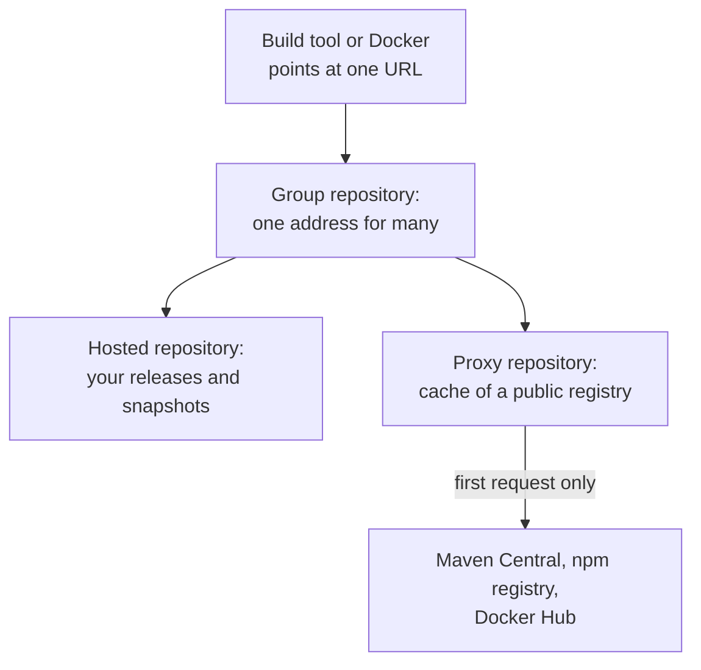

# Artifacts and registries

> **Status: AI draft, 2026-11-16.** Not yet verified by me. Written from the Sonatype, Semantic Versioning, OCI and AWS documentation; nothing was run.

## In one line

Builds produce artifacts (jars, packages, images, charts) stored in repositories: hosted ones for your releases, proxies that cache public registries, and groups that combine both. Version releases immutably, promote the same artifact between stages, and expire old versions.

## The plain idea

The output of a pipeline is not "the code", it is a **built artifact**: a specific jar, image or chart that can be deployed again and again, identically. Artifacts need a home with versions, access control and retention: an **artifact repository** or **registry**.

The same tools also solve the opposite problem: builds download hundreds of dependencies from public registries. If the internet, the registry or a rate limit gets in the way, builds fail. A local **proxy** that caches what you download fixes that.

## How it works

### Repository types

| Type | Holds | Example |
|---|---|---|
| **Hosted** | Artifacts you publish | `maven-releases`, `npm-internal`, an ECR repository |
| **Proxy** | Cached copies of an upstream registry | `maven-central-proxy`, ECR pull-through cache for Docker Hub |
| **Group** | Nothing itself; searches its members in order | `maven-public` = hosted plus proxy |

Tools: Sonatype Nexus Repository, JFrog Artifactory, cloud services (AWS CodeArtifact for packages, ECR for images and charts, [ECR](../aws-services/ecr.md)).

### Why a proxy matters for CI

- **Speed**: dependencies come from the local network.
- **Resilience**: builds keep working when the public registry is slow, down or rate-limiting (Docker Hub limits anonymous pulls).
- **Control**: one place to block known-bad packages and to see which external components you use ([Quality and security gates](quality-and-security-gates.md)).

### Versions

- **Semantic versioning**: `MAJOR.MINOR.PATCH`. Increase MAJOR for incompatible changes, MINOR for compatible features, PATCH for compatible fixes.
- **Immutable releases**: once `1.4.2` is published it never changes. Rebuilding means `1.4.3`.
- **Snapshots** (Maven `-SNAPSHOT`) and moving tags (`latest`, `main`) are mutable conveniences for development, never for production deploys ([Build tools: Maven, Gradle, npm](build-tools.md)).
- For images, deploy by **digest** (`sha256:...`) or an immutable tag; ECR can enforce tag immutability.

### Promotion

Build once, then move the same artifact forward ([CI/CD concepts](concepts.md)):

- **Promote by metadata**: the same image digest is deployed to staging, then production; a tag or a GitOps change records it ([Promotion and rollback](../gitops/promotion-and-rollback.md)).
- **Promote by repository**: copy the artifact from `releases-staging` to `releases-production` after the staging gate passes; production pulls only from the production repository.

Either way, nothing is rebuilt between environments.

### Images and Helm charts as OCI artifacts

Container registries implement the OCI distribution specification, and the same API can store other artifact types: Helm charts (`helm push ... oci://`), signatures and SBOMs attached to an image ([Releases, hooks and debugging](../helm/releases-hooks-debugging.md), [Pipeline security](pipeline-security.md)). One registry, one access model, for images and charts.

### Retention and cleanup

Every pipeline run adds artifacts. Without rules, storage costs grow and old, vulnerable versions stay pullable.

- Keep all releases deployed in the last N months, plus the last few releases of each line.
- Delete snapshots and untagged images after days, not years.
- ECR lifecycle policies and repository manager cleanup policies do this automatically; test them in a dry run before enabling.

## A concrete example

A team's setup:

1. All builds use one group URL per format (Maven, npm, Docker) that combines hosted repositories with proxies of the public registries.
2. Pipelines publish versioned jars to `maven-releases` and images to ECR with immutable tags; the image tag is the Git tag (`1.4.2`), and deploys reference the digest.
3. The GitOps repository records which digest runs in each environment; promotion is a pull request changing that digest.
4. ECR lifecycle rules expire untagged images after 14 days and keep the last 50 release tags per repository.

## Why not just...?

- **...rebuild from the tag for each environment?** Rebuilds can pull different dependency versions or base images. The bytes in production must be the bytes that were tested.
- **...deploy `latest`?** Nobody can say which build is running, rollbacks are guesswork, and nodes may cache different images under the same tag.
- **...let builds pull straight from public registries?** Every outage or rate limit upstream becomes your outage, and you have no record of what you consumed.

## Commands to know

| Command | What it does |
|---|---|
| `mvn deploy` | Publish a Maven artifact to the repository in `distributionManagement`. |
| `npm publish --registry <url>` | Publish an npm package to a private registry. |
| `docker buildx imagetools inspect <image>:<tag>` | Show the digest behind a tag. |
| `helm push sample-app-1.4.2.tgz oci://<registry>/charts` | Store a chart in an OCI registry. |
| `aws ecr describe-images --repository-name sample-app` | Tags, digests and push dates of images in ECR. |
| `aws ecr put-lifecycle-policy --repository-name sample-app --lifecycle-policy-text file://policy.json` | Apply a retention policy. |

## How it breaks

| Symptom | Layer | Check | Likely cause |
|---|---|---|---|
| Builds fail with `429 Too Many Requests` | Upstream registry | Where builds pull from | Pulling directly from a rate-limited public registry |
| Same version, different behaviour in two environments | Versioning | Digests | Mutable tag or snapshot overwritten |
| `401` or `403` pulling from the internal registry | Access | Credentials, IAM | Expired token, missing permissions for the node or runner role |
| Storage bill keeps growing | Retention | Repository sizes | No cleanup or lifecycle rules |
| Production rollback image is gone | Retention | Lifecycle rules | Cleanup deleted versions still needed for rollback |

## Interview questions

**1. What are hosted, proxy and group repositories?**

Answer

- Hosted: stores your own published artifacts.
- Proxy: caches an upstream public registry on first use.
- Group: one URL that searches several repositories, so tools need only one setting.

**2. Why put a proxy repository in front of public registries?**

Answer

- Faster builds from a local cache.
- Builds survive upstream outages and rate limits.
- Visibility and control over external components.

**3. What does "immutable artifact" mean and why does it matter?**

Answer

- A published version never changes; any change gets a new version.
- What was tested is exactly what is deployed, and rollbacks are reliable.
- Enforce it with release repositories that reject overwrites and immutable image tags.

**4. How do you promote an artifact from staging to production?**

Answer

- Deploy the same artifact, identified by version or digest, after the staging gate passes.
- Record the promotion: a GitOps change, a tag, or a copy to a production repository.
- Never rebuild for production.

**5. How are Helm charts stored in container registries?**

Answer

- Registries that implement the OCI distribution specification can store non-image artifacts.
- `helm push` uploads a packaged chart to an `oci://` reference; `helm install` pulls it with `--version`.
- Signatures and SBOMs can be stored alongside images the same way.

**6. What retention policy would you set for an image repository?**

Answer

- Expire untagged images after a short period.
- Keep the last N release tags and anything deployed recently, so rollbacks work.
- Review the policy's effect before enabling, and keep production rollback targets safe.

## Try it

1. Run `docker buildx imagetools inspect nginx:1.27` and note the digest; explain why a deploy should reference it.
2. Decide the next version under semantic versioning for: a bug fix, a new optional field, a removed API endpoint.
3. Write the two rules of an ECR lifecycle policy for "expire untagged after 14 days, keep 50 tagged images".

## Zoom out

Artifacts connect build and deploy: the pipeline produces them, registries store them, GitOps and deploy tools reference them by version or digest ([CI/CD concepts](concepts.md), [ECR](../aws-services/ecr.md)). Supply chain security attaches signatures and SBOMs to them ([Pipeline security](pipeline-security.md)).

## Sources

- [Sonatype Nexus Repository: repository types](https://help.sonatype.com/en/repository-types.html)
- [Semantic Versioning 2.0.0](https://semver.org/)
- [OCI distribution specification](https://github.com/opencontainers/distribution-spec/blob/main/spec.md)
- [Amazon ECR User Guide: lifecycle policies](https://docs.aws.amazon.com/AmazonECR/latest/userguide/LifecyclePolicies.html)
- [Amazon ECR User Guide: image tag mutability](https://docs.aws.amazon.com/AmazonECR/latest/userguide/image-tag-mutability.html)
- [Amazon ECR User Guide: pull through cache](https://docs.aws.amazon.com/AmazonECR/latest/userguide/pull-through-cache.html)
- [Helm documentation: OCI-based registries](https://helm.sh/docs/topics/registries/)
