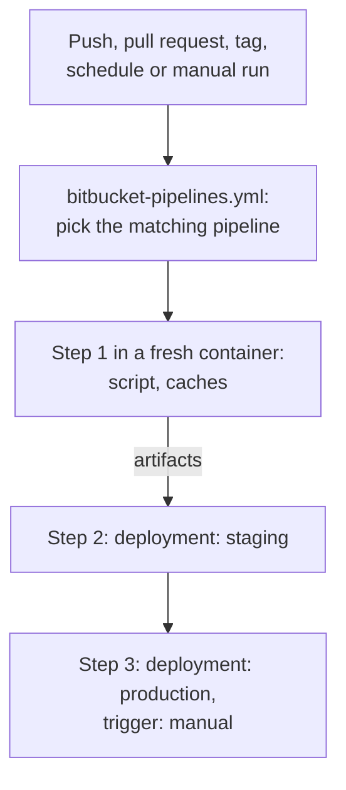

# Bitbucket Pipelines

> **Status: AI draft, 2026-11-16.** Not yet verified by me. Written from the Bitbucket Cloud documentation; nothing was run.

## In one line

Bitbucket Pipelines is the CI/CD built into Bitbucket Cloud: `bitbucket-pipelines.yml` defines pipelines per branch, pull request, tag or manual trigger, each step runs in a fresh container, and deployments, caches, artifacts, pipes and `oidc: true` cover environments, speed, reuse and keyless AWS access.

## How it works



```yaml
image: node:22

definitions:
  caches:
    npm-cache: ~/.npm

pipelines:
  pull-requests:
    "**":
      - step:
          name: Test
          caches: [npm-cache]
          script:
            - npm ci
            - npm test
  branches:
    main:
      - step:
          name: Build
          caches: [npm-cache]
          script:
            - npm ci
            - npm run build
          artifacts:
            - dist/**
      - step:
          name: Deploy to staging
          deployment: staging
          oidc: true
          script:
            - ./deploy.sh staging
      - step:
          name: Deploy to production
          deployment: production
          trigger: manual
          oidc: true
          script:
            - ./deploy.sh production
```

| Concept | Meaning |
|---|---|
| `image` | Default Docker image for steps (each step may set its own) |
| `pipelines` | `default`, `branches`, `pull-requests`, `tags`, `custom` (manual or scheduled) |
| `step` | One container run; `script` is a list of shell commands |
| `parallel` | Steps that run at the same time |
| `caches` | Predefined (such as `node`, `pip`) or custom directories kept between runs |
| `artifacts` | Files passed from one step to later steps in the same pipeline |
| `deployment` | Marks the step as a deploy to an environment (test, staging, production types), shown on the Deployments page and given that environment's variables |
| `trigger: manual` | Wait for someone to click before running the step |
| Variables | Workspace, repository and deployment level; **secured** variables are encrypted and masked in logs |
| `pipe` | A packaged task in a container, such as `atlassian/aws-s3-deploy`, configured with variables |
| `oidc: true` | The step gets a token in `BITBUCKET_STEP_OIDC_TOKEN` for AWS role assumption ([OIDC from pipelines to AWS](oidc-to-aws.md)) |

| | Bitbucket Pipelines | GitHub Actions |
|---|---|---|
| File | One `bitbucket-pipelines.yml` | Many files in `.github/workflows/` |
| Unit of work | Step = one container | Job = one runner with steps |
| Reuse | Pipes, YAML anchors, shared pipeline configurations | Actions, reusable workflows ([GitHub Actions in depth](github-actions-in-depth.md)) |
| Environments | Deployments with variables, permissions and manual triggers | Environments with protection rules |
| Keyless AWS | `oidc: true` | `id-token: write` |
| Self-hosted | Runners | Self-hosted runners |

## Interview questions

**1. Describe the structure of `bitbucket-pipelines.yml`.**

<details markdown="1">
<summary>Answer</summary>

- An optional default `image`, `definitions` (caches, services, YAML anchors), and `pipelines`.
- Pipelines by trigger: `default`, `branches`, `pull-requests`, `tags`, `custom`.
- Each contains steps with a `script`, optional caches, artifacts, deployment and trigger.

</details>

**2. What is the difference between caches and artifacts?**

<details markdown="1">
<summary>Answer</summary>

- Caches keep dependency directories between pipeline runs to save download time; not guaranteed.
- Artifacts pass build outputs from one step to later steps of the same run.
- Never rely on a cache for correctness.

</details>

**3. How do deployments and variables work together?**

<details markdown="1">
<summary>Answer</summary>

- A step with `deployment: production` is tracked on the Deployments page and receives that environment's variables.
- Secured variables are encrypted and masked.
- Combined with `trigger: manual` and branch permissions, this gates production.

</details>

**4. How do you deploy to AWS from Bitbucket without stored keys?**

<details markdown="1">
<summary>Answer</summary>

- Register the workspace's OIDC provider in IAM and create a role trusting it.
- Pin the trust policy's `sub` to the repository UUID and, for production, the deployment environment UUID.
- Add `oidc: true` to the step and give the token to the AWS CLI or SDK through `AWS_WEB_IDENTITY_TOKEN_FILE` and `AWS_ROLE_ARN`.

</details>

**5. What is a pipe?**

<details markdown="1">
<summary>Answer</summary>

- A reusable, containerised task called with `pipe:` and configured with variables.
- Examples: deploying to S3, notifying Slack, scanning.
- Pin the pipe's version, as with any third-party action.

</details>

## Sources

- [Bitbucket Cloud: pipelines configuration reference](https://support.atlassian.com/bitbucket-cloud/docs/bitbucket-pipelines-configuration-reference/)
- [Bitbucket Cloud: step options](https://support.atlassian.com/bitbucket-cloud/docs/step-options/)
- [Bitbucket Cloud: pipeline start conditions](https://support.atlassian.com/bitbucket-cloud/docs/pipeline-start-conditions/)
- [Bitbucket Cloud: cache dependencies](https://support.atlassian.com/bitbucket-cloud/docs/cache-dependencies/)
- [Bitbucket Cloud: use artifacts in steps](https://support.atlassian.com/bitbucket-cloud/docs/use-bitbucket-artifacts-in-step/)
- [Bitbucket Cloud: set up and monitor deployments](https://support.atlassian.com/bitbucket-cloud/docs/set-up-and-monitor-deployments/)
- [Bitbucket Cloud: variables and secrets](https://support.atlassian.com/bitbucket-cloud/docs/variables-and-secrets/)
- [Bitbucket Cloud: what are pipes](https://support.atlassian.com/bitbucket-cloud/docs/what-are-pipes/)
- [Bitbucket Cloud: deploy on AWS using OpenID Connect](https://support.atlassian.com/bitbucket-cloud/docs/deploy-on-aws-using-bitbucket-pipelines-openid-connect/)
