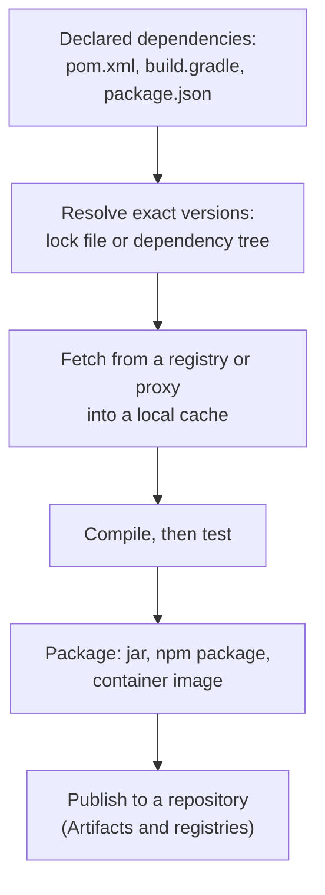

# Build tools: Maven, Gradle, npm

> **Status: AI draft, 2026-11-16.** Not yet verified by me. Written from the Maven, Gradle and npm documentation; nothing was run.

## In one line

A build tool resolves dependencies, compiles, tests and packages code the same way everywhere: Maven runs lifecycle phases from `pom.xml`, Gradle runs tasks through a pinned wrapper, and npm installs from `package.json`, with `npm ci` following the lock file exactly. In CI, cache dependencies and pin everything.

## How it works

**Maven**: convention over configuration. The default lifecycle's main phases are `validate`, `compile`, `test`, `package`, `verify`, `install` (copy to the local `~/.m2` repository) and `deploy` (upload to a remote repository). Running a phase runs every phase before it: `mvn verify` compiles, tests, packages and runs integration checks. `pom.xml` holds coordinates (`groupId:artifactId:version`), dependencies and plugins; versions ending `-SNAPSHOT` are mutable development builds.

**Gradle**: build scripts (Groovy or Kotlin) define **tasks** with dependencies between them; Gradle runs only the tasks needed and skips up-to-date ones. The **wrapper** (`gradlew` plus `gradle/wrapper/gradle-wrapper.properties`, committed) downloads the exact Gradle version for the project, so nobody needs Gradle installed and everyone uses the same one.

**npm**: `package.json` lists dependency ranges; `package-lock.json` records the exact tree. `npm install` may update the lock file; `npm ci` requires a lock file, fails if it does not match `package.json`, deletes `node_modules` first and never writes the lock file. Use `npm ci` in CI.

| | Maven | Gradle | npm |
|---|---|---|---|
| Build file | `pom.xml` | `build.gradle(.kts)` | `package.json` |
| Exact versions | Declared versions (plus dependency management) | Declared versions, optional lock files | `package-lock.json` |
| Local cache | `~/.m2/repository` | `~/.gradle/caches` | `~/.npm` |
| CI command | `mvn -B verify` | `./gradlew build` | `npm ci && npm test` |
| Publish | `mvn deploy` | `publish` task | `npm publish` |

**In CI**:

- Cache the dependency directory, keyed on a hash of the build or lock file ([GitHub Actions basics](github-actions-basics.md)).
- Point builds at a proxy repository rather than the public internet, for speed and resilience ([Artifacts and registries](artifacts-and-registries.md)).
- Pin the build tool (Maven version or image, Gradle wrapper, Node version) as well as the dependencies.
- **Reproducible builds**: the same source, tools and inputs give the same output. Locked versions, pinned tool images and no network access during the build get you most of the way.

## Interview questions

**1. What happens when you run `mvn package`?**

Answer

- Maven runs every lifecycle phase up to `package`: validate, compile, test, then package.
- Dependencies are resolved from the local repository or downloaded.
- The result is the jar (or war) in `target/`.

**2. Why commit the Gradle wrapper?**

Answer

- It pins the Gradle version per project and downloads it automatically.
- CI and every developer use the same version without installing Gradle.
- Upgrading Gradle becomes a reviewed change to the wrapper properties.

**3. What is the difference between `npm install` and `npm ci`?**

Answer

- `npm install` resolves ranges and may update `package-lock.json`.
- `npm ci` installs exactly the lock file, fails if it disagrees with `package.json`, and starts from a clean `node_modules`.
- Use `npm ci` in CI for repeatable installs.

**4. How do you make builds faster in CI?**

Answer

- Cache dependency directories keyed on the lock or build file hash.
- Use a nearby proxy repository; enable incremental builds and build caches where the tool supports them.
- Split slow test suites and run them in parallel.

**5. What is a SNAPSHOT version and why not deploy one to production?**

Answer

- A mutable development version: the same version name can point to different builds over time.
- A production deploy would not be reproducible or traceable.
- Release immutable versions and promote those.

## Sources

- [Apache Maven: introduction to the build lifecycle](https://maven.apache.org/guides/introduction/introduction-to-the-lifecycle.html)
- [Gradle: the Gradle wrapper](https://docs.gradle.org/current/userguide/gradle_wrapper.html)
- [Gradle: using tasks](https://docs.gradle.org/current/userguide/tutorial_using_tasks.html)
- [npm documentation: npm ci](https://docs.npmjs.com/cli/v11/commands/npm-ci/)
- [npm documentation: package-lock.json](https://docs.npmjs.com/cli/v11/configuring-npm/package-lock-json/)
- [Reproducible Builds: definition](https://reproducible-builds.org/docs/definition/)
