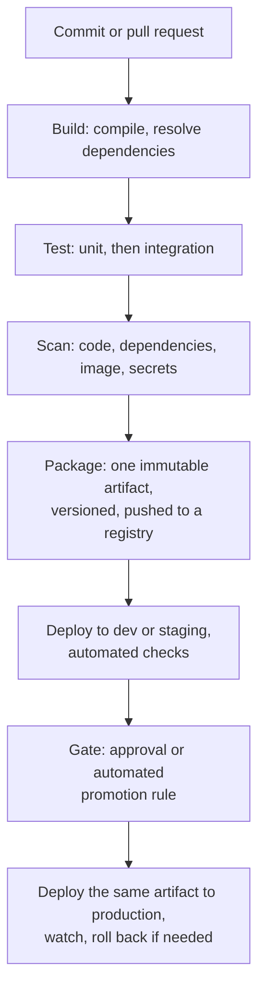

# CI/CD concepts

> **Status: AI draft, 2026-11-16.** Not yet verified by me. Written from general practice and the sources listed; the worked example is this site's own pipeline.

## In one line

Continuous integration merges small changes often and checks each one automatically; continuous delivery keeps every passing change ready to release with a button; continuous deployment releases every passing change automatically. A good pipeline builds an artifact once, promotes that same artifact through environments with gates and approvals, gives feedback fast, and is itself code.

## The plain idea

Without automation, releasing is a rare, risky event: weeks of changes merged at once, built by hand, tested by whoever remembers, deployed by a runbook. Every step is a chance for "it worked on my machine".

CI/CD turns release into a routine: every change goes through the same automated path, the path catches problems early, and because each change is small, finding and fixing what broke is easy. The path is the **pipeline**.

## How it works

### CI, continuous delivery, continuous deployment

| Practice | What happens automatically | Human step |
|---|---|---|
| **Continuous integration** | Every push or pull request is built and tested; developers merge to the main branch at least daily | Code review |
| **Continuous delivery** | Every change that passes is packaged and deployable to production at any time | Someone decides to release |
| **Continuous deployment** | Every change that passes goes to production | None after merge |

### The pipeline

- **Build once, promote the same artifact.** The image tested in staging is the one that reaches production, identified by digest. Rebuilding per environment means production runs something nobody tested ([Artifacts and registries](artifacts-and-registries.md)).
- **Environments and approvals.** Each environment has its own configuration and credentials; production deploys need an approval or a passing automated check ([GitHub Actions in depth](github-actions-in-depth.md)).
- **Fail fast.** Cheap checks first (lint, unit tests) so most failures show within minutes; expensive ones later or in parallel ([Quality and security gates](quality-and-security-gates.md)).
- **Pipeline as code.** The pipeline definition lives in the repository (`.github/workflows/`, `Jenkinsfile`, `bitbucket-pipelines.yml`), reviewed and versioned like the application.

### What makes a pipeline trustworthy

| Property | Meaning | How |
|---|---|---|
| Reproducible | Same input, same output | Pinned tool versions, lock files, pinned base images |
| Idempotent | Re-running is safe | Declarative deploys (Helm, Terraform, GitOps), not "create" scripts |
| Observable | You can see what ran and why it failed | Logs, timings, links from deploys to commits |
| Secure | Only reviewed code reaches production, with minimal credentials | Protected branches, OIDC, least-privilege roles ([Pipeline security](pipeline-security.md)) |
| Fast | Feedback within minutes | Caching, parallel jobs, small changes |

### Measuring it

DORA's research uses five software delivery metrics: **change lead time**, **deployment frequency** and **failed deployment recovery time** for throughput, and **change fail rate** and **deployment rework rate** for instability. They measure the whole delivery process, not individuals.

## A concrete example

This site's own pipeline (`.github/workflows/pages.yml`), small but complete:

1. **Trigger**: a push to `main` (or a manual run).
2. **Build**: the same script and the same pinned container image as on the laptop, in strict mode, so a broken link or warning fails the build.
3. **Package**: the built site uploaded as an artifact.
4. **Deploy**: a second job, which runs only if the build succeeded, publishes that artifact to the `github-pages` environment.
5. **Safety**: minimal token permissions, one deployment at a time, checks (structure, lint, diagrams, secrets scan) run locally through git hooks before the push.

Line by line on [GitHub Actions basics](github-actions-basics.md).

## Why not just...?

- **...deploy from a laptop when it is urgent?** That bypasses tests, review and audit, and the laptop's build is not the tested artifact. Make the pipeline fast enough that it is the quickest way, even in an incident.
- **...build a new image per environment with environment settings baked in?** Then production runs an artifact that was never tested. Keep artifacts environment-neutral and inject configuration at deploy time ([ConfigMaps and Secrets](../kubernetes/configmaps-and-secrets.md)).
- **...run every test on every commit, however slow?** A 90-minute pipeline teaches people to batch changes and skip it. Run fast checks first and parallelise; move slow suites to merge or nightly runs.

## Commands to know

| Command or file | Purpose |
|---|---|
| `.github/workflows/*.yml` | GitHub Actions pipeline definitions ([GitHub Actions basics](github-actions-basics.md)) |
| `Jenkinsfile` | Jenkins pipeline as code ([Jenkins](jenkins.md)) |
| `bitbucket-pipelines.yml` | Bitbucket Pipelines definition ([Bitbucket Pipelines](bitbucket-pipelines.md)) |
| `git tag v1.4.2 && git push origin v1.4.2` | A release trigger in many pipelines ([Branching and release strategies](../git/branching-strategies.md)) |
| `docker buildx imagetools inspect <image>` | Find an image's digest, to promote by digest |
| `gh run list`, `gh run view --log-failed` | Inspect GitHub Actions runs from the terminal |

## How it breaks

| Symptom | Layer | Check | Likely cause |
|---|---|---|---|
| Works locally, fails in CI | Environment | Tool and dependency versions | Unpinned tools, missing lock file, different base image |
| Flaky tests fail one run in five | Tests | Failure history | Timing, shared state, external services in unit tests |
| Production differs from staging | Artifacts | Image digests per environment | Rebuilt per environment, or mutable tags such as `latest` |
| Pipeline takes too long, people skip it | Speed | Step timings | No caching, everything serial, slow suites on every commit |
| A deploy nobody approved reached production | Controls | Branch protection, environment rules | Missing protection or overly broad credentials |

## Interview questions

**1. What is the difference between continuous delivery and continuous deployment?**

Answer

- Delivery: every passing change is ready to release; a person decides when.
- Deployment: every passing change is released automatically.
- Both rest on continuous integration: small, frequent merges with automated checks.

**2. What does "build once, promote the same artifact" mean, and why?**

Answer

- Build and version one artifact (for example an image by digest), then deploy that same artifact to each environment.
- What reaches production is exactly what was tested.
- Environment differences come from configuration, not rebuilt code.

**3. Describe the stages of a typical pipeline.**

Answer

- Build, unit tests, static analysis and security scans, package and push the artifact.
- Deploy to a test environment, integration or smoke tests, approval or automated gate.
- Deploy to production, watch metrics, roll back if needed.

**4. How do you keep a pipeline fast?**

Answer

- Cheap checks first; fail fast.
- Cache dependencies and build layers; run independent jobs in parallel.
- Move slow suites to merge or nightly runs; keep changes small.

**5. What metrics tell you whether delivery is healthy?**

Answer

- DORA's: change lead time, deployment frequency, failed deployment recovery time, change fail rate, deployment rework rate.
- They balance speed with stability.
- Use them for the system, not to rank people.

**6. A deploy broke production even though all pipeline checks passed. What do you change?**

Answer

- First recover: roll back or roll forward; then find which check should have caught it.
- Add the missing test, a canary stage with automated metrics checks, or a staging environment closer to production.
- Review whether the artifact or configuration differed between environments.

## Try it

1. Open this repository's `.github/workflows/pages.yml` and label each part with a stage from the diagram above. Which stages are missing, and why are they acceptable here?
2. For a service you know, sketch its pipeline and mark where the artifact is built and which environments it passes through.
3. Pick one DORA metric and write down how you would measure it from your Git and deployment history.

## Zoom out

CI/CD is the delivery half of DevOps: the other pages cover the tools (GitHub Actions, Jenkins, Bitbucket), the release patterns ([Deployment strategies](deployment-strategies.md)), the security of the pipeline itself, and GitOps, where the "deploy" step becomes a commit that a controller applies ([GitOps principles](../gitops/principles.md)).

## Sources

- [Martin Fowler: Continuous Integration](https://martinfowler.com/articles/continuousIntegration.html)
- [Martin Fowler: Continuous Delivery](https://martinfowler.com/bliki/ContinuousDelivery.html)
- [Martin Fowler: Deployment Pipeline](https://martinfowler.com/bliki/DeploymentPipeline.html)
- [DORA: continuous delivery](https://dora.dev/capabilities/continuous-delivery/)
- [DORA: software delivery performance metrics](https://dora.dev/guides/dora-metrics/)
- [GitHub Docs: deployment environments](https://docs.github.com/en/actions/concepts/workflows-and-actions/deployment-environments)
