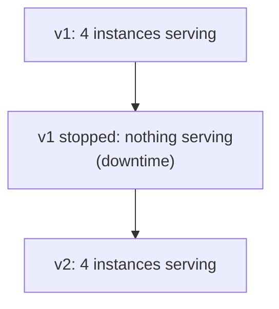
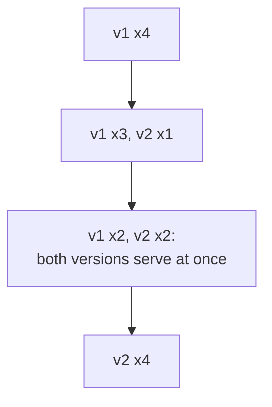
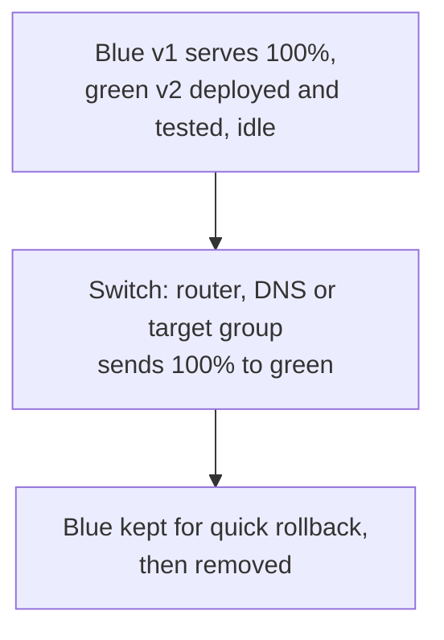
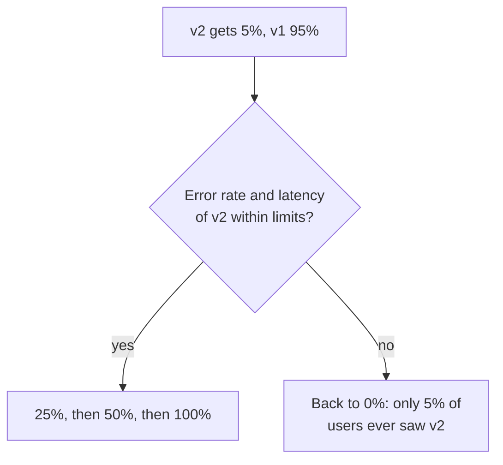

# Deployment strategies

> **Status: AI draft, 2026-11-16.** Not yet verified by me. Written from the sources listed; nothing was run for this page (the Kubernetes rolling update is shown with real output on [Deployments and rollouts](../kubernetes/deployments-and-rollouts.md)).

## In one line

Recreate stops the old version first (downtime). Rolling replaces instances in batches. Blue-green runs the new version beside the old and switches all traffic at once. Canary sends a little traffic to the new version and grows it while metrics stay healthy. Database changes must survive rollback: expand first, contract later.

## The plain idea

Every deploy replaces something users are using. The strategies differ in **how much of the old version stays available** while the new one starts, and **how many users meet the new version** before you know it works. More safety costs more capacity, more tooling, or more time.

## How it works

### The four strategies

**Recreate**: stop everything, then start the new version.

**Rolling**: replace instances in small batches.

**Blue-green**: a full second copy, then one switch.

**Canary**: a little traffic first, then more while healthy.

| | Downtime | Extra capacity | Rollback speed | Users exposed to a bad version | Mixed versions running | Complexity |
|---|---|---|---|---|---|---|
| Recreate | Yes | None | Slow (another deploy) | All | No | Lowest |
| Rolling | No | A small surge | Medium (roll back the rollout) | Growing share | Yes | Low |
| Blue-green | No | Double, during the switch | Instant (switch back) | All, at once | No (except data) | Medium |
| Canary | No | Small | Fast (weight to 0) | A small share | Yes | High (traffic splitting, metrics analysis) |

### Where each lives

| Strategy | Kubernetes | AWS load balancers | Service mesh or Gateway API |
|---|---|---|---|
| Recreate | `strategy: Recreate` | | |
| Rolling | `RollingUpdate` with `maxSurge`, `maxUnavailable` ([Deployments and rollouts](../kubernetes/deployments-and-rollouts.md)) | Instance refresh on an Auto Scaling group | |
| Blue-green | Two Deployments, switch the Service selector | Swap target groups on an ALB listener | Route weights 100/0 to 0/100 |
| Canary | Replica ratios (coarse) or a progressive delivery tool (Argo Rollouts, Flagger) | ALB weighted target groups | Weighted routes ([Traffic management](../mesh/traffic-management.md), [Ingress and Gateway API](../kubernetes/ingress-and-gateway-api.md)) |

### Feature flags: separating deploy from release

A **feature flag** ships new code switched off, then turns it on (for some users, then all) without a deploy. Deploying becomes low-risk because nothing changes for users until the flag flips, and "rollback" of a feature is flipping it back. The cost is code paths to test and old flags to clean up.

### Databases: expand and contract

Rollbacks revert code, not data. A deploy that renames a column breaks the old version the moment it runs, so rolling back does not help. **Expand and contract** (parallel change) makes each step backward compatible:

1. **Expand**: add the new column; the new code writes both, reads the new one with a fallback.
2. Migrate existing data in the background.
3. Once no running version uses the old column, **contract**: remove it in a later release.

At every point, the previous application version still works with the current schema, so any single release can be rolled back.

### Rollback vs roll forward

- **Rollback**: go back to the last good version. Fast when the artifact and configuration are versioned and data changes were backward compatible.
- **Roll forward**: fix and deploy a new version. Necessary when a rollback is unsafe (a migration that cannot be reversed), and natural with fast pipelines.
- Decide which you will use **before** the deploy, and practise both ([Incident response](../operations/incident-response.md)).

## A concrete example

`sample-app` on EKS moves from rolling updates to canaries after two bad releases:

1. The ALB routes through the mesh (or Gateway API), which supports weighted routes.
2. A progressive delivery controller deploys v2 at 5%, waits 10 minutes, and compares v2's error rate and p99 latency from Prometheus with v1's ([Prometheus](../observability/prometheus.md)).
3. If healthy: 25%, 50%, 100%. If not: weight back to 0 and the pipeline fails.
4. A schema change in the same release is split: this release only adds a column; the column removal ships two releases later.

## Why not just...?

- **...use blue-green for everything?** Double capacity during each switch, and a database shared by blue and green must work with both versions anyway. It shines for stateless services with infrequent, risky releases.
- **...use canaries without automated analysis?** Someone has to watch dashboards for every step, and slow problems (memory leaks) slip through. Define the metrics and thresholds that promote or abort.
- **...rely on rollback to fix a bad schema change?** The code goes back; the dropped column does not. Make schema changes backward compatible.

## Commands to know

| Command | What it does |
|---|---|
| `kubectl rollout status deployment/<name>` | Watch a rolling update finish. |
| `kubectl rollout undo deployment/<name>` | Roll a Deployment back to the previous ReplicaSet. |
| `kubectl patch service <svc> -p '{"spec":{"selector":{"version":"green"}}}'` | A minimal blue-green switch by Service selector. |
| `aws elbv2 modify-listener --listener-arn <arn> --default-actions <weighted-forward-json>` | Shift ALB traffic between target groups. |
| `kubectl argo rollouts get rollout <name>` | Progress of an Argo Rollouts canary (if that tool is installed). |

## How it breaks

| Symptom | Strategy | Check | Likely cause |
|---|---|---|---|
| Errors only during the deploy window | Rolling | Readiness, graceful shutdown | Pods receive traffic before ready, or are killed with requests in flight ([Probes and graceful shutdown](../kubernetes/probes-and-graceful-shutdown.md)) |
| New and old versions fight over data | Rolling, canary | Schema and message formats | Changes not backward compatible across versions |
| Rollback did not fix it | Any | What changed besides code | Data migration, configuration or a dependency changed too |
| Canary promoted a bad version | Canary | Analysis metrics and duration | Wrong metric, too little traffic to be significant, too short a wait |
| Blue-green switch caused errors | Blue-green | Warm-up, sessions, DNS TTL | Green not warmed up, sessions held on blue, clients caching DNS |

## Interview questions

**1. Compare rolling, blue-green and canary deployments.**

Answer

- Rolling: replace in batches; no downtime, little extra capacity, both versions run together.
- Blue-green: full parallel copy, switch at once; instant rollback, double capacity.
- Canary: small share of traffic first, grow while healthy; least blast radius, needs traffic splitting and metrics.

**2. How do you implement blue-green on Kubernetes?**

Answer

- Two Deployments labelled blue and green; the Service selects one.
- Deploy and test green, then change the Service selector (or route weights).
- Keep blue until confident, then remove it.

**3. What is a feature flag and how does it change deployment risk?**

Answer

- A runtime switch that enables code paths without deploying.
- Deploy dark, release by flipping the flag for some users then all; turning it off is the rollback.
- Costs: more code paths to test, flags to clean up.

**4. How do you change a database schema safely with zero-downtime deploys?**

Answer

- Expand and contract: add new structures, write both, migrate, then remove the old in a later release.
- Every step works with both the current and previous application versions.
- So any single release can be rolled back.

**5. When would you roll forward instead of rolling back?**

Answer

- When rollback is unsafe: irreversible migrations, external side effects.
- When the fix is small and the pipeline is fast.
- Decide in advance, and keep both paths practised.

**6. A canary at 5% shows the same error rate as the stable version, but users complain after full rollout. What went wrong?**

Answer

- 5% may have been too little traffic or too short a window to show the problem, or the metric did not capture it (latency, a specific endpoint, a slow leak).
- Some problems appear only at full load or with all users (caches, connection pools).
- Add better metrics, longer steps, and a step near 50% before 100%.

## Try it

On a kind cluster:

1. Create Deployments `web-blue` (`nginx:1.27`, label `version: blue`) and `web-green` (`busybox:1.36` running `httpd`, label `version: green`), and a Service selecting `version: blue`.
2. Switch the Service selector to green with `kubectl patch` and confirm with `kubectl get endpointslices` which pods are behind it now.
3. Switch back, and time how long it takes. That is blue-green rollback speed.

## Zoom out

Deployment strategies are where CI/CD meets reliability: they decide how a bad change reaches users and how fast it leaves ([Concepts](concepts.md), [High availability](../operations/high-availability.md)). The mechanics live in Kubernetes Deployments, load balancers, Gateway API and service meshes; GitOps tools drive them from Git ([Promotion and rollback](../gitops/promotion-and-rollback.md)).

## Sources

- [Kubernetes documentation: Deployments (rolling updates)](https://kubernetes.io/docs/concepts/workloads/controllers/deployment/)
- [AWS whitepaper: blue/green deployments on AWS](https://docs.aws.amazon.com/whitepapers/latest/blue-green-deployments/welcome.html)
- [Martin Fowler: BlueGreenDeployment](https://martinfowler.com/bliki/BlueGreenDeployment.html)
- [Martin Fowler: CanaryRelease](https://martinfowler.com/bliki/CanaryRelease.html)
- [Martin Fowler: feature toggles](https://martinfowler.com/articles/feature-toggles.html)
- [Martin Fowler: ParallelChange (expand and contract)](https://martinfowler.com/bliki/ParallelChange.html)
