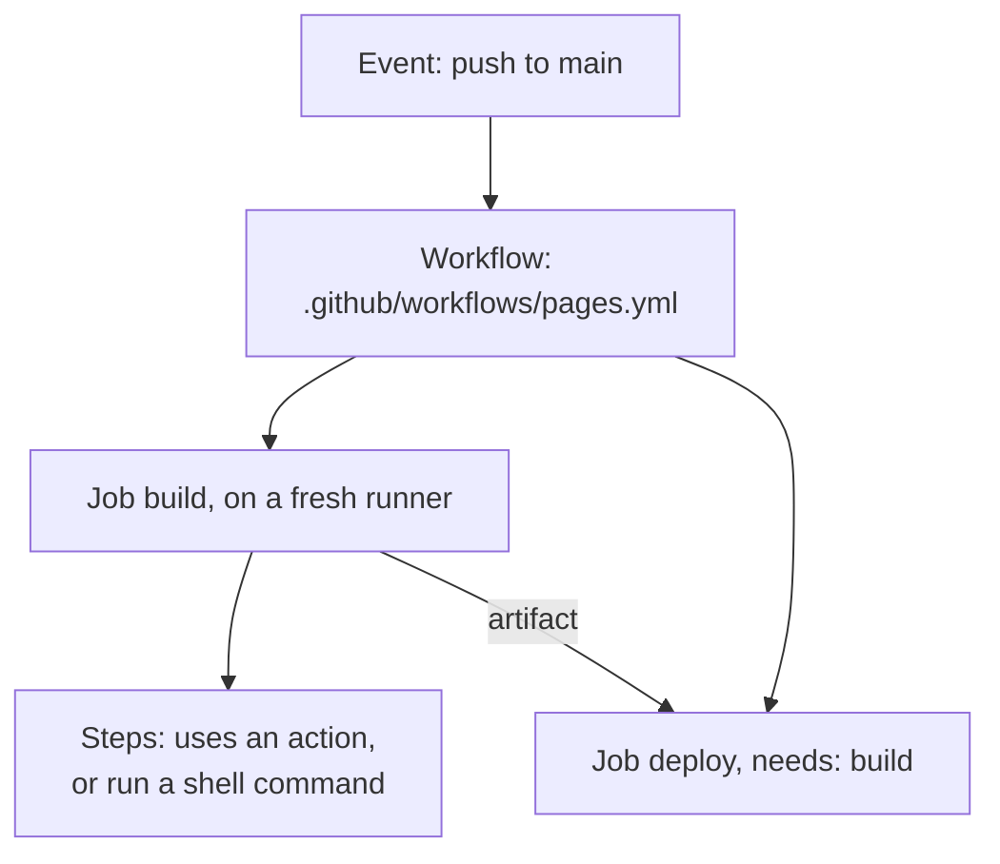

# GitHub Actions basics

> **Status: AI draft, 2026-11-16.** Not yet verified by me. Written from the GitHub documentation; the worked example is this repository's real workflow, which runs on every push to `main`.

## In one line

A workflow is a YAML file in `.github/workflows/` that runs on events. Its jobs run on fresh runners, in parallel unless linked with `needs`, and each job is a list of steps: shell commands or reusable actions. Secrets and expressions feed values in, and `GITHUB_TOKEN` gets only the permissions you grant.

## The plain idea

GitHub Actions is GitHub's built-in CI/CD ([Concepts](concepts.md)). When something happens in the repository (a push, a pull request, a schedule), GitHub reads the workflow files, starts a clean virtual machine (a **runner**), checks out your code, and runs the steps you listed. Each job gets its own machine, so jobs share nothing unless you pass it explicitly (artifacts, outputs, caches).

## How it works

### The vocabulary



| Term | Meaning |
|---|---|
| **Workflow** | One YAML file; one automated process |
| **Event** | What starts it: `push`, `pull_request`, `schedule`, `workflow_dispatch` (manual), and many more |
| **Job** | A set of steps on one runner; jobs run in parallel unless `needs` orders them |
| **Step** | One command (`run:`) or one action (`uses:`) |
| **Action** | A reusable step published in a repository, referenced as `owner/repo@ref` |
| **Runner** | The machine: GitHub-hosted (`ubuntu-latest`) or self-hosted |

### Triggers

```yaml
on:
  push:
    branches: [main]
  pull_request:
    branches: [main]
    paths: ["docs/**"]
  schedule:
    - cron: "0 2 * * 1"     # Mondays 02:00 UTC
  workflow_dispatch:
    inputs:
      environment:
        type: choice
        options: [staging, production]
```

Schedules use cron syntax in UTC ([Cron and timers](../linux/cron-and-timers.md)).

### Expressions, contexts, secrets, variables

- `${{ github.ref_name }}`, `${{ github.sha }}`, `${{ runner.os }}`: **contexts** describe the run, the event, the runner, earlier steps (`steps.<id>.outputs`), job results (`needs.<job>.outputs`).
- `if: github.event_name == 'push'` makes a step or job conditional.
- `${{ secrets.NAME }}` for encrypted secrets; `${{ vars.NAME }}` for plain configuration variables. Both can be set per repository, per organisation, or per environment.
- Secrets are redacted from logs when printed as is, but transformed values (base64, substrings) are not; never echo them ([Pipeline security](pipeline-security.md)).
- Except for `GITHUB_TOKEN`, secrets are not passed to workflows triggered from forks.

### GITHUB_TOKEN and permissions

Each job gets a `GITHUB_TOKEN`, an installation token limited to the repository and expiring when the job ends. The `permissions:` key sets what it may do; anything not listed is `none`. Grant only what the job needs (`contents: read` for most builds). `id-token: write` lets the job request an OIDC token, the basis for keyless cloud access ([OIDC from pipelines to AWS](oidc-to-aws.md)).

### Artifacts and caches

| | Artifacts | Cache |
|---|---|---|
| Purpose | Pass files between jobs, or keep results (reports, builds) | Speed up later runs (dependencies) |
| Lifetime | Retained for a set period, downloadable | Evicted when unused or over the size limit |
| Typical action | `actions/upload-artifact`, `actions/download-artifact` | `actions/cache`, or built-in caching in `setup-*` actions |
| Key | Name | A key such as a hash of the lock file |

## A concrete example

This site's own workflow. The full file is `.github/workflows/pages.yml` in this repository. Line by line:

```yaml
name: Publish site
```

The name shown in the Actions tab and in `gh run list`.

```yaml
on:
  push:
    branches: [main]
  workflow_dispatch:
```

Runs on every push to `main`, and can be started by hand. There is no `pull_request` trigger: checks for changes run locally through git hooks before pushing.

```yaml
permissions:
  contents: read
  pages: write
  id-token: write
```

The token may read the code, publish to Pages, and request an OIDC token, which the Pages deployment uses to prove which workflow is deploying. Nothing else: no writing to the repository.

```yaml
concurrency:
  group: pages
  cancel-in-progress: false
```

Only one run in the group `pages` at a time. A new run waits for the running one rather than cancelling it, so a deploy is never cut off midway. If several pushes queue up while one runs, only the newest waiting run is kept; older pending ones are cancelled.

```yaml
jobs:
  build:
    runs-on: ubuntu-latest
    steps:
      - uses: actions/checkout@v7
      - uses: actions/configure-pages@v6
      - run: ./preview.sh build
      - uses: actions/upload-pages-artifact@v5
        with:
          path: site
```

The `build` job: check out the code; read the Pages settings; build the site with the same script and the same pinned container image used on the laptop (so CI and local builds cannot differ); upload the `site` folder as the special Pages artifact. The step names are left out here for brevity.

```yaml
  deploy:
    needs: build
    runs-on: ubuntu-latest
    environment:
      name: github-pages
      url: ${{ steps.deployment.outputs.page_url }}
    steps:
      - name: Deploy to GitHub Pages
        id: deployment
        uses: actions/deploy-pages@v5
```

The `deploy` job waits for `build` (`needs`), runs in the `github-pages` **environment** (which can carry protection rules and shows deployments in the repository), and deploys the artifact. The step's `id` lets the environment's `url` read its output, so the run page links to the published site. Actions are pinned to major version tags here; Dependabot opens pull requests when new majors appear ([GitHub Actions in depth](github-actions-in-depth.md) covers pinning to commit SHAs).

## Why not just...?

- **...put everything in one job?** Jobs separate concerns and permissions: the build cannot deploy by itself, and a failed build never reaches the deploy job. Jobs also run in parallel when independent.
- **...give the workflow `permissions: write-all`?** Any compromised step (a third-party action, a dependency's install script) could then push code or create releases. Grant per job, per need.
- **...use `pull_request_target` to get secrets in pull requests from forks?** It runs with the base repository's permissions and secrets; checking out and running the fork's code there hands those secrets to whoever wrote the pull request ([GitHub Actions in depth](github-actions-in-depth.md)).

## Commands to know

These use the GitHub CLI, `gh`.

| Command | What it does |
|---|---|
| `gh run list --limit 5` | Recent runs and their status. |
| `gh run view <run-id> --log-failed` | Logs of the failed steps only. |
| `gh run watch <run-id>` | Follow a run live. |
| `gh run rerun <run-id> --failed` | Re-run only the failed jobs. |
| `gh workflow run "Publish site"` | Start a `workflow_dispatch` workflow. |
| `gh secret set NAME` | Set a repository secret from stdin. |

## How it breaks

| Symptom | Layer | Check | Likely cause |
|---|---|---|---|
| Workflow never starts | Trigger | `on:` filters, file location | Branch or path filter excludes the change, or the file is not in `.github/workflows/` on that branch |
| `Resource not accessible by integration` | Permissions | `permissions:` block | The token lacks a needed scope |
| Secret is empty | Secrets | Where it is defined, fork or not | Wrong name or environment, or a fork-triggered run |
| A job cannot see a file from another job | Isolation | Artifacts or outputs | Each job runs on a fresh runner; pass files with artifacts |
| Runs cancel each other | Concurrency | `concurrency` group | `cancel-in-progress: true`, or a shared group name |
| Cache never hits | Cache key | The key expression | Key changes every run, or the lock file is not committed |

## Interview questions

**1. Explain workflow, job, step, action and runner.**

<details markdown="1">
<summary>Answer</summary>

- A workflow is a YAML file triggered by events; it contains jobs.
- A job runs on its own runner; jobs run in parallel unless linked with `needs`.
- Steps run commands or actions; an action is a reusable, versioned step.

</details>

**2. How do jobs share data?**

<details markdown="1">
<summary>Answer</summary>

- Artifacts for files; job outputs for small values (`needs.<job>.outputs`).
- Caches speed up later runs but are not guaranteed to exist.
- Nothing is shared implicitly, because each job gets a fresh runner.

</details>

**3. What is `GITHUB_TOKEN` and how do you limit it?**

<details markdown="1">
<summary>Answer</summary>

- An automatic, short-lived token scoped to the repository, expiring when the job ends.
- The `permissions:` key grants scopes; unlisted ones are none.
- Grant per job and only what is needed; `id-token: write` only where OIDC is used.

</details>

**4. What does `concurrency` do in the Pages workflow?**

<details markdown="1">
<summary>Answer</summary>

- Only one run of the group at a time.
- `cancel-in-progress: false` lets a running deploy finish; newer runs wait, and only the newest pending one is kept.
- Prevents two deploys overwriting each other.

</details>

**5. Why are secrets not available to pull requests from forks?**

<details markdown="1">
<summary>Answer</summary>

- A fork's pull request runs code written by someone outside the repository.
- If secrets were passed, that code could read and exfiltrate them.
- Use `pull_request` (no secrets) for untrusted code; never run fork code under `pull_request_target`.

</details>

**6. A workflow did not run after a push. How do you find out why?**

<details markdown="1">
<summary>Answer</summary>

- Check the `on:` filters (branches, paths, tags) against the push.
- Check the workflow file exists on that branch, is valid YAML, and Actions is enabled.
- Look in the Actions tab for skipped or failed-to-parse runs.

</details>

## Try it

1. Read this repository's `.github/workflows/pages.yml` and, without looking at this page, say what each block does.
2. Run `gh run list --limit 3` in the repository and open the latest run with `gh run view`.
3. Write a workflow for a pull request check that runs `./tools/check.sh` with `contents: read` only. Which job-level settings would you add?

## Zoom out

These basics cover most pipelines; matrices, reusable workflows, environments and runner security are on [GitHub Actions in depth](github-actions-in-depth.md). The same building blocks appear in Jenkins and Bitbucket under other names ([Jenkins](jenkins.md), [Bitbucket Pipelines](bitbucket-pipelines.md)).

## Sources

- [GitHub Docs: understanding GitHub Actions](https://docs.github.com/en/actions/get-started/understand-github-actions)
- [GitHub Docs: workflow syntax](https://docs.github.com/en/actions/reference/workflows-and-actions/workflow-syntax)
- [GitHub Docs: events that trigger workflows](https://docs.github.com/en/actions/reference/workflows-and-actions/events-that-trigger-workflows)
- [GitHub Docs: contexts](https://docs.github.com/en/actions/reference/workflows-and-actions/contexts)
- [GitHub Docs: GITHUB_TOKEN](https://docs.github.com/en/actions/concepts/security/github_token)
- [GitHub Docs: using secrets](https://docs.github.com/en/actions/how-tos/write-workflows/choose-what-workflows-do/use-secrets)
- [GitHub Docs: workflow artifacts](https://docs.github.com/en/actions/concepts/workflows-and-actions/workflow-artifacts)
- [GitHub Docs: dependency caching](https://docs.github.com/en/actions/concepts/workflows-and-actions/dependency-caching)
- [GitHub Docs: custom workflows for GitHub Pages](https://docs.github.com/en/pages/getting-started-with-github-pages/using-custom-workflows-with-github-pages)
