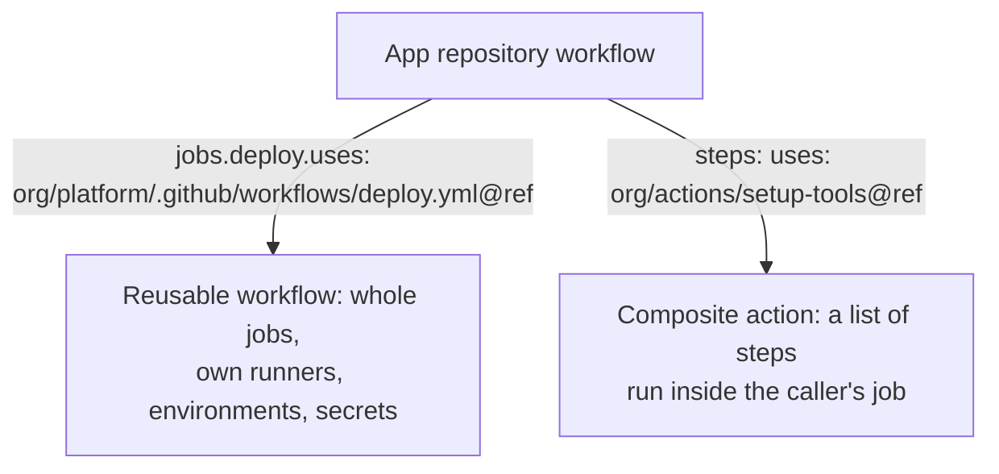

# GitHub Actions in depth

> **Status: AI draft, 2026-11-16.** Not yet verified by me. Written from the GitHub documentation; nothing was run for this page.

## In one line

Matrices run one job across many combinations; reusable workflows share pipelines and composite actions share steps; environments add approvals and branch rules; concurrency groups stop overlapping runs. Lock third-party actions, and keep untrusted code away from `pull_request_target` and self-hosted runners.

## The plain idea

The basics ([GitHub Actions basics](github-actions-basics.md)) get a single repository building. Real organisations need more: test on several versions at once, share one deploy pipeline across fifty repositories, require a human to approve production, and keep untrusted code away from secrets. Each need has a specific feature, and most incidents with GitHub Actions come from using the powerful ones carelessly.

## How it works

### Matrix builds

```yaml
jobs:
  test:
    runs-on: ${{ matrix.os }}
    strategy:
      fail-fast: false
      max-parallel: 4
      matrix:
        os: [ubuntu-latest, windows-latest]
        python: ["3.12", "3.13"]
        include:
          - os: ubuntu-latest
            python: "3.14"
            experimental: true
    steps:
      - uses: actions/setup-python@<version>
        with:
          python-version: ${{ matrix.python }}
```

Four combinations plus one included; `fail-fast: false` lets the others finish when one fails, so you see every failure at once.

### Reusable workflows vs composite actions



| | Reusable workflow (`on: workflow_call`) | Composite action (`runs: using: composite`) |
|---|---|---|
| Unit | Whole jobs | Steps inside one job |
| Called with | `jobs.<id>.uses:` | `steps[*].uses:` |
| Can use environments, `runs-on`, multiple jobs | Yes | No |
| Secrets | Passed explicitly or `secrets: inherit` | Through inputs or the environment |
| Good for | A standard build-and-deploy pipeline for every service | A shared setup sequence (install tools, log in) |

### Environments and protection rules

A job that names `environment: production` only runs when the environment's rules pass:

- **Required reviewers**: named people or teams approve the deployment (on free and team plans, only for public repositories).
- **Wait timer**: a delay before the job starts.
- **Deployment branches and tags**: only `main` (or release tags) may deploy there.
- Environment-scoped **secrets and variables**, available only to jobs in that environment.

Combined with OIDC trust conditions on the environment, this means only approved runs from the right branch can reach production credentials ([OIDC from pipelines to AWS](oidc-to-aws.md)).

### Concurrency groups

```yaml
concurrency:
  group: deploy-${{ github.ref }}
  cancel-in-progress: true
```

One run per group. `cancel-in-progress: true` suits pull request checks (a new push makes the old run pointless); `false` suits deploys (never cut one off midway). Pending runs are replaced by newer ones either way.

### Locking third-party actions

`uses: some-org/some-action@v3` follows a tag the action's owner can move. If their account is compromised, your next run executes their new code with your token and secrets.

- GitHub's guidance now recommends a **workflow dependency lockfile**, which records the exact commit of every action, including the actions those actions use, and verifies them at run time. It supersedes SHA pinning for repositories that adopt it.
- Otherwise, pin to a **full commit SHA** (`uses: some-org/some-action@<40-character-sha>  # v3.2.1`) and let Dependabot propose updates.
- Reusable workflows called with `jobs.<id>.uses` are not covered by the lockfile; reference them by full SHA as well.

### pull_request vs pull_request_target

| | `pull_request` | `pull_request_target` |
|---|---|---|
| Runs code from | The pull request's merge commit | The base branch |
| Secrets and write token for forks | No | Yes |
| Safe for untrusted forks | Yes | Only if it never checks out or runs the pull request's code |

The classic "pwn request": a `pull_request_target` workflow checks out the fork's code and runs its build script, which now runs with your secrets. Keep untrusted code under `pull_request`; if you need privileges (to label or comment), do that in a separate workflow that does not execute the pull request's code ([Pipeline security](pipeline-security.md)).

### Self-hosted runners

They run in your network with your tools, which is useful for private resources and large builds, but GitHub's guidance is that they should almost never be used for public repositories: anyone can open a pull request and run code on them, and a non-ephemeral runner can stay compromised for later jobs. Use ephemeral runners (one job, then destroyed), isolate them per trust level, and give their machine role minimal permissions. On Kubernetes, Actions Runner Controller runs them as pods.

### Debugging a failed run

1. Read the failed step's log (`gh run view --log-failed`).
2. Re-run with debug logging (a checkbox in the UI, or set the secret or variable `ACTIONS_STEP_DEBUG` to `true`; `ACTIONS_RUNNER_DEBUG` adds runner diagnostics).
3. Reproduce locally with the same container image or script, which is why keeping logic in scripts rather than YAML pays off.
4. For "works on re-run" failures, look for flaky tests, rate limits and cache races.

Billing: GitHub-hosted runner minutes on private repositories are billed by plan and runner type; see the billing page rather than memorising numbers.

## A concrete example

A platform team gives 40 services one deploy pipeline:

1. Reusable workflow `org/platform/.github/workflows/deploy.yml` with inputs `service` and `environment`; it builds once, pushes the image by digest, then deploys to staging and production jobs in their environments.
2. Each service's workflow is ten lines calling it, referenced by full commit SHA.
3. `production` environment: required reviewers from the service team, deployment branch `main` only, OIDC role trust pinned to that environment.
4. Pull request workflows use `pull_request` with `contents: read`, and a concurrency group per branch with `cancel-in-progress: true`.
5. Third-party actions are locked by the lockfile; Dependabot proposes updates.

## Why not just...?

- **...copy the same workflow into 40 repositories?** Fixes then need 40 pull requests and copies drift. A reusable workflow changes in one place, with versioned references.
- **...pin to `@v3` because SHAs are ugly?** Tags can be moved by whoever controls the action; a SHA (or a lockfile) cannot. Comments keep the version readable.
- **...use one self-hosted runner pool for everything?** A job from a low-trust repository could leave something behind for a production deploy job. Separate pools by trust, and make them ephemeral.

## Commands to know

| Command | What it does |
|---|---|
| `gh run view <id> --log-failed` | Logs of failed steps. |
| `gh run rerun <id> --debug` | Re-run with debug logging. |
| `gh workflow list` | Workflows in the repository. |
| `gh api repos/{owner}/{repo}/environments` | Environments and their protection rules. |
| `gh secret set NAME --env production` | Set an environment-scoped secret. |

## How it breaks

| Symptom | Layer | Check | Likely cause |
|---|---|---|---|
| Deploy job waits forever | Environment | Pending review | Required reviewers not notified or not available |
| `Branch is not allowed to deploy` | Environment rules | Deployment branches | Run from a branch not in the allowed list |
| Reusable workflow cannot see a secret | Secrets passing | `secrets:` in the caller | Not passed, or not `secrets: inherit` |
| Matrix job fails on one OS only | Matrix | That combination's log | Path separators, shell differences, missing tool |
| An action started behaving differently overnight | Dependencies | The `uses:` reference | Unpinned tag moved; lock or pin it |
| Secrets leaked from a pull request | Trigger | `pull_request_target` with checkout | Untrusted code ran with secrets |

## Interview questions

**1. When would you use a reusable workflow versus a composite action?**

<details markdown="1">
<summary>Answer</summary>

- Reusable workflow: share whole jobs, with their runners, environments and secrets, such as a standard deploy pipeline.
- Composite action: share a sequence of steps inside a job, such as tool setup.
- Both should be referenced by a fixed version (SHA).

</details>

**2. How do you require approval before deploying to production?**

<details markdown="1">
<summary>Answer</summary>

- A `production` environment with required reviewers and allowed deployment branches.
- The deploy job declares `environment: production`.
- Production credentials (environment secrets or an OIDC role trusting that environment) are only available to that job.

</details>

**3. Why pin actions to a commit SHA, and what does GitHub now recommend?**

<details markdown="1">
<summary>Answer</summary>

- Tags can be moved; a compromised action owner could ship malicious code to every user of `@v3`.
- A SHA is immutable. GitHub now recommends a workflow dependency lockfile, which pins every action including transitive ones and verifies them at run time.
- Use Dependabot to propose reviewed updates.

</details>

**4. What is the risk of `pull_request_target`?**

<details markdown="1">
<summary>Answer</summary>

- It runs in the base repository's context with secrets and a write-capable token, even for forks.
- Checking out and running the fork's code there gives that code your secrets.
- Use `pull_request` for untrusted code; keep privileged steps separate from it.

</details>

**5. What are the risks of self-hosted runners?**

<details markdown="1">
<summary>Answer</summary>

- Code from workflows runs on your infrastructure, possibly with network access to internal systems.
- Non-ephemeral runners can be left compromised for later jobs; public repositories let anyone run code.
- Use ephemeral runners, separate pools per trust level, minimal permissions.

</details>

**6. A workflow fails only sometimes. How do you debug it?**

<details markdown="1">
<summary>Answer</summary>

- Compare failed and successful logs; re-run with debug logging.
- Look for flaky tests, rate limits from registries or APIs, cache races, concurrency between runs.
- Reproduce the step locally with the same image and script.

</details>

## Try it

1. Write a matrix for Node.js 22 and 24 on Ubuntu only, with `fail-fast: false`, and count the jobs it creates.
2. Turn the build steps of this repository's Pages workflow into a composite action. What stays in the workflow?
3. Read your own repositories' workflows and list every `uses:` that is not pinned to a SHA.

## Zoom out

These features are what make GitHub Actions usable as an organisation's delivery platform, and also where its security risks concentrate ([Pipeline security](pipeline-security.md)). The same ideas exist in other tools: shared libraries in Jenkins, pipes in Bitbucket ([Jenkins](jenkins.md), [Bitbucket Pipelines](bitbucket-pipelines.md)).

## Sources

- [GitHub Docs: running variations of jobs (matrix)](https://docs.github.com/en/actions/how-tos/write-workflows/choose-what-workflows-do/run-job-variations)
- [GitHub Docs: reusing workflow configurations](https://docs.github.com/en/actions/concepts/workflows-and-actions/reusing-workflow-configurations)
- [GitHub Docs: reuse workflows](https://docs.github.com/en/actions/how-tos/reuse-automations/reuse-workflows)
- [GitHub Docs: deployments and environments](https://docs.github.com/en/actions/reference/workflows-and-actions/deployments-and-environments)
- [GitHub Docs: secure use reference](https://docs.github.com/en/actions/reference/security/secure-use)
- [GitHub Docs: workflow dependency lockfiles](https://docs.github.com/en/actions/concepts/security/workflow-dependency-lockfiles)
- [GitHub Docs: self-hosted runners](https://docs.github.com/en/actions/concepts/runners/self-hosted-runners)
- [GitHub Docs: enabling debug logging](https://docs.github.com/en/actions/how-tos/monitor-workflows/enable-debug-logging)
- [GitHub Docs: GitHub Actions billing](https://docs.github.com/en/billing/concepts/product-billing/github-actions)
