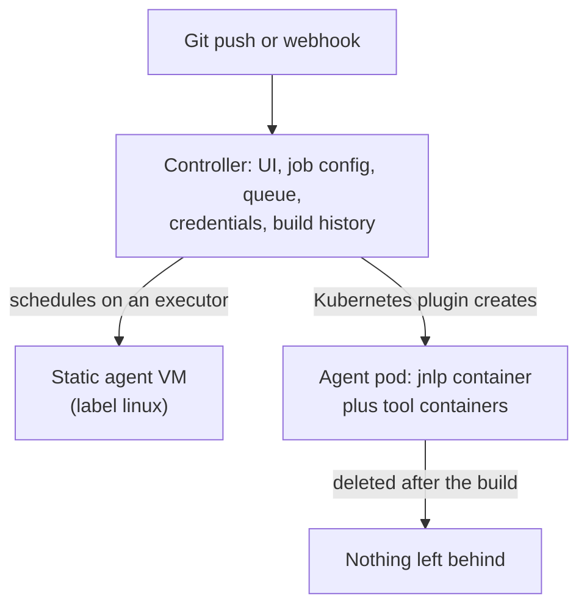

# Jenkins

> **Status: AI draft, 2026-11-16.** Not yet verified by me. Written from the Jenkins documentation; nothing was run.

## In one line

Jenkins is a self-hosted automation server: a controller schedules and stores jobs, agents run the builds (ideally ephemeral pods on Kubernetes), and pipelines are defined as code in a `Jenkinsfile` (declarative `pipeline { stages { ... } }` or scripted Groovy), shared across repositories with shared libraries, with secrets injected through the credentials store and `withCredentials`. Its plugins are its power and its main risk.

## The plain idea

Jenkins is the oldest of the common CI servers and still everywhere. Unlike GitHub Actions or Bitbucket Pipelines, you run it yourself: a Java web application (the **controller**) that keeps job configuration, history and credentials, and dispatches work to **agents**. Almost every feature (Git, Kubernetes, credentials binding, Slack) is a **plugin**.

Running it yourself gives full control (any network, any tools, no per-minute billing) and full responsibility (upgrades, plugin security, backups, scaling).

## How it works

### Controller and agents



- **Executors** are build slots on a node. Builds should not run on the controller's built-in node: the Jenkins documentation recommends distributed builds so build code cannot reach the controller's files and secrets. Set the built-in node's executors to 0.
- **Labels** route jobs to suitable agents (`agent { label 'docker' }`).
- **Ephemeral agents on Kubernetes**: the Kubernetes plugin starts a pod per build from a **pod template** (a `jnlp` container that talks to the controller, plus containers with your tools), runs the stages in those containers, and deletes the pod. Clean workspace every time, and capacity scales with the cluster ([Pods](../kubernetes/pods.md)).

### Job types

| Type | Use |
|---|---|
| Freestyle | Old UI-configured jobs; avoid for new work |
| Pipeline | One pipeline, defined in a `Jenkinsfile` (from Git) |
| Multibranch Pipeline | Scans a repository; creates a pipeline per branch and pull request that has a `Jenkinsfile` |
| Organization folder | Multibranch for every repository in a GitHub or Bitbucket organisation |

### A declarative Jenkinsfile

```groovy
pipeline {
  agent {
    kubernetes {
      yaml '''
        apiVersion: v1
        kind: Pod
        spec:
          containers:
            - name: build
              image: maven:3.9-eclipse-temurin-21
              command: ["sleep"]
              args: ["infinity"]
      '''
    }
  }
  options {
    timeout(time: 30, unit: 'MINUTES')
    disableConcurrentBuilds()
  }
  environment {
    APP = 'sample-app'
  }
  stages {
    stage('Build and test') {
      steps {
        container('build') {
          sh 'mvn -B verify'
        }
      }
    }
    stage('Push image') {
      when { branch 'main' }
      steps {
        withCredentials([usernamePassword(credentialsId: 'registry-creds',
                         usernameVariable: 'REG_USER', passwordVariable: 'REG_PASS')]) {
          sh 'echo "$REG_PASS" | docker login registry.example.com -u "$REG_USER" --password-stdin'
        }
      }
    }
    stage('Deploy to production') {
      when { branch 'main' }
      input { message 'Deploy to production?' }
      steps {
        sh './deploy.sh production'
      }
    }
  }
  post {
    failure { echo 'Notify the team here' }
    always  { junit 'target/surefire-reports/*.xml' }
  }
}
```

| Section | Meaning |
|---|---|
| `agent` | Where the pipeline runs: `any`, a label, a Docker image, or a Kubernetes pod |
| `stages`, `stage`, `steps` | The structure shown in the UI |
| `when` | Conditions on branch, environment or expression |
| `input` | Pause for a human approval |
| `environment`, `options`, `parameters`, `triggers` | Variables, timeouts, build inputs, schedules |
| `post` | Run on `always`, `success`, `failure`, `unstable`, `changed` |

**Declarative** (above) is structured and validated; **scripted** (`node { stage('x') { ... } }`) is plain Groovy, more flexible and easier to get wrong. Declarative can embed Groovy in a `script { }` block when needed.

Secrets: note the single quotes in `sh '... "$REG_PASS" ...'`. The shell expands the variable; Groovy does not interpolate it into the command string, which would leak it into logs and process listings ([Pipeline security](pipeline-security.md)).

### Shared libraries

A Git repository of Groovy code (`vars/`, `src/`) that pipelines load with `@Library('platform-lib@v2') _`. Twenty services can call `standardBuild(app: 'sample-app')` and get the same stages. Version the library and pin it, like a module ([Modules and environments](../iac/modules-and-environments.md)).

### Credentials

Jenkins stores credentials (username and password, secret text, SSH keys, files) encrypted on the controller, scoped globally or to a folder. Pipelines reference them by ID through `withCredentials` (the Credentials Binding plugin) or `environment { X = credentials('id') }`, and Jenkins masks the values in logs. For AWS, prefer agent pods whose service account has an IAM role (IRSA or Pod Identity) over stored keys ([Cluster access, IRSA and Pod Identity](../eks/access-and-pod-identity.md)).

### Plugins as a risk

Hundreds of plugins, maintained by different people, run inside the controller with full access. Old plugins carry known vulnerabilities, and upgrades can break each other. Keep the plugin list short, upgrade Jenkins LTS and plugins regularly, watch the security advisories, and back up `JENKINS_HOME` (or define the controller as code with Configuration as Code).

## A concrete example

A team moves from static build VMs to Kubernetes agents:

1. Install the Kubernetes plugin; point it at a namespace `jenkins-agents` with a service account allowed to create pods there only ([RBAC and service accounts](../kubernetes/rbac-and-service-accounts.md)).
2. Define pod templates per tool chain (Maven, Node, Terraform) in the shared library.
3. Set the controller's built-in executors to 0.
4. Builds now start in a fresh pod, and the "workspace full" and "tool version left over from another job" failures disappear.

## Why not just...?

- **...run builds on the controller?** Build scripts could read every credential and the controller's configuration; one runaway build slows the UI for everyone. The documentation recommends distributed builds.
- **...configure jobs in the web UI?** Unreviewed, unversioned, lost when the controller is rebuilt. Use `Jenkinsfile`s and Configuration as Code.
- **...install a plugin for every small need?** Each one is code running inside the controller with all its secrets. Prefer shell steps and a few well-maintained plugins.

## Commands to know

| Command or path | What it does |
|---|---|
| `JENKINS_HOME` | The controller's data: jobs, builds, credentials, plugins. Back it up. |
| `<jenkins-url>/pipeline-syntax` | The snippet generator for steps. |
| `<jenkins-url>/script` | Script console: Groovy with full controller access. Restrict it to administrators. |
| `curl -X POST <jenkins-url>/job/<job>/build --user <user>:<api-token>` | Trigger a job via the API. |
| `java -jar jenkins-cli.jar -s <jenkins-url> -auth @token-file list-jobs` | The Jenkins CLI. |
| `kubectl get pods -n jenkins-agents -w` | Watch agent pods come and go. |

## How it breaks

| Symptom | Layer | Check | Likely cause |
|---|---|---|---|
| Builds stuck "waiting for next available executor" | Capacity | Executors, agent status, labels | Agents offline, no agent with the label, or too few executors (starvation) |
| Agent offline | Connectivity | Agent log, controller log | Network or TLS between agent and controller, Java version mismatch, disk full |
| Kubernetes agent pod never starts | Pod template | `kubectl describe pod` | Image pull, resource quota, RBAC for the plugin's service account |
| "No space left on device" on static agents | Workspaces | Disk usage | Old workspaces never cleaned; use ephemeral agents or cleanup steps |
| Pipeline fails after a plugin upgrade | Plugins | Release notes, dependency tree | Incompatible plugin versions |
| Secret appears in the log | Credentials handling | Groovy string interpolation | Double-quoted Groovy string interpolated the secret |

## Interview questions

**1. Explain the controller and agent architecture.**

<details markdown="1">
<summary>Answer</summary>

- The controller holds configuration, the queue, credentials and history, and serves the UI.
- Agents run builds on executors, chosen by labels.
- Builds should not run on the controller; ephemeral agents (Kubernetes pods) give clean, scalable capacity.

</details>

**2. Declarative vs scripted pipelines?**

<details markdown="1">
<summary>Answer</summary>

- Declarative: structured `pipeline { stages {} post {} }`, validated, easier to read; `script {}` for small Groovy pieces.
- Scripted: free Groovy with `node {}` blocks; flexible but harder to maintain.
- Prefer declarative plus shared libraries.

</details>

**3. What is a shared library and why use one?**

<details markdown="1">
<summary>Answer</summary>

- A versioned Git repository of Groovy steps loaded with `@Library`.
- Many repositories call the same standard stages instead of copying Jenkinsfiles.
- Pin versions so a library change does not break every pipeline at once.

</details>

**4. How do you use secrets safely in a Jenkinsfile?**

<details markdown="1">
<summary>Answer</summary>

- Store them in the credentials store, scoped narrowly; reference by ID with `withCredentials`.
- Use single-quoted `sh` strings so the shell, not Groovy, expands them.
- Prefer workload identity (IRSA, OIDC) over stored cloud keys.

</details>

**5. How do you run Jenkins agents on Kubernetes?**

<details markdown="1">
<summary>Answer</summary>

- The Kubernetes plugin creates a pod per build from pod templates: a `jnlp` container plus tool containers.
- Stages run in chosen containers with `container('name')`; the pod is deleted afterwards.
- Give the plugin a service account limited to the agent namespace.

</details>

**6. Builds queue for a long time. What do you check?**

<details markdown="1">
<summary>Answer</summary>

- Agent status and labels: is any online agent able to take the job?
- Executor counts, stuck builds holding executors, `disableConcurrentBuilds` and locks.
- For Kubernetes agents: pending pods, quotas, node capacity.

</details>

## Try it

Without a Jenkins server:

1. Rewrite the declarative pipeline above as a GitHub Actions workflow with two jobs and an environment for production approval. Which Jenkins features map to which Actions features?
2. Find the line in the pipeline that would leak a secret if its quotes were changed, and explain why.
3. List the plugins this pipeline depends on.

## Zoom out

Jenkins offers the same building blocks as every CI system (triggers, stages, agents, secrets, approvals) but makes you operate the platform. Many teams run it alongside or migrate from it to hosted tools ([GitHub Actions basics](github-actions-basics.md), [Bitbucket Pipelines](bitbucket-pipelines.md)); the security principles are the same ([Pipeline security](pipeline-security.md)).

## Sources

- [Jenkins documentation: pipeline syntax](https://www.jenkins.io/doc/book/pipeline/syntax/)
- [Jenkins documentation: multibranch pipelines](https://www.jenkins.io/doc/book/pipeline/multibranch/)
- [Jenkins documentation: shared libraries](https://www.jenkins.io/doc/book/pipeline/shared-libraries/)
- [Jenkins documentation: managing nodes](https://www.jenkins.io/doc/book/managing/nodes/)
- [Jenkins documentation: controller isolation](https://www.jenkins.io/doc/book/security/controller-isolation/)
- [Jenkins documentation: using credentials](https://www.jenkins.io/doc/book/using/using-credentials/)
- [Jenkins: credentials binding steps](https://www.jenkins.io/doc/pipeline/steps/credentials-binding/)
- [Jenkins Kubernetes plugin](https://plugins.jenkins.io/kubernetes/)
