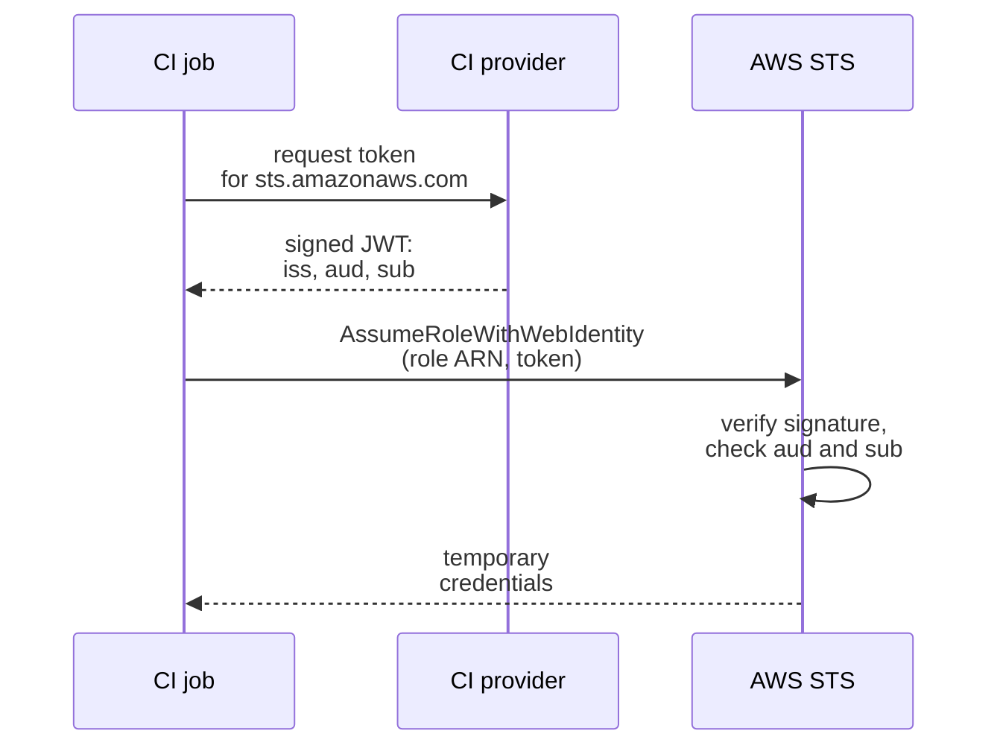

# OIDC from pipelines to AWS

> **Status: AI draft, 2026-11-16.** Not yet verified by me. Written from the GitHub, Bitbucket and AWS documentation; nothing was run.

## In one line

Instead of storing AWS access keys in CI, the CI provider issues each job a short-lived signed token (OIDC); AWS trusts that provider as an IAM identity provider, and the job exchanges the token with `AssumeRoleWithWebIdentity` for temporary credentials of a role whose trust policy checks the token's `aud` and `sub`, pinning which repository, branch or environment may use it.

## The plain idea

A pipeline that deploys to AWS needs AWS credentials. The old way was an IAM user's access key stored as a CI secret: it never expires, works from anywhere, gets copied into other projects, and shows up in leaked logs. Rotating it is a chore nobody does.

**OIDC federation** removes the stored key. The CI system already knows exactly which repository, branch and job is running. It writes that down in a signed token. AWS has been told to trust tokens signed by that CI system, and a role's trust policy says which token contents are acceptable. The job swaps the token for credentials that expire within the hour. Nothing long-lived exists to leak ([IAM roles and STS](../aws-core/iam-roles-and-sts.md), [Federation and SSO](../aws-core/federation-and-sso.md)).

## How it works



### One-time AWS setup

1. Create an **IAM OIDC identity provider** for the CI system: for GitHub, `https://token.actions.githubusercontent.com` with audience `sts.amazonaws.com`; for Bitbucket, the workspace-specific URL and audience shown in the repository's OpenID Connect settings.
2. Create a **role** whose trust policy allows `sts:AssumeRoleWithWebIdentity` from that provider, with conditions.
3. Attach a **permissions policy** with only what that pipeline needs ([Least privilege and AccessDenied](../aws-core/least-privilege-and-accessdenied.md)).

### The trust policy is the security

```json
{
  "Effect": "Allow",
  "Principal": {
    "Federated": "arn:aws:iam::123456789012:oidc-provider/token.actions.githubusercontent.com"
  },
  "Action": "sts:AssumeRoleWithWebIdentity",
  "Condition": {
    "StringEquals": {
      "token.actions.githubusercontent.com:aud": "sts.amazonaws.com",
      "token.actions.githubusercontent.com:sub": "repo:sample-org/sample-app:environment:production"
    }
  }
}
```

- `aud` must be the expected audience.
- `sub` says *which* workflows may assume the role. Without it, any repository on GitHub that can request a token for that audience could assume your role. AWS recommends always evaluating the `sub` condition key.
- GitHub `sub` formats include `repo:ORG/REPO:ref:refs/heads/BRANCH`, `repo:ORG/REPO:environment:NAME` and pull request forms. Pinning to an **environment** combines with GitHub's environment protection rules (approvals, allowed branches) ([GitHub Actions in depth](github-actions-in-depth.md)).
- `StringLike` with `repo:sample-org/sample-app:*` allows every branch and pull request of that repository: acceptable for a read-only plan role, not for a deploy role.

### GitHub Actions side

```yaml
permissions:
  id-token: write     # allow the job to request an OIDC token
  contents: read

jobs:
  deploy:
    environment: production
    runs-on: ubuntu-latest
    steps:
      - uses: aws-actions/configure-aws-credentials@<pinned-version>
        with:
          role-to-assume: arn:aws:iam::123456789012:role/sample-app-deploy
          aws-region: ap-south-1
      - run: aws sts get-caller-identity
```

The action requests the token, calls STS, and exports the temporary credentials for later steps.

### Bitbucket Pipelines side

- Add `oidc: true` to the step; the token is in the `BITBUCKET_STEP_OIDC_TOKEN` variable.
- Write it to a file and set `AWS_ROLE_ARN` and `AWS_WEB_IDENTITY_TOKEN_FILE`; the AWS CLI and SDKs then assume the role themselves.
- The `sub` claim is made of UUIDs: `{repository-uuid}:{environment-uuid}:{step-uuid}`. Trust conditions pin the repository UUID, and for deploy roles the deployment environment UUID ([Bitbucket Pipelines](bitbucket-pipelines.md)).

## A concrete example

Two roles for `sample-app`'s Terraform pipeline ([Testing and CI for Terraform](../iac/testing-and-ci.md)):

| Role | Trust `sub` | Permissions |
|---|---|---|
| `sample-app-plan` | `repo:sample-org/sample-app:*` (any branch or pull request) | Read-only, plus read and lock the state |
| `sample-app-deploy` | `repo:sample-org/sample-app:environment:production` | What the apply needs, nothing more |

Pull requests can plan but never apply; only a job in the `production` environment, which requires approval and runs only from `main`, can deploy.

## Why not just...?

- **...keep the access key, but rotate it regularly?** It still exists in the CI system, works from anywhere until rotated, and rotation is the step teams skip. Temporary credentials expire on their own.
- **...trust the whole GitHub provider without a `sub` condition?** Then any workflow in any repository that can get a token with your audience can become your role. Always pin `sub`.
- **...use one role for every pipeline?** One compromised repository then has every permission any pipeline needs. One role per pipeline and purpose.

## Commands to know

| Command | What it does |
|---|---|
| `aws iam list-open-id-connect-providers` | OIDC providers in the account. |
| `aws iam get-role --role-name sample-app-deploy --query Role.AssumeRolePolicyDocument` | The role's trust policy, to check `aud` and `sub`. |
| `aws sts get-caller-identity` | In the job: which role it is actually using. |
| `aws cloudtrail lookup-events --lookup-attributes AttributeKey=EventName,AttributeValue=AssumeRoleWithWebIdentity` | Who assumed roles through OIDC, with the token's subject ([CloudTrail, Athena and Config](../aws-services/cloudtrail-and-config.md)). |

## How it breaks

| Symptom | Layer | Check | Likely cause |
|---|---|---|---|
| `Not authorized to perform sts:AssumeRoleWithWebIdentity` | Trust policy | `sub` and `aud` conditions against the token | Branch, environment or repository does not match; typo in the condition key |
| `Credentials could not be loaded` or no token requested | Workflow permissions | `permissions:` block | Missing `id-token: write` |
| `No OpenIDConnect provider found` | IAM provider | `list-open-id-connect-providers` | Provider missing in this account, or wrong URL |
| `Incorrect token audience` | Audience | Provider audiences, the action's audience | Provider registered with another audience |
| Works on `main`, fails on a tag release | `sub` format | Tag `sub` is `ref:refs/tags/...` | Trust policy only allows the branch form |
| Deploy succeeds but `AccessDenied` on a call | Permissions | Role's permissions policy | Role can be assumed but lacks the action |

## Interview questions

**1. Why use OIDC instead of access keys in CI?**

<details markdown="1">
<summary>Answer</summary>

- No long-lived secret stored in the CI system, so nothing to leak or rotate.
- Credentials are temporary and tied to a specific repository, branch or environment.
- CloudTrail shows which workflow assumed the role.

</details>

**2. Walk through the OIDC flow from a GitHub Actions job to AWS.**

<details markdown="1">
<summary>Answer</summary>

- The job (with `id-token: write`) requests a signed JWT from GitHub's provider.
- It calls `AssumeRoleWithWebIdentity` with the token and role ARN.
- STS verifies the signature against the registered provider, checks the trust policy's `aud` and `sub`, and returns temporary credentials.

</details>

**3. Why must the trust policy pin `sub`?**

<details markdown="1">
<summary>Answer</summary>

- `sub` identifies the repository and branch or environment.
- Without it, any repository's workflow that can get a token for the audience could assume the role.
- Pin deploy roles to an environment or protected branch.

</details>

**4. A job fails with "Not authorized to perform sts:AssumeRoleWithWebIdentity". Debug it.**

<details markdown="1">
<summary>Answer</summary>

- Compare the token's `sub` (branch, tag, environment, pull request form) with the trust policy conditions.
- Check `aud`, the provider ARN in the principal, and that the provider exists in that account.
- Check the workflow requested a token (`id-token: write`).

</details>

**5. How does Bitbucket's OIDC differ from GitHub's?**

<details markdown="1">
<summary>Answer</summary>

- The provider URL and audience are per workspace; `sub` is built from repository, environment and step UUIDs.
- The step needs `oidc: true`; the token comes in `BITBUCKET_STEP_OIDC_TOKEN`, written to a file for the SDK.
- The trust policy pins repository UUID and, for deploys, environment UUID.

</details>

**6. How would you design roles for plan and deploy?**

<details markdown="1">
<summary>Answer</summary>

- A read-only plan role trusted by all branches and pull requests of the repository.
- A deploy role trusted only by the production environment's jobs, with approval required.
- Separate roles per account and per pipeline.

</details>

## Try it

Without AWS:

1. Write the trust policy for a role that only release tags `v*` of `sample-org/sample-app` may assume. (Hint: the tag `sub` form is `repo:ORG/REPO:ref:refs/tags/TAG`, so use `StringLike` with `refs/tags/v*`.)
2. Decode a JWT you have (for example a kind service account token, as on [RBAC and service accounts](../kubernetes/rbac-and-service-accounts.md)) and identify `iss`, `aud` and `sub`.
3. List every place in your current pipelines where a long-lived cloud key is stored.

## Zoom out

OIDC from CI is the same pattern as IRSA and Pod Identity on EKS and as SSO for people: short-lived credentials from a trusted identity provider, narrowed by conditions ([Cluster access, IRSA and Pod Identity](../eks/access-and-pod-identity.md), [OAuth 2.0, OIDC and JWTs](../security/oauth-oidc-jwt.md)). It is the single biggest improvement to most pipelines' security ([Pipeline security](pipeline-security.md)).

## Sources

- [GitHub Docs: configuring OpenID Connect in AWS](https://docs.github.com/en/actions/how-tos/secure-your-work/security-harden-deployments/oidc-in-aws)
- [GitHub Docs: OpenID Connect reference (subject claim formats)](https://docs.github.com/en/actions/reference/security/oidc)
- [GitHub Docs: OpenID Connect concepts](https://docs.github.com/en/actions/concepts/security/openid-connect)
- [AWS IAM User Guide: create an OIDC identity provider](https://docs.aws.amazon.com/IAM/latest/UserGuide/id_roles_providers_create_oidc.html)
- [configure-aws-credentials action](https://github.com/aws-actions/configure-aws-credentials)
- [Bitbucket Cloud: deploy on AWS using OpenID Connect](https://support.atlassian.com/bitbucket-cloud/docs/deploy-on-aws-using-bitbucket-pipelines-openid-connect/)
