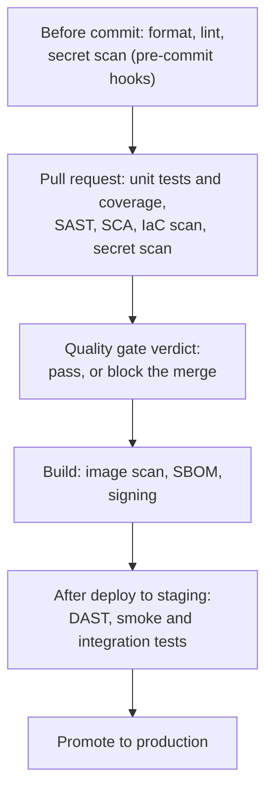

# Quality and security gates

> **Status: AI draft, 2026-11-16.** Not yet verified by me. Written from the tools' documentation; this site's own gates (structure check, Markdown lint, diagram width, strict build, identifier scan, gitleaks) are described from its real configuration.

## In one line

A gate is a pipeline check that stops a change when it breaks a rule: tests and coverage, code quality, code and dependency scanning, image, IaC and secret scanning, and tests against the running app. Choose per rule whether it fails or warns, and run the fast ones first.

## The plain idea

Reviewers are good at judging design and intent and bad at spotting the hundredth missing null check, the vulnerable library version, or the AWS key pasted into a test file. Machines are the opposite. A **gate** is an automated rule placed where it is cheapest to apply: before the commit, in the pull request, before deploy. If it fails, the change does not move on.

## How it works

### Where the gates sit

### The kinds of scan

| Kind | Looks at | Finds | Examples |
|---|---|---|---|
| **Unit tests and coverage** | Code, by running it | Broken behaviour; untested code | JUnit, pytest, Jest, with a coverage tool |
| **Static analysis (quality)** | Source code | Bugs, code smells, duplication, complexity | SonarQube, linters |
| **SAST** (static application security testing) | Your source code | Injection, unsafe APIs, hard-coded secrets | SonarQube security rules, Semgrep, CodeQL |
| **SCA** (software composition analysis) | Your dependencies (lock files, SBOM) | Libraries with known CVEs, licence issues | Trivy, Dependabot, OWASP Dependency-Check |
| **Image scan** | Container image layers | Vulnerable OS packages and libraries | Trivy, ECR scanning ([ECR](../aws-services/ecr.md)) |
| **IaC scan** | Terraform, Kubernetes YAML, Dockerfiles | Public buckets, open security groups, root containers | Trivy config, Checkov ([Testing and CI for Terraform](../iac/testing-and-ci.md)) |
| **Secret scan** | Files and Git history | Keys, tokens, passwords | gitleaks, GitHub secret scanning |
| **DAST** (dynamic) | A running application, from outside | Missing headers, injection that really works, auth flaws | OWASP ZAP |

### SonarQube quality gates

SonarQube analyses code on each pull request and compares the results with a **quality gate**: a set of conditions on new code or overall code, such as "no new bugs above minor", "coverage on new code at least 80%", "no new security hotspots unreviewed". The built-in default gate is called "Sonar way". The verdict is reported back to the pull request and can block the merge.

Judging **new code** is the important idea: a legacy project with thousands of old issues can still demand that every change is clean, and quality improves as code is touched.

### Fail or warn

| Fail the build | Warn only |
|---|---|
| Secrets found | Low-severity CVEs with no fix available |
| Critical or high CVEs with a fix available, in the image you are shipping | Code smells on old code |
| Unit tests failing; quality gate failed on new code | Style issues already covered by the formatter |
| IaC findings that expose data (public bucket, `0.0.0.0/0` to a database) | Findings with a documented, time-limited exception |

Every exception should be recorded with a reason and an expiry date (in the tool's ignore file or as an inline suppression), not by turning the gate off.

### Keeping gates fast

- Fast checks first; run independent scans in parallel jobs.
- Scan only what changed in pull requests; full scans nightly.
- Cache vulnerability databases and dependencies.
- Keep tool versions pinned so results do not change under you.

## A concrete example

This site's own gates, as a small worked example:

| Gate | Where | Fails on |
|---|---|---|
| Page structure (`tools/check_page.py`) | Local, before publishing | Missing sections, wrong question format, banned syntax, broken relative links |
| Diagram width check | Local | Any diagram wider than 800px |
| Markdown lint | `tools/check.sh` | Missing blank lines, bad list indentation |
| Identifier scanner | pre-commit and pre-push hooks | Anything that looks like a real address, account ID, hostname or secret |
| gitleaks | pre-push hook | Secrets in commits being pushed |
| Strict site build | Locally and in GitHub Actions | Any build warning |

The scanner and gitleaks fail closed: if the tool is missing, the commit or push is blocked.

## Why not just...?

- **...make every finding fail the build?** Teams then drown in unfixable low-severity findings, start ignoring the gate, and eventually turn it off. Fail on what matters, warn on the rest, and tighten over time.
- **...rely on scanning images in the registry after the fact?** A vulnerable image may already be running. Scan before push and keep rescanning, because new CVEs are published against old images ([Vulnerability and patch management](../security/vulnerability-and-patch-management.md)).
- **...chase 100% coverage?** Coverage shows what ran, not what was checked. A target on new code plus review of the tests themselves gives more than a number.

## Commands to know

| Command | What it does |
|---|---|
| `trivy fs --scanners vuln,secret,misconfig .` | Scan a repository folder for vulnerable dependencies, secrets and misconfigurations. |
| `trivy image --severity HIGH,CRITICAL --exit-code 1 --ignore-unfixed <image>` | Fail on fixable high and critical CVEs in an image. |
| `trivy config .` | IaC misconfiguration scan. |
| `gitleaks git --redact` | Scan Git history for secrets. |
| `gitleaks dir .` | Scan the working tree. |
| `mvn verify sonar:sonar` (with server settings) | Run tests and send results to SonarQube ([Build tools](build-tools.md)). |

## How it breaks

| Symptom | Layer | Check | Likely cause |
|---|---|---|---|
| Builds suddenly fail on CVEs with no code change | SCA or image scan | New advisories | A new CVE was published against an existing dependency |
| Developers bypass the gate | Process | Branch protection | Gate not required, or too noisy to trust |
| Quality gate fails on code nobody touched | New code definition | SonarQube new code period | Wrong baseline branch or period |
| Secret scan misses a key | Rules | Tool rules and entropy settings | Unusual format; add a custom rule |
| Pipeline takes 40 minutes | Speed | Step timings | Serial full scans on every pull request |

## Interview questions

**1. What is the difference between SAST, SCA and DAST?**

Answer

- SAST: analyses your source code without running it.
- SCA: checks your dependencies against known vulnerabilities and licences.
- DAST: attacks a running application from outside.

**2. What is a SonarQube quality gate?**

Answer

- A set of conditions (bugs, vulnerabilities, coverage, duplication) checked on each analysis, on new code or overall code.
- Pass or fail is reported to the pull request and can block the merge.
- Focusing on new code lets legacy projects improve without fixing everything first.

**3. How do you decide whether a finding fails the build or only warns?**

Answer

- Fail on high impact and actionable: secrets, critical CVEs with fixes, exposed data, failing tests.
- Warn on low severity, unfixable or legacy findings.
- Record exceptions with reasons and expiry; tighten thresholds over time.

**4. A critical CVE is reported in a base image used by 30 services. What do you do?**

Answer

- Find affected images (SBOMs, registry scans) and running workloads.
- Update the base image, rebuild and redeploy through the pipelines, highest exposure first.
- Make the image gate fail on that CVE so nothing new ships with it.

**5. How do you keep security scanning from slowing delivery?**

Answer

- Scan changes in pull requests and everything nightly.
- Parallel jobs, cached databases, pinned tools.
- Fail only on what needs action now.

**6. A secret was committed and pushed. What now?**

Answer

- Revoke and rotate it first: assume it is compromised.
- Remove it from the code; rewriting history helps only if nobody has pulled, and does not undo exposure.
- Add or tune secret scanning so the next one is caught before the push.

## Try it

1. Run `./tools/check.sh` in this repository and match each step's output to a row in the example table.
2. If you have Docker, run Trivy on a public image you use and count the high and critical findings with fixes available.
3. Write the fail and warn policy you would propose for a new service, in six rows.

## Zoom out

Gates turn quality and security standards into automatic, consistent checks, part of a trustworthy pipeline ([Concepts](concepts.md)) and of supply chain security ([Pipeline security](pipeline-security.md)). Their findings feed vulnerability management ([Vulnerability and patch management](../security/vulnerability-and-patch-management.md)).

## Sources

- [SonarQube Server: introduction to quality gates](https://docs.sonarsource.com/sonarqube-server/quality-standards-administration/managing-quality-gates/introduction-to-quality-gates)
- [Trivy documentation](https://trivy.dev/docs/latest/guide/)
- [gitleaks](https://github.com/gitleaks/gitleaks)
- [OWASP: source code analysis tools](https://community.owasp.org/Source_Code_Analysis_Tools)
- [OWASP ZAP](https://www.zaproxy.org/)
