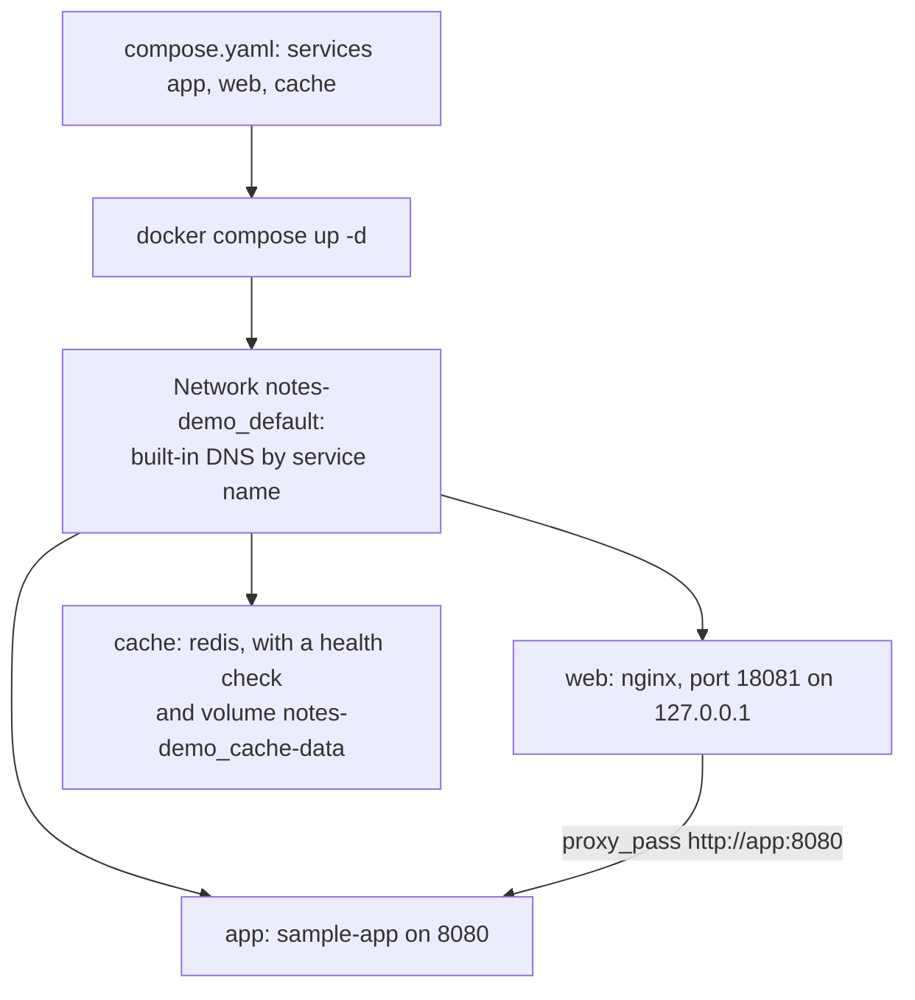

# Docker Compose

> **Status: AI draft, 2026-11-16.** Not yet verified by me. Commands and output were run with Docker 29 and Compose v5 on a Linux host.

## In one line

Compose describes a multi-container application in one `compose.yaml`: services, ports, environment, volumes and dependencies. `docker compose up` creates them on a private network where services find each other by name. It is for local development and simple single-host setups, not a replacement for Kubernetes.

## How it works

A project is a directory with a `compose.yaml`. Compose turns each **service** into one or more containers, all attached to a network created for the project, so `web` can reach `app` at `http://app:8080` ([Running and debugging containers](running-containers.md)). Named volumes are created once and kept between runs.



The file used here:

```yaml
services:
  app:
    image: notes-sample-app:1.0.0
    environment:
      APP_VERSION: "1.0.0"
  web:
    image: nginx:1.27
    ports:
      - "127.0.0.1:18081:80"
    volumes:
      - ./nginx.conf:/etc/nginx/conf.d/default.conf:ro
    depends_on:
      - app
  cache:
    image: redis:7
    healthcheck:
      test: ["CMD", "redis-cli", "ping"]
      interval: 2s
      retries: 5
    volumes:
      - cache-data:/data
volumes:
  cache-data:
```

| Key | Meaning |
|---|---|
| `image` or `build` | Use an image, or build one from a directory with a Dockerfile |
| `ports` | Publish container ports on the host, like `-p` |
| `environment`, `env_file` | Variables for the container |
| `volumes` | Named volumes or bind mounts |
| `depends_on` | Start order. Only start order, unless you add `condition: service_healthy`, which also waits for the dependency's health check |
| `healthcheck` | A command Docker runs to report the container healthy or unhealthy |
| `restart` | A restart policy, as with `docker run --restart` |

What it did:

```console
$ docker compose -p notes-demo up -d
 Container notes-demo-cache-1 Started
 Container notes-demo-app-1 Started
 Container notes-demo-web-1 Started
$ docker compose -p notes-demo ps --format 'table {{.Service}}\t{{.Status}}\t{{.Ports}}'
SERVICE   STATUS                   PORTS
app       Up 4 seconds             8080/tcp
cache     Up 4 seconds (healthy)   6379/tcp
web       Up 4 seconds             127.0.0.1:18081->80/tcp
$ curl -s http://127.0.0.1:18081/
hello from sample-app 1.0.0
$ docker compose -p notes-demo exec -T cache sh -c 'getent hosts app'
<address> app
```

`down` removes containers and the network but keeps named volumes; `down -v` removes the volumes too:

```console
$ docker compose -p notes-demo down
 Network notes-demo_default Removed
$ docker volume ls --format '{{.Name}}' | grep notes-demo
notes-demo_cache-data
$ docker compose -p notes-demo down -v
 Volume notes-demo_cache-data Removed
```

`-p` sets the project name, which prefixes every container, network and volume. The current command is `docker compose` (a Docker CLI plugin); the older standalone `docker-compose` binary is no longer maintained.

**Compose against Kubernetes.** Compose runs containers on one Docker host. It has no scheduler across machines, no self-healing beyond restart policies, no rolling updates with health-gated traffic, and no Services, Ingress or autoscaling. That is why the same application is described with Deployments and Services in production ([Deployments and rollouts](../kubernetes/deployments-and-rollouts.md), [Services and DNS](../kubernetes/services-and-dns.md)).

## Interview questions

**1. What is Docker Compose for?**

<details markdown="1">
<summary>Answer</summary>

- Defining and running a multi-container application from one file, on one host.
- Local development, integration tests in CI, small single-host deployments.
- It creates a project network with service-name DNS, plus named volumes.

</details>

**2. Does `depends_on` make a service wait until its dependency is ready?**

<details markdown="1">
<summary>Answer</summary>

- By default it only controls start order: the dependency is started first.
- With `condition: service_healthy` and a health check on the dependency, Compose waits until it is healthy.
- Applications should still retry connections, since dependencies can restart later.

</details>

**3. How do services in Compose find each other?**

<details markdown="1">
<summary>Answer</summary>

- Compose puts them on a user-defined network for the project.
- Docker's built-in DNS resolves each service name to its container addresses.
- So `app` is reachable at `app:<port>` from any service in the project.

</details>

**4. What is the difference between `docker compose down` and `down -v`?**

<details markdown="1">
<summary>Answer</summary>

- `down` stops and removes containers and the project network; named volumes stay, so data survives.
- `down -v` also removes the named volumes, deleting their data.

</details>

**5. Why not run production on Compose?**

<details markdown="1">
<summary>Answer</summary>

- One host only: no scheduling across machines, so the host is a single point of failure.
- No health-gated rolling updates, service discovery across hosts, autoscaling or self-healing beyond restarts.
- An orchestrator such as Kubernetes or ECS provides those.

</details>

## Sources

- [Docker documentation: Docker Compose overview](https://docs.docker.com/compose/)
- [Compose file reference: services](https://docs.docker.com/reference/compose-file/services/)
- [Docker documentation: control startup order in Compose](https://docs.docker.com/compose/how-tos/startup-order/)
- [Docker documentation: networking in Compose](https://docs.docker.com/compose/how-tos/networking/)
