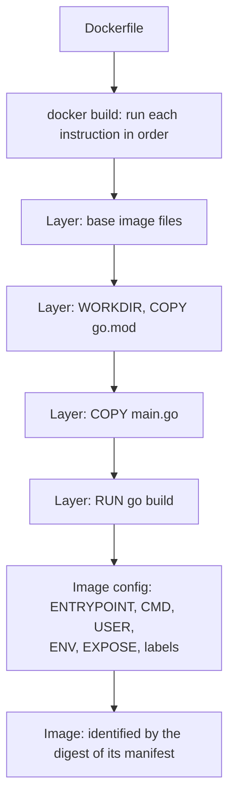

# Images and Dockerfiles

> **Status: AI draft, 2026-11-16.** Not yet verified by me. Commands and output were run with Docker 29 on a Linux host; image IDs and digests are shortened.

## In one line

An image is read-only layers plus a config. Each file-changing Dockerfile step makes a cached layer, reused until its inputs change. Multi-stage builds ship only what runs. Use exec-form `ENTRYPOINT`, a non-root `USER`, and digests for exactness.

## The plain idea

A **container image** is a frozen, portable filesystem plus instructions for how to start it: a snapshot of everything a program needs (the binary, its libraries, its configuration defaults) and the command to run. Anyone with the image runs the same thing, on a laptop or on any node of a cluster.

A **Dockerfile** is the recipe. Each line is a step: start from this base, copy these files, run this command. Each step that changes files records the difference as a **layer**. Because layers are cached, rebuilding after a small code change only redoes the steps after that change, which is why the order of the lines matters so much.

## How it works

### Layers and the config



- `FROM`, `COPY`, `ADD` and `RUN` change files and create layers.
- `ENV`, `USER`, `WORKDIR`, `EXPOSE`, `ENTRYPOINT`, `CMD` and `LABEL` change only the image's **config** (zero-size entries in `docker history`).
- A layer is identified by a hash of its contents, so identical layers are stored once and shared between images.

### The instructions that matter

| Instruction | What it does | Watch out for |
|---|---|---|
| `FROM image:tag AS name` | Start from a base image; `AS` names a stage | Pin a specific tag, or a digest for exact builds |
| `WORKDIR /src` | Set and create the working directory | Prefer it to `RUN cd` |
| `COPY src dest` | Copy files from the build context | Copy dependency files first, source later (caching) |
| `RUN cmd` | Run a command and save the resulting files as a layer | Combine install and cleanup in one `RUN`, or the deleted files stay in the earlier layer |
| `ENV KEY=value` | Set an environment variable in the image | Never put secrets here: anyone with the image can read them |
| `USER app` | Run as this user from here on | Without it, the process runs as root |
| `EXPOSE 8080` | Document the listening port | It publishes nothing by itself |
| `ENTRYPOINT ["/server"]` | The program to run | Use the exec form (a JSON list) |
| `CMD ["--port", "8080"]` | Default arguments, or the default command if there is no `ENTRYPOINT` | Overridden by arguments to `docker run` |

### Exec form and shell form

```dockerfile
ENTRYPOINT ["/server"]        # exec form: /server is PID 1
ENTRYPOINT /server            # shell form: /bin/sh -c "/server", the shell is PID 1
```

With the shell form, the shell is PID 1 and does not forward `SIGTERM` to your program, so containers take the full stop timeout and are then killed. Even with the exec form, PID 1 must handle `SIGTERM` itself or run under a small init ([What a container is](what-is-a-container.md)). Shell scripts used as entrypoints should end with `exec "$@"` or `exec /server` so the real program replaces the shell.

### Layer caching

The builder reuses a cached layer when the instruction and its inputs are unchanged: for `COPY`, the content of the copied files; for `RUN`, the command text and every layer before it. Once one step misses the cache, every later step runs again. So order the Dockerfile from what changes least to what changes most: base image, system packages, dependency files and their install, then the source code.

### Multi-stage builds

A build needs compilers, package managers and headers; running the result needs none of them. **Multi-stage builds** use one stage to build and copy only the output into a small final stage:

```dockerfile
# Build stage: has the Go toolchain
FROM golang:1.23 AS build
WORKDIR /src
COPY go.mod ./
COPY main.go ./
RUN CGO_ENABLED=0 go build -o /out/server .

# Run stage: only the binary
FROM gcr.io/distroless/static-debian12:nonroot
COPY --from=build /out/server /server
ENV APP_VERSION=1.0.0
EXPOSE 8080
USER nonroot
ENTRYPOINT ["/server"]
```

The final image here was 17.9 MB, the binary plus a minimal base, with no shell, package manager or compiler for an attacker to use.

### Base images

| Base | Contains | Trade-off |
|---|---|---|
| Full distribution (`ubuntu`, `debian`) | Shell, package manager, common tools | Easy to debug; larger, more packages to patch |
| `-slim` variants | A trimmed distribution | A good default for interpreted languages |
| `alpine` | Very small, uses the musl C library | Small; some software behaves differently with musl |
| Distroless | Only the runtime the program needs, no shell | Minimal attack surface; debugging needs an ephemeral debug container |
| `scratch` | Nothing at all | For fully static binaries |

### Tags and digests

A **tag** such as `1.0.0` or `latest` is a movable label: whoever controls the repository can point it at a different image. A **digest** (`sample-app@sha256:...`) is the hash of the image's manifest and can never change. Deploy by digest, or with immutable tags, to know exactly what runs ([Registries and image security](registries-and-image-security.md)). `latest` is just the default tag name, not "the newest".

The **build context** is the directory sent to the builder; `.dockerignore` keeps `.git`, local secrets and build output out of it.

## A concrete example

A Node.js service takes 6 minutes to build on every commit, even for a one-line change.

1. The Dockerfile copies the whole source tree before `npm ci`, so any file change invalidates the dependency install layer.
2. Reorder: `COPY package.json package-lock.json ./`, then `RUN npm ci`, then `COPY . .`. Dependency installation is now cached until the lock file changes ([Build tools](../cicd/build-tools.md)).
3. Add a `.dockerignore` excluding `node_modules`, `.git` and test reports, so the context is small and local files cannot leak in.
4. Move to a multi-stage build: install and build in a `node` stage, copy only `dist/` and production dependencies into a `-slim` stage, and set `USER node`.
5. Build time for a source change drops to well under a minute, and the image no longer contains the build tools.

## Why not just...?

- **...use `latest` everywhere?** It changes under you, so two nodes can run different code with the same name, and rollbacks are guesswork. Use immutable version tags or digests.
- **...`RUN apt-get update` in one line and `apt-get install` in the next?** The `update` layer gets cached with an old package index, and a later rebuild installs from stale lists. Put `update`, `install` and cleanup in one `RUN`.
- **...delete a secret in a later `RUN` step?** The earlier layer still contains it, and `docker history` or pulling the layer reveals it. Use build secrets (`RUN --mount=type=secret`) so they never become part of a layer.

## Commands to know

The first build pulled bases and compiled; a rebuild with no changes reused every step:

```console
$ docker build -q -t notes-sample-app:1.0.0 .
sha256:d157eb1c41dc...
# took 40s
$ docker build -t notes-sample-app:1.0.0 .
...
#8 CACHED
# took 2s
```

After changing only `main.go`, the steps before the change came from the cache and the rest ran again:

```console
$ docker build --progress=plain -t notes-sample-app:1.0.2 .
#8 [build 2/5] WORKDIR /src
#8 CACHED
#9 [build 3/5] COPY go.mod ./
#9 CACHED
#10 [build 4/5] COPY main.go ./
#10 DONE 0.0s
#11 [build 5/5] RUN CGO_ENABLED=0 go build -o /out/server .
#11 DONE 6.8s
#5 [stage-1 1/2] FROM gcr.io/distroless/static-debian12:nonroot
#5 CACHED
#12 [stage-1 2/2] COPY --from=build /out/server /server
#12 DONE 0.0s
```

The result, its layers and its config:

```console
$ docker images --format '{{.Repository}}:{{.Tag}} {{.Size}}' | grep notes-sample-app
notes-sample-app:1.0.0 17.9MB
$ docker history --format '{{.CreatedBy}} | {{.Size}}' notes-sample-app:1.0.0
ENTRYPOINT ["/server"] | 0B
USER nonroot | 0B
EXPOSE [8080/tcp] | 0B
ENV APP_VERSION=1.0.0 | 0B
COPY /out/server /server # buildkit | 7.46MB
...
$ docker image inspect notes-sample-app:1.0.0 --format 'User={{.Config.User}} Entrypoint={{.Config.Entrypoint}} Layers={{len .RootFS.Layers}}'
User=nonroot Entrypoint=[/server] Layers=13
```

The config instructions show as 0 B; the copied binary is the one real layer this build added. The other twelve layers come from the distroless base.

No shell in a distroless image:

```console
$ docker exec notes-app1 sh -c "id"
OCI runtime exec failed: exec failed: unable to start container process: exec: "sh": executable file not found in $PATH
```

Use an ephemeral debug container instead ([Running and debugging containers](running-containers.md)).

| Command | What it does |
|---|---|
| `docker build -t name:tag .` | Build from the Dockerfile in the current directory. |
| `docker build --target build .` | Build only up to a named stage. |
| `docker build --no-cache .` | Ignore the cache, for example to pick up new package versions. |
| `docker buildx build --platform linux/amd64,linux/arm64 --push .` | Build for several CPU architectures and push a multi-architecture image. |
| `docker history <image>` | The layers and the instruction that created each. |
| `docker image inspect <image>` | The config: entrypoint, user, environment, labels, layers. |

## How it breaks

| Symptom | Layer | Check | Likely cause |
|---|---|---|---|
| Every build reinstalls dependencies | Cache | Instruction order | Source copied before the dependency install |
| `exec format error` at start | Architecture | `docker image inspect --format '{{.Architecture}}'` | Image built for another CPU (arm64 against amd64) |
| `exec: "/server": no such file or directory`, though the file exists | Linking | Was the binary built for the base's C library? | Dynamically linked binary on `scratch`, distroless static, or alpine (musl) |
| Container stops slowly, exit 137 | PID 1 | Entrypoint form | Shell-form entrypoint, or no SIGTERM handling |
| Image much larger than expected | Layers | `docker history` | Build tools in the final image, or files deleted in a later layer |
| A secret found in the image | Layers | `docker history`, layer contents | Secret copied or set with `ENV`, or removed only in a later layer |
| A new deploy runs old code | Tags | Compare digests | A mutable tag reused, and nodes caching the old image |

## Interview questions

**1. What is an image layer, and why does instruction order matter?**

<details markdown="1">
<summary>Answer</summary>

- Each file-changing instruction records its changes as a read-only layer, identified by a hash.
- The builder reuses cached layers until an instruction or its inputs change, then rebuilds everything after it.
- So put rarely changing steps (base, dependencies) before frequently changing ones (source code).

</details>

**2. What is the difference between `CMD` and `ENTRYPOINT`?**

<details markdown="1">
<summary>Answer</summary>

- `ENTRYPOINT` is the program that runs; `CMD` gives its default arguments (or the default command if there is no entrypoint).
- `docker run image args` replaces `CMD` but not `ENTRYPOINT`.
- Use exec form for both so the program is PID 1 and receives signals.

</details>

**3. What is a multi-stage build, and why use one?**

<details markdown="1">
<summary>Answer</summary>

- Several `FROM` stages in one Dockerfile; later stages copy only selected files from earlier ones.
- Build tools stay in the build stage; the final image holds only what runs.
- Smaller images, faster pulls, fewer vulnerabilities and less for an attacker to use.

</details>

**4. Why should you not use the `latest` tag in production?**

<details markdown="1">
<summary>Answer</summary>

- It is just a default tag name that can be moved to any image.
- Different nodes may pull different images under the same name, and you cannot tell what ran.
- Use immutable version tags or deploy by digest.

</details>

**5. How can a secret end up in an image even after you delete it?**

<details markdown="1">
<summary>Answer</summary>

- Deleting in a later step only hides it; the earlier layer still contains the file.
- `ENV` and build arguments are recorded in the image config or history.
- Use build secret mounts, keep secrets out of the build context with `.dockerignore`, and inject them at run time.

</details>

**6. A container fails with `exec format error`. What happened?**

<details markdown="1">
<summary>Answer</summary>

- The image's binaries were built for a different CPU architecture than the node's.
- Typical case: built on an arm64 laptop, run on amd64 servers.
- Build multi-architecture images with `buildx`, or build for the target platform.

</details>

**7. How would you make a Dockerfile more secure?**

<details markdown="1">
<summary>Answer</summary>

- A small, pinned base image (slim or distroless) and a multi-stage build.
- A non-root `USER`, exec-form entrypoint, no secrets in layers or `ENV`.
- `.dockerignore` for the context, regular rebuilds for patches, and image scanning in CI.

</details>

## Try it

**Step 1.** Make a tiny project and Dockerfile in an empty directory.

```bash
mkdir -p /tmp/img-demo && cd /tmp/img-demo
printf 'hello\n' > data.txt
printf 'FROM ubuntu:24.04\nRUN apt-get update -qq && apt-get install -y -qq curl && rm -rf /var/lib/apt/lists/*\nCOPY data.txt /data.txt\nCMD ["cat", "/data.txt"]\n' > Dockerfile
docker build -t img-demo:1 .
```

**Step 2.** Change `data.txt` and rebuild. Predict which steps come from the cache.

```bash
echo world >> data.txt
docker build --progress=plain -t img-demo:2 . 2>&1 | grep -E 'CACHED|DONE'
```

**Step 3.** Look at the layers, run it, then clean up.

```bash
docker history img-demo:2
docker run --rm img-demo:2
docker rmi img-demo:1 img-demo:2
```

## Zoom out

Images are the unit that CI builds, registries store, scanners inspect and Kubernetes runs ([Registries and image security](registries-and-image-security.md), [Pipeline security](../cicd/pipeline-security.md)). Their content-addressed layers work like Git objects ([How Git stores things](../git/how-git-stores-things.md)). The principle to carry: build small and from the least-changing parts up, run as non-root with the program as PID 1, and identify what you deploy by digest.

## Sources

- [Docker documentation: Dockerfile reference](https://docs.docker.com/reference/dockerfile/)
- [Docker documentation: build cache](https://docs.docker.com/build/cache/)
- [Docker documentation: multi-stage builds](https://docs.docker.com/build/building/multi-stage/)
- [Docker documentation: building best practices](https://docs.docker.com/build/building/best-practices/)
- [Docker documentation: build secrets](https://docs.docker.com/build/building/secrets/)
- [Distroless container images](https://github.com/GoogleContainerTools/distroless)
- [Open Container Initiative: image specification](https://github.com/opencontainers/image-spec)
