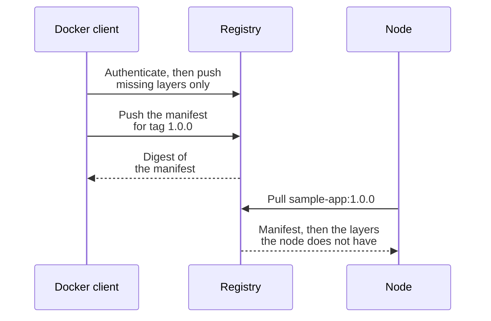

# Registries and image security

> **Status: AI draft, 2026-11-16.** Not yet verified by me. Commands and output were run with Docker 29, a local `registry:2` container and Trivy 0.76 on a Linux host; digests are shortened.

## In one line

A registry stores images as repositories of tags pointing at content-addressed manifests; a tag can be moved, a digest cannot. Secure images by building small, non-root and without secrets, scanning both OS packages and language dependencies, deploying by digest or immutable tag, and rebuilding regularly so fixes actually land.

## The plain idea

Once an image is built it has to live somewhere every server can pull it from: a **registry**. Docker Hub, Amazon ECR and GitHub's container registry are all registries speaking the same protocol. Inside a registry, a **repository** (`sample-app`) holds many versions, each reachable by a **tag** (`1.0.0`) and by a **digest** (`sha256:...`), the fingerprint of its content.

Security for images is mostly about what is inside them and whether you know exactly which one is running. An image is a whole small operating system plus your code and its libraries; every one of those can carry known vulnerabilities, and every one of them is frozen at build time. A patched base image does nothing for an image built last year. So the work is: put less in, check what is in, and rebuild often.

## How it works

### Names, tags and digests

```text
123456789012.dkr.ecr.ap-south-1.amazonaws.com/sample-app:1.0.0
└────────────── registry host ──────────────┘ └ repo ──┘ └tag┘

sample-app@sha256:ac487d04d0aa...   ← the same image, by digest
```

| Reference | Can change? | Use it for |
|---|---|---|
| Tag (`1.0.0`, `latest`) | Yes, anyone with push rights can point it elsewhere | Humans, release names |
| Digest (`@sha256:...`) | Never: it is the hash of the manifest | Deployments that must be exact, and rollbacks |

Registries such as ECR can make tags **immutable**, so a tag can never be pushed twice ([ECR](../aws-services/ecr.md)). Then tags become as dependable as digests, and easier to read.

### Push and pull



Layers are uploaded and downloaded only if the other side does not already have them, which is why small changes to the top layers are fast to push and pull. A **multi-architecture** image is an index manifest listing one manifest per CPU architecture; the client picks its own.

### Authentication and pull limits

Private registries need credentials: `docker login`, a credential helper, or on AWS, an ECR token derived from IAM permissions. Kubernetes nodes get them from the node's role or an image pull secret ([EKS architecture and node options](../eks/architecture.md)). Public registries limit anonymous and free pulls; check the registry's current limits, and use a pull-through cache or your own copy of base images for anything production depends on.

### What image security covers

| Practice | Why |
|---|---|
| Small base images, multi-stage builds ([Images and Dockerfiles](images-and-dockerfiles.md)) | Fewer packages, fewer vulnerabilities, less for an attacker to use |
| Non-root `USER`, read-only root filesystem, dropped capabilities | Limits what a compromised process can do ([Pod security](../kubernetes/pod-security.md)) |
| No secrets in layers, `ENV` or build arguments | Anyone who can pull the image can read them |
| Scan OS packages **and** language dependencies | A minimal OS layer does not help if the application's libraries are old |
| Rebuild on a schedule, not only when code changes | Base images and toolchains get patches; your image does not change until rebuilt |
| Deploy by digest or immutable tag | Know exactly what runs, and roll back to an exact image |
| Sign images and attach an SBOM | Prove where an image came from and list what is in it ([Pipeline security](../cicd/pipeline-security.md)) |

A **vulnerability scanner** such as Trivy reads the image's package databases and language manifests (or, for compiled programs, the module information embedded in the binary), and matches versions against vulnerability databases. It reports each finding with its severity and, when one exists, the version that fixes it ([Vulnerability and patch management](../security/vulnerability-and-patch-management.md)). An **SBOM** (software bill of materials) is the full list of components, in a standard format such as CycloneDX or SPDX.

## A concrete example

The 17.9 MB distroless image from [Images and Dockerfiles](images-and-dockerfiles.md) is scanned before release.

1. The scan reports **0** high or critical findings in the Debian packages of the distroless base.
2. It reports **26** high or critical findings (one critical) in the `server` binary, all in the Go standard library: the binary was compiled with a Go 1.23 release that has known vulnerabilities, fixed in later releases.
3. The minimal base did its job, but the code layer brought its own problems. The fix is in the build stage: move to a supported Go release with the fixes, rebuild, rescan.
4. The pipeline is changed to fail on critical findings that have a fix available, and to rebuild every week even without code changes, so toolchain and base fixes arrive without anyone remembering.

## Why not just...?

- **...trust an official base image to be free of vulnerabilities?** Official images are maintained, but they contain many packages, and your copy is frozen at the moment you built. Scan, and rebuild.
- **...scan only the operating system packages?** Many findings live in language dependencies and in compiled runtimes, as in the example. Use a scanner that covers both.
- **...fail every build on any vulnerability?** Many findings have no fix yet or do not apply. Gate on severity and fix availability, and track the rest with an expiry date ([Quality and security gates](../cicd/quality-and-security-gates.md)).

## Commands to know

Push to a registry and receive the digest:

```console
$ docker tag notes-sample-app:1.0.0 localhost:5000/sample-app:1.0.0
$ docker push localhost:5000/sample-app:1.0.0
b839dfae01f6: Pushed
1.0.0: digest: sha256:ac487d04d0aa... size: 856
```

The registry's HTTP API, the same for every registry:

```console
$ curl -s http://127.0.0.1:5000/v2/_catalog
{"repositories":["sample-app"]}
$ curl -s http://127.0.0.1:5000/v2/sample-app/tags/list
{"name":"sample-app","tags":["1.0.0"]}
```

A tag moved to different content, with nothing to stop it:

```console
$ docker tag notes-sample-app:1.0.2 localhost:5000/sample-app:1.0.0
$ docker push localhost:5000/sample-app:1.0.0
1.0.0: digest: sha256:49107fd31ed5... size: 856
```

Same tag, new digest. Anyone deploying `sample-app:1.0.0` now gets different code; anyone deploying `@sha256:ac487d04d0aa...` still gets the original.

Scanning, and where the findings came from:

```console
$ trivy image --scanners vuln --severity HIGH,CRITICAL notes-sample-app:1.0.0
Report Summary
┌───────────────────────────────────────┬──────────┬─────────────────┐
│                Target                 │   Type   │ Vulnerabilities │
├───────────────────────────────────────┼──────────┼─────────────────┤
│ notes-sample-app:1.0.0 (debian 12.15) │  debian  │        0        │
├───────────────────────────────────────┼──────────┼─────────────────┤
│ server                                │ gobinary │       26        │
└───────────────────────────────────────┴──────────┴─────────────────┘
```

The one critical finding, from the JSON output:

```text
server | stdlib v1.23.12 -> 1.24.13, 1.25.7, 1.26.0-rc.3 | CRITICAL CVE-2025-68121
```

The installed standard library version, the versions that fix it, and the identifier. Trivy ran here as a container (`aquasec/trivy`) with the Docker socket mounted, so it could read local images.

| Command | What it does |
|---|---|
| `docker login <registry>` | Store credentials for a registry. |
| `docker pull sample-app@sha256:<digest>` | Pull an exact image by digest. |
| `docker buildx imagetools inspect <image>` | Show the manifest list, platforms and digests of a remote image. |
| `trivy image --severity CRITICAL --exit-code 1 <image>` | Fail (exit 1) if critical findings exist: a CI gate. |
| `trivy image --format cyclonedx --output sbom.json <image>` | Write an SBOM. |
| `aws ecr describe-image-scan-findings --repository-name sample-app --image-id imageTag=1.0.0` | Scan results from ECR's own scanning. |

## How it breaks

| Symptom | Layer | Check | Likely cause |
|---|---|---|---|
| `ImagePullBackOff`, `unauthorized` | Authentication | Registry credentials on the node or pull secret | Missing permission, expired token, wrong registry |
| `ImagePullBackOff`, `not found` | Name or tag | `docker manifest inspect <image>` | Typo, tag never pushed, wrong repository or region |
| `toomanyrequests` from a public registry | Pull limits | Registry's limit headers | Too many anonymous or free pulls; authenticate or cache |
| Different nodes run different code under one tag | Mutable tag | Compare running digests | Tag moved; deploy by digest or make tags immutable |
| Scanner clean on the base, findings in the app | Dependencies | Scanner targets and types | Old libraries or toolchain inside the application |
| Fixed vulnerability still reported in production | Rebuild | Image build date and digest | The fix landed in the base image, but the app image was never rebuilt |

## Interview questions

**1. What is the difference between an image tag and an image digest?**

<details markdown="1">
<summary>Answer</summary>

- A tag is a movable name; whoever can push can point it at different content.
- A digest is the hash of the image manifest and identifies exactly one image forever.
- Deploy by digest, or use immutable tags, to know what runs.

</details>

**2. How do you make sure every node runs exactly the same image?**

<details markdown="1">
<summary>Answer</summary>

- Reference the image by digest in the deployment, or use a registry with immutable tags.
- Have CI record and promote the digest it built ([Artifacts, registries and versioning](../cicd/artifacts-and-registries.md)).
- Check running digests across nodes when in doubt.

</details>

**3. What does an image scanner check, and what are its limits?**

<details markdown="1">
<summary>Answer</summary>

- Installed OS packages and language dependencies (including modules embedded in binaries), matched against vulnerability databases.
- It finds known issues in known components only: not your own code's logic flaws, not misconfiguration in every case.
- Results depend on the database's freshness and on fix availability.

</details>

**4. Your base image is distroless, yet the scan shows critical vulnerabilities. How is that possible?**

<details markdown="1">
<summary>Answer</summary>

- The application layer brings its own components: language libraries, or the runtime compiled into the binary.
- The scanner reports them under a separate target, such as a Go binary or a package lock file.
- Fix by updating the dependency or toolchain and rebuilding.

</details>

**5. Why rebuild images on a schedule, not only on code changes?**

<details markdown="1">
<summary>Answer</summary>

- Base image and package fixes only reach your image when it is rebuilt.
- An unchanged service otherwise keeps old vulnerable packages indefinitely.
- A scheduled rebuild plus scan plus redeploy keeps patch latency bounded.

</details>

**6. What should a CI pipeline do with image security?**

<details markdown="1">
<summary>Answer</summary>

- Build small, non-root images without secrets.
- Scan and fail on high-severity findings that have a fix, with tracked exceptions.
- Produce an SBOM, sign the image, push by digest, and record the digest for deployment.

</details>

## Try it

**Step 1.** Run a local registry and push an image to it.

```bash
docker run -d --name reg -p 127.0.0.1:5000:5000 registry:2
docker pull busybox:1.36 && docker tag busybox:1.36 localhost:5000/demo:1.0
docker push localhost:5000/demo:1.0
```

**Step 2.** Move the tag to different content. Predict whether the digest changes.

```bash
docker pull busybox:1.37 && docker tag busybox:1.37 localhost:5000/demo:1.0
docker push localhost:5000/demo:1.0
curl -s http://127.0.0.1:5000/v2/demo/tags/list
```

**Step 3.** Scan two images and compare what each finding is in.

```bash
docker run --rm -v /var/run/docker.sock:/var/run/docker.sock aquasec/trivy:latest image --severity HIGH,CRITICAL busybox:1.36
```

**Step 4.** Clean up.

```bash
docker rm -f reg && docker rmi localhost:5000/demo:1.0
```

## Zoom out

Registries sit between CI and every cluster: CI pushes and records digests, and nodes pull them ([CI/CD concepts](../cicd/concepts.md), [ECR](../aws-services/ecr.md)). Scanning and patching images is one part of the wider vulnerability process in [Vulnerability and patch management](../security/vulnerability-and-patch-management.md). The principle to carry: know exactly which image runs, scan everything in it, and rebuild so fixes actually ship.

## Sources

- [OCI distribution specification](https://github.com/opencontainers/distribution-spec)
- [Docker documentation: docker image push](https://docs.docker.com/reference/cli/docker/image/push/)
- [CNCF Distribution: the open-source registry behind registry:2](https://distribution.github.io/distribution/)
- [Trivy documentation](https://trivy.dev/docs/latest/guide/)
- [Amazon ECR documentation: image tag mutability](https://docs.aws.amazon.com/AmazonECR/latest/userguide/image-tag-mutability.html)
- [CycloneDX specification](https://cyclonedx.org/)
- [Go release history and security fixes](https://go.dev/doc/devel/release)
