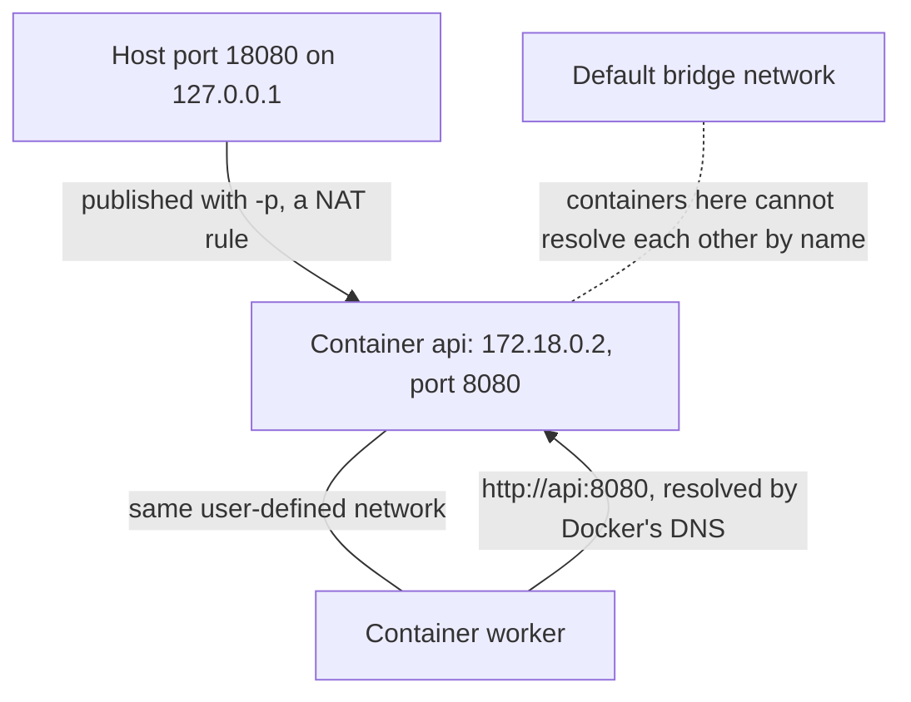

# Running and debugging containers

> **Status: AI draft, 2026-11-16.** Not yet verified by me. Commands and output were run with Docker 29 on a Linux host; addresses are rewritten to example ranges.

## In one line

`docker run` combines an image with run-time settings: ports to publish, environment, volumes, network, resource limits and a restart policy. When a container misbehaves, read its status and exit code, then its logs, then look inside it or alongside it with `exec`, `inspect` and a debug container that shares its network.

## The plain idea

An image is the same everywhere; what changes from one run to the next is how you start it: which port it is reachable on, which configuration it gets, where its data lives, how much memory it may use, and what to do if it crashes. All of that is set at run time, mostly as `docker run` flags (or, later, as fields in a Kubernetes pod spec, which map almost one to one).

Debugging follows the same short path every time: is it running, and if not, how did it exit? What did it print? What does it look like from inside? Most container problems are answered by the first two questions.

## How it works

### The flags that matter

| Flag | Meaning | Kubernetes equivalent |
|---|---|---|
| `-d` | Run in the background (detached) | Always the case for pods |
| `--name api` | A fixed name instead of a random one | Pod and container names |
| `--rm` | Delete the container when it exits | No direct equivalent; Jobs clean up with a TTL |
| `-it` | Interactive terminal | `kubectl exec -it` |
| `-p 127.0.0.1:18080:8080` | Publish container port 8080 on host port 18080, on that host address only | A Service ([Services and DNS](../kubernetes/services-and-dns.md)) |
| `-e KEY=value`, `--env-file f` | Environment variables | `env`, `envFrom` |
| `-v name:/data`, `-v /host/path:/data:ro` | A named volume, or a bind mount (`:ro` for read-only) | Volumes ([Storage](../kubernetes/storage.md)) |
| `--network net` | Attach to a network | Pod networking |
| `-m 256m`, `--cpus 0.5` | Memory and CPU limits ([What a container is](what-is-a-container.md)) | `resources.limits` |
| `--restart on-failure:3`, `unless-stopped` | Restart policy | `restartPolicy` and controllers |
| `--user 1000`, `--read-only`, `--cap-drop ALL` | Security settings: run as user ID 1000, read-only root filesystem, no Linux capabilities | `securityContext` |

### Networking



- The **default bridge** network gives each container an address, but containers on it cannot find each other by name.
- A **user-defined network** (`docker network create`) adds built-in DNS: containers reach each other by container name. Compose creates one per project ([Docker Compose](docker-compose.md)).
- `-p` publishes a port through NAT on the host. Without it, the container is reachable only from the host and its network, not from elsewhere. Publishing to `127.0.0.1` keeps it off the host's external interfaces.
- `--network host` shares the host's network namespace: no isolation and no port mapping.
- `--network container:<name>` joins another container's network namespace, which is how debug containers see exactly what the app sees.

### Storage

| Type | What it is | Use it for |
|---|---|---|
| **Named volume** (`-v data:/data`) | Managed by Docker under its own directory | Databases and anything that must outlive the container |
| **Bind mount** (`-v /host/dir:/data`) | A host directory or file mapped into the container | Configuration files, local development source code |
| **tmpfs** (`--tmpfs /tmp`) | In memory only | Scratch space, secrets that must not touch disk |

Everything else a container writes goes to its writable layer and disappears with it.

### Exit codes

| Exit code | Usually means |
|---|---|
| 0 | The process finished normally (for a server, that is often a bug: it should not finish) |
| 1, or another small number | The application reported an error: read the logs |
| 125 | Docker itself failed to run the container (bad flag, conflict) |
| 126 | The command could not be executed (permissions) |
| 127 | The command was not found in the image |
| 137 | SIGKILL: out of memory, or killed after a stop timeout ([Memory and the OOM killer](../linux/memory-and-oom.md)) |
| 143 | SIGTERM: stopped normally |

### Logs

The runtime captures each container's stdout and stderr ([Streams, pipes and redirection](../linux/streams-and-redirection.md)). `docker logs` reads them back, even after the container has exited (until it is removed). Applications in containers should log to stdout rather than to files inside the container, for the same reason Kubernetes relies on it ([How Kubernetes logging works](../observability/kubernetes-logging.md)).

## A concrete example

A container exits a second after starting.

1. `docker ps -a` shows `Exited (3) 2 seconds ago`. A non-zero code from the application itself, not a kill.
2. `docker logs <name>` shows the last thing it printed before exiting, often the real error: a missing environment variable, a bad config path, a database it cannot reach.
3. If the logs say nothing, run the image with an interactive shell instead of its entrypoint: `docker run --rm -it --entrypoint sh <image>`. Check the files, the user and the environment.
4. If the image has no shell (distroless), keep the original running if you can, and attach a tools container to its network namespace: `docker run --rm -it --network container:<name> nicolaka/netshoot`.
5. If it was `137` instead, check `docker inspect --format '{{.State.OOMKilled}}'` before anything else.

## Why not just...?

- **...use `--network host` to avoid port problems?** It removes the network isolation entirely, ports from different containers collide, and it behaves differently on Docker Desktop. Use a user-defined network and `-p`.
- **...use the container's IP address to connect to it?** Addresses change every time a container is recreated. Use the container name on a user-defined network, or a published port.
- **...bind-mount a host directory for database data in production?** It ties the container to that host, its permissions and its disk layout. Named volumes, or the platform's storage, are easier to back up and move.

## Commands to know

Run, check, read the logs:

```console
$ docker run -d --name notes-app1 -p 127.0.0.1:18080:8080 -e APP_VERSION=1.0.0 notes-sample-app:1.0.0
$ curl -s http://127.0.0.1:18080/
hello from sample-app 1.0.0
$ docker ps --filter name=notes-app1 --format '{{.Names}} {{.Image}} {{.Status}} {{.Ports}}'
notes-app1 notes-sample-app:1.0.0 Up 1 second 127.0.0.1:18080->8080/tcp
$ docker logs notes-app1
listening on :8080
$ docker stats --no-stream --format '{{.Name}} cpu={{.CPUPerc}} mem={{.MemUsage}}' notes-app1
notes-app1 cpu=0.00% mem=1.504MiB / 14.48GiB
```

`stats` shows the host's total memory as the limit because this container has none.

Names resolve on a user-defined network, but not on the default bridge:

```console
$ docker network create notes-net
$ docker run -d --name notes-api --network notes-net notes-sample-app:1.0.0
$ docker run --rm --network notes-net curlimages/curl:8.11.1 -s http://notes-api:8080/healthz
ok
$ docker run --rm curlimages/curl:8.11.1 -s -m 3 http://notes-api:8080/healthz; echo "exit $?"
exit 6
```

curl's exit code 6 means "could not resolve host".

A debug container joined to the app's network namespace, which has no shell of its own:

```console
$ docker run --rm --network container:notes-api nicolaka/netshoot:v0.13 sh -c 'ss -tlnp | grep 8080; curl -s localhost:8080/healthz'
LISTEN 0      4096               *:8080             *:*
ok
```

A read-only bind mount, a volume that outlives containers, and a restart policy:

```console
$ docker run --rm -v "$PWD/bind:/config:ro" ubuntu:24.04 sh -c 'cat /config/config.txt; touch /config/x'
from the host
touch: cannot touch '/config/x': Read-only file system
$ docker run --rm -v notes-data:/data ubuntu:24.04 sh -c "echo saved > /data/f.txt"
$ docker run --rm -v notes-data:/data ubuntu:24.04 cat /data/f.txt
saved
$ docker run -d --name notes-flaky --restart on-failure:3 ubuntu:24.04 sh -c 'echo attempt; exit 1'
$ docker inspect notes-flaky --format 'Status={{.State.Status}} RestartCount={{.RestartCount}} ExitCode={{.State.ExitCode}}'
Status=exited RestartCount=3 ExitCode=1
$ docker logs notes-flaky | sort | uniq -c
      4 attempt
```

One start plus three restarts, then Docker gave up.

A container that exits immediately:

```console
$ docker run --name notes-crash ubuntu:24.04 sh -c "echo starting; exit 3"
starting
$ docker inspect notes-crash --format 'Status={{.State.Status}} ExitCode={{.State.ExitCode}}'
Status=exited ExitCode=3
```

| Command | What it does |
|---|---|
| `docker ps -a` | All containers, including exited ones, with their status and exit code. |
| `docker logs -f --tail 100 <c>` | Follow the last 100 lines. |
| `docker exec -it <c> sh` | A shell inside a running container, if the image has one. |
| `docker inspect <c>` | Everything: state, exit code, OOM flag, mounts, network, environment. |
| `docker cp <c>:/path ./` | Copy a file out of a container, running or stopped. |
| `docker run --rm -it --entrypoint sh <image>` | Start the image with a shell instead of its entrypoint. |
| `docker system df` | Disk used by images, containers, volumes and build cache. |

## How it breaks

| Symptom | Layer | Check | Likely cause |
|---|---|---|---|
| Exits immediately with a small exit code | Application | `docker logs` | Bad configuration, missing variable, dependency unreachable |
| Exit 127 | Image | The entrypoint and `PATH` | Command not in the image, or a script with a bad shebang |
| Exit 137, `OOMKilled: true` | Memory | `docker inspect`, `stats` | Memory limit too low or a leak |
| `port is already allocated` | Host ports | `ss -tlnp` on the host | Another container or process uses that host port |
| Connection refused on the published port | Listening address | `docker exec <c> ss -tlnp`, or a debug container | The app listens on `127.0.0.1` inside the container instead of `0.0.0.0` |
| Containers cannot reach each other by name | Network | `docker network inspect` | On the default bridge, or on different networks |
| `Permission denied` writing to a volume | Ownership | The container's user and the volume's owner | Image runs as non-root, the volume is owned by root |
| Disk full on the host | Storage | `docker system df` | Old images, stopped containers, unused volumes, build cache |

## Interview questions

**1. A container keeps exiting right after it starts. How do you debug it?**

<details markdown="1">
<summary>Answer</summary>

- `docker ps -a` for the exit code; `docker logs` for the last output.
- Interpret the code: small numbers are app errors, 127 command not found, 137 OOM or kill.
- Start the image with a shell (`--entrypoint sh`) to inspect files, user and environment.

</details>

**2. What is the difference between a volume and a bind mount?**

<details markdown="1">
<summary>Answer</summary>

- A named volume is managed by Docker in its own storage area, independent of the host's directory layout.
- A bind mount maps a specific host path into the container.
- Volumes for persistent data; bind mounts for configuration and local development.

</details>

**3. Why can two containers on the default bridge network not reach each other by name?**

<details markdown="1">
<summary>Answer</summary>

- Docker's embedded DNS for container names works on user-defined networks, not the default bridge.
- Create a network and attach both containers, or use Compose, which does it for you.

</details>

**4. The app works inside the container but the published port refuses connections. Why?**

<details markdown="1">
<summary>Answer</summary>

- The app listens on `127.0.0.1`, which is the container's own loopback, so traffic from the port mapping cannot reach it.
- Listen on `0.0.0.0` inside the container.
- Also check the `-p` mapping and the container port.

</details>

**5. How do you debug the network of a container whose image has no shell?**

<details markdown="1">
<summary>Answer</summary>

- Run a tools image in its network namespace: `docker run --network container:<name> <tools-image>`.
- It sees the same interfaces, ports and DNS as the app.
- In Kubernetes, `kubectl debug` adds an ephemeral container for the same purpose.

</details>

**6. What do exit codes 125, 126, 127 and 137 mean for a container?**

<details markdown="1">
<summary>Answer</summary>

- 125: Docker failed to run the container.
- 126: the command was found but not executable.
- 127: the command was not found.
- 137: killed by SIGKILL, often out of memory or a stop timeout.

</details>

## Try it

**Step 1.** Run a container that fails and read why.

```bash
docker run --name t1 ubuntu:24.04 sh -c 'echo "config missing"; exit 2'
docker ps -a --filter name=t1 --format '{{.Status}}'
docker logs t1
docker rm t1
```

**Step 2.** Create a network and check name resolution. Predict which `getent` finds the name.

```bash
docker network create t-net
docker run -d --name t-web --network t-net nginx:1.27
docker run --rm --network t-net ubuntu:24.04 getent hosts t-web
docker run --rm ubuntu:24.04 getent hosts t-web; echo "exit $?"
```

**Step 3.** Clean up.

```bash
docker rm -f t-web && docker network rm t-net
```

## Zoom out

Almost every `docker run` flag has a Kubernetes counterpart in the pod spec, so this is the vocabulary of [Pods](../kubernetes/pods.md), [ConfigMaps and Secrets](../kubernetes/configmaps-and-secrets.md) and the [Troubleshooting playbook](../kubernetes/troubleshooting.md). The debugging order is the same too: status and exit code, logs, then look inside or alongside. The principle to carry: the exit code and the last log lines answer most container questions before you open a shell.

## Sources

- [Docker documentation: docker container run](https://docs.docker.com/reference/cli/docker/container/run/)
- [Docker documentation: networking overview](https://docs.docker.com/engine/network/)
- [Docker documentation: bridge network driver](https://docs.docker.com/engine/network/drivers/bridge/)
- [Docker documentation: volumes](https://docs.docker.com/engine/storage/volumes/)
- [Docker documentation: bind mounts](https://docs.docker.com/engine/storage/bind-mounts/)
- [Docker documentation: start containers automatically](https://docs.docker.com/engine/containers/start-containers-automatically/)
- [netshoot: a network troubleshooting container](https://github.com/nicolaka/netshoot)
