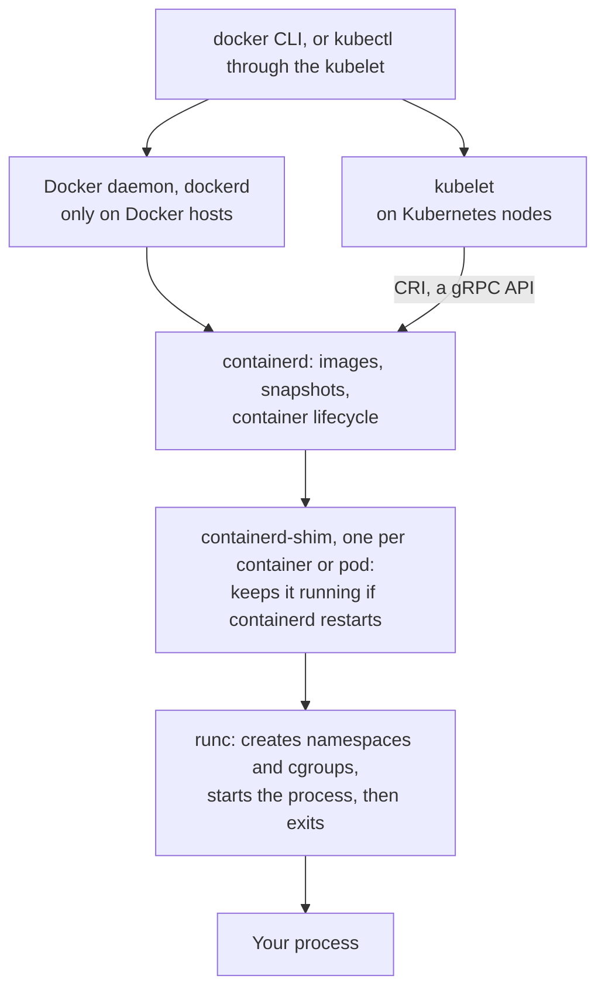

# Container runtimes

> **Status: AI draft, 2026-11-16.** Not yet verified by me. Commands and output were run on a Linux host with Docker 29 and inside the node container of a local kind cluster; IDs and process numbers are replaced with placeholders.

## In one line

"Docker" is several programs: the CLI talks to the Docker daemon, which asks containerd to manage containers, which uses runc to create each one from an OCI bundle. Kubernetes talks to containerd (or CRI-O) directly through the CRI, which is why removing dockershim did not stop images built with Docker from running.

## The plain idea

When you type `docker run`, it feels like one program did everything. In fact a chain of programs is involved, each with one job: one takes your command, one manages images and container lifecycles, and one does the actual kernel calls that create namespaces and cgroups ([What a container is](what-is-a-container.md)).

The chain matters because Kubernetes does not use the top of it. A Kubernetes node has no need for the Docker CLI or daemon; the kubelet talks straight to the middle layer. Images are a standard format, so an image built with Docker runs the same under any compliant runtime. Knowing the layers tells you which tool to use on a node when something goes wrong.

## How it works

### The layers



| Layer | Job |
|---|---|
| **docker CLI** | Turns your commands into API calls to the daemon. |
| **dockerd** | Docker's daemon: builds, networks, volumes, and the Docker API. Delegates containers to containerd. |
| **containerd** | A container manager: pulls and stores images, prepares the layered filesystem, and supervises containers. Also implements Kubernetes' CRI. |
| **containerd-shim** | A small process per container (or per pod), so containers keep running while containerd restarts or upgrades, and something holds their stdio and exit code. |
| **runc** | The low-level runtime: reads an OCI bundle (a root filesystem plus a `config.json`), creates the namespaces and cgroups, starts the process, and exits. |

### The standards

- **OCI image specification**: how an image is laid out (manifest, config, layers). Any builder can produce it; any runtime can run it ([Images and Dockerfiles](images-and-dockerfiles.md)).
- **OCI runtime specification**: what a low-level runtime such as runc must do with a bundle. Alternatives include crun, and sandboxed runtimes such as gVisor or Kata Containers that add an extra isolation boundary.
- **CRI** (Container Runtime Interface): the API the kubelet uses to ask a runtime to run pods and containers. containerd and CRI-O implement it.

### What dockershim was

Early Kubernetes spoke to the Docker daemon, which did not implement CRI, through an adapter in the kubelet called **dockershim**. It was removed in Kubernetes 1.24. Clusters moved to containerd or CRI-O directly. Nothing about images changed, because Docker builds standard OCI images. What changed was the node: there is no `docker` command to debug with, and anything that mounted `/var/run/docker.sock` on nodes (some CI agents, some monitoring agents) stopped working.

### Pods and the sandbox

For each pod, the runtime first creates a **sandbox**, a tiny "pause" container that holds the pod's network namespace, and then starts the pod's containers inside that namespace. That is how containers in a pod share an IP address and `localhost` ([Pods](../kubernetes/pods.md)).

## A concrete example

A pod on a node is stuck in `ContainerCreating`, and `kubectl describe pod` shows only a vague "failed to create containerd task" event.

1. SSH or use Session Manager to reach the node. There is no `docker` command: the node runs containerd.
2. `crictl pods --name sample-app` shows the pod sandbox and its state; `crictl ps -a --pod <pod-id>` shows its containers, including exited ones.
3. `crictl logs <container-id>` reads a container's output even if Kubernetes lost track of it; `crictl inspect <container-id>` shows its exit code and the runtime's reason.
4. `journalctl -u containerd` and `journalctl -u kubelet` on the node show the runtime's own errors, for example a failed image unpack because the disk is full ([Disks and filesystems](../linux/disks-and-filesystems.md)).
5. The fix is on the node (free disk, restart a stuck component), not in the pod spec.

## Why not just...?

- **...install Docker on Kubernetes nodes to debug them?** The kubelet does not use it, so Docker would show none of the pods' containers, and it adds another daemon to patch. `crictl` talks to the runtime the kubelet actually uses.
- **...mount the Docker socket into a CI pod to build images?** On modern nodes there is no Docker socket, and when there is, mounting it gives the pod control of every container on the node. Use rootless or daemonless builders ([Pipeline security](../cicd/pipeline-security.md)).
- **...worry that images built with Docker will not run on containerd?** They are OCI images; any compliant runtime runs them. Only tooling that assumed a Docker daemon on the node needed changes.

## Commands to know

The runtime chain on a Docker host:

```console
$ docker info --format 'DefaultRuntime={{.DefaultRuntime}} CgroupDriver={{.CgroupDriver}} CgroupVersion={{.CgroupVersion}}'
DefaultRuntime=runc CgroupDriver=systemd CgroupVersion=2
$ docker version --format '...'
containerd=v2.4.2 runc=1.5.2
```

The same layers on a Kubernetes node (here the kind node), seen through the CRI:

```console
$ crictl version
Version:  0.1.0
RuntimeName:  containerd
RuntimeVersion:  v2.3.4
RuntimeApiVersion:  v1
$ crictl pods --namespace kube-system
POD ID   CREATED   STATE   NAME                       NAMESPACE     ATTEMPT   RUNTIME
<id>     ...       Ready   coredns-559f6c778d-dz9l7   kube-system   1         (default)
<id>     ...       Ready   kindnet-jzwmm              kube-system   1         (default)
<id>     ...       Ready   kube-proxy-z9rd4           kube-system   1         (default)
```

Containers and the pods they belong to:

```text
NAME                      STATE               POD
coredns                   CONTAINER_RUNNING   coredns-559f6c778d-dz9l7
kindnet-cni               CONTAINER_RUNNING   kindnet-jzwmm
kube-proxy                CONTAINER_RUNNING   kube-proxy-z9rd4
kube-apiserver            CONTAINER_RUNNING   kube-apiserver-notes-lab-control-plane
```

The kubelet's connection to the runtime, and the shims:

```console
$ cat /etc/crictl.yaml
runtime-endpoint: unix:///run/containerd/containerd.sock
$ ps -eo comm | grep -c containerd-shim
9
$ ps -eo args | grep containerd-shim
/usr/local/bin/containerd-shim-runc-v2 -namespace k8s.io -id <id> ...
```

containerd keeps Kubernetes' containers in its own `k8s.io` namespace (a containerd namespace, unrelated to Kubernetes namespaces), separate from anything Docker or `ctr` creates.

| Command | Talks to | What it does |
|---|---|---|
| `crictl pods`, `crictl ps -a`, `crictl images` | CRI | Pods, containers (including exited), images on the node |
| `crictl logs <id>`, `crictl inspect <id>` | CRI | A container's output and full state |
| `crictl rmi --prune` | CRI | Remove unused images on the node |
| `ctr -n k8s.io containers list` | containerd directly | Lower-level view; rarely needed |
| `journalctl -u containerd`, `journalctl -u kubelet` | systemd | The runtime's and kubelet's own logs |

## How it breaks

| Symptom | Layer | Check | Likely cause |
|---|---|---|---|
| Pod stuck in `ContainerCreating` | Runtime or CNI | `kubectl describe pod` events; `journalctl -u containerd` on the node | Image unpack failed, CNI could not assign an address, volume mount failed |
| `ImagePullBackOff` | containerd pull | `crictl pull <image>` on the node | Credentials, network to the registry, or the image does not exist |
| Node `NotReady`, `container runtime is down` | Runtime | `systemctl status containerd` | containerd stopped or its socket missing |
| Tools that used `docker.sock` on nodes fail | Runtime change | Node runtime | Node runs containerd without Docker |
| Disk full on nodes | Image storage | `crictl images`; `df -h` on the containerd directory | Old images not garbage-collected |
| `exec format error` | Image | Image architecture against node | Wrong CPU architecture image |

## Interview questions

**1. What is the difference between Docker, containerd and runc?**

<details markdown="1">
<summary>Answer</summary>

- Docker is the CLI and daemon (build, networks, volumes, the Docker API).
- containerd manages images and container lifecycles and implements Kubernetes' CRI.
- runc is the low-level OCI runtime that creates namespaces and cgroups and starts the process.

</details>

**2. What is the CRI?**

<details markdown="1">
<summary>Answer</summary>

- The Container Runtime Interface: the gRPC API the kubelet uses to run pods and containers.
- containerd and CRI-O implement it.
- It lets Kubernetes use different runtimes without changing the kubelet.

</details>

**3. Kubernetes removed dockershim. Do images built with Docker still run?**

<details markdown="1">
<summary>Answer</summary>

- Yes: Docker builds standard OCI images, and containerd or CRI-O run them.
- What changed is the node: no Docker daemon, so no `docker` command there and no Docker socket for tools that relied on it.
- Use `crictl` on nodes instead.

</details>

**4. How do you debug containers on a Kubernetes node that has no Docker?**

<details markdown="1">
<summary>Answer</summary>

- `crictl pods`, `crictl ps -a`, `crictl logs`, `crictl inspect` against the CRI socket.
- `journalctl -u containerd` and `-u kubelet` for the runtime's and kubelet's errors.
- Prefer `kubectl debug` from outside when node access is not needed.

</details>

**5. What is a containerd shim for?**

<details markdown="1">
<summary>Answer</summary>

- A small process per container or pod that holds its stdio and exit status and reaps it.
- containerd can restart or upgrade without killing running containers.
- runc exits after starting the container; the shim stays.

</details>

**6. What is the pause container in a pod?**

<details markdown="1">
<summary>Answer</summary>

- The pod sandbox: a minimal container created first to hold the pod's network (and some other) namespaces.
- The pod's app containers join those namespaces, so they share an IP and `localhost`.
- It keeps the namespaces alive even when app containers restart.

</details>

## Try it

**Step 1.** Create a kind cluster (or use an existing one) and enter its node, which is itself a container.

```bash
kind create cluster --name rt-demo
docker exec -it rt-demo-control-plane bash
```

**Step 2.** Inside the node, predict how many pods `crictl` shows in `kube-system`, then look at the pods, containers, images and shims.

```bash
crictl pods --namespace kube-system
crictl ps
crictl images
ps -eo comm | grep -c containerd-shim
```

**Step 3.** Leave the node and delete the cluster.

```bash
exit
kind delete cluster --name rt-demo
```

## Zoom out

The runtime is the layer between the kubelet and the kernel, so it shows up in node troubleshooting, upgrades and image pulls ([Architecture and the reconcile loop](../kubernetes/architecture.md), [Troubleshooting playbook](../kubernetes/troubleshooting.md)). Because images and runtimes are standardised, you can build with one tool and run with another. The principle to carry: on a node, talk to the runtime the kubelet uses, and read its logs before blaming the pod.

## Sources

- [containerd documentation](https://containerd.io/docs/)
- [Kubernetes documentation: container runtimes](https://kubernetes.io/docs/setup/production-environment/container-runtimes/)
- [Kubernetes documentation: dockershim removal FAQ](https://kubernetes.io/blog/2022/02/17/dockershim-faq/)
- [Kubernetes documentation: debugging nodes with crictl](https://kubernetes.io/docs/tasks/debug/debug-cluster/crictl/)
- [OCI runtime specification](https://github.com/opencontainers/runtime-spec)
- [runc](https://github.com/opencontainers/runc)
