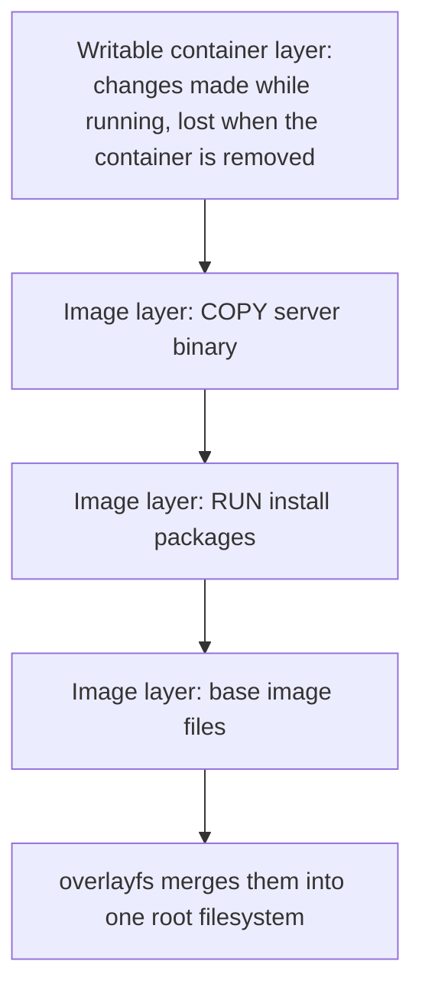

# What a container is

> **Status: AI draft, 2026-11-16.** Not yet verified by me. Commands and output were run with Docker on a Linux host; host process IDs and namespace inode numbers are replaced with placeholders.

## In one line

A container is an ordinary Linux process that the kernel isolates with namespaces (what it can see), limits with cgroups (what it can use), and gives a layered filesystem built from an image. It shares the host's kernel, which is why it starts in milliseconds and why it is not a virtual machine.

## The plain idea

A virtual machine pretends to be a whole computer: virtual hardware, its own kernel, its own operating system booting up. A container does far less. It is one process (or a few) on the host, running on the host's own kernel, with blinkers on.

The kernel gives that process its own view of the world: its own list of processes, in which it is number 1; its own network interfaces and addresses; its own filesystem tree; its own host name. Those private views are **namespaces**. The kernel also caps what it may consume: memory, CPU, number of processes. Those caps are **cgroups**. And its files come from an **image**, stacked as read-only layers with a thin writable layer on top. Put together, the process behaves as if it had a small machine to itself, without any of a machine's cost.

## How it works

### Namespaces: what the process can see

| Namespace | Isolates | Inside a container you see |
|---|---|---|
| `pid` | Process IDs | Your own process tree, starting at PID 1 |
| `net` | Network interfaces, addresses, routes, ports, firewall rules | Your own `eth0`, your own `localhost`, your own ports |
| `mnt` | Mount points | Your own root filesystem |
| `uts` | Host name | Your own host name, usually the container ID |
| `ipc` | Shared memory, message queues | Your own |
| `user` | User and group IDs | Optionally, root inside mapped to an unprivileged user outside |
| `cgroup`, `time` | The cgroup tree view, clocks | Your own view |

Namespaces are also what Kubernetes builds pods from: containers in one pod share a network namespace, which is why they can talk over `localhost` ([Pods](../kubernetes/pods.md)). Network namespaces are the same feature used for the router lab in [Routing and NAT](../networking/routing-and-nat.md).

### cgroups: what the process can use

A **cgroup** (control group) groups processes and limits their resources. The files under `/sys/fs/cgroup` show the limits ([Memory and the OOM killer](../linux/memory-and-oom.md)):

| File | Meaning | Set by |
|---|---|---|
| `memory.max` | Hard memory limit; above it, the OOM killer acts inside the group | `docker run -m`, a Kubernetes memory limit |
| `cpu.max` | `quota period`: how many microseconds of CPU per period | `docker run --cpus`, a Kubernetes CPU limit |
| `pids.max` | Maximum number of processes | `docker run --pids-limit` |

`--cpus 0.5` becomes `50000 100000`: 50 ms of CPU time in every 100 ms period. The process is **throttled** when it uses its quota early, which shows up as latency rather than an error ([Performance triage](../linux/performance-triage.md)).

### Layers: what the process's files are



An image is a stack of read-only layers, each the set of files one build step added or changed ([Images and Dockerfiles](images-and-dockerfiles.md)). When a container starts, the runtime adds a thin **writable layer** on top and uses **overlayfs** to present all of them as a single filesystem. Changing a file copies it up into the writable layer first (**copy-on-write**); deleting one records a "whiteout". Many containers can share the same image layers on disk, and anything written only to the writable layer disappears when the container is removed. Data that must survive goes in a **volume**.

### PID 1 and signals

The first process in a container is PID 1 in its namespace, and PID 1 is special: **the kernel does not apply a signal's default action to it**. A normal process receiving SIGTERM with no handler is terminated; PID 1 with no handler simply ignores it ([Processes and signals](../linux/processes-and-signals.md)). So `docker stop` waits its 10 seconds and then sends SIGKILL, unless PID 1:

- installs a SIGTERM handler (many runtimes such as Go and the JVM do; a plain `sleep` or a shell script does not), or
- is a small init process, such as Docker's `--init` (tini), which forwards signals to the real program and reaps zombie processes.

A shell as PID 1 (shell-form `CMD`) adds a second problem: it does not pass the signal on to its child.

### Container compared with a virtual machine

| | Container | Virtual machine |
|---|---|---|
| Kernel | Shared with the host | Its own |
| Starts in | Milliseconds to seconds | Tens of seconds to minutes |
| Size | Megabytes | Gigabytes |
| Isolation | Kernel features; a kernel bug can break out | Hardware virtualisation; stronger boundary |
| Runs a different OS kernel | No: Linux containers need a Linux kernel | Yes |

Docker Desktop on macOS and Windows runs Linux containers inside a small Linux virtual machine for exactly this reason. Some platforms wrap each container or pod in a lightweight VM (for example AWS Fargate, or Firecracker-based runtimes) to get VM-strength isolation with container-like speed.

## A concrete example

`docker run -d -m 256m --cpus 0.5 -p 8080:8080 sample-app:1.0.0` turns into kernel operations:

1. The runtime unpacks the image's layers (if not already present) and mounts them with overlayfs, plus a writable layer.
2. It creates new namespaces (pid, net, mnt, uts, ipc) and a cgroup with `memory.max` = 268435456 and `cpu.max` = `50000 100000`.
3. It creates a virtual network interface pair: one end becomes the container's `eth0` with an address such as `172.17.0.2`, the other plugs into the host's `docker0` bridge. A NAT rule maps host port 8080 to the container's port 8080 ([Routing and NAT](../networking/routing-and-nat.md)).
4. It starts the image's entrypoint as PID 1 inside all of that.
5. From the host, `ps` shows it as an ordinary process with an ordinary host PID. From inside, it is PID 1 and sees almost nothing else.

## Why not just...?

- **...call a container a lightweight VM?** It hides the important differences: a shared kernel (weaker isolation, no other kernels), and a process model where PID 1 and signals matter. "An isolated process" predicts its behaviour much better.
- **...write data inside the container's filesystem?** It lives in the writable layer and vanishes when the container is replaced, which in Kubernetes happens on every deploy and reschedule. Use volumes or external storage ([Storage](../kubernetes/storage.md)).
- **...run as root inside because it is "only in a container"?** Root in the container is root on the host's kernel unless user namespaces remap it. A container escape, or a mounted host path, then gives full host access ([Pod security](../kubernetes/pod-security.md)).

## Commands to know

What a container sees of its own processes, namespaces and limits:

```console
$ docker run --rm ubuntu:24.04 bash -c 'ls /proc | grep -cE "^[0-9]+$"; cat /proc/self/cgroup; ls -l /proc/self/ns'
4
0::/
cgroup -> cgroup:[<inode>]
ipc -> ipc:[<inode>]
mnt -> mnt:[<inode>]
net -> net:[<inode>]
pid -> pid:[<inode>]
...
uts -> uts:[<inode>]
```

Only a handful of process IDs are visible, the container's cgroup appears as the root (`0::/`) of its own tree, and each namespace is a separate object.

The cgroup files after setting limits:

```console
$ docker run --rm -m 256m --cpus 0.5 ubuntu:24.04 sh -c 'cat /sys/fs/cgroup/memory.max /sys/fs/cgroup/cpu.max'
268435456
50000 100000
```

The same process from the host's side has a normal host PID:

```console
$ docker top notes-ns2 -o pid,cmd
PID CMD
<host-pid> sleep 300
```

The writable layer: what the container changed compared with its image.

```console
$ docker exec notes-ov sh -c 'echo hi > /tmp/new.txt; rm /etc/issue.net'
$ docker diff notes-ov
C /tmp
A /tmp/new.txt
C /etc
D /etc/issue.net
$ docker exec notes-ov sh -c 'mount | grep " / "'
overlay on / type overlay (rw,relatime,lowerdir=<layers>,upperdir=<container-layer>,workdir=<work>,nouserxattr)
```

`A` added, `C` changed, `D` deleted. The root filesystem is an overlay of the image layers (`lowerdir`) and the container's own layer (`upperdir`).

PID 1 and stopping, four ways. Each container was stopped with `docker stop`, which waits 10 seconds before SIGKILL:

```console
$ docker exec notes-shellform ps -o pid,cmd
    PID CMD
      1 /bin/sh -c sleep 300
      7 sleep 300
# stop took 10s, exit 137
$ docker exec notes-execform ps -o pid,cmd
    PID CMD
      1 sleep 300
# stop took 10s, exit 137
$ docker exec notes-init ps -o pid,cmd
    PID CMD
      1 /sbin/docker-init -- sleep 300
      7 sleep 300
# with --init: stop took 1s, exit 143
# bash as PID 1 with: trap "echo got SIGTERM; exit 0" TERM
# PID 1 with a handler: stop took 0s, exit 0
```

Shell form: the shell is PID 1 and does not pass the signal on. Exec form: `sleep` is PID 1 but has no SIGTERM handler, so the kernel ignores the signal. With `--init`, tini is PID 1 and forwards SIGTERM, which kills `sleep` normally (143). With a handler, PID 1 exits cleanly at once.

| Command | What it does |
|---|---|
| `lsns` | List namespaces on the host and which processes use them. |
| `nsenter -t <host-pid> -n ip addr` | Run a command inside a container's network namespace from the host. |
| `docker inspect <c> --format '{{.State.Pid}}'` | The container's PID 1 as seen from the host. |
| `cat /proc/<host-pid>/cgroup` | Which cgroup a process is in. |
| `docker run --init` | Use a minimal init as PID 1 to forward signals and reap zombies. |

## How it breaks

| Symptom | Layer | Check | Likely cause |
|---|---|---|---|
| `docker stop` always takes 10 seconds, exit 137 | PID 1 signals | `docker exec <c> ps -o pid,cmd` | PID 1 is a shell, or a program with no SIGTERM handler; use exec form plus a handler, or `--init` |
| Exit 137, `OOMKilled: true` | cgroup memory | `docker inspect`; `memory.events` | Hit `memory.max` |
| Latency spikes, CPU never at 100% | cgroup CPU | `cpu.stat` throttling counters | CPU quota throttling |
| Data gone after a restart or redeploy | Writable layer | Was the path a volume? | Written to the container layer |
| `ps` inside shows only a few processes; host tools see more | pid namespace | Expected behaviour | Isolation working as designed |
| Zombie processes pile up in a container | PID 1 reaping | `ps` for state `Z` | PID 1 does not reap children; use `--init` |
| A container image built for Linux fails on another kernel | Shared kernel | Host OS and architecture | Containers need a compatible kernel and CPU architecture |

## Interview questions

**1. What is a container, technically?**

<details markdown="1">
<summary>Answer</summary>

- A Linux process isolated with namespaces (its view of processes, network, mounts, host name, users).
- Limited with cgroups (memory, CPU, process count).
- Running on a layered filesystem from an image, sharing the host's kernel.

</details>

**2. How is a container different from a virtual machine?**

<details markdown="1">
<summary>Answer</summary>

- A container shares the host kernel; a VM runs its own kernel on virtual hardware.
- Containers start faster and are smaller; VMs give a stronger isolation boundary and can run other operating systems.
- Some platforms combine them with lightweight VMs per container.

</details>

**3. What are namespaces and cgroups, and which does what?**

<details markdown="1">
<summary>Answer</summary>

- Namespaces control what a process can see: PIDs, network, mounts, host name, IPC, users.
- cgroups control what it can use: memory, CPU, I/O, process count.
- Containers need both: isolation and limits.

</details>

**4. Why can a container ignore `docker stop` and get killed after 10 seconds?**

<details markdown="1">
<summary>Answer</summary>

- The kernel does not apply default signal actions to PID 1, so a PID 1 without a SIGTERM handler ignores it.
- A shell as PID 1 (shell-form `CMD`) also does not forward the signal to the real program.
- Fix: exec form plus a SIGTERM handler, or an init such as `--init` (tini) that forwards signals.

</details>

**5. What is copy-on-write in the container filesystem?**

<details markdown="1">
<summary>Answer</summary>

- Image layers are read-only and shared; each container gets a thin writable layer.
- Changing a file copies it into the writable layer first; deletions are recorded as whiteouts.
- The writable layer is lost when the container is removed, so persistent data belongs in volumes.

</details>

**6. A container was OOM-killed although the host had plenty of free memory. Why?**

<details markdown="1">
<summary>Answer</summary>

- The container's cgroup has its own `memory.max`, set by the memory limit.
- Reaching it triggers the OOM killer inside that cgroup, regardless of host memory.
- Check the limit against real usage and raise it, or reduce usage.

</details>

**7. Is running as root inside a container safe?**

<details markdown="1">
<summary>Answer</summary>

- Not by default: without user namespaces, root inside is root on the host kernel.
- A kernel exploit, a privileged container or a mounted host path turns it into host root.
- Run as a non-root user, drop capabilities, and use read-only filesystems where possible.

</details>

## Try it

**Step 1.** Start a container with limits and look at what it can see and use.

```bash
docker run --rm -it -m 128m --cpus 0.5 ubuntu:24.04 bash
ls /proc | grep -cE '^[0-9]+$'
cat /sys/fs/cgroup/memory.max /sys/fs/cgroup/cpu.max
exit
```

**Step 2.** Predict how long each `docker stop` takes and its exit code, then check.

```bash
docker run -d --name s1 ubuntu:24.04 sleep 300
docker run -d --name s2 --init ubuntu:24.04 sleep 300
time docker stop s1; docker inspect s1 --format '{{.State.ExitCode}}'
time docker stop s2; docker inspect s2 --format '{{.State.ExitCode}}'
docker rm s1 s2
```

**Step 3.** Change files in a running container and list the differences from its image.

```bash
docker run -d --name w ubuntu:24.04 sleep 300
docker exec w sh -c 'echo hi > /tmp/new.txt; rm /etc/issue.net'
docker diff w
docker rm -f w
```

## Zoom out

Everything Kubernetes does with pods (shared network, resource requests and limits, graceful termination) is built on these kernel features ([Pods](../kubernetes/pods.md), [Requests, limits and QoS](../kubernetes/resources-and-qos.md), [Probes and graceful shutdown](../kubernetes/probes-and-graceful-shutdown.md)). Knowing that a container is just an isolated process explains most container surprises. The principle to carry: when a container misbehaves, ask what its process can see, what it may use, and who is PID 1.

## Sources

- [namespaces(7) manual page](https://man7.org/linux/man-pages/man7/namespaces.7.html)
- [cgroups(7) manual page](https://man7.org/linux/man-pages/man7/cgroups.7.html)
- [Linux kernel documentation: Control Group v2](https://docs.kernel.org/admin-guide/cgroup-v2.html)
- [Linux kernel documentation: overlay filesystem](https://docs.kernel.org/filesystems/overlayfs.html)
- [pid_namespaces(7): signals and the init process](https://man7.org/linux/man-pages/man7/pid_namespaces.7.html)
- [Docker documentation: docker container run, --init](https://docs.docker.com/reference/cli/docker/container/run/)
- [Docker documentation: resource constraints](https://docs.docker.com/engine/containers/resource_constraints/)
