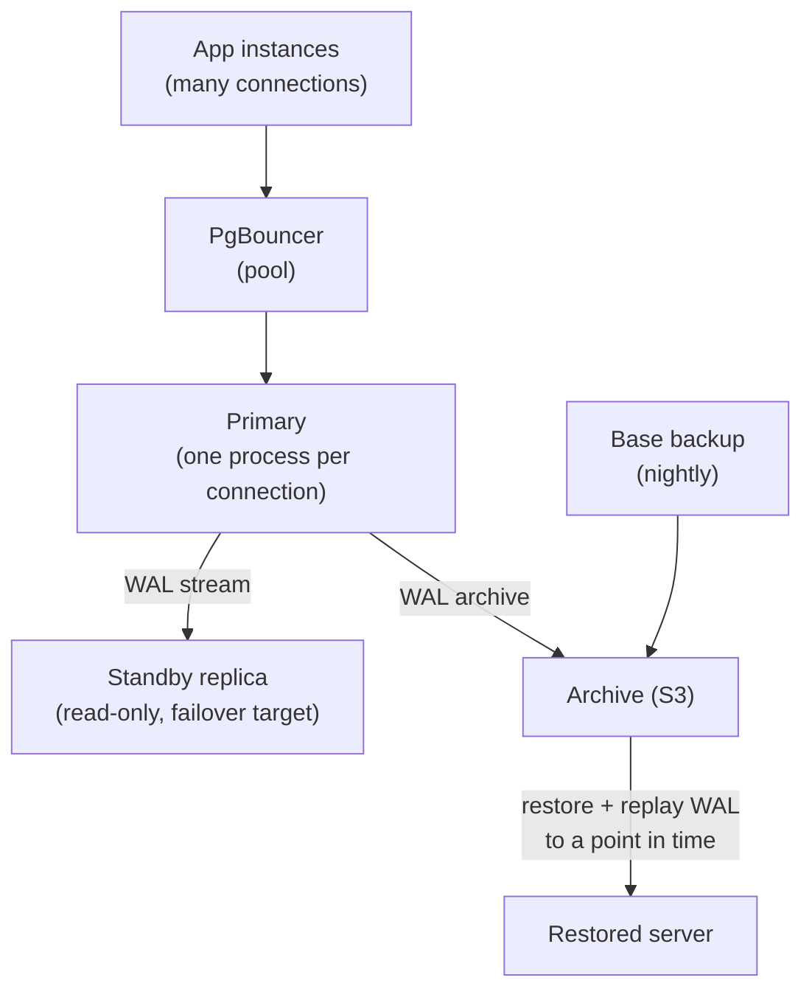

# PostgreSQL for operators

> **Status: AI draft, 2026-11-16.** Not yet verified by me. Commands were run in a throwaway `postgres:18` container (PostgreSQL 18.7) and the output below is real; replication and PgBouncer are from the documentation only.

## In one line

An operator's PostgreSQL: connect with `psql` and the right `sslmode`; grant through roles, schema usage and default privileges; keep connections under `max_connections` with a pooler; back up logically with `pg_dump` or physically with base backups plus WAL for point-in-time recovery; and find slow or blocked work with `pg_stat_activity`, locks and `EXPLAIN`.

## The plain idea

You do not need to be a database administrator to run PostgreSQL well, but you will be the one paged when the app says "too many connections", "permission denied" or "the database is slow". Each of those maps to a few views and commands. This page is that kit; RDS and Aurora change who patches and backs up, not these questions ([RDS and Aurora](../aws-services/rds-and-aurora.md)).

## How it works



### Connecting

```bash
psql "host=db.internal.example.com port=5432 dbname=app user=app_ro sslmode=verify-full sslrootcert=/etc/ssl/certs/rds-ca.pem"
```

- `sslmode` decides whether TLS is used and checked. The default is **prefer**: use TLS if the server offers it, but silently fall back and never verify the certificate. Use `verify-full` (encrypt and check the certificate and hostname) for anything over a network ([TLS and certificates](../networking/tls.md)).
- With `require`, a server without TLS refuses the connection. Real output from the container, which has TLS off:

```text
psql: error: connection to server at "127.0.0.1", port 5432 failed: server does not support SSL, but SSL was required
```

### Roles and privileges

PostgreSQL has only **roles**; a "user" is a role that can log in. Access is layered: the role must be able to connect to the database, **use** the schema, and have privileges on each table (and on sequences for inserts that use them). The usual pattern is an owner role that owns objects, plus read-write and read-only roles:

```sql
create role app_owner nologin;
create role app_rw login password 'example-only';
create role app_ro login password 'example-only';
create schema shop authorization app_owner;
grant usage on schema shop to app_rw, app_ro;
grant select, insert, update, delete on all tables in schema shop to app_rw;
grant select on all tables in schema shop to app_ro;
alter default privileges for role app_owner in schema shop grant select on tables to app_ro;
alter default privileges for role app_owner in schema shop grant select, insert, update, delete on tables to app_rw;
```

`GRANT ... ON ALL TABLES` covers only tables that exist now. **Default privileges** cover tables `app_owner` creates later; without them, every migration silently locks the app out of new tables. The result, as `\dp` shows it:

```text
 Schema |  Name  | Type  |      Access privileges       |
--------+--------+-------+------------------------------+
 shop   | orders | table | app_owner=arwdDxtm/app_owner+|
        |        |       | app_rw=arwd/app_owner       +|
        |        |       | app_ro=r/app_owner           |
```

The letters are privileges: `r` select, `a` insert, `w` update, `d` delete, `D` truncate, `x` references, `t` trigger, `m` maintain. Two classic errors, both real:

```text
app_rw> insert into shop.orders (customer, amount) values ('cust-1', 10);
ERROR:  permission denied for sequence orders_id_seq

app_ro> delete from shop.orders where id = 1;
ERROR:  permission denied for table orders
```

The first is fixed with `grant usage on all sequences in schema shop to app_rw` (plus the matching default privilege); after that the insert returns `INSERT 0 1`. The second is the read-only role doing its job.

### Connections and pooling

- Each connection is a server **process** with its own memory. `max_connections` was 100 in the container (`9 of 100 connections in use` at rest, counting background processes). Raising it costs memory per connection and needs a restart.
- Apps with many instances, or Lambda functions, each holding a small pool, add up fast. A **pooler** shares a few server connections among many clients.
- **PgBouncer** pool modes: **session** (a server connection per client connection; all features work), **transaction** (a server connection only for the length of a transaction; far fewer server connections, but session state such as `SET`, advisory locks and some prepared-statement setups do not carry over), **statement** (rarely used). On AWS, RDS Proxy plays this role.

### Replication and failover, in outline

- **Streaming replication** ships the write-ahead log (WAL) from the primary to standbys, which replay it and can serve reads. Asynchronous by default (a failover can lose the last transactions); synchronous replication waits for a standby to confirm.
- **Failover** promotes a standby; something must decide when (Patroni, a Kubernetes operator, or the managed service) and move clients to the new primary (DNS, a virtual IP, or the pooler).
- **Logical replication** copies changes per table, between major versions too, which makes it a tool for low-downtime upgrades and migrations ([Migration patterns](../operations/migration-patterns.md)).

### Backups

| Kind | Tool | Good for | Limits |
|---|---|---|---|
| Logical | `pg_dump` (one database), `pg_dumpall --globals-only` (roles) | Moving data, single-table restores, version upgrades | Slow for large databases; a snapshot at one moment only |
| Physical | `pg_basebackup` or storage snapshots, plus archived WAL | Full restores and **point-in-time recovery** | Same major version; whole cluster |

`pg_dump` does **not** include roles; dump them separately with `pg_dumpall --globals-only` or a restore will fail on missing owners. A custom-format dump lists its contents (real output, trimmed):

```text
$ pg_dump -U postgres -d app -Fc -f /tmp/app.dump
$ pg_restore --list /tmp/app.dump
6; 2615 16388 SCHEMA - shop app_owner
221; 1259 16390 TABLE shop orders app_owner
3445; 0 16390 TABLE DATA shop orders app_owner
3296; 2606 16400 CONSTRAINT shop orders orders_pkey app_owner
3294; 1259 16403 INDEX shop orders_customer_idx app_owner
```

**Point-in-time recovery** restores a base backup and replays archived WAL up to a chosen moment, for example just before a bad `DROP TABLE`. A backup you have never restored is a hope, not a backup ([Backup and DR](../operations/backup-and-dr.md)).

### Seeing what is slow or stuck

`pg_stat_activity` shows every session. Here one transaction holds a row lock while sleeping, and a second session waits for it (real output, trimmed):

```text
 pid | application_name | state  | wait_event_type |  wait_event   | blocked_by |   running_for
-----+------------------+--------+-----------------+---------------+------------+----------------
 140 | psql             | active | Timeout         | PgSleep       | {}         | 00:00:04.011558
 147 | report-job       | active | Lock            | transactionid | {140}      | 00:00:02.007331
```

`pg_blocking_pids(147)` returned `{140}`: find what 140 is doing, then `pg_cancel_backend(140)` (cancel its query) or `pg_terminate_backend(140)` (end the session) if it must go. Watch also for `idle in transaction` sessions: they hold locks and block vacuum.

`EXPLAIN ANALYZE` runs a query and shows the plan with real timings. Before and after an index on 50,000 rows (PostgreSQL 18 includes buffer counts by default):

```text
 Seq Scan on orders  (cost=0.00..993.01 rows=99 width=30) (actual time=0.018..3.843 rows=100.00 loops=1)
   Filter: (customer = 'cust-42'::text)
   Rows Removed by Filter: 49901
 Execution Time: 3.886 ms

 Bitmap Heap Scan on orders  (cost=5.06..229.20 rows=99 width=30) (actual time=0.121..0.238 rows=100.00 loops=1)
   Recheck Cond: (customer = 'cust-42'::text)
   ->  Bitmap Index Scan on orders_customer_idx  (cost=0.00..5.03 rows=99 width=0) (actual time=0.083..0.083 rows=100.00 loops=1)
 Execution Time: 0.326 ms
```

"Rows Removed by Filter: 49901" is the tell: the database read everything to return 100 rows.

### What a managed service changes

RDS or Aurora take over installation, minor patching, backups and PITR, replication and failover, and the superuser: you get a `rds_superuser`-style admin role instead. You still own roles and grants, connection counts, indexes and queries, parameter tuning, major upgrades and restore tests.

## A concrete example

`sample-app` on PostgreSQL in `10.0.0.0/16`:

1. Roles `app_owner` (migrations), `app_rw` (the service), `app_ro` (reports), with default privileges so new tables work for both.
2. The service connects through PgBouncer in transaction mode with `sslmode=verify-full`; reports connect to a read replica.
3. Nightly physical backups plus continuous WAL archiving; a monthly restore test into a scratch instance; `pg_dumpall --globals-only` with every backup.
4. Alerts on connections above 80 percent of `max_connections`, replication lag, and transactions idle for more than 5 minutes.
5. Slow query log (`log_min_duration_statement`) feeds a weekly review of the worst queries with `EXPLAIN ANALYZE`.

## Why not just...?

- **...connect as the `postgres` superuser from the app?** Any bug or injection then has full control, including dropping the database. Use the least-privileged role.
- **...raise `max_connections` to 2,000?** Each connection is a process with memory; past a point throughput falls. Pool instead.
- **...rely on `pg_dump` for a 2 TB database?** Dumps and restores take hours and give no point-in-time recovery. Use physical backups with WAL archiving.
- **...kill every long query?** Some are legitimate (reports, migrations). Find what blocks what first with `pg_blocking_pids`.

## Commands to know

These were run in the container unless noted.

| Command | What it does |
|---|---|
| `psql "host=<h> dbname=<db> user=<u> sslmode=verify-full"` | Connect with TLS verification (not run with TLS here). |
| `\du`, `\dn+`, `\dp <table>`, `\ddp` (inside psql) | Roles, schemas with privileges, table privileges, default privileges. |
| `select * from pg_stat_activity where state <> 'idle';` | What is running and waiting. |
| `select pg_blocking_pids(<pid>);` | Who blocks a session. |
| `select pg_cancel_backend(<pid>);` / `pg_terminate_backend(<pid>)` | Cancel a query / end a session. |
| `explain (analyze, buffers) <query>;` | Real plan, timings and buffer use (runs the query). |
| `pg_dump -Fc -d app -f app.dump` / `pg_restore --list app.dump` | Logical backup in custom format / list its contents. |
| `pg_dumpall --globals-only > globals.sql` | Roles and tablespaces (not run here). |
| `show max_connections;` / `show wal_level;` | Settings (100 and `replica` in the container). |

## How it breaks

| Symptom | Layer | Check | Likely cause |
|---|---|---|---|
| `FATAL: sorry, too many clients already` | Connections | `pg_stat_activity` count by application | Leak, no pooling, autoscaling or Lambda fan-out |
| `permission denied for table` on a new table | Privileges | `\ddp`, table owner | Missing default privileges, or the table was created by a different role |
| `permission denied for sequence` | Privileges | Sequence grants | `usage` on sequences not granted |
| Queries pile up waiting | Locks | `pg_blocking_pids`, `idle in transaction` sessions | Long transaction, migration taking a lock, forgotten open transaction |
| One query suddenly slow | Plan | `EXPLAIN ANALYZE`, table statistics | Missing index, stale statistics, plan change after data growth |
| Disk keeps growing | WAL or bloat | Replication slots, archive status, dead tuples | Inactive replication slot holding WAL, failing archive, vacuum not keeping up |
| Restore fails: role does not exist | Backup | Globals in the backup | `pg_dump` without `pg_dumpall --globals-only` |

## Interview questions

**1. The app reports "too many clients already". What do you do now and later?**

<details markdown="1">
<summary>Answer</summary>

- Now: count connections by application and state in `pg_stat_activity`; terminate idle leaked sessions if safe.
- Later: a pooler (PgBouncer or RDS Proxy), sane pool sizes per instance, fix leaks; raise `max_connections` only with memory headroom.

</details>

**2. New tables created by migrations are not readable by the app. Why?**

<details markdown="1">
<summary>Answer</summary>

- `GRANT ON ALL TABLES` only covered existing tables.
- Set `ALTER DEFAULT PRIVILEGES FOR ROLE <owner>` so future tables (and sequences) get grants; check the migration runs as that owner.

</details>

**3. `pg_dump` versus physical backups?**

<details markdown="1">
<summary>Answer</summary>

- `pg_dump`: logical, one database, portable across versions, good for small data and single objects; no PITR; roles need `pg_dumpall --globals-only`.
- Physical: base backup plus WAL archive; whole cluster, same major version, point-in-time recovery, faster for large data.

</details>

**4. Queries are hanging. How do you find the cause?**

<details markdown="1">
<summary>Answer</summary>

- `pg_stat_activity` for `wait_event_type = Lock` and `idle in transaction`.
- `pg_blocking_pids` to find the blocker; see what it runs and since when.
- Decide: wait, cancel the query, or terminate the session; then fix the long transaction or the migration.

</details>

**5. What does `sslmode=prefer` really give you?**

<details markdown="1">
<summary>Answer</summary>

- TLS if the server offers it, otherwise plain text, and the certificate is never checked: no protection against a man in the middle.
- Use `verify-full` with the CA certificate.

</details>

**6. Session versus transaction pooling in PgBouncer?**

<details markdown="1">
<summary>Answer</summary>

- Session: one server connection per client connection; everything works, fewer savings.
- Transaction: server connection only during a transaction; big savings, but session state (`SET`, advisory locks, some prepared statements) does not persist.

</details>

**7. How would you upgrade a major PostgreSQL version with little downtime?**

<details markdown="1">
<summary>Answer</summary>

- Logical replication to a new-version server (or Blue/Green on RDS), catch up, switch clients during a short write pause.
- Test extensions and queries on the new version; keep the old one for rollback.

</details>

## Try it

About 10 minutes with Docker:

1. `docker run -d --name pg -e POSTGRES_PASSWORD=example-only -e POSTGRES_DB=app postgres:18`, then `docker exec -it pg psql -U postgres -d app`.
2. Create the three roles and schema above; as `app_owner` create a table; confirm `app_ro` can read it only after default privileges are set.
3. In two `psql` sessions, open a transaction that updates a row and leave it; update the same row from the other session; find the blocker with `pg_stat_activity`.
4. Take a `pg_dump -Fc`, drop the table, and restore just that table with `pg_restore -t`.
5. Clean up: `docker rm -f pg`.

## Zoom out

Most PostgreSQL incidents an operator sees are about connections, permissions, locks and backups, not exotic internals. With these, a managed database stops being a black box ([RDS and Aurora](../aws-services/rds-and-aurora.md), [Redis and caching](redis-and-caching.md)).

## Sources

- [PostgreSQL documentation: libpq SSL support (sslmode)](https://www.postgresql.org/docs/current/libpq-ssl.html)
- [PostgreSQL documentation: privileges](https://www.postgresql.org/docs/current/ddl-priv.html)
- [PostgreSQL documentation: ALTER DEFAULT PRIVILEGES](https://www.postgresql.org/docs/current/sql-alterdefaultprivileges.html)
- [PostgreSQL documentation: pg_dump](https://www.postgresql.org/docs/current/app-pgdump.html)
- [PostgreSQL documentation: continuous archiving and point-in-time recovery](https://www.postgresql.org/docs/current/continuous-archiving.html)
- [PostgreSQL documentation: monitoring statistics (pg_stat_activity)](https://www.postgresql.org/docs/current/monitoring-stats.html)
- [PostgreSQL documentation: EXPLAIN](https://www.postgresql.org/docs/current/sql-explain.html)
- [PgBouncer: features and pooling modes](https://www.pgbouncer.org/features.html)
