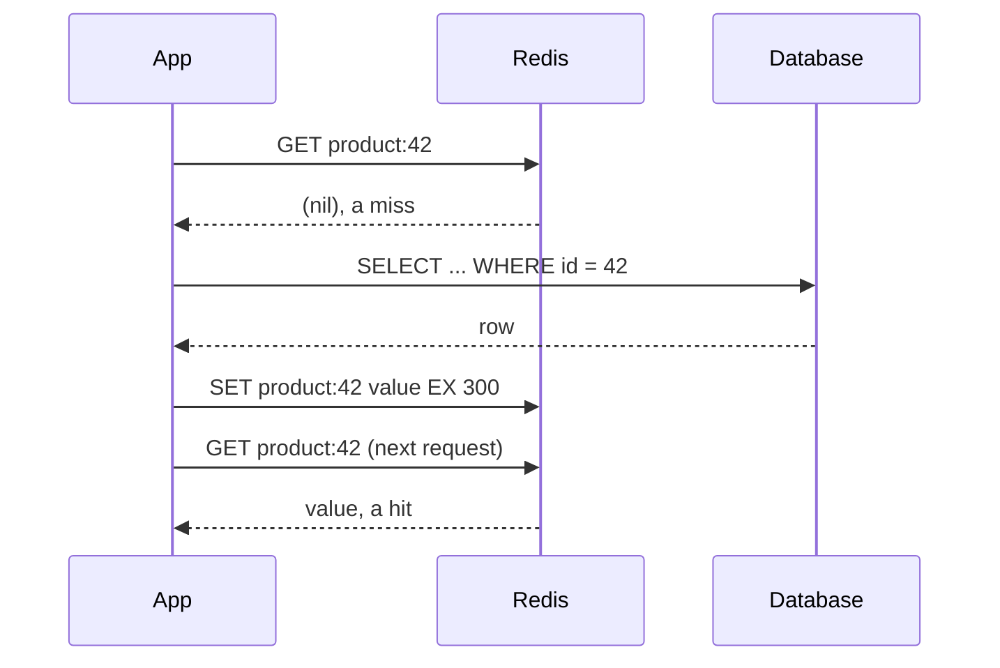

# Redis and caching patterns

> **Status: AI draft, 2026-11-16.** Not yet verified by me. Commands were run in throwaway `redis:7` containers (Redis 7.4.12, one primary and one replica) and the output below is real; cluster mode and ElastiCache are from the documentation only.

## In one line

Redis keeps data structures in memory, so reads and writes take well under a millisecond. Persistence (RDB snapshots, AOF logs) and replicas make it durable enough for some jobs. As a cache, it needs a memory limit, an eviction policy, TTLs, and a pattern such as cache-aside, plus protection against stampedes and hot keys.

## The plain idea

A database on disk is a library: everything is there, but fetching a book takes time. A cache is the pile of books on your desk: the ones you used recently, within arm's reach. The desk is small, so you decide what to throw back (eviction), how long a book stays before you check for a newer edition (TTL), and what happens when ten people ask for the same missing book at once (stampede).

**Redis** is the most common desk. It is a server that holds strings, hashes, lists, sets and sorted sets in memory, reached over the network with simple commands. **Valkey** is a community fork of Redis maintained under the Linux Foundation, compatible with it; Redis itself now ships under a choice of licences that includes AGPLv3 from Redis 8.

## How it works



### Data types in brief

Real output from `redis-cli`:

```text
> SET session:abc123 '{"user":42}' EX 1800
OK
> TTL session:abc123
(integer) 1800
> INCR page:views
(integer) 1
> HSET user:42 name Asha plan pro
(integer) 2
> ZADD leaderboard 120 alice 95 bob 140 carol
(integer) 3
> ZREVRANGE leaderboard 0 1 WITHSCORES
1) "carol"
2) "140"
3) "alice"
4) "120"
> SET lock:report token-1 NX EX 30
OK
> SET lock:report token-2 NX EX 30
(nil)
```

| Type | Use |
|---|---|
| String | Cached values, counters (`INCR` is atomic), simple locks (`SET ... NX EX`) |
| Hash | An object's fields (`user:42`) |
| List | Simple queues (`LPUSH` / `RPOP`) |
| Set, sorted set | Membership, rankings and leaderboards, rate-limit windows |
| Stream | Append-only log with consumer groups |

Commands on one key run one at a time on the main thread, which is why counters and `SET NX` are safe without extra locking. It is also why one slow command (`KEYS *` on millions of keys) blocks everyone: use `SCAN`.

### Memory limit and eviction

With `maxmemory` set, the **eviction policy** decides what happens when memory is full. The default policy is `noeviction`: writes fail. Real output with a 3 MB limit and 3,000 writes of 1 KB values:

```text
   1654 OK
   1346 OOM command not allowed when used memory > 'maxmemory'.
```

After switching to `allkeys-lru` and writing 3,000 more:

```text
evicted_keys:3021
used_memory_human:3.00M
maxmemory_policy:allkeys-lru
```

| Policy | Evicts | Good for |
|---|---|---|
| `noeviction` (default) | Nothing; writes return errors | Data you must not lose silently (queues, sessions you cannot rebuild) |
| `allkeys-lru` / `allkeys-lfu` | Least recently / least frequently used key | Pure caches |
| `volatile-lru` / `volatile-lfu` / `volatile-ttl` | Only keys with a TTL | Mixed use: cache keys with TTLs, other keys kept |
| `allkeys-random` / `volatile-random` | Random | Rarely the best choice |

Newer Redis versions add more (for example least recently *modified*). For a cache, set `maxmemory` below the machine's memory, leaving room for replication and persistence buffers.

### Persistence

- **RDB**: point-in-time snapshots by a forked child process. The image's default schedule was `save 3600 1 300 100 60 10000` (after 1 hour if 1 change, 5 minutes if 100, 1 minute if 10,000). A crash loses writes since the last snapshot.
- **AOF**: logs every write; with `appendfsync everysec` (the default) a crash loses about a second. Off by default in the image (`appendonly no`); turning it on showed `aof_enabled:1`.
- Both can be on together. A pure cache often uses neither; a store of record needs both and backups.

### Replication, failover and cluster mode

- A **replica** copies the primary: it loads a snapshot, then follows the stream of writes. Real output from the replica container:

```text
role:slave
master_link_status:up
Done loading RDB, keys loaded: 1504, keys expired: 0.
MASTER <-> REPLICA sync: Finished with success
READONLY You can't write against a read only replica.
```

- Replication is asynchronous: a failover can lose the latest writes. **Sentinel** or a managed service promotes a replica when the primary fails.
- **Cluster mode** shards data across primaries: every key maps to one of 16,384 **hash slots**, and each primary owns a range. Multi-key commands need keys in the same slot (use hash tags like `{user:42}:cart`).

### Caching patterns

| Pattern | How | Trade-off |
|---|---|---|
| Cache-aside (lazy loading) | App reads the cache; on a miss it reads the database and fills the cache | Simple, caches only what is used; first read is slow; stale until TTL or invalidation |
| Write-through | App writes the database and the cache together | Cache is fresh; writes slower; caches data that may never be read |
| Write-behind (write-back) | App writes the cache; something flushes to the database later | Fast writes; risk of loss if the cache fails before flushing |
| Read-through | The cache layer itself loads from the database on a miss | Same as cache-aside, logic moved into a library or proxy |

### TTLs, stampedes and hot keys

- **TTL** on every cache key bounds staleness and memory. Add **jitter** (300 seconds plus or minus a random 30) so keys written together do not expire together.
- **Cache stampede**: a popular key expires and hundreds of requests hit the database at once. Fixes: one request rebuilds while others wait or serve the stale value (a lock with `SET NX EX`), refresh early before expiry, or keep serving stale data while refreshing.
- **Hot key**: one key gets most traffic and saturates one node (or one shard). Fixes: a small in-process cache in front, read replicas, or splitting the key into copies (`product:42:1..N`).
- **Invalidation**: on update, delete the cache key after writing the database (not before), so a concurrent reader does not refill it with old data.

### Managed services

- **ElastiCache** (node-based or serverless) supports **Valkey**, **Redis OSS** and **Memcached**. **MemoryDB** is a durable, Redis-compatible primary database.
- Valkey and Redis OSS bring replication, Multi-AZ automatic failover, persistence and rich types; **Memcached** is a simple multithreaded key-value cache with no replication or persistence.
- Security: in-transit encryption (TLS), AUTH tokens or users with access control lists, IAM authentication for Valkey and Redis OSS, and private subnets with security groups ([Security groups and NACLs](../aws-core/security-groups-and-nacls.md)).

## A concrete example

`sample-app`'s product pages:

1. ElastiCache for Valkey, cluster mode off, one primary and one replica in different zones, Multi-AZ failover on, TLS and IAM authentication.
2. `maxmemory-policy allkeys-lru`; every key has a TTL of 300 seconds plus jitter.
3. Cache-aside: `GET product:42`; on a miss, read PostgreSQL, then `SET product:42 <json> EX 300` ([PostgreSQL for operators](postgres-for-operators.md)).
4. On product update: write PostgreSQL, then `DEL product:42`.
5. For the home page's top products (a hot key), a 5-second in-process cache in each app instance.
6. Sessions live in a separate Valkey with `noeviction` and AOF on, so they are never evicted silently.
7. Alarms on evictions, CPU on the main engine thread, memory use and replication lag ([CloudWatch](../aws-services/cloudwatch.md)).

## Why not just...?

- **...cache everything forever?** Memory fills, eviction kicks in unpredictably, and stale data lives on. TTLs and a policy make behaviour predictable.
- **...use Redis as the only copy of important data?** Asynchronous replication and snapshot gaps mean possible loss. Use a database of record, or MemoryDB if you need Redis semantics with durability.
- **...run `KEYS user:*` to find keys?** It blocks the server while it walks every key. Use `SCAN` with a pattern.
- **...put a cache in front of every query?** Caches add invalidation bugs and another failure mode. Cache what is read often, expensive to compute and tolerant of slight staleness.

## Commands to know

Run in the container unless noted.

| Command | What it does |
|---|---|
| `redis-cli -h <host> -p 6379 --tls --user <u> --pass <p>` | Connect to a managed instance with TLS and ACL user (not run here). |
| `INFO memory` / `INFO stats` / `INFO replication` / `INFO persistence` | Memory and eviction, hit and miss counts, role and link, snapshot status. |
| `CONFIG GET maxmemory-policy` | Eviction policy (`noeviction` by default). |
| `TTL <key>` / `EXPIRE <key> <seconds>` | Remaining time to live / set one. |
| `SCAN 0 MATCH product:* COUNT 100` | Iterate keys without blocking. |
| `SET <key> <value> NX EX 30` | Set only if absent, with expiry: a simple lock. |
| `redis-cli --bigkeys` / `--hotkeys` | Find large keys / most-used keys (not run here). |
| `SLOWLOG GET 10` | Slowest recent commands. |
| `BGSAVE` | Snapshot in the background. |

`keyspace_hits` and `keyspace_misses` in `INFO stats` give the hit ratio; `evicted_keys` rising on a cache that should hold its working set means it is too small.

## How it breaks

| Symptom | Layer | Check | Likely cause |
|---|---|---|---|
| `OOM command not allowed` | Memory | `maxmemory`, policy | `noeviction` with a full instance |
| Hit ratio drops, database load jumps | Cache | `evicted_keys`, TTLs | Cache too small, or many keys expiring together |
| Database overwhelmed after a deploy or restart | Cold cache | Miss rate | Empty cache and no warm-up or request coalescing |
| One node at 100 percent CPU | Hot key | `--hotkeys`, per-shard metrics | One key or slot takes most traffic |
| Latency spikes for everyone | Blocking command | `SLOWLOG GET` | `KEYS`, huge `DEL`, large sorted-set ranges |
| Users see old data | Invalidation | Write and delete order | Cache filled with stale data between DB write and delete; TTL too long |
| Writes lost after failover | Replication | Replication lag before failover | Asynchronous replication |
| `READONLY You can't write against a read only replica` | Topology | Endpoint used | App writing to a replica endpoint |

## Interview questions

**1. Explain cache-aside and its failure modes.**

<details markdown="1">
<summary>Answer</summary>

- Read cache; on miss read the database and fill the cache with a TTL.
- Failure modes: stale data until TTL or invalidation; stampede on popular misses; cold cache after restart.

</details>

**2. What is a cache stampede and how do you prevent it?**

<details markdown="1">
<summary>Answer</summary>

- Many requests miss the same key at once and all hit the database.
- Single-flight rebuild with a lock (`SET NX EX`), serve stale while refreshing, early refresh, TTL jitter.

</details>

**3. Which eviction policy for a pure cache, and which for sessions?**

<details markdown="1">
<summary>Answer</summary>

- Pure cache: `allkeys-lru` or `allkeys-lfu`.
- Sessions or queues: `noeviction` (fail loudly) on a separate instance, with persistence; or `volatile-*` if only TTL keys may go.

</details>

**4. RDB versus AOF?**

<details markdown="1">
<summary>Answer</summary>

- RDB: periodic snapshots, compact, fast restarts, loses changes since the last one.
- AOF: logs every write, with `everysec` loses about a second; larger files, rewritten in the background.
- Use both for data you care about; neither for a disposable cache.

</details>

**5. Redis or Valkey versus Memcached?**

<details markdown="1">
<summary>Answer</summary>

- Redis or Valkey: rich types, replication and failover, persistence, pub/sub, scripting.
- Memcached: simple multithreaded key-value cache, no replication or persistence; fine for a plain cache.

</details>

**6. How does Redis Cluster split data, and what breaks?**

<details markdown="1">
<summary>Answer</summary>

- 16,384 hash slots spread across primaries; each key hashes to a slot.
- Multi-key commands and transactions need keys in one slot (hash tags); clients must follow redirects.

</details>

**7. After a database update, users still see the old price. Why?**

<details markdown="1">
<summary>Answer</summary>

- The cache was not invalidated, or was invalidated before the write and a concurrent read refilled it with old data.
- Write the database, then delete the key; keep TTLs as a safety net.

</details>

## Try it

About 10 minutes with Docker:

1. `docker run -d --name redis redis:7`, then `docker exec -it redis redis-cli`.
2. Run the data type commands above; try `SET lock NX EX 10` twice.
3. `CONFIG SET maxmemory 3mb`, write until you see `OOM`, switch to `allkeys-lru`, write more, and read `evicted_keys` in `INFO stats`.
4. Implement cache-aside in a short script against a file or SQLite "database" and measure hit ratio.
5. Clean up: `docker rm -f redis`.

## Zoom out

Caching trades freshness for speed and database load. The patterns (TTL, eviction, invalidation, stampede control) apply to CDNs, in-process caches and DNS as much as to Redis ([CloudFront and WAF](../aws-core/cloudfront-and-waf.md), [DNS](../networking/dns.md)).

## Sources

- [Redis documentation: key eviction](https://redis.io/docs/latest/develop/reference/eviction/)
- [Redis documentation: persistence](https://redis.io/docs/latest/operate/oss_and_stack/management/persistence/)
- [Redis documentation: redis-cli](https://redis.io/docs/latest/develop/tools/cli/)
- [Redis licences (RSALv2, SSPLv1, AGPLv3 from Redis 8)](https://redis.io/legal/licenses/)
- [Valkey documentation: cluster tutorial (hash slots)](https://valkey.io/topics/cluster-tutorial/)
- [ElastiCache User Guide: what is ElastiCache](https://docs.aws.amazon.com/AmazonElastiCache/latest/dg/WhatIs.html)
- [ElastiCache User Guide: comparing Valkey, Memcached and Redis OSS](https://docs.aws.amazon.com/AmazonElastiCache/latest/dg/SelectEngine.html)
- [ElastiCache User Guide: Multi-AZ automatic failover](https://docs.aws.amazon.com/AmazonElastiCache/latest/dg/AutoFailover.html)
- [ElastiCache User Guide: IAM authentication](https://docs.aws.amazon.com/AmazonElastiCache/latest/dg/auth-iam.html)
