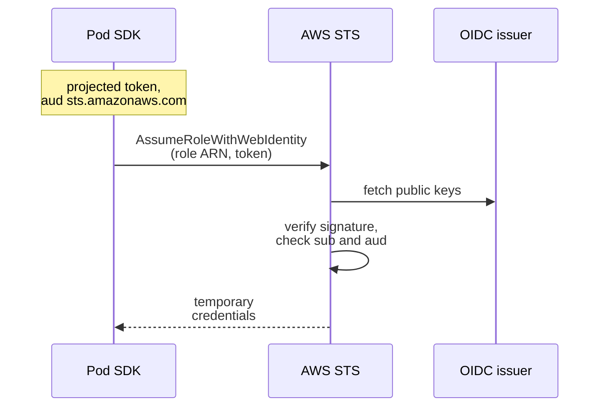
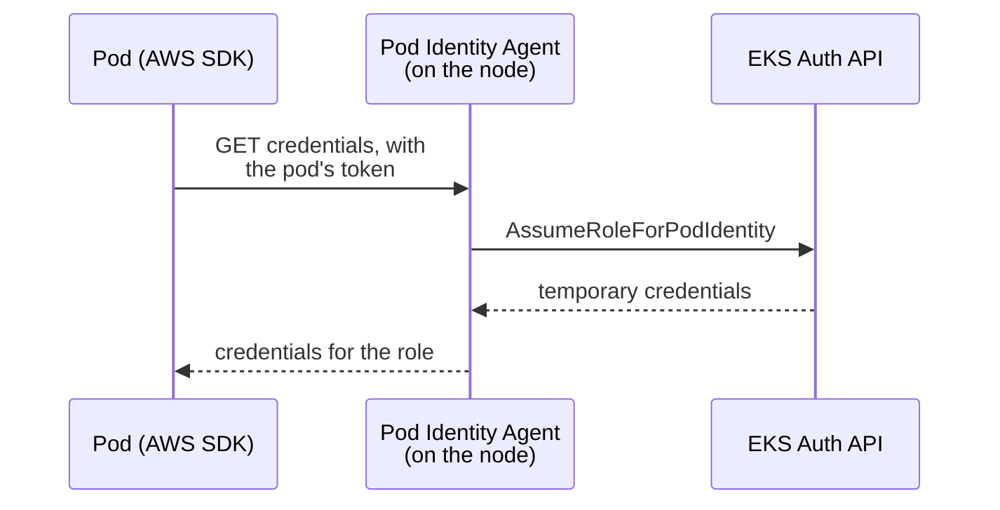

# Cluster access, IRSA and Pod Identity

> **Status: AI draft, 2026-11-16.** Not yet verified by me. Written from the AWS documentation; no AWS commands were run, so the commands below have no sample output.

## In one line

Two directions of identity on EKS: people and pipelines reach the Kubernetes API with IAM identities mapped in through access entries (the `aws-auth` ConfigMap is deprecated), and pods reach AWS APIs with IAM roles tied to their service account, through IRSA (OIDC and `AssumeRoleWithWebIdentity`) or EKS Pod Identity (an agent on each node), never through the node's role.

## The plain idea

EKS sits between two permission systems: IAM for AWS ([IAM policies and how they are evaluated](../aws-core/iam-policies.md)) and RBAC for Kubernetes ([RBAC and service accounts](../kubernetes/rbac-and-service-accounts.md)). Identity has to cross between them both ways:

- **Into the cluster.** An engineer or a CI job holds AWS credentials. EKS must decide which Kubernetes user and groups that IAM identity becomes, and RBAC or access policies decide what it may do.
- **Out of the cluster.** A pod needs to read an S3 bucket. It should get an IAM role chosen for that application, not the permissions of whichever node it landed on.

## How it works

### Into the cluster: access entries

An **access entry** is an EKS API object that links one IAM principal (role or user) to the cluster. It can then get permissions in two ways:

- **Access policies** managed by AWS, associated with the entry, scoped to the whole cluster or to named namespaces (wildcards such as `dev-*` allowed): `AmazonEKSClusterAdminPolicy`, `AmazonEKSAdminPolicy`, `AmazonEKSEditPolicy`, `AmazonEKSViewPolicy`.
- **Kubernetes groups** on the entry, which your own RBAC RoleBindings refer to.

The cluster's **authentication mode** says which mechanisms are read:

| Mode | Reads |
|---|---|
| `CONFIG_MAP` | Only the legacy `aws-auth` ConfigMap in `kube-system` |
| `API_AND_CONFIG_MAP` | Access entries and the ConfigMap |
| `API` | Only access entries |

- The `aws-auth` ConfigMap is deprecated; AWS recommends access entries. They are managed through the EKS API (CLI, Terraform, CloudFormation), so a typo cannot lock everyone out the way a broken ConfigMap could, and they are visible in AWS rather than only inside the cluster.
- Once access entries are enabled they cannot be disabled, and a cluster created without the ConfigMap method cannot get it back. Auto Mode requires access entries.
- Migration: switch to `API_AND_CONFIG_MAP`, create an access entry for each ConfigMap mapping, check, then move to `API`.

### Out of the cluster: why not the node role

Every pod on a node can reach the instance metadata service and, by default, use the node's instance profile. Permissions on the node role are therefore given to every pod that ever runs there. AWS's EKS best practices guide recommends restricting pods from the node's credentials, by requiring IMDSv2 with a hop limit of 1 for pods that do not need them, and giving each application its own role.

### IRSA: IAM roles for service accounts



1. The cluster has an OIDC issuer URL; you register it once as an **IAM OIDC identity provider** in the account.
2. You annotate a service account with `eks.amazonaws.com/role-arn: arn:aws:iam::123456789012:role/sample-app-s3`.
3. Pods using that service account get environment variables (`AWS_ROLE_ARN`, `AWS_WEB_IDENTITY_TOKEN_FILE`) and a projected token file under `/var/run/secrets/eks.amazonaws.com/serviceaccount/`.
4. The AWS SDK exchanges the token with STS for the role's temporary credentials ([IAM roles and STS](../aws-core/iam-roles-and-sts.md)).

The role's trust policy decides which service account may use it:

```json
{
  "Effect": "Allow",
  "Principal": { "Federated": "arn:aws:iam::123456789012:oidc-provider/<cluster-oidc-issuer>" },
  "Action": "sts:AssumeRoleWithWebIdentity",
  "Condition": {
    "StringEquals": {
      "<cluster-oidc-issuer>:sub": "system:serviceaccount:team-a:sample-app",
      "<cluster-oidc-issuer>:aud": "sts.amazonaws.com"
    }
  }
}
```

Without the `sub` condition, any service account in the cluster could assume the role.

### EKS Pod Identity



1. Install the EKS Pod Identity Agent add-on; it runs as a DaemonSet on the host network, at the link-local address `169.254.170.23`.
2. The role's trust policy allows the service principal `pods.eks.amazonaws.com` the actions `sts:AssumeRole` and `sts:TagSession`. The same trust policy works in every cluster.
3. Create a **Pod Identity association** in the EKS API: cluster, namespace, service account, role. No annotation is needed.
4. New pods with that service account get `AWS_CONTAINER_CREDENTIALS_FULL_URI` pointing at the agent and a token file; the SDK fetches credentials from the agent.
5. Sessions carry tags such as `eks-cluster-name`, `kubernetes-namespace` and `kubernetes-service-account`, usable in IAM policy conditions, so one role can serve many namespaces with attribute-based rules.

| | IRSA | EKS Pod Identity |
|---|---|---|
| Setup per cluster | IAM OIDC provider for each cluster | Agent add-on |
| Link | Annotation on the service account | Association in the EKS API |
| Trust policy | Names the cluster's OIDC provider and the service account | Same for every cluster (`pods.eks.amazonaws.com`) |
| Reusing a role in a new cluster | Edit the trust policy | Add an association |
| Runs on | EC2 nodes, Fargate, also outside EKS with any OIDC issuer | Linux EC2 nodes only; not Fargate |
| Who does what | IAM admins must create OIDC providers | IAM admins own roles; cluster admins own associations |

## A concrete example

`sample-app` in namespace `team-a` reads from the bucket `sample-app-uploads`.

1. IAM role `sample-app-s3` with a permissions policy allowing `s3:GetObject` on that bucket only ([Least privilege and AccessDenied](../aws-core/least-privilege-and-accessdenied.md)).
2. Trust policy for Pod Identity, plus a Pod Identity association: cluster `sample-cluster`, namespace `team-a`, service account `sample-app`.
3. The Deployment sets `serviceAccountName: sample-app` and is restarted, because credentials are injected when pods are created.
4. Engineers get an access entry with `AmazonEKSEditPolicy` scoped to `team-a`; CI's deploy role gets an entry mapped to a Kubernetes group with a narrower custom Role.
5. Node instances require IMDSv2 with a hop limit of 1, so no pod can fall back to the node role.

## Why not just...?

- **...put the S3 permissions on the node role?** Every pod on every node with that role gets them, including ones from other teams and anything compromised. Per-application roles limit the damage.
- **...keep editing `aws-auth`?** It is deprecated, lives only inside the cluster, and one malformed edit can lock out everyone, including the people who would fix it. Access entries are API objects with their own IAM permissions and audit trail.
- **...mount long-lived AWS access keys as a Secret?** Keys do not expire, get copied into images and logs, and must be rotated by hand. IRSA and Pod Identity give short-lived credentials that renew themselves ([Secrets from AWS into pods](secrets.md)).

## Commands to know

These were not run for this page.

| Command | What it does |
|---|---|
| `aws eks create-access-entry --cluster-name sample-cluster --principal-arn arn:aws:iam::123456789012:role/platform-admin` | Lets an IAM role authenticate to the cluster. |
| `aws eks associate-access-policy --cluster-name sample-cluster --principal-arn <role-arn> --policy-arn arn:aws:eks::aws:cluster-access-policy/AmazonEKSViewPolicy --access-scope type=namespace,namespaces=team-a` | Grants read access in one namespace. |
| `aws eks list-access-entries --cluster-name sample-cluster` | Who can authenticate. |
| `aws eks update-cluster-config --name sample-cluster --access-config authenticationMode=API_AND_CONFIG_MAP` | Turns on access entries alongside the ConfigMap. |
| `aws eks describe-cluster --name sample-cluster --query cluster.identity.oidc.issuer` | The OIDC issuer URL, for IRSA. |
| `kubectl annotate serviceaccount sample-app -n team-a eks.amazonaws.com/role-arn=arn:aws:iam::123456789012:role/sample-app-s3` | Links a service account to a role with IRSA. |
| `aws eks create-pod-identity-association --cluster-name sample-cluster --namespace team-a --service-account sample-app --role-arn <role-arn>` | Links a service account to a role with Pod Identity. |
| `kubectl exec <pod> -- env` and look for `AWS_ROLE_ARN` or `AWS_CONTAINER_CREDENTIALS_FULL_URI` | Whether credentials were injected. |
| `kubectl exec <pod> -- aws sts get-caller-identity` | Which role the pod really uses (needs the CLI in the image). |

## How it breaks

| Symptom | Layer | Check | Likely cause |
|---|---|---|---|
| kubectl: `You must be logged in to the server (Unauthorized)` | Access entry | `aws sts get-caller-identity`, `list-access-entries` | No entry for that IAM principal, or a different role or profile than expected |
| kubectl: `Forbidden` | Authorisation | Associated access policies and their scope, RBAC | Policy scoped to other namespaces, or groups without bindings |
| Pod's AWS calls use the node role | Injection | Pod env variables | Pod created before the annotation or association; wrong `serviceAccountName`; SDK too old to support the method |
| `Not authorized to perform sts:AssumeRoleWithWebIdentity` | IRSA trust | Trust policy conditions | `sub` names a different namespace or service account, wrong OIDC provider, or the provider is not registered |
| Pod Identity credentials request fails | Agent | Agent DaemonSet, `169.254.170.23` | Agent not installed or not running, a proxy without that address in `NO_PROXY`, or the pod is on Fargate |
| `AccessDenied` with the right role | Permissions | Role policy, SCPs, resource and KMS key policies | The role lacks the action or resource ([Least privilege and AccessDenied](../aws-core/least-privilege-and-accessdenied.md)) |

## Interview questions

**1. How do you give a new engineer read-only access to one namespace on EKS?**

<details markdown="1">
<summary>Answer</summary>

- An access entry for their IAM role (usually an Identity Center permission set role).
- Associate `AmazonEKSViewPolicy` scoped to that namespace, or map a Kubernetes group bound to a custom Role.
- Not an `aws-auth` edit: that ConfigMap is deprecated.

</details>

**2. Explain how IRSA works end to end.**

<details markdown="1">
<summary>Answer</summary>

- The cluster's OIDC issuer is registered as an IAM identity provider; the service account is annotated with a role ARN.
- The pod gets a projected, signed token and environment variables; the SDK calls `AssumeRoleWithWebIdentity`.
- STS verifies the token against the issuer's keys and the role's trust conditions on `sub` and `aud`, then returns temporary credentials.

</details>

**3. How does EKS Pod Identity differ from IRSA?**

<details markdown="1">
<summary>Answer</summary>

- No OIDC provider per cluster; the trust policy names the service `pods.eks.amazonaws.com` and is the same for every cluster.
- The link is an association in the EKS API instead of an annotation.
- An agent on each node fetches credentials with `AssumeRoleForPodIdentity`; sessions carry tags for ABAC; not available on Fargate.

</details>

**4. Why should application permissions not go on the node IAM role?**

<details markdown="1">
<summary>Answer</summary>

- Every pod on the node can use them through the instance metadata service.
- One compromised pod gets every permission any workload on that node needs.
- Use per-application roles, and block pods from IMDS with IMDSv2 and a hop limit of 1.

</details>

**5. A pod gets AccessDenied calling S3. Walk through your debugging.**

<details markdown="1">
<summary>Answer</summary>

- Which identity is it really using? Check env variables and `sts get-caller-identity` from the pod; the node role means injection failed.
- If the role is right: read the error's action and resource, then the role policy, bucket policy, SCPs and KMS key policy.
- If injection failed: service account name, annotation or association, pod restarted after the change, agent health.

</details>

**6. What is the risk of an IRSA trust policy without a `sub` condition?**

<details markdown="1">
<summary>Answer</summary>

- Any service account in the cluster with a token for that audience could assume the role.
- Anyone who can create pods in any namespace gains the role's permissions.
- Always pin `sub` to the exact namespace and service account, and `aud` to `sts.amazonaws.com`.

</details>

**7. You are migrating a cluster from `aws-auth` to access entries. What are the steps and risks?**

<details markdown="1">
<summary>Answer</summary>

- Set the authentication mode to `API_AND_CONFIG_MAP`; create an access entry for every ConfigMap mapping, including node roles.
- Test each identity, then switch to `API` and remove the ConfigMap.
- Enabling access entries cannot be undone; missing the node role entry stops nodes from joining.

</details>

## Try it

EKS is not free, so practise the reasoning:

1. On a kind cluster, create a token for a service account and decode its payload as on [RBAC and service accounts](../kubernetes/rbac-and-service-accounts.md). Compare its `iss`, `sub` and `aud` with the IRSA trust policy above: which values would STS check?
2. Write the trust policy for a role used by service account `reports` in namespace `finance`, first for IRSA and then for Pod Identity.
3. For each "How it breaks" row, write the single command you would run first.

## Zoom out

These are the EKS forms of a general idea: workloads get short-lived, narrowly scoped credentials from a trusted identity provider instead of stored keys. The same pattern gives CI pipelines AWS access through OIDC ([OIDC from pipelines to AWS](../cicd/oidc-to-aws.md)) and humans access through federation ([Federation and SSO](../aws-core/federation-and-sso.md)).

## Sources

- [Amazon EKS User Guide: grant IAM users and roles access to Kubernetes APIs](https://docs.aws.amazon.com/eks/latest/userguide/grant-k8s-access.html)
- [Amazon EKS User Guide: access entries](https://docs.aws.amazon.com/eks/latest/userguide/access-entries.html)
- [Amazon EKS User Guide: access policies](https://docs.aws.amazon.com/eks/latest/userguide/access-policies.html)
- [Amazon EKS User Guide: the aws-auth ConfigMap (deprecated)](https://docs.aws.amazon.com/eks/latest/userguide/auth-configmap.html)
- [Amazon EKS User Guide: IAM roles for service accounts](https://docs.aws.amazon.com/eks/latest/userguide/iam-roles-for-service-accounts.html)
- [Amazon EKS User Guide: assign IAM roles to service accounts](https://docs.aws.amazon.com/eks/latest/userguide/associate-service-account-role.html)
- [Amazon EKS User Guide: EKS Pod Identity](https://docs.aws.amazon.com/eks/latest/userguide/pod-identities.html)
- [Amazon EKS User Guide: how EKS Pod Identity works](https://docs.aws.amazon.com/eks/latest/userguide/pod-id-how-it-works.html)
- [Amazon EKS User Guide: Pod Identity session tags](https://docs.aws.amazon.com/eks/latest/userguide/pod-id-abac.html)
- [Amazon EKS Best Practices Guide: identity and access management](https://docs.aws.amazon.com/eks/latest/best-practices/identity-and-access-management.html)
