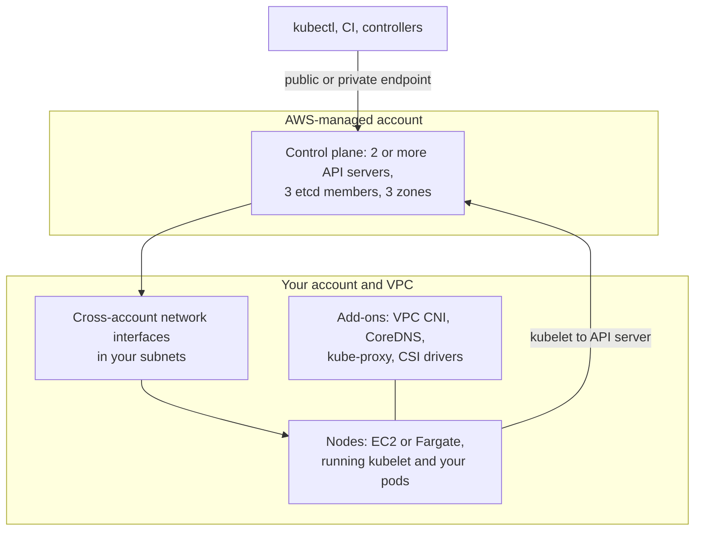
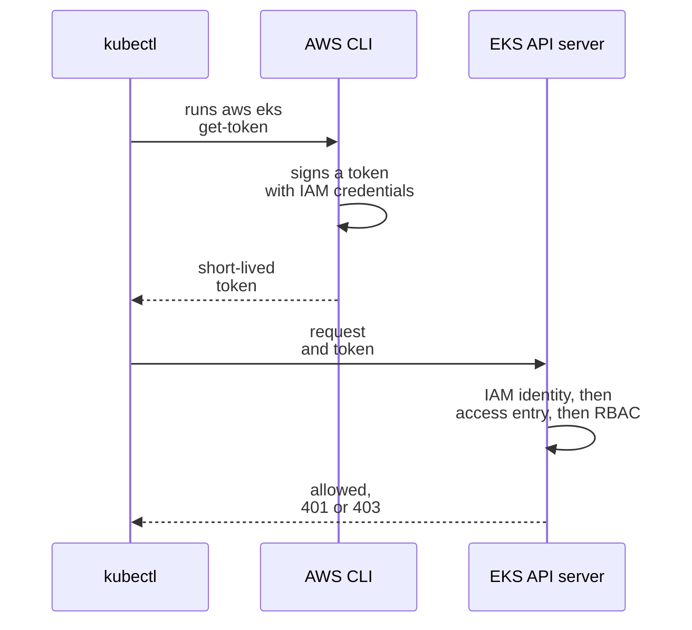

# EKS architecture and node options

> **Status: AI draft, 2026-11-16.** Not yet verified by me. Written from the AWS documentation; no AWS commands were run, so the commands below have no sample output.

## In one line

EKS runs the Kubernetes control plane (at least two API servers and three etcd members across three Availability Zones) in an AWS-owned account, and you run the nodes in your VPC: managed node groups, self-managed nodes, Fargate, or EKS Auto Mode. kubectl signs in with IAM through `aws eks get-token`, and the API endpoint can be public, private, or both.

## The plain idea

A Kubernetes cluster has a brain (API server, etcd, scheduler, controllers) and hands (the nodes that run pods) ([Architecture and the reconcile loop](../kubernetes/architecture.md)). Running the brain well is hard: etcd quorum, backups, upgrades, certificates ([etcd, backups and cluster upgrades](../kubernetes/etcd-backups-and-upgrades.md)).

EKS takes the brain off your hands. AWS runs it for each cluster separately, spread over three zones, replaces failed parts, and gives you one endpoint to talk to. You still decide how the hands are provided: you can manage EC2 instances yourself, let EKS manage groups of them, run each pod on Fargate with no node at all, or let Auto Mode handle the nodes and the core add-ons for you.

## How it works

### Who runs what

| AWS runs | You run |
|---|---|
| API servers, etcd, scheduler, controller manager, across 3 zones | Nodes (unless Fargate or Auto Mode) |
| Control plane patching and minor-version upgrades you trigger | Choosing when to upgrade, and upgrading nodes and add-ons ([EKS upgrades](upgrades.md)) |
| etcd backups and recovery | Backups of your workloads and data |
| An SLA on the API endpoint | Everything inside the cluster: RBAC, policies, apps |

The control plane reaches the kubelets (for `logs`, `exec`, webhooks) through network interfaces that EKS places in subnets you chose at cluster creation.

### The API endpoint

| Setting | Who can reach the API | Node traffic to the API |
|---|---|---|
| Public only (the default) | Anyone on the internet, optionally limited to a list of CIDR blocks; IAM and RBAC still apply | Leaves the VPC, stays on Amazon's network |
| Public and private | Internet (optionally restricted) and inside the VPC | Stays in the VPC |
| Private only | Only from the VPC and networks connected to it (VPN, Direct Connect, peering) | Stays in the VPC |

The private endpoint works through a private hosted zone that EKS manages; the VPC needs DNS support and DNS hostnames turned on ([VPC basics](../aws-core/vpc-basics.md)). If you restrict the public endpoint to some CIDR blocks, either enable the private endpoint too, or include the addresses your nodes reach the internet from.

### Node options

| Option | You manage | AWS manages | Good for | Limits |
|---|---|---|---|---|
| **Managed node groups** | Instance types, sizes, AMI version choice, when to update | An Auto Scaling group per node group, graceful drain on update | Most clusters; system add-ons | Fixed instance types per group |
| **Self-managed nodes** | Everything: AMI, ASG, joining, draining | Nothing beyond EC2 | Custom AMIs or setups managed groups do not allow | All the work is yours |
| **Fargate** | Fargate profiles (which namespaces and labels run there) | One pod per isolated compute environment | Small, bursty or untrusted workloads; no nodes to patch | No DaemonSets, privileged containers, host network or GPUs; private subnets only |
| **Karpenter on EC2** | NodePools, the Karpenter controller | EC2 | Mixed instance types, Spot, fast bin-packing ([Karpenter in depth](karpenter.md)) | You run and upgrade Karpenter |
| **EKS Auto Mode** | NodePools and settings | Nodes (Karpenter-based), their AMIs and patching, plus networking, DNS, block storage and load balancing as built-in components | Teams who want the least to operate | Nodes are replaced at most every 21 days by default; less control over the node |

Managed node groups cost nothing extra; you pay for the instances and volumes. Fargate is charged per pod's CPU and memory.

### Add-ons

Every cluster needs the **VPC CNI** (pod networking, [Networking with the VPC CNI](vpc-cni.md)), **CoreDNS** (cluster DNS) and **kube-proxy** (Service routing). EKS installs them; you can manage them as **EKS add-ons**, which EKS can install, configure and update for you with versions it has tested. Other common EKS add-ons: the EBS and EFS CSI drivers ([EBS and EFS CSI drivers](storage.md)) and the EKS Pod Identity Agent ([Cluster access, IRSA and Pod Identity](access-and-pod-identity.md)). With Auto Mode, these core functions are built in and the separate add-ons are not needed.

### The two IAM roles

| Role | Used by | Needs |
|---|---|---|
| **Cluster role** | The EKS control plane | `AmazonEKSClusterPolicy` or the minimal permissions in the docs: managing network interfaces and describing EC2 resources |
| **Node role** | The kubelet on each EC2 node (instance profile) | `AmazonEKSWorkerNodePolicy` (describe EC2, and Pod Identity Agent permissions) and the AWS managed ECR pull-only policy (pull add-on and app images from ECR) |

The VPC CNI also needs permissions to manage network interfaces. AWS recommends giving them to the CNI's own service account through IRSA or Pod Identity rather than the node role, so that every pod on the node does not inherit them ([Cluster access, IRSA and Pod Identity](access-and-pod-identity.md)).

### How kubectl signs in

`aws eks update-kubeconfig` writes a kubeconfig entry whose user runs `aws eks get-token` for each session, using whatever AWS credentials the CLI has ([Accounts, regions and the CLI](../aws-core/accounts-regions-cli.md)). The IAM identity then needs cluster access, through an access entry ([Cluster access, IRSA and Pod Identity](access-and-pod-identity.md)), and Kubernetes RBAC decides what it may do ([RBAC and service accounts](../kubernetes/rbac-and-service-accounts.md)).

## A concrete example

`sample-app` runs on a production cluster in `ap-south-1`, account `123456789012`.

1. Cluster in three private subnets, one per zone, carved from `10.0.0.0/16` ([VPC basics](../aws-core/vpc-basics.md)).
2. Endpoint: private enabled for nodes; public enabled only for the office VPN egress range and the CI runners' range.
3. A small managed node group (2 to 3 nodes) runs CoreDNS, Karpenter and other controllers, so they never depend on Karpenter to have somewhere to run.
4. Karpenter runs application pods on a mix of On-Demand and Spot instances.
5. Core add-ons managed as EKS add-ons, pinned to versions tested with the cluster's Kubernetes version.
6. Engineers and CI reach the API through IAM roles with access entries; pods reach AWS through Pod Identity, never the node role.

## Why not just...?

- **...run Kubernetes yourself on EC2?** You would operate etcd, its backups, certificates and control plane upgrades across three zones. EKS charges per cluster-hour for exactly that work.
- **...put everything on Fargate?** No DaemonSets means log and monitoring agents must become sidecars; no GPUs or privileged pods; each pod is billed separately. Fargate suits some workloads, rarely a whole platform.
- **...leave the public endpoint open to the internet?** It is protected by IAM and RBAC, but it is an exposed API: one leaked credential or bug away from trouble. Restrict it to known ranges or make it private.

## Commands to know

These were not run for this page; read them with the AWS CLI reference.

| Command | What it does |
|---|---|
| `aws eks update-kubeconfig --region ap-south-1 --name sample-cluster` | Adds the cluster to `~/.kube/config`, using `aws eks get-token` for credentials. |
| `aws sts get-caller-identity` | Which IAM identity kubectl will use ([IAM roles and STS](../aws-core/iam-roles-and-sts.md)). |
| `aws eks describe-cluster --name sample-cluster --query cluster.resourcesVpcConfig` | Subnets, security groups and the endpoint access settings. |
| `aws eks list-nodegroups --cluster-name sample-cluster` | Managed node groups. |
| `aws eks list-addons --cluster-name sample-cluster` | Add-ons managed by EKS. |
| `aws eks describe-addon-versions --addon-name coredns --kubernetes-version <version>` | Add-on versions available for a Kubernetes version. |
| `kubectl get nodes -L eks.amazonaws.com/nodegroup,eks.amazonaws.com/capacityType` | Which node group and capacity type each node belongs to. |

## How it breaks

| Symptom | Layer | Check | Likely cause |
|---|---|---|---|
| `You must be logged in to the server (Unauthorized)` | Authentication | `aws sts get-caller-identity`; access entries | Wrong IAM identity or profile, or no access entry for it |
| kubectl times out reaching the endpoint | Endpoint access | Endpoint settings, your source address | Private-only endpoint from outside the VPC, or your address is not in the public CIDR list |
| New nodes never become Ready | Node bootstrap | Node's network path to the API and ECR; node role access | Private subnets with no NAT or VPC endpoints; node role not granted cluster access |
| Pods `ImagePullBackOff` from ECR | Node role | Node role policies | Missing ECR pull permissions, or no route to ECR ([NAT, endpoints and PrivateLink](../aws-core/nat-endpoints-privatelink.md)) |
| Pods stay `Pending` and should run on Fargate | Fargate profile | Profile namespace and labels | No profile matches the pod |
| DNS or networking broken after an upgrade | Add-ons | Add-on versions and health | CNI, CoreDNS or kube-proxy not upgraded to a compatible version |

## Interview questions

**1. What does AWS manage in EKS, and what do you manage?**

Answer

- AWS: the control plane (API servers, etcd, scheduler, controllers) across three zones, its patching, scaling and recovery.
- You: nodes (unless Fargate or Auto Mode), add-on versions, upgrades timing, networking, IAM, RBAC, workloads and their backups.

**2. Compare managed node groups, Fargate and Karpenter.**

Answer

- Managed node groups: EKS manages an Auto Scaling group with fixed instance types and drains nodes on updates.
- Fargate: no nodes, one isolated environment per pod; no DaemonSets, privileged pods or GPUs.
- Karpenter: launches instances chosen from pending pods' needs, with Spot and consolidation; you run the controller.

**3. What are the endpoint access options, and which would you choose for production?**

Answer

- Public (default), public and private, or private only.
- Production: private enabled so node traffic stays in the VPC; public either off (access through VPN) or limited to known CIDR blocks.
- Private needs VPC DNS support and hostnames, and a network path for admins and CI.

**4. How does kubectl authenticate to EKS?**

Answer

- The kubeconfig runs `aws eks get-token`, which signs a short-lived token with your IAM credentials.
- EKS verifies the IAM identity and maps it to a Kubernetes user and groups through access entries.
- RBAC then authorises each request.

**5. What is the difference between the cluster IAM role and the node IAM role?**

Answer

- Cluster role: used by the EKS control plane to manage resources such as network interfaces.
- Node role: the instance profile the kubelet uses to describe EC2 and pull images from ECR.
- Neither is for application permissions; pods get their own roles through IRSA or Pod Identity.

**6. New nodes in private subnets never join the cluster. What do you check?**

Answer

- Network path: can the subnets reach the API endpoint (private endpoint, or NAT to the public one) and ECR, S3 and STS (NAT or VPC endpoints)?
- Identity: does the node role have cluster access (access entry or `aws-auth`)?
- Security groups between nodes and the control plane, and the node's bootstrap logs.

**7. When would you choose EKS Auto Mode?**

Answer

- When the team wants AWS to run nodes and the core add-ons: compute autoscaling, networking, DNS, block storage, load balancing.
- Trade-off: less control over the node, and nodes cycle within 21 days by default, so workloads and PDBs must handle regular replacement.
- Stick with node groups or self-run Karpenter when you need custom AMIs or node-level agents and tuning.

## Try it

Nothing to run for free here: EKS charges per cluster-hour. Instead, without an AWS account:

1. Draw the diagram above from memory, with the endpoint options and both IAM roles.
2. Read your local kubeconfig from a kind cluster (`kubectl config view --minify`) and compare its `user` section with the `exec` block that `aws eks update-kubeconfig` would write (the AWS documentation page on kubeconfig shows one).
3. For each node option, write one workload you would put there and one you would not.

## Zoom out

EKS is ordinary Kubernetes with AWS taking the control plane and wiring in IAM, VPC networking and load balancers. Everything on the Kubernetes pages still applies; the EKS pages cover the AWS joins: identity ([Cluster access, IRSA and Pod Identity](access-and-pod-identity.md)), networking ([Networking with the VPC CNI](vpc-cni.md)), load balancing ([AWS Load Balancer Controller](load-balancer-controller.md)), storage, nodes and upgrades.

## Sources

- [Amazon EKS User Guide: architecture](https://docs.aws.amazon.com/eks/latest/userguide/eks-architecture.html)
- [Amazon EKS User Guide: cluster API server endpoint](https://docs.aws.amazon.com/eks/latest/userguide/cluster-endpoint.html)
- [Amazon EKS User Guide: manage compute resources by using nodes](https://docs.aws.amazon.com/eks/latest/userguide/eks-compute.html)
- [Amazon EKS User Guide: managed node groups](https://docs.aws.amazon.com/eks/latest/userguide/managed-node-groups.html)
- [Amazon EKS User Guide: AWS Fargate](https://docs.aws.amazon.com/eks/latest/userguide/fargate.html)
- [Amazon EKS User Guide: EKS Auto Mode](https://docs.aws.amazon.com/eks/latest/userguide/automode.html)
- [Amazon EKS User Guide: EKS add-ons](https://docs.aws.amazon.com/eks/latest/userguide/eks-add-ons.html)
- [Amazon EKS User Guide: cluster IAM role](https://docs.aws.amazon.com/eks/latest/userguide/cluster-iam-role.html)
- [Amazon EKS User Guide: node IAM role](https://docs.aws.amazon.com/eks/latest/userguide/create-node-role.html)
- [Amazon EKS User Guide: connect kubectl to a cluster with a kubeconfig file](https://docs.aws.amazon.com/eks/latest/userguide/create-kubeconfig.html)
