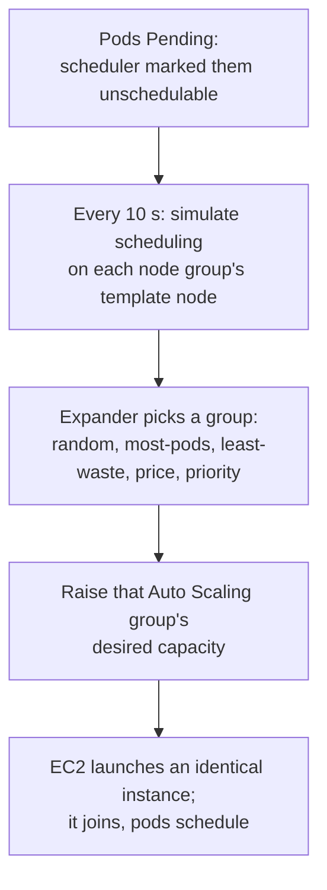
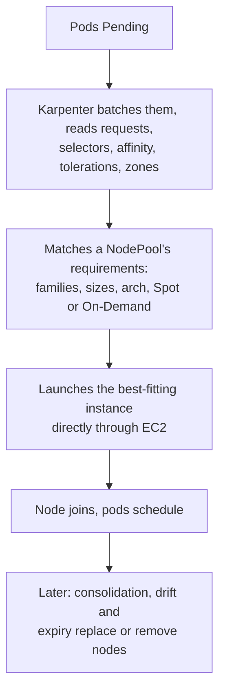

# Node autoscaling: Cluster Autoscaler vs Karpenter

> **Status: AI draft, 2026-11-16.** Not yet verified by me. Written from the Cluster Autoscaler FAQ, the Karpenter documentation and the EKS best practices guide; nothing was run.

## In one line

Both add nodes when pods are unschedulable and remove nodes that are not needed. Cluster Autoscaler does it by resizing node groups (Auto Scaling groups) whose instances are all alike; Karpenter skips node groups and launches EC2 instances chosen to fit the pending pods, then keeps replacing nodes with cheaper or fuller ones (consolidation).

## The plain idea

The pod autoscalers create pods; the scheduler places them on nodes; when no node has room, pods wait as `Pending` ([Scheduling](../kubernetes/scheduling.md), [Autoscaling](../kubernetes/autoscaling.md)). A **node autoscaler** watches for those pending pods and buys capacity. Later, when nodes sit mostly idle, it gives capacity back.

The two tools differ in how they think about capacity:

- **Cluster Autoscaler** thinks in **node groups**: "group B's machines are 4-CPU, 16 GiB; one more of those would fit these pods; set group B's desired size +1".
- **Karpenter** thinks in **pods**: "these pods need 7 CPUs, arm64 is fine, Spot is fine, zone a or b; which instance type is cheapest and available right now?", and asks EC2 for exactly that.

## How it works

### Cluster Autoscaler

- **Scale up**: every 10 seconds (`--scan-interval`), for unschedulable pods, it simulates whether a new node from each group would fit them, and the **expander** chooses among the groups that would.
- **Scale down**: a node is a candidate when the sum of its pods' requests is below 50% of allocatable (`--scale-down-utilization-threshold`) and all its pods can move elsewhere; after 10 minutes unneeded (`--scale-down-unneeded-time`), it drains and removes it.
- **On AWS** it changes each Auto Scaling group's desired capacity, and finds groups by tags (managed node groups are tagged for this automatically).
- Pods that block scale-down include those with restrictive PDBs, local storage, or the annotation `cluster-autoscaler.kubernetes.io/safe-to-evict: "false"`.
- Keep its version matched to the cluster's Kubernetes version; AWS's guide notes cross-version use is not tested.

### Karpenter

- No node groups. A **NodePool** lists what is allowed (instance families, capacity types, zones, limits), and an **EC2NodeClass** says how to launch (AMI, subnets, security groups, IAM role). Details on [Karpenter in depth](karpenter.md).
- It picks from many instance types at once, so it can bin-pack tightly and use Spot across many pools.
- **Consolidation** continuously looks for empty or underutilised nodes and removes them or replaces them with cheaper ones, within disruption budgets.
- **Drift** and **expiration** replace nodes whose configuration (AMI, NodePool settings) changed or that reached their maximum age, which also makes node upgrades routine ([EKS upgrades](upgrades.md)).

### Comparison

| | Cluster Autoscaler | Karpenter |
|---|---|---|
| Unit it scales | Node groups (ASGs) of identical instances | Individual instances chosen per need |
| Instance choice | Fixed per group; more choice means more groups | Any type the NodePool allows |
| Speed to a new node | ASG round trip, plus EC2 launch | Direct EC2 fleet call, plus launch |
| Bin-packing | Limited by group shapes | Picks sizes to fit pending pods |
| Scale-down | Utilisation below a threshold for a period | Consolidation: delete or replace with cheaper |
| Spot | Per-group mixed instances policy | Native, price and capacity aware, interruption handling |
| Node upgrades | Done by node group updates | Drift and expiration replace nodes |
| Runs on | Any cloud with a provider | AWS (and some other providers) |
| What you operate | Deployment plus node groups | Controller plus NodePools, EC2NodeClasses, an SQS queue for interruptions |

## A concrete example

A cluster runs steady web services plus batch jobs that sometimes need 64-CPU machines for an hour.

- **With Cluster Autoscaler**: a general node group, a large-instance group for batch (min 0), and separate On-Demand and Spot groups. Each new instance shape means a new group. Batch nodes are removed 10 minutes after they become unneeded.
- **With Karpenter**: one NodePool for general workloads (several families, Spot and On-Demand), one for batch (large sizes only, tainted so only batch tolerates it). The batch pods get a right-sized node within about a minute; consolidation removes it when empty.
- Either way: a small managed node group runs Karpenter or Cluster Autoscaler themselves, CoreDNS and other controllers, so the autoscaler never depends on the capacity it manages ([EKS architecture and node options](architecture.md)).

## Why not just...?

- **...scale the Auto Scaling group on CPU like plain EC2?** The ASG does not know about pending pods, requests or scheduling constraints. It may add nodes no pod can use, or none when pods are waiting with low average CPU.
- **...pick Karpenter for every cluster?** It is AWS-centric (with some other providers), and it changes nodes often by design. Workloads must tolerate frequent, controlled disruption: PDBs, graceful shutdown, multiple replicas ([Disruptions and PDBs](../kubernetes/disruptions-and-pdbs.md)).
- **...run both on the same nodes?** They would fight over the same capacity. Use one per set of nodes; migrating means moving workloads from node groups to NodePools step by step.

## Commands to know

These were not run for this page.

| Command | What it does |
|---|---|
| `kubectl get pods -A --field-selector=status.phase=Pending` | Pods waiting for capacity. |
| `kubectl describe pod <pod>` | The scheduler's reason, and autoscaler events (`TriggeredScaleUp`, `NotTriggerScaleUp` for Cluster Autoscaler). |
| `kubectl -n kube-system logs deploy/cluster-autoscaler` | Scale-up and scale-down decisions. |
| `kubectl -n kube-system get configmap cluster-autoscaler-status -o yaml` | Cluster Autoscaler's view of each node group. |
| `kubectl get nodepools,nodeclaims` | Karpenter's pools and the nodes it launched. |
| `kubectl logs -n <karpenter-namespace> deploy/karpenter` | Karpenter's launch and disruption decisions. |
| `kubectl annotate node <node> cluster-autoscaler.kubernetes.io/scale-down-disabled=true` | Keep a node from being removed by Cluster Autoscaler. |

## How it breaks

| Symptom | Tool | Check | Likely cause |
|---|---|---|---|
| Pods Pending, no scale-up | Either | Pod events, autoscaler logs | Pod needs something no group or NodePool can provide (zone, arch, GPU, too large), or limits reached |
| `NotTriggerScaleUp`: `pod didn't trigger scale-up` | Cluster Autoscaler | Which predicates failed | No node group template fits the pod; group at max size |
| Nodes never scale down | Cluster Autoscaler | Pods on the node | PDB with 0 allowed disruptions, local storage, `safe-to-evict: "false"`, kube-system pods without a PDB |
| Nodes replaced constantly | Karpenter | Disruption events, consolidation settings | Aggressive consolidation with churning workloads; budgets too loose |
| New node in a zone where the pod's volume is not | Either | PV zone, pod events | EBS zone pinning not matched by group or NodePool zones ([EBS and EFS CSI drivers](storage.md)) |
| Autoscaler itself unschedulable | Either | Where it runs | It runs on capacity it manages; give it its own small node group |

## Interview questions

**1. How does Cluster Autoscaler decide to add a node?**

Answer

- It watches for pods marked unschedulable, every 10 seconds by default.
- It simulates scheduling them on each node group's template node.
- An expander picks one of the groups that would fit, and it raises that group's desired size.

**2. When does Cluster Autoscaler remove a node?**

Answer

- Requests on the node are below the utilisation threshold (50% by default).
- All its pods can be moved elsewhere (PDBs, local storage, annotations can block it).
- It has been unneeded for the configured time (10 minutes by default); then it drains and terminates it.

**3. What is the main difference in how Karpenter adds capacity?**

Answer

- No node groups: it reads pending pods' requirements and launches instance types that fit, directly through EC2.
- It chooses among many types and capacity types at once.
- It also consolidates continuously, replacing nodes with cheaper or fewer ones.

**4. Pods are Pending but the autoscaler does nothing. How do you investigate?**

Answer

- Pod events: the scheduler's reason and the autoscaler's event.
- Can any group or NodePool provide what the pod needs: size, zone, architecture, taints, GPUs?
- Limits: group max size, NodePool limits, EC2 quotas or capacity in that zone; then the autoscaler's logs.

**5. Why run the autoscaler on a separate, fixed node group?**

Answer

- If it runs on nodes it may remove, it can disrupt itself or be unable to start when capacity is short.
- A small managed node group keeps it and other controllers (CoreDNS) stable.
- It also avoids a chicken-and-egg problem at cluster creation.

**6. A team complains their pods restart every few hours since moving to Karpenter. What is happening and what do you change?**

Answer

- Consolidation, drift or expiry is replacing nodes and evicting their pods.
- Make the app tolerate it: replicas, PDBs, graceful shutdown.
- Tune Karpenter: disruption budgets, `consolidateAfter`, a less aggressive policy, or `karpenter.sh/do-not-disrupt` for pods that truly cannot move.

## Try it

Without AWS:

1. On a kind cluster, create a pod that requests more CPU than the node has and read the `FailedScheduling` event ([Troubleshooting playbook](../kubernetes/troubleshooting.md)). That event is what both autoscalers react to.
2. On paper: three pending pods need 3, 3 and 6 CPUs. Group A has 4-CPU nodes, group B 8-CPU nodes. What does Cluster Autoscaler add with the `least-waste` expander? What could Karpenter add?
3. List three pod settings that would stop Cluster Autoscaler from removing a node.

## Zoom out

Node autoscaling closes the loop that pod autoscaling opens ([Autoscaling](../kubernetes/autoscaling.md)), and it is where most compute cost is decided ([Cost optimisation](../operations/cost-optimisation.md)). Whichever tool you use, it depends on honest resource requests and on workloads that survive having their node taken away.

## Sources

- [Cluster Autoscaler FAQ](https://github.com/kubernetes/autoscaler/blob/master/cluster-autoscaler/FAQ.md)
- [Amazon EKS Best Practices Guide: Cluster Autoscaler](https://docs.aws.amazon.com/eks/latest/best-practices/cas.html)
- [Amazon EKS Best Practices Guide: Karpenter](https://docs.aws.amazon.com/eks/latest/best-practices/karpenter.html)
- [Karpenter documentation: NodePools](https://karpenter.sh/docs/concepts/nodepools/)
- [Karpenter documentation: disruption](https://karpenter.sh/docs/concepts/disruption/)
